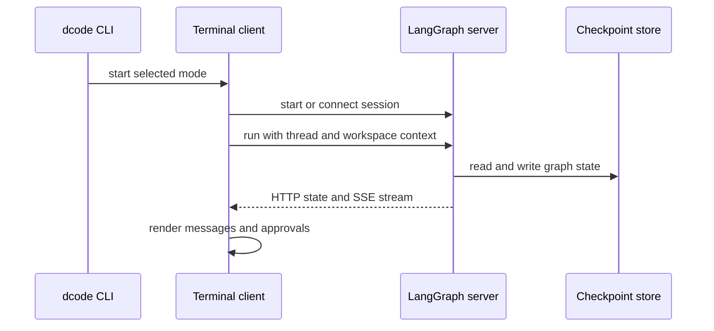
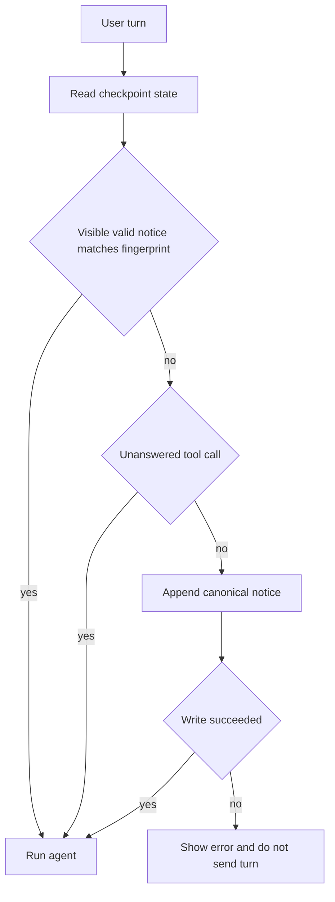
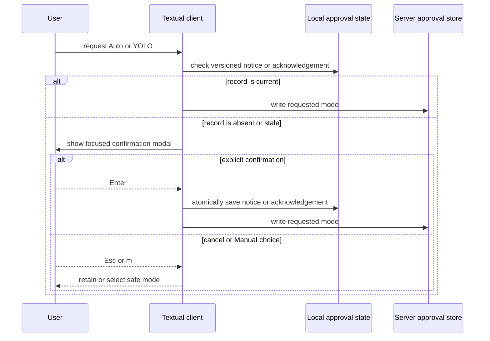

# Deep Agents Code Architecture

`deepagents-code` (`dcode`) 0.1.85 is a prebuilt terminal coding agent and reference implementation of the `deepagents` SDK harness. It packages terminal interaction, persistence, tools, skills, approvals, and optional sandbox execution. Its primary ownership rule is intentional: the client owns presentation and user interaction; the server owns agent execution and durable graph state.

## Runtime ownership and startup

A normal local session consists of separate processes:

- The **terminal client** owns Textual UI state, interactive or headless input/output, approval UX, and provisional streamed display.
- The **LangGraph server** owns graph construction and execution, model/provider setup, tools, memory, skills, MCP integration, backends/sandboxes, and checkpoint writes.
- `RemoteAgent` is a transport adapter around `RemoteGraph`, not a graph-state authority. It converts streamed message dictionaries to LangChain messages for the UI while leaving snapshots unchanged and obtains accounting separately from the server.

*The client presents a session, while the server executes it and persists its graph state.*

`main.py` is the process entrypoint: it establishes warning policy before heavyweight imports and installs POSIX termination handlers that exit with the conventional signal-derived code. The handler is designed to be safe during teardown because cleanup is re-entrant. Configuration and launch policy should be resolved before creating the UI/server pair; see [Configuration layering](/openwiki/concepts/config-layering.md) and [Run a dcode session](/openwiki/workflows/run-dcode-session.md).

A workspace is not merely a UI selection. Graph execution requires thread and workspace context, and server-side durable bindings validate it before selecting a workspace runtime. A process-wide sandbox is reserved by the first workspace that claims it; incompatible LangSmith tracing/redaction settings likewise prohibit sharing one server process. Checkpoints are server-owned, whereas the client may hold display, transport, and selection caches.

## Goal and rubric control messages

The TUI owns the editable goal/rubric selection and writes its channel values to the checkpoint. It withholds the public `rubric` from paused or complete goals so grading cannot drive work in those states, while retaining `_sticky_rubric` for later restoration. Out-of-run goal mutations take a lock and wait for graph execution and reconciliation to become quiescent before writing, preventing a UI checkpoint update from racing a running graph.

Goal state reaches the model through framework-owned `HumanMessage` control messages, not through the user transcript. A canonical notice projects authoritative channels into a deterministic fingerprint, marks its source as `goal_state`, and carries a schema version and event ID. Title, transcript, and other derived conversation projections must filter these messages; they are model context despite the `HumanMessage` transport role.

Before a normal model call, the app verifies that the newest *visible* valid notice matches the desired fingerprint. It appends a replacement when it is missing, stale, invalid, or hidden by summarization. It defers that append when the effective conversation has unanswered tool calls so graph middleware can repair tool ordering first; an actual notice persistence failure blocks the user turn rather than running with untrusted goal state.

*Goal context is reconciled at the model boundary, but tool-message ordering takes precedence over appending a notice.*

Notices use explicit tagged sections for objective, criteria, and status notes, escaping embedded text and labelling it as context data rather than instructions. A size violation suppresses all embedded goal/rubric data and tells the model not to work toward or grade it; an unknown persisted status is treated as paused rather than guessed active. This is a fail-safe boundary against corrupted state and oversized prompt context.

## Skills: invocation, containment, and trust

`/skill:<name> [args]` creates a visible pending skill row and sends a compact envelope: a normal user request plus `additional_kwargs.__skill` containing the normalized name, arguments, and `pinned: true`. The client intentionally does not send skill instructions. The server resolves the named skill, trust-checks and reads it, and the SDK returns a separate pinned instruction message; only that returned message fills the pending UI row. If the body cannot be read, is too large, or has no instructions after frontmatter, invocation fails rather than silently running without the skill.

Discovery merges built-in, plugin, user, project, agent-alias, and experimental Claude skill roots in increasing precedence, so a higher-precedence name replaces a lower one. Loading resolves `SKILL.md` and refuses it when it lies outside the pre-resolved allowed roots, preventing a symlink in a skill directory from becoming an arbitrary-file read.

For an external resolved directory, dcode can interrupt for user trust. The persisted trust store records the canonical directory shown at approval time under the state directory; its enforcement path re-verifies stored entries to reject later symlink swaps. A corrupt or unrecognized store fails closed to an empty allowlist, so it causes re-prompting rather than broadening file access. See [Permissions and human-in-the-loop](/openwiki/concepts/permissions-hitl.md).

## Approval modes and first-enable notices

The live per-thread selection is one of `manual`, classifier-backed `auto`, or unrestricted `yolo`. It is stored under a namespace/key derived from the thread ID; malformed, missing, or unreadable records are interpreted as Manual. Shift+Tab cycles Manual → Auto → YOLO → Manual when both alternatives are available. Auto is omitted where it is ineligible (for example with a remote sandbox), and disabling `startup.yolo_switcher` removes YOLO from entry into the cycle while still allowing an already active YOLO session to exit.

Auto mode is a security gate layered over the normal HITL interrupt map. It deterministically routes policy cases and sends remaining tool calls as a batch to an authorization classifier; classifier output must contain exactly one decision for every reviewed tool-call ID. The classifier may inherit the main model or use a lazily built distinct model cached by specification. A per-run classifier setting in the graph context overrides the startup selection.

The classifier has separate positive finite construction and inference deadlines. A classifier error, malformed batch, unavailable control-state write, or timeout never becomes an approval: it produces a denial/unavailable outcome or escalates to human approval. Repeated unavailability and policy denials trigger human fallback; a repeated configured-model construction failure is latched until a successful review, so a broken model does not silently deny indefinitely. Classifier reasons are sanitized before they reach the agent/UI.

First enable is deliberately a UI gate rather than a background preference. For Auto, the modal describes routine gated actions, makes clear that Auto is not a sandbox, and identifies whether the reviewing classifier is the code-writing model or a separate model. The model label is Markdown-escaped before insertion; losing the required interpolation anchor raises instead of silently omitting that disclosure. Enter is the only confirmation; Esc and programmatic dismissal leave the current mode in place. For YOLO, the warning explicitly covers unsupervised shell commands, file edits, network calls, and other tools; Enter acknowledges it, `m` selects Manual, and Esc preserves the prior mode.

*First-enable notices must be explicitly accepted and locally recorded before the corresponding live mode write.*

The local `approval.json` is install-local state, not the live authorization source. It is private (`0700` directory and `0600` file outside Windows), atomically replaced, and protected by both in-process and cross-process locks so Auto and YOLO updates merge rather than drop one another. Its notice and acknowledgement have independent versions. Missing, corrupt, or stale data does not count as acceptance; the warning is shown again. A local save failure prevents activation through the Shift+Tab/modal path. In the inline Auto approval path, a successfully confirmed notice is recorded before the live mode write; a failed live write keeps the action pending in Manual.

The app serializes a displayed first-enable dialog with pending flags/futures, preventing a second entry point from bypassing the confirmation. A failed modal push also leaves the mode unchanged and permits a later retry. The server-store write remains the commit point: when it fails, neither local session state nor the status bar may claim the new mode.

The Auto middleware emits opaque `review_started` and `review_completed` events. The Textual adapter accepts them only from the main agent with an exact validated shape, pauses reviewed rows during review, and converts a malformed completion into a safe completion with no trusted resumptions so rows do not remain frozen. Nested classifier stream chunks identified as `auto_mode_classifier` are excluded from the transcript.

## Remote operations and rendering seams

Remote offload and handoff remain server-owned operations. The client ensures a remote thread record, transports hook interrupts with a stable operation ID, validates a typed terminal result, and bounds hook fulfillment. On caller cancellation it sends the operation-specific cancellation request and waits—despite repeated caller cancellation—until the server acknowledges `cancelled` or `finished`, with a ten-second bound.

The message-rendering boundary is defensive. Internal summarization and classifier chunks are filtered, while Auto lifecycle payloads are treated as untrusted stream input until they pass main-agent and schema checks. Markdown links in assistant messages and approval notices have automatic link opening disabled and are handled by one shared path: it checks URL safety, blocks suspicious Unicode or homograph URLs, opens the browser off the UI loop, and provides plain-text toast feedback. UI updates are cosmetic where possible: a widget/render failure is contained so it does not alter graph execution or checkpoint authority. Terminal titles follow the same principle: validated, bounded title rendering is only pushed around a successfully started TTY stream, and rendering/write failures do not fail the session.

Textual is a constrained compatibility boundary, not an interchangeable presentation dependency. The package requires `textual>=8.2.8,<9.0.0`: local patches carry an unresolved upstream Alt-key workaround, and custom rendering depends on private wrapping/compositor offset contracts. In particular, message pointer behavior uses the private `offset` style metadata to distinguish actual rendered text from alignment padding. Re-verify the patches and private contracts when changing the supported Textual range; a version bump can silently break keyboard handling, wrapped gutters, selection, or cursor affordances.

Auxiliary model calls are also capability-separated. Tool-free request preparation deep-copies request defaults and strips tools, functions, parallel-tool-call settings, and MCP server configuration—including nested provider options—while retaining provider HTTP clients. Thread title generation uses that tool-free request shape, bounded non-hidden conversation text, disabled callbacks, and safe title normalization; it is charged and synchronized as a side question rather than changing the main conversation.

## Change and test guide

When changing this subsystem:

1. Keep presentation, transport, and provisional UI state client-owned; keep execution and checkpoints server-owned.
2. Preserve goal notice reconciliation at the model boundary, including the no-send failure behavior and the dangling-tool-call deferral.
3. Do not let skill discovery imply read authority: containment and resolved-directory trust must remain server-side enforcement.
4. Do not enable Auto or YOLO through a notification-only path: preserve explicit confirmation, local versioned acknowledgement/notice state, and the live-store commit check.
5. Keep classifier disclosure role-accurate and Markdown-safe, and route every Markdown URL through the checked link helper.
6. Treat Textual internals, stream payloads, and terminal escape output as compatibility seams, never as sources of graph authority.

Focused coverage includes `test_approval_mode.py` for fail-closed store reads and versioned local-state persistence; `test_app.py` for first-enable confirmation, cancellation, acknowledgement failures, and failed live writes; and Auto/textual-adapter tests for approval event validation and row lifecycle. Retain widget/link tests when changing notice Markdown or URL handling, and review the dependency constraints before a Textual upgrade. See the [Testing guide](/openwiki/testing/testing-guide.md), [Permissions and human-in-the-loop](/openwiki/concepts/permissions-hitl.md), and [Profiles and models](/openwiki/concepts/profiles-models.md).
