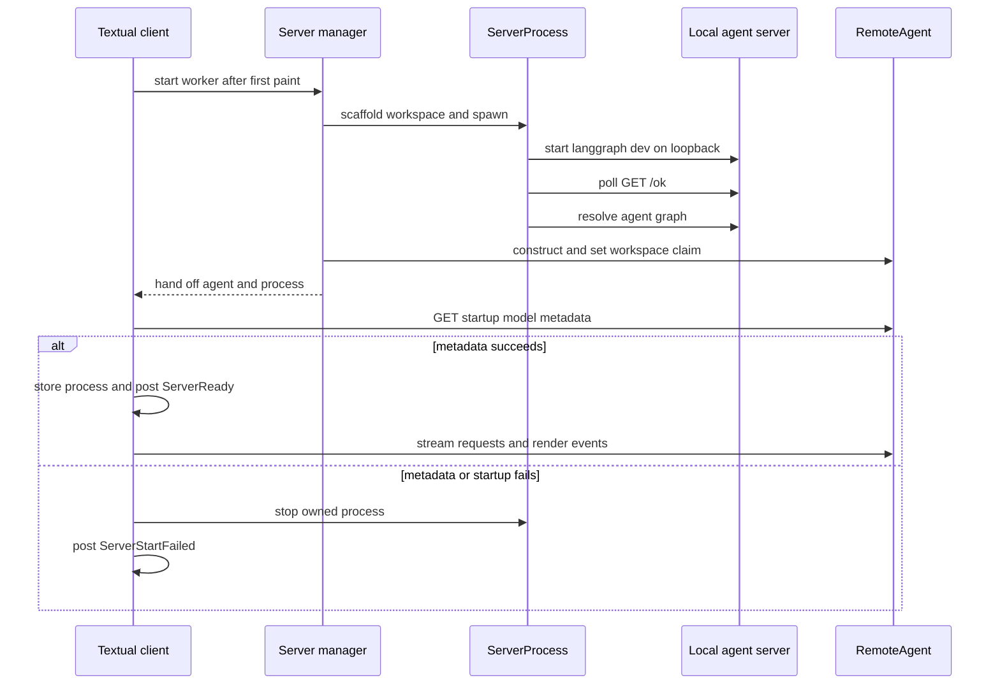
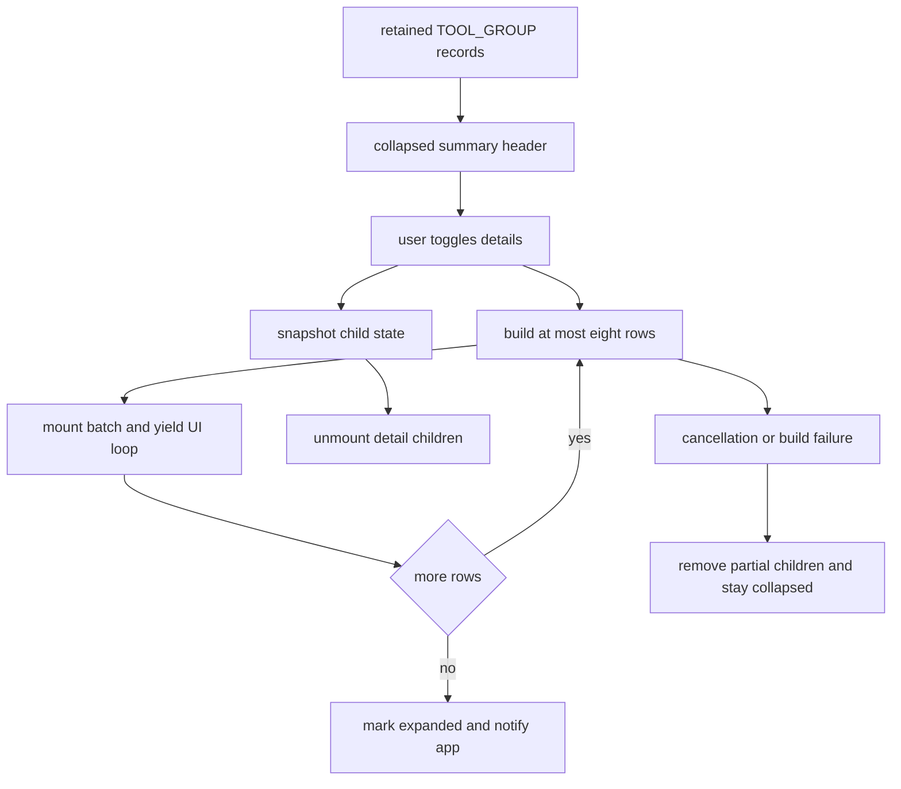

# Deep Agents Code Architecture

`deepagents-code` (`dcode`) is a prebuilt terminal coding agent and reference implementation built around the `deepagents` SDK harness. It combines terminal interaction with persistence, tools, skills, and optional sandboxed execution. The central rule is ownership: the client presents and collects interaction; the server constructs and executes the agent.

## Ownership and execution surfaces

Normal interactive and headless dcode sessions have separate processes:

- The **terminal client** owns Textual presentation, terminal input, approval interaction, and interactive or console rendering of the remote event stream.
- The **agent server** owns the graph, model, tools, memory, skills, backend resources, checkpoints, and server-side workspace policy.

The client may retain display records, resolve UI choices, or schedule Textual work, but it does not become an agent host. In particular, transcript virtualization and a tool-detail click never start, cancel, or otherwise control the corresponding server tool execution.

`cli_main` dispatches `-n` to the headless path and otherwise launches the Textual application. Headless mode still uses a server session with `interactive=False`, renders the remote stream through a console loop, disables shell execution by default unless an allow-list is configured, and releases hooks and thread ownership during teardown. ACP is intentionally different: it is an in-process stdio surface that builds an agent per ACP session, uses thread leases, and cleans MCP sessions and remaining leases on exit. ACP must not be used to infer ownership for the normal Textual client/server architecture.

## Local-server startup and handoff

The launcher prepares a temporary server workspace, writes the LangGraph configuration, starts `langgraph dev`, waits first for `/ok` and then resolves the served `agent` graph. Only then does it construct `RemoteAgent` and bind its workspace claim. The server is loopback-only by default and uses an ephemeral port rather than occupying the normal `langgraph dev` port; an explicitly requested busy port also falls back to a free port.

*Readiness requires both a healthy listener and a resolvable graph. Once ownership is handed off, metadata failure is also a client-side process-cleanup path.*

`PrespawnedServer` can overlap process spawning with app import and first paint. It pauses the launch after spawning; adoption runs the caller's post-spawn work, releases the health-check gate, and transfers ownership. If no caller adopts it, `aclose()` cancels or reaps the startup result instead of leaving a process behind.

Startup has two distinct readiness checks because a live HTTP listener is insufficient evidence that lazy graph construction succeeded. Both health and graph-readiness paths detect early process exit, attach the tail of the captured server log, and reconstruct marked startup failures such as credential or provider-package errors. Startup cancellation is also cleanup: after a process has been spawned, failure or `CancelledError` stops it in a `finally` path; failures after `start()` but before handoff are reaped by the server manager.

### Process and environment hygiene

The child environment is deliberately not a transparent copy of the client environment. The launcher strips variables that can alter interpreter or helper startup, including `PYTHONPATH`, dynamic-loader injection variables, askpass hooks, and carrier variables. A launch-time `PYTHONPATH` is retained in a dedicated carrier so it can later be applied to approval-gated agent shell execution rather than influencing server imports. The launcher fixes profile and other trust-root carrier values at launch, so later environment overrides cannot split client and server profile identity.

On POSIX the child starts a new session, and the launcher keeps a parent-owned pipe so the server can notice owner death. Shutdown signals the dedicated process group with `SIGTERM`, waits for the whole group, then escalates with `SIGKILL` if necessary. Windows uses a new console process group and Ctrl+Break for graceful shutdown, but hard escalation reaches only the root process. `ServerProcess.stop()` serializes synchronous resource cleanup, is idempotent under concurrent calls, and increments a stop generation so an in-flight asynchronous restart cannot resurrect a process after terminal shutdown wins. Debug log paths are queued during teardown and announced only after the terminal is restored.

## Textual lifecycle and client state

`DeepAgentsApp` composes the chat area, startup tip, goal-status panel, chat input, and docked status bar. `on_mount` performs only lightweight widget/configuration work, prewarms imports, and schedules server start after the first refresh. It creates its callback-only `TextualUIAdapter` after prewarming; the adapter receives UI callbacks but no agent. The agent arrives later through `ServerReady`.

The app records the `ServerProcess` immediately after a successful background launch, before posting `ServerReady`, so outer teardown can still stop it if the user exits before the Textual message is handled. `ServerReady` clears the connecting state, assigns the remote agent and MCP display information, refreshes the status UI, then schedules one serialized session-start sequence. That sequence restores history when appropriate, runs a startup command, performs an initial submission, and drains queued input in order. A later ready event from reconnect or restart does not rehydrate an already populated transcript.

A startup failure is also a settled connection state: it clears connection/resume flags, makes recovery information visible, and leaves client controls able to retry. Deferred model choices are queued while connecting rather than locally constructing a provider model.

## Server-authoritative model metadata

Model construction and provider inference belong to the server's workspace environment. The server stores a provider-independent `ModelMetadata` snapshot for its launch model and exposes it through the private `GET /dcode/model` route. `RemoteAgent.aget_model_metadata()` applies a 60-second timeout and validates the JSON before the client applies name, provider, context limit, and unsupported modalities to UI runtime state. The payload contains metadata only, never a model object or credentials.

For an existing thread, the client posts a workspace-bound request to `POST /dcode/threads/{thread_id}/model`. The server validates the request shape and purpose, confirms the thread workspace binding, and resolves a proposed model in that server runtime's saved environment. Main-model resolution receives workspace profile overrides; auxiliary resolution does not. Invalid specifications and model configuration errors return 422, a workspace conflict returns 409, and unavailable runtime/environment or unexpected resolution failures return 503. The client preserves its active override and runtime metadata if resolution fails.

This division handles provider aliases correctly: a bare client selection can be adopted using the provider the server actually resolved, without importing provider packages or constructing the model in the terminal process. Before a server exists, the client can only perform a policy/identity check for a default selection; runtime capabilities remain unknown.

## Remote stream and thread boundary

`RemoteAgent` is the client-side transport seam, not a second agent implementation. For every stream it requires a `thread_id`, resolves the server-authorized workspace for that thread, and delegates HTTP plus SSE and stream-mode negotiation to LangGraph's `RemoteGraph`. It requests `messages` and `updates` by default, converts serialized message dictionaries to LangChain message objects for the Textual adapter, and converts serialized interrupts in update events. Non-message events remain transport data; root-level `session_cost` events additionally update the client display tracker.

For locally owned sessions, a mutation first verifies the current thread lease, sends its token in the ownership header, and removes that token from the run configuration because a LangGraph run cannot carry both configurable values and workspace context. The remote server, rather than the client cache, remains the source of graph state. After a dev-server restart, `aensure_thread()` idempotently materializes the HTTP thread record without overwriting a persisted checkpoint, allowing subsequent state mutation to proceed.

The server also authorizes project-scoped workspace policy. It rejects client-claimed project fields, verifies the client-claimable session-policy fingerprint, resolves policy for the canonical target directory, and persists the server-authoritative workspace payload with the thread binding. Treat client workspace configuration as a claim, not authority. See [Configuration layering](/openwiki/concepts/config-layering.md) and [Profiles and models](/openwiki/concepts/profiles-models.md).

## Terminal transcript and rendering seam

Long transcript state is intentionally separate from the server's checkpoint state:

1. `MessageStore` retains lightweight `MessageData` records while mounting only a sliding window of transcript widgets.
2. `TOOL` records retain the identity, arguments, status, output, duration, expansion state, rejection/diff/caveat state, and other data required to reconstruct a row. Completed grouped details are retained as a `TOOL_GROUP` record.

On restore, the app projects history into these client records, matches `ToolMessage` results to calls using `tool_call_id`, bulk-loads the store, and mounts only the initial tail window. Older rows hydrate as needed. Live tool widgets synchronize their mutable rendering state back to the store; pending or running rows are protected from virtualization until a known terminal status is recorded.

Streamed assistant text uses a different client-only optimization: later fragments are coalesced on a throttled timer, and completion replaces the streamed Textual `Markdown` with a single `FinalMarkdown`. That widget mirrors Markdown layout while caching rows by width, avoiding per-block widget growth in long replies.

### Lazy, data-backed tool groups

Once a completed group is safe to compact, the app can replace its constituent display records with one `TOOL_GROUP` record. A rehydrated `LazyToolGroupSummary` retains copies of those records and mounts only a header and empty detail container while collapsed. Its header is computed from tool names and arguments without creating detail widgets.

*Expansion reconstructs client widgets from retained records; it is not a batch of server tool calls.*

A click schedules a Textual worker rather than blocking the input handler. The summary uses the app-provided detail factory so rebuilt rows receive ordinary timestamp and footer wiring. It mounts rows in batches of eight and yields with `asyncio.sleep(0)` between batches, allowing the event loop to paint and process input.

Expansion failure semantics are conservative. Cancellation removes partial children and re-raises cancellation. A builder or mount failure logs, attempts cleanup, leaves the summary collapsed, and shows a warning. Collapse snapshots each child `ToolCallMessage` expansion state before unmounting; if removal fails, details remain visible and the UI warns rather than asserting a false collapsed state. `ExpansionChanged` is emitted only after a successful transition. The app writes group expansion state to `MessageStore`, remeasures height, and snapshots details before pruning, so later hydration restores both group and per-tool expansion state.

When extending a tool row, put durable reconstruction fields in `MessageData`, synchronize them at the app boundary, and restore them in the detail builder. Do not make mounted widgets the source of truth, and do not compact live, failed, rejected, or caveat-bearing rows unless their visible semantics are preserved.

## Plugins, extensions, and cleanup

Enabled marketplace plugins are validated `name@marketplace` instances. Their adapters namespace MCP servers and recursively namespace plugin skills, then route both through the standard MCP and trusted-skill loading boundaries. ACP discovers enabled plugin MCP configuration and provides it as extra configuration layers to its normal MCP resolver unless MCP loading is disabled.

`server_session` owns cleanup for headless callers: it cleans MCP sessions, stops a handed-off server in `finally`, and drains queued debug-log notices when no TUI owns the terminal. The interactive application follows the same ownership direction: client teardown stops only the server process it owns; server teardown owns graph, MCP, and agent resources.

## Change and test guidance

- Keep server lifecycle changes in `client/launch`: test ephemeral/busy port handling, graph readiness, cancellation cleanup, scaffold recovery, restart-versus-stop races, and group shutdown semantics.
- Keep model validation on the server. Test malformed requests, workspace conflicts, availability failures, payload validation, and the invariant that failed switches preserve active UI state.
- Keep first-paint work non-blocking. A new startup action must not make a Textual adapter or a remote agent appear before its prerequisite readiness/handoff boundary.
- For lazy groups, test a group through expansion, collapse, prune, and rehydration. The focused widget test uses 32 retained rows and covers progress between batches, builder failure, and cancellation cleanup.
- Preserve the separation between retained client display state and server checkpoints/graph state. See [Testing guide](/openwiki/testing/testing-guide.md), [Run a dcode session](/openwiki/workflows/run-dcode-session.md), and [Quickstart](/openwiki/quickstart.md).
