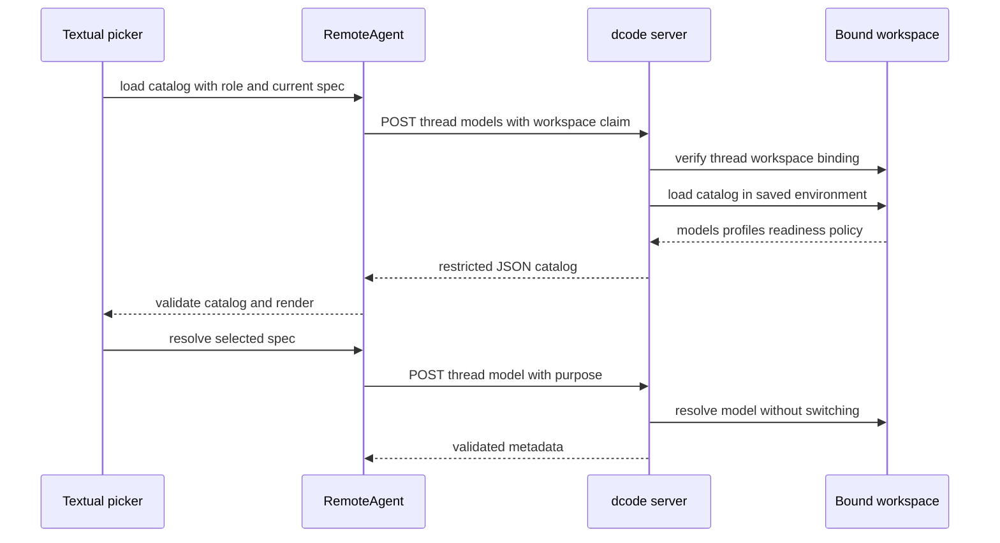

# Deep Agents Code Architecture

`deepagents-code` (`dcode`) is a prebuilt terminal coding agent and reference implementation that packages the `deepagents` SDK harness with a terminal experience, persistence, tools, skills, and optional sandboxed execution. Its architectural boundary is deliberate: the client presents and gathers interaction, while the server constructs and runs the agent.

## Ownership and execution surfaces

Normal interactive and headless sessions run as two processes:

- The **terminal client** owns Textual presentation, input, approvals, and interactive or console rendering.
- The **agent server** owns the graph, model, tools, memory, skills, backend resources, checkpoints, and workspace policy.

`cli_main` sends `-n` to one headless task; otherwise it launches the Textual app. Headless execution creates a server session with `interactive=False`, streams the remote agent through a console loop, disables shell execution by default unless an allow-list is configured, and releases hooks and thread ownership during teardown. ACP is a separate, in-process stdio surface: it opens a persistent checkpointer, creates an agent per ACP session, fences sessions with thread leases, and cleans MCP sessions and remaining leases when it exits.

The server authorizes project-scoped workspace policy. It rejects claimed project fields, verifies the client-claimable session-policy fingerprint, resolves policy for the canonical target directory, and persists the authoritative workspace payload with the thread binding. Client-side workspace state is therefore a claim rather than authority; see [Configuration layering](/openwiki/concepts/config-layering.md) and [Profiles and models](/openwiki/concepts/profiles-models.md).

## Startup, handoff, and shutdown

`DeepAgentsApp` composes the chat area, startup tip, goal-status panel, chat input, and docked status bar. After its first paint it starts server work and, after import prewarming, creates a callback-only Textual adapter. The adapter does not host an agent; it receives callbacks until the remote agent arrives.

The local launcher scaffolds a temporary LangGraph workspace, starts a loopback server on an ephemeral or fallback-free port, checks health and the `agent` graph, then creates `RemoteAgent` and binds its workspace claim. Cancellation or startup failure before handoff cleans up the server. To avoid importing from an unintended environment, it strips startup-altering inherited variables including `PYTHONPATH`, carries that value separately for approval-gated agent shell execution, and rejects overrides of immutable server environment keys.

After background startup succeeds, the app records the server process before posting `ServerReady`. The ready handler assigns the remote agent, clears connection state, refreshes client state, and schedules serialized session startup; a failure settles connection state so recovery remains possible.

Shutdown follows ownership. `server_session` cleans MCP sessions and stops its child in `finally`. `ServerProcess.stop()` is idempotent and concurrency-safe; on POSIX it signals the detached server process group with `SIGTERM` before `SIGKILL` escalation.

## Server-authoritative model transport

The client must not construct a provider model merely to populate or validate a picker. The server is the inference host: it has the workspace environment, provider packages, credentials, policy, and profile configuration needed to determine what can actually run. The client receives validated JSON presentation data and maintains only UI/runtime state.

*The server performs discovery and resolution in the bound workspace; the picker only renders and submits choices.*

### Launch metadata and proposed resolution

`GET /dcode/model` returns cached metadata for the launch model without binding or validating a thread. `RemoteAgent.aget_model_metadata()` uses a 60-second timeout and validates the response. `ModelMetadata` is provider-independent: model name, provider, context limit, unsupported modalities, and structured-output support. Its JSON serializer intentionally never carries a model object or credentials; after validation the client applies these fields to runtime UI state.

For a proposed model, the client calls `POST /dcode/threads/{thread_id}/model` with its workspace claim, optional spec and main-model parameters, and a `purpose` of `main` or `auxiliary`. The server accepts only the fixed request fields and validates types before resolving anything. It requires the thread/workspace binding, enters the saved server model environment, and resolves in a worker thread without committing a switch or running inference. A workspace conflict is `409`; malformed or model configuration requests are `422`; missing runtime environment or unexpected resolution failure is `503`.

The role changes configuration semantics:

- **Main** resolution passes the bound workspace's `profile_overrides` and may receive `extra_kwargs`.
- **Auxiliary** resolution must include a spec and cannot carry `extra_kwargs`; it deliberately omits main-model profile overrides.

This permits a bare choice to adopt the provider the server actually inferred, rather than the client's guess. If resolution fails, the app preserves its active override and runtime metadata. Before a server exists, it can only make a policy/identity check for a default selection; capabilities remain unknown.

### Workspace-bound catalog discovery

`POST /dcode/threads/{thread_id}/models` is the discovery counterpart to proposed resolution. The client sends the workspace claim, purpose, recommended specs, and current spec; `RemoteAgent.aget_model_catalog()` requires the thread ID, validates the returned `ModelCatalog`, and applies the same 60-second transport bound.

The server validates that compact request shape, verifies the thread workspace, resolves its bound configuration and saved model environment, then runs `load_model_catalog()` in that environment. Main catalog discovery receives workspace profile overrides; auxiliary discovery does not. It returns a strict catalog containing model specs, filtered display profiles, provider readiness and display data, model-allow-list policy and provenance, and the retained current spec. Catalog endpoint failures use the same `409`, `422`, and `503` boundary as resolution.

The catalog is deliberately restricted presentation data:

- A profile permits only scalar picker fields such as name, token limits, supported modalities, reasoning, tool calling, and structured output; arbitrary profile extensions are omitted.
- Provider records report readiness, source, environment-variable *name*, explanatory detail, labels, and an install extra, but never credential values.
- Constructor kwargs and executable or arbitrary configuration data do not cross the process boundary.

Discovery starts with available models, then may retain allowed recommended or current specs. It also reports enabled known providers that have no discovered model rows, so the picker can guide installation or authentication. Disabled providers and disallowed recommendations remain absent. This makes the catalog both a display contract and a policy boundary, not a snapshot of client-local provider availability.

## Picker behavior and local fallback

With a connected `RemoteAgent`, `DeepAgentsApp._load_model_catalog()` always delegates catalog loading to the server with the current thread ID. `_load_auxiliary_model_catalog()` delegates with `purpose="auxiliary"`. The local `load_model_catalog()` path exists only before a remote agent is available, and uses the bootstrap process's configuration.

`ModelSelectorScreen` loads a supplied catalog after its first frame while keeping the filter focused. It turns catalog data into display policy, profiles, install prompts, and provider readiness, while retaining local-only preferences such as recent models and stored default markers. It preserves the active spec even when ordinary discovery omitted it, supports a recommended subset without hiding recent/current selections, and renders failure as a retryable connection error rather than silently consulting local provider data.

When a catalog loader is present, the picker treats an unrecognized explicit provider as `UNKNOWN` and leaves ambiguous or bare IDs for inference-host resolution. It does not call local provider discovery, local auth checks, provider inference, or model construction. Provider setup prompts remain possible because the server supplied readiness and install-extra metadata. Policy checks occur before setup prompts, so a model rejected by `models.allowed` is never offered an install/auth bypass.

A selection is resolved by the server before a default is persisted or a runtime model changes. The work runs asynchronously, so navigation and dismissal remain responsive; a late result after dismissal cannot save a default. The main-model switch records the provider returned by the server, including a provider inferred differently from a bare client entry. Auxiliary pickers use the same transport but update their own role-specific settings rather than retargeting the main agent model.

## Remote stream and thread boundary

`RemoteAgent` is the client transport seam, not another agent implementation. `astream()` requires a thread ID, sends the thread workspace as runtime context, delegates SSE and stream-mode handling to `RemoteGraph`, turns serialized messages and interrupts into UI-oriented objects, leaves other events as transport data, and folds root `session_cost` events into the client tracker.

For local sessions, mutating requests carry the current thread-lease token. `aensure_thread()` idempotently registers the HTTP thread record, allowing persisted checkpoints to remain usable after a development-server restart.

## Transcript rendering and extensions

The client transcript is separate from the server checkpoint. `MessageStore` retains lightweight `MessageData` and mounts only a sliding widget window. Tool records retain reconstruction state and completed compacted details become `TOOL_GROUP` data. During restoration, dcode matches `ToolMessage` results to calls by `tool_call_id`, bulk-loads those records, mounts an initial tail window, and hydrates older rows on demand. It synchronizes mutable tool-widget state back to the store and protects pending/running rows from virtualization until a terminal status is known.

Completed assistant replies replace streamed Textual `Markdown` with one `FinalMarkdown`, which mirrors Markdown layout while caching rows by width to avoid per-block widget growth. `LazyToolGroupSummary` creates detail widgets only when expanded, mounts retained rows in batches of eight with an event-loop yield, and removes partial children on cancellation or expansion failure while retaining the collapsed summary. Collapse snapshots child expansion state; successful transitions emit `ExpansionChanged`, and the app records the group state and snapshots details before pruning.

Enabled marketplace plugins are validated `name@marketplace` instances. Their adapters namespace MCP servers and recursively namespace plugin skills, routing both through standard MCP and trusted-skill loading boundaries. ACP discovers enabled plugin MCP configuration and supplies it as extra configuration layers to its normal MCP resolver unless MCP loading is disabled.

## Change and test guidance

- Keep provider discovery, credentials, model construction, and profile evaluation on the inference host. Extend `CatalogProfile` or `CatalogProvider` only with deliberately reviewable presentation fields.
- For a new model role, thread `ModelPurpose` through catalog and metadata endpoints, specify whether it receives main profile overrides, and prohibit parameters unless their ownership is intentional.
- Preserve strict request and response validation, workspace binding, and the `409`/`422`/`503` failure distinctions. Never make catalog fallback silently inspect client credentials.
- Focus tests on server-environment discovery, private-extension filtering, main-versus-auxiliary profile behavior, malformed requests, policy before provider setup, bare/ambiguous IDs, and the assertion that a remote picker never consults local provider data.
- Also retain lifecycle and rendering tests: server start/cancellation/teardown, startup metadata validation, failed-switch state preservation, transcript hydration, and lazy-group cancellation. See [Testing guide](/openwiki/testing/testing-guide.md) and [Run a dcode session](/openwiki/workflows/run-dcode-session.md).
