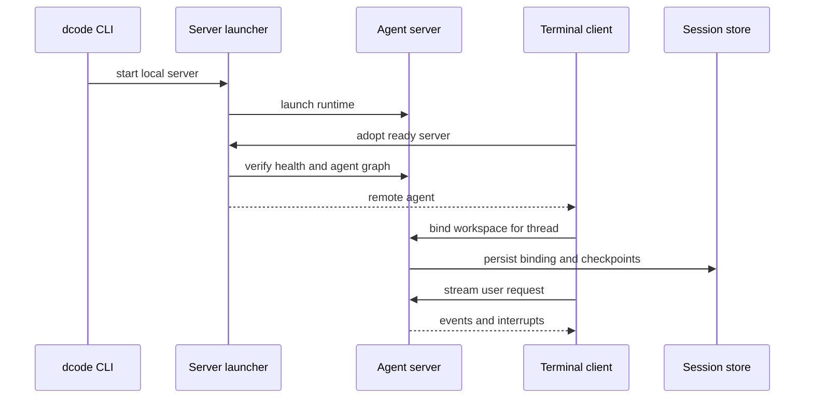
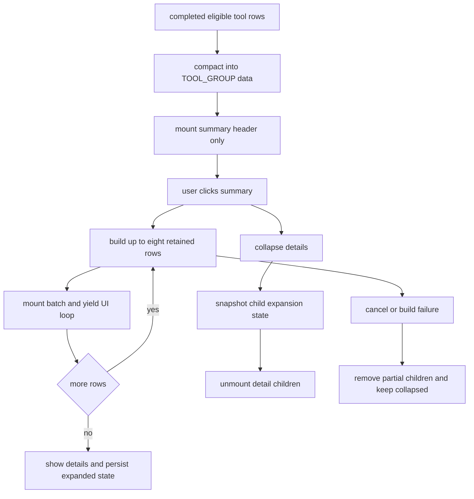

# Deep Agents Code Architecture

`deepagents-code` (`dcode`) is a prebuilt terminal coding agent and reference implementation built around the `deepagents` SDK harness. It combines a terminal experience with persistence, tools, skills, and optional sandboxed execution. Its central architectural rule is ownership: the terminal client presents agent activity and gathers input; the local server constructs and runs the agent.

## Client and server ownership

Interactive and headless dcode sessions use separate processes.

- The **terminal client** owns Textual presentation, terminal input, approval interaction, and either interactive or headless rendering of the remote stream.
- The **agent server** owns the agent runtime: model, tools, memory, skills, backend resources, graph execution, and checkpoint-related state.

The client/server boundary is therefore not merely a way to avoid UI work. Moving a render, expansion, or transcript-virtualization concern into a Textual widget must not move model, tool, policy, or graph execution into that widget.

*The client hands input to a graph-ready remote server and renders the returned stream; persistence and agent execution remain server-side.*

`DeepAgentsApp` composes the chat area, startup tip, goal-status panel, chat input, and status bar. It defers server work until after the first paint and prewarms imports before constructing its callback-only `TextualUIAdapter`. The adapter receives UI callbacks—including a callback that synchronizes tool-widget state—but the agent itself is supplied later when work executes. This avoids conflating UI startup responsiveness with agent ownership.

### Other execution surfaces

`cli_main` sends `-n` to a single headless task; otherwise it launches the Textual application. Headless execution uses a server session with `interactive=False`, renders the remote stream through a console loop, defaults shell execution to disabled unless a shell allow-list is configured, and releases hooks and thread ownership during teardown.

ACP is a separate in-process stdio surface. It opens a persistent checkpointer, creates an agent per ACP session, fences sessions with thread leases, and releases remaining leases and MCP sessions as its server exits. Do not use ACP's in-process architecture to infer that the normal Textual client owns agent construction.

## Retained tool data and the terminal rendering seam

Long transcripts are represented twice, deliberately:

1. `MessageStore` retains lightweight `MessageData` records and keeps only a sliding window of transcript widgets mounted.
2. A `TOOL` record retains the tool identity, arguments, status, output, duration, expansion state, rejection reason, diff/caveat state, and other information needed to rebuild the row. A `TOOL_GROUP` record retains completed tool and associated diff rows as data.

This is terminal-client state, not a second agent history or a replacement for server checkpoints. On history restore, the app projects stored LangChain messages into `MessageData`, matches each `ToolMessage` result to its tool call by `tool_call_id`, and later mounts only the initial tail window. Older rows hydrate as scrolling approaches them. Live tool widgets synchronize their mutable display state back into the store; pending and running rows remain protected from virtualization until a known terminal status releases that protection.

### Settled groups become data-backed summaries

During a live turn, `ToolGroupSummary` can fold a completed run while retaining its widgets. Once a finalized group is safe to compact—its tools are successful, not caveat-bearing, and no longer tracked as live—the app replaces its individual store rows with one `TOOL_GROUP` record and removes the folded DOM rows. A rehydrated summary starts with just its header and an empty detail container. Its header derives from retained tool names and arguments without building child detail widgets.

This distinction is important when changing grouping rules: only settled successful rows can be compacted. Rows that need to keep an execution failure, rejection, caveat, or live state visible must not be summarized away.

*Tool-detail expansion is a client-side, batched reconstruction from retained records; cancellation or failure cleans up partial DOM work rather than affecting the server tool run.*

### Lazy expansion, cancellation, and cleanup

`LazyToolGroupSummary` owns a copy of the group records, its transient detail widgets, and an expansion transition guard. A click schedules the transition in a Textual worker rather than blocking the input handler. Expansion builds detail rows through the app-provided factory so each reconstructed row has the same timestamp/footer wiring as an ordinary hydrated message.

The summary mounts at most eight retained rows per batch, then awaits `asyncio.sleep(0)`. That yield gives the Textual event loop a chance to process input and paint between batches. It is a rendering scheduling mechanism only: it neither batches server tool calls nor cancels tool execution.

Failure semantics are deliberately conservative:

- If expansion is cancelled, it removes any partially mounted children and re-raises cancellation; the summary remains unexpanded and has no retained transient widget list.
- If a detail factory or mount fails, it logs the failure, attempts the same cleanup, keeps the group collapsed, and displays a warning notification.
- On collapse, the summary snapshots mutable child tool-output expansion into the retained records before removing children. A removal failure restores detail visibility and warns rather than reporting a false collapsed state.
- The summary posts `ExpansionChanged` only after a successful transition. `DeepAgentsApp` writes that state to `MessageStore`, schedules a height remeasurement, and also snapshots detail state before pruning; a later hydration can restore the user's expanded group and per-tool output choices.

These invariants mean that a group may be inexpensive while collapsed without losing tool output or user-facing expansion state. They also define the extension seam: add fields necessary to rebuild a tool row to `MessageData`, serialize/synchronize them at the app boundary, and make the detail builder restore them. Do not retain live widget instances as the source of truth.

## Other terminal responsiveness seams

The tool-detail seam is separate from streamed assistant rendering. A streaming `AssistantMessage` shows its first fragment immediately, then coalesces later fragments on a throttled timer so repeated Markdown reparsing does not starve keyboard input. At completion, it replaces streamed Textual `Markdown` with one `FinalMarkdown` widget that caches rows by width instead of retaining a widget per Markdown block. This is another client-side rendering optimization; server streaming behavior does not change.

## Workspace policy, plugins, and shutdown

The server—not the terminal—authorizes project-scoped workspace policy. It rejects client-claimed project fields, verifies the client-claimable session-policy fingerprint, resolves policy for the canonical target directory, and persists the server-authoritative workspace payload with the thread binding. Treat client workspace configuration as a claim, not authority. See [Configuration layering](/openwiki/concepts/config-layering.md) and [Profiles and models](/openwiki/concepts/profiles-models.md).

Enabled marketplace plugins are validated `name@marketplace` instances. Their adapters namespace MCP servers and recursively namespace plugin skills, then send both through standard MCP and trusted-skill loading boundaries. ACP explicitly discovers enabled plugin MCP configuration and supplies it as extra layers to its normal MCP resolver unless MCP loading is disabled.

Cleanup follows ownership as well. `server_session` cleans MCP sessions and stops its child in a `finally` block. `ServerProcess.stop()` is idempotent and concurrency-safe; on POSIX, teardown signals the detached server process group with `SIGTERM` before escalation to `SIGKILL`.

## Change and test guidance

- Keep terminal responsiveness changes in the client: Textual workers, batches, virtualized data, and rendering timers must not change server-side execution semantics.
- When changing tool rows, test a compacted group through expand, collapse, prune, and rehydrate. Preserve the distinction between durable `MessageData` and temporary mounted widgets.
- Preserve cancellation cleanup and the transition guard. A partially expanded group must not leave orphan detail widgets or claim an expanded state.
- Keep caveat-bearing, failed, rejected, pending, and running tool rows out of compaction unless their visible semantics are explicitly preserved.
- The focused `TestLazyToolGroupExpansion` test builds 32 retained rows, observes progress between batches, and covers normal completion, builder failure, and cancellation cleanup. Widget tests also cover streamed-message coalescing and final Markdown replacement. See [Testing guide](/openwiki/testing/testing-guide.md) and [Run a dcode session](/openwiki/workflows/run-dcode-session.md).
