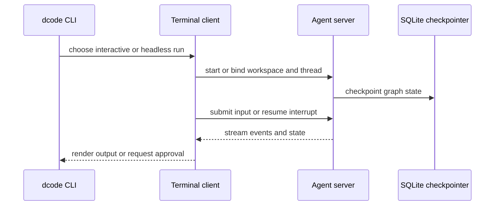
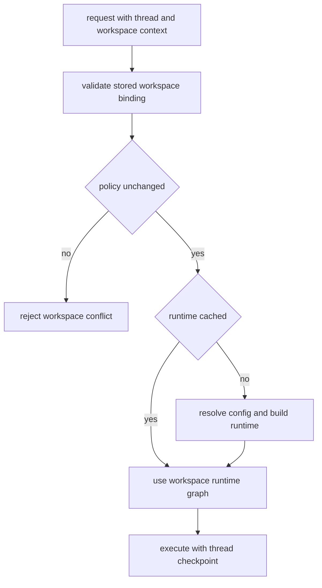
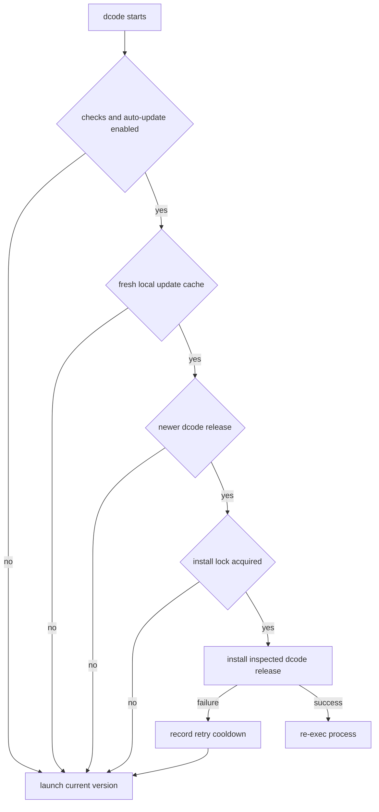

# Deep Agents Code Architecture

`deepagents-code` (`dcode`) is a prebuilt terminal coding agent and reference implementation that packages the reusable `deepagents` SDK harness with a terminal experience, persistence, tools, skills, approval controls, and optional sandboxed execution. The SDK supplies reusable agent-building primitives; dcode owns the end-user CLI, terminal UX, server launch, workspace policy, and distribution update behavior.

## Runtime boundary

Dcode deliberately separates the terminal client from the agent server, which run as separate processes. The client owns input, interactive rendering or headless console output, and approval collection. The server owns the compiled coding-agent graph, model, tools, MCP connections, skills, backend, and graph state. This keeps presentation work separate from graph construction and execution policy.

*Both modes use the server-side dcode runtime; only the presentation and approval boundary differs.*

### Process launch and configuration handoff

The distribution publishes both `dcode` and `deepagents-code` for the same `cli_main` entrypoint. The launcher creates the server environment and returns a remote agent to the client. `ServerConfig` is the process-boundary schema: the launcher serializes its mapping to `DEEPAGENTS_CODE_SERVER_*`, and the server reconstructs it with `from_env`. Relative paths are normalized before serialization because the server has a different working directory.

The server, rather than the client, authorizes project-scoped execution. It rejects client-claimed project fields, verifies the client-claimable session-policy fingerprint, resolves policy for the canonical directory, and persists the server-authoritative workspace payload with the thread binding. Moving to a different workspace fails closed: launch-project MCP configuration, sandbox setup, and extension paths are dropped, then extension trust is re-read for the target project.

## Client startup surfaces

### Interactive terminal mode

The normal path runs Textual. `DeepAgentsApp` composes the startup tip, goal-status panel, chat input, and docked status bar. Mount work is intentionally light; after first paint `_post_paint_init` constructs `TextualUIAdapter` and starts independent background initialization. The adapter is the UI boundary: it provides callbacks for rendering, status, approvals, questions, skills, subagent events, cache/accounting, and Auto-mode fallback instead of letting graph code manipulate Textual widgets.

The status bar keeps hook and agent messages in separate slots. A nonempty hook message temporarily takes display priority, configured hook text is rendered as plain `Content`, and one spinner serves connection and busy indications; unmount stops the spinner and cache timer.

### Headless mode

`dcode -n` dispatches a single task through `run_non_interactive`. It still starts a server session and streams the remote agent, but renders through a console loop rather than Textual. It passes `interactive=False` to the agent, which changes the generated prompt and enables the headless terminal-stall recovery wiring. Headless mode has no human approval conversation: with no shell allow-list, shell access is disabled; with a restrictive allow-list, shell commands are checked by middleware while other tools are auto-approved.

## Server graph and lifecycle

The server constructs a runtime by snapshotting workspace environment and credentials, configuring tracing, resolving the model and tools, optionally opening a sandbox, and compiling the CLI agent. `create_cli_agent` is the dcode-configured assembly boundary: it combines the SDK graph with dcode middleware, tool policy, memory, skills, subagents, project context, and persistence. Its public parameters make it usable by external callers, but dcode-specific policy and UX behavior should not be inferred as SDK behavior.

A runtime contains the compiled graph, composite backend, server-owned offload operation, and metadata. The graph factory caches runtime construction because MCP discovery, sandbox creation, and `atexit` ownership effects must happen once. Workspace runtimes are keyed by workspace identity and runtime fingerprint: a runtime-only change can rebuild an executable runtime without discarding a durable thread binding.

*The durable binding authorizes execution context; runtime caching only reuses construction work.*

For a request with execution context, the graph factory requires a thread ID and workspace context, validates the binding, and selects a workspace runtime. Policy drift is rejected, whereas a runtime-fingerprint-only change rebuilds the runtime without invalidating the binding. Checkpoints preserve graph state; the binding preserves the directory and execution-policy assumptions needed to resume it safely.

Shutdown is ownership-aware. `server_session` cleans MCP sessions and stops the child in a `finally` block. `ServerProcess.stop()` is idempotent and concurrency-safe; on POSIX teardown signals the detached server process group with `SIGTERM` before escalation. Headless teardown drains pending hook work and releases its held thread lease.

## Product version and update subsystem

### Version ownership and reporting

`deepagents_code._version.__version__` is the dcode distribution version, kept in sync with `pyproject.toml` by release-please. `--version` reports both the CLI distribution and the installed `deepagents` SDK version, then optional dependencies; it is intentionally offline and consults only fresh local cache for any update hint.

The update subsystem belongs to the dcode product, not to the SDK. It can read `deepagents` PyPI metadata solely to label the installed SDK release age. It does **not** check for, download, or independently update the SDK. Updating dcode installs the dcode distribution and its resolved dependencies as one tool environment.

### Best-effort discovery and local state

Update discovery is advisory and must never prevent a session from starting. `latest_version.json` caches stable and prerelease dcode versions, release timestamps, and targeted prerequisite metadata for 24 hours. Startup reads this cache only: missing, stale, corrupt, invalid, or ambiguous data returns no answer without contacting PyPI. The interactive app performs its PyPI check in a background worker after first paint; errors leave the current session running and preserve an existing on-screen result rather than retracting it.

*The startup path acts only on a fresh local answer; network refresh is deferred to the running application.*

`update_state.json` records notification throttling, “what's new” acknowledgement, and startup-update retry/defer markers. Read failures degrade to empty state; write failures are logged and generally allow a later retry. Cache writes for fetched version data use a sibling temporary file and atomic replacement so readers never observe a partial JSON cache. The state is product-local UX and recovery data, not agent or SDK state.

### Install safety and failure semantics

Managed configuration can disable checks or automatic updates. An unreadable, corrupt, or invalid managed update policy fails closed because the feature reaches the network and can install binaries; editable installs never auto-update. User configuration and environment settings follow the configuration layering described in [Configuration layering](/openwiki/concepts/config-layering.md).

When automatic updates are enabled, startup only uses the fresh cached result. A cross-process advisory install lock serializes changes to the shared tool environment, with a profile-scoped fallback when the installation lock directory is unwritable. An installer preserves the inspected dcode release, existing extras, receipt-managed packages, and interpreter rather than guessing a different environment. If an install fails, dcode reports it and launches the installed version; same-version failures receive a cooldown to avoid stalling every launch.

A successful install is different: the process must re-exec before launching the TUI, because already imported modules and newly rewritten site-packages would otherwise make a mixed-version process. The restart sentinel prevents restart loops, and a failure after an install exits rather than launching mixed code. In-session checks do not install: they surface a durable restart/update action, so a running agent session is not interrupted.

## Change guidance and focused tests

- Treat CLI/UI behavior, server workspace policy, and reusable SDK capabilities as separate ownership layers. Add graph behavior through `create_cli_agent` and server configuration, not by coupling agent code to Textual.
- Preserve the workspace-binding distinction: a runtime cache may be rebuilt, but a thread must not be reused across incompatible execution policy.
- Keep update checks best-effort. Do not put network I/O on `--version` or the startup critical path, and do not turn SDK release-age metadata into an SDK updater.
- Preserve updater invariants when changing install code: an update targets the running tool environment, concurrent installers are serialized, failed installs remain launchable, and successful installs re-exec.

Focused tests cover the split startup behavior: fresh cache answers do not make HTTP requests, stale/missing/corrupt timestamps fail safely, cached prerequisite constraints reject unsafe values, and on-disk distribution metadata—not the already imported module—verifies an installed update. Startup tests verify lock contention, lock coverage during installation, and lock release before restart. Version tests verify the offline CLI report includes CLI, SDK, and optional-dependency facts.

For operation, see [Run a dcode session](/openwiki/workflows/run-dcode-session.md) and [Quickstart](/openwiki/quickstart.md). For local development and test execution, see [Development](/openwiki/operations/development.md). For agent memory and compaction behavior, see [Context management](/openwiki/concepts/context-management.md).
