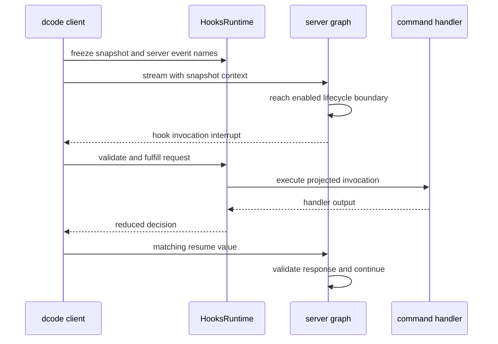

# Deep Agents Code Architecture

`deepagents-code` (`dcode`) is a terminal coding agent around a Deep Agents/LangGraph runtime. The important boundary is not simply local versus remote code: the **client** owns interaction, hook configuration and execution, while the **server graph** owns agent lifecycle positions, tools, checkpoints, and the point at which a decision must affect execution. A client communicates its frozen hook configuration as context; the server uses that context only to decide which lifecycle boundaries to interrupt.

## Execution surfaces and ownership

| Surface | Process and presentation | Agent execution and interaction |
|---|---|---|
| Interactive CLI | Textual `DeepAgentsApp` and a loopback agent server | The app presents stream events, approval/question UI, hook notices, and status. The server constructs and runs the graph. |
| Headless CLI (`-n`) | One console-oriented client process plus server session | `run_non_interactive()` streams one task, fulfills server-owned hook interrupts, and exits with an operational exit code. |
| ACP | In-process stdio ACP server | ACP builds a graph per ACP session and wraps it with `_AutoGraph` to persist trusted Auto-mode control state and inject prompt metadata. |

All surfaces use the graph middleware assembled by `create_cli_agent()`. The main graph receives `ServerHooksMiddleware` after approval middleware, so `PreToolUse` is evaluated before approval routing. The same middleware is added to subagents, but with `emit_stop=False`: subagent tools still get pre/post hooks while only the parent `task` boundary emits the main-agent `Stop` event. MCP timeout middleware is inside the hook wrapper, allowing `PostToolUseFailure` to observe timeouts as failed results.

## Hooks v2: configuration is client-owned, lifecycle position is server-owned

A `HooksRuntime` is created for one client session. It freezes a validated `HooksSnapshot`, a transcript store and engine, resolved workspace trust, a presenter, and a fulfillment ledger. It materializes transcript files only on the client before executing matching command handlers; the graph never receives client-local hook configuration or transcript paths.

Configuration is merged in precedence/reduction order: trusted project `.deepagents/hooks.json`, user `~/.deepagents/hooks.json`, then enabled-plugin documents. Project configuration is excluded unless the workspace is trusted. Every source is validated and incorporated into a canonical snapshot hash; enabled server events and that `snapshot_id` are projected into per-run graph context. Moving to a new working directory or reloading reconstructs the runtime and re-resolves trust, so a grant for one project does not travel to another.

The event capability table divides work deliberately:

- **Client-owned events**—such as `SessionStart`, `UserPromptSubmit`, `SessionEnd`, `PermissionRequest`, and `Notification`—are invoked by the client lifecycle coordinator and can add context, stop client processing, make permission decisions, or present notices.
- **Server-owned events**—`PreCompact`, `PreToolUse`, `PostToolUse`, `PostToolUseFailure`, `Stop`, `SubagentStart`, and `SubagentStop`—are emitted at graph-safe lifecycle boundaries by `ServerHooksMiddleware`. They are enabled only when the client supplied both a snapshot ID and the corresponding event name, avoiding an interrupt round trip for unconfigured events.

Project hooks can execute commands, so headless and CI runs do **not** inherit an interactive persisted grant. They load project hooks only with `--trust-project-hooks`; interactive startup may prompt and remember a project grant.

*Server middleware chooses the lifecycle boundary; the client executes handlers and resumes the paused graph with a typed decision.*

### Interrupt and resume invariants

The interrupt wire envelope has a fixed `hook_invocation` discriminator and a validated versioned request. The server derives a deterministic invocation ID from the thread, hook snapshot, prompt, event, and logical event identity. The client checks that the request snapshot matches its runtime, then deduplicates fulfillment by `(snapshot_id, invocation_id)`: concurrent or repeated delivery shares one handler execution and cached response. On resume, the server verifies both invocation and snapshot ID before accepting the decision.

The session gate is checkpointed at the start of an independent turn. On every resume the server compares the current `hooks_snapshot_id` and configured server-event set to that checkpointed gate; a changed context aborts rather than applying a decision under different hook policy. Malformed response *shape* is logged and reduced to a neutral decision, but an answer for a different invocation or snapshot is fatal.

This division also covers operations outside ordinary graph streaming. The server offload route returns one hook request at a time; the client fulfills it and sends an accumulated map of responses on the next request. The operation replays from the top and reuses answers keyed by deterministic ID, rather than re-running an already answered hook. This is essential for `PreCompact` and offload operations that cross normal graph interrupt boundaries.

### What the middleware changes

`PreToolUse` runs after a model proposes calls and before downstream approval. It can deny a call, explicitly allow it, request the existing HITL approval path, add context, or replace a local `execute` command. A denial becomes an error `ToolMessage` and prevents tool execution. Explicit allow/deny decisions are checkpointed per tool-call ID so normal approval does not prompt again; an undecided call continues through normal approval. Duplicate provider tool-call IDs never receive a trusted explicit-allow marker.

After a tool result is committed, the middleware stores a duration keyed by call ID in private checkpointed state. At the next `before_model` safe boundary it emits `PostToolUse` or `PostToolUseFailure`, may rewrite the committed `ToolMessage`, and removes the pending entry with a reducer tombstone. `task` calls additionally bracket the subagent with `SubagentStart` and `SubagentStop`; private hook state is stripped from subagent result merges so parallel subagents cannot corrupt parent hook bookkeeping.

At a natural main-agent end, `Stop` may feed hook feedback back as a `HumanMessage` and jump to `model`. A continuation counter is checkpointed, passed to the event, and reset when the loop ends. Subagent graphs do not emit this parent `Stop`. Hook inputs are omitted from tracing by default.

## Normal, headless, and ACP implications

The Textual app owns a `HooksManager` and attaches its presenter to notices and a delayed footer-status slot. It applies the runtime's snapshot ID/event names to the graph context, projects rendered messages into the hook transcript, and fulfills hook interrupts received in agent streaming. Its offload and handoff calls pass the same fulfillment function, preserving hook behavior when compaction is server-operated.

Headless execution creates the same manager with a fixed one-turn identity, displays hook notices on the console and hook progress on the spinner, and applies the snapshot context before streaming. It collects hook interrupts separately from ordinary approval interrupts, executes them, and resumes the graph with both response maps. Permission hooks intentionally prevent automatic approval from bypassing the hook decision. It drains legacy fire-and-forget hooks during teardown, while Hooks v2 lifecycle execution is awaited at the applicable boundary.

ACP's `_AutoGraph` is a distinct in-process adapter. For every streamed ACP request it persists `ApprovalMode.AUTO` under the session's key, adds trusted prompt metadata to the final human message when present, and supplies an Auto `CLIContextSchema`. It does not create a Textual hook runtime or a terminal status reporter; integrations that require Hooks v2 must provide the corresponding hook context and fulfillment behavior at their own graph boundary. See [ACP integration](/openwiki/integrations/acp.md) and [Hooks lifecycle](/openwiki/concepts/hooks-lifecycle.md).

## Terminal program status

Terminal status is independent of the agent-server protocol. `program_status.py` implements the Program Status Protocol with `OSC 7501` records for terminals or multiplexers that support it. `ProgramStatus` validates legal state/field combinations, record-ID grammar, progress bounds, and state-specific `kind`; text is converted to one sanitized line, byte-truncated without breaking UTF-8, then base64 encoded. Reporting is best effort: invalid records and writer failures are dropped rather than breaking the agent, and `DEEPAGENTS_CODE_NO_TERMINAL_ESCAPE` applies through the shared terminal writer.

`ProgramStatusReporter` is thread-safe, suppresses duplicate per-record sequences, and normally registers an `atexit` clear after its first successful report. Its `clear()` operation removes a record and its descendants, or every record at the root. Interactive `DeepAgentsApp` owns an `AgentStatusTracker`, starts at `idle`, and clears records when the app exits. The tracker gives the newest outstanding blocker precedence over work and prior outcome, then reports `working`, `done`, `error`, or `idle`; prompts map to `blocked` with `permission`, `question`, or `auth`. Starting new work clears an old outcome, while changing or clearing a transcript drops its transcript-mounted blockers.

Headless CLI has different terminal semantics. It sends `working` before `run_non_interactive()`, uses a reporter with `clear_on_exit=False`, and reports `done` for success or `error` for failure just before exit so the terminal can retain a terminal result. Ctrl-C or an unknown exit produces `clear`; a timeout reports error and carries its timeout reason. Neither surface sends the protocol support query, avoiding startup latency or a false negative on a slow terminal.

## Server-authoritative model transport

The model picker remains deliberately separate from hook execution. Model metadata crosses the process boundary as validated provider-independent JSON: the server serves cached launch metadata at `GET /dcode/model`, resolves thread-bound proposals in its workspace environment, and the client applies metadata without constructing a provider model.

The private workspace-bound `POST /dcode/threads/{thread_id}/models` endpoint validates catalog requests, verifies the thread workspace, and discovers the catalog in the server's saved model environment; it applies workspace profile overrides only for the main purpose. `ModelCatalog` carries only strict presentation and readiness data: scalar whitelisted profile fields with override provenance, provider readiness and labels without credential values, allowed-model policy, and the retained current spec; arbitrary profile extensions and constructor data do not cross the process boundary.

When connected to a server, the app delegates main and auxiliary picker catalog loading to `RemoteAgent.aget_model_catalog()` with the current thread, while the auxiliary path explicitly uses `purpose="auxiliary"`; local discovery is retained only as a disconnected bootstrap fallback. A server-backed `ModelSelectorScreen` renders catalog-supplied policy, profiles, readiness, and installation metadata while keeping local preferences, and it avoids local provider discovery and inference: unknown explicit providers remain unknown and ambiguous IDs are deferred to inference-host resolution. See [Profiles and models](/openwiki/concepts/profiles-models.md).

## Change and test guidance

- Do not move hook command execution into server middleware. The server must own the exact lifecycle boundary, while the client owns trusted configuration, local transcripts, presentation, and handler processes.
- Preserve snapshot identity, deterministic invocation IDs, client fulfillment deduplication, and server validation on resume. A retry must not execute a decision-producing hook twice or apply it to a different policy snapshot.
- Keep server hook state private but checkpointed. Post-tool results must be committed before post hooks run, and subagent result merges must not leak private hook channels.
- Keep `PreToolUse` before approval routing and preserve the distinction between explicit hook allow, deny, ask, and no opinion. Headless auto-approval must not bypass permission hooks.
- Treat OSC output as cosmetic and best effort. Preserve protocol validation, duplicate suppression, interactive clear-on-exit, and headless retained final status.
- Focus tests on real-graph pre-tool denial and resume, response mismatch handling, duplicate fulfillment, offload replay, post-tool cleanup, and parallel-subagent private-state isolation. For status, test state precedence, prompt blocking/unblocking, queued turns, terminal preference opt-out, interactive clearing, and headless final outcomes.
