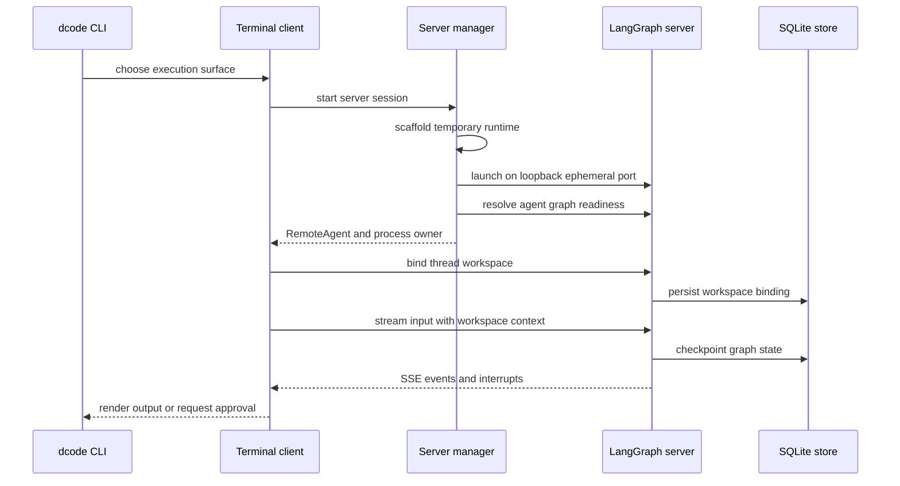
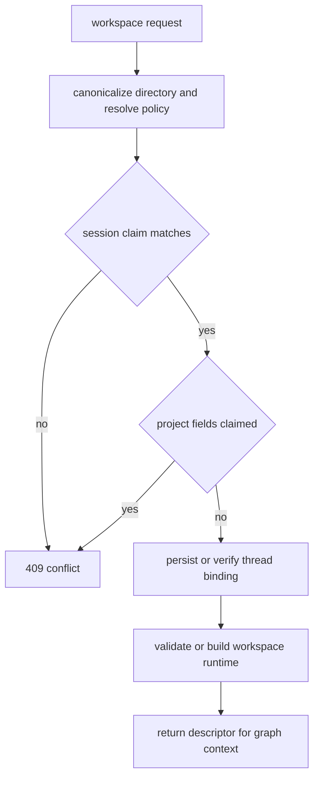
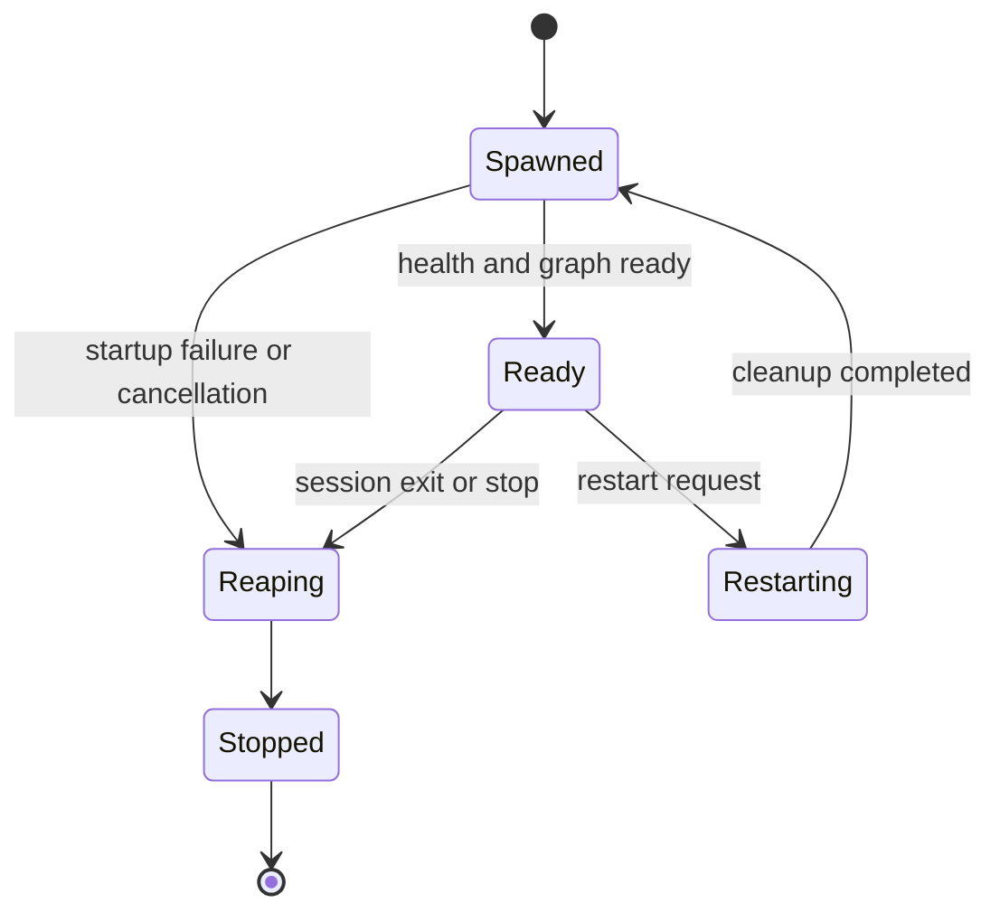

# Deep Agents Code Architecture

`deepagents-code` (`dcode`) is a prebuilt terminal coding agent and reference implementation built on the `deepagents` SDK harness. It combines that harness with terminal presentation, persistence, tools, skills, approval controls, and optional sandboxed execution. The CLI owns product-facing startup and execution surfaces; the server owns agent construction and execution.

## Process and ownership boundary

The normal dcode runtime has two processes:

- The **terminal client** owns Textual presentation, input, approval interaction, and the `RemoteAgent` transport wrapper. Headless mode uses the same remote path but renders to a console.
- The **agent server** is a local `langgraph dev` process. It owns provider models, tools and MCP connections, skills, backend resources, the compiled graph, checkpoints, and server-side operations.

The client never creates the provider model for a remote run. `RemoteAgent` lazily instantiates LangGraph `RemoteGraph`, delegates HTTP/SSE stream handling to it, and converts streamed message dictionaries to LangChain message objects for the presentation layer. State snapshots remain server-shaped; accounting is reconciled separately.

*Launch hands a ready local server to the client; execution stays server-side after the workspace binding is accepted.*

### Launch configuration and readiness

`ServerConfig` is the process-boundary contract. The launcher derives it from CLI arguments, serializes it as `DEEPAGENTS_CODE_SERVER_*` variables, and the child reconstructs it with `from_env`. Paths are normalized before serialization because the generated runtime has a different working directory. Security-sensitive configuration fails closed: a shell allow-list cannot be empty, and an explicit filesystem allowlist must be nonempty and include `read_file`.

The launcher first preflights an explicitly supplied MCP configuration, so malformed explicit configuration is reported in the terminal process rather than as opaque child logs. It then creates a temporary runtime directory containing a generated `checkpointer.py`, `pyproject.toml`, and `langgraph.json`. The checkpointer connects to the persistent sessions database through an environment-provided path; the generated project depends on a local editable dcode project when available, otherwise the installed distribution version. The built-in configuration registers the `agent` graph and the authenticated dcode HTTP operations, not additional addressable graphs.

`ServerProcess` chooses a free ephemeral loopback port by default, starts `langgraph dev`, waits for `/ok`, and then resolves the `agent` graph endpoint. Resolving the graph is distinct from health polling: it makes lazy graph-construction failures visible before the client is handed a `RemoteAgent`. If startup or graph readiness fails or is cancelled before handoff, the launcher reaps the child; unsandboxed abandoned startup uses a short grace period, while sandboxed startup retains the normal graceful period so the child can clean up a sandbox under construction.

The server environment strips startup-affecting inherited variables such as `PYTHONPATH`; the launch value is carried separately for later application only to the approval-gated shell backend. Profile selection and other launch-owned carrier values cannot be overridden by restart environment overrides. These rules prevent an untrusted project path or a restart caller from changing the server interpreter's startup trust root.

## CLI execution surfaces

`cli_main` has a lightweight `--version` fast path, parses arguments, dispatches lightweight administrative commands before state/config bootstrap where possible, and requires healthy managed configuration for remaining policy-sensitive commands. It selects three execution surfaces:

- **Interactive TUI (default):** starts `DeepAgentsApp`, which owns the local server session for the terminal session.
- **Headless task (`-n`):** runs one remote server-backed task with `interactive=False`, streams output through a console loop, and exits for scripting.
- **ACP (`--acp`):** serves Agent Client Protocol over stdio and builds graphs in process rather than using the local `RemoteAgent`/`langgraph dev` pair.

### Interactive initialization

`DeepAgentsApp.compose` creates the chat area, optional startup tip, goal-status panel, chat input, and docked status bar. `on_mount` intentionally limits itself to widget lookup and lightweight configuration so the first frame is not delayed. It restores status and input presentation, focuses the chat input synchronously, starts import/tracing prewarm workers, starts branch resolution, and schedules server startup after the first refresh.

The Textual adapter is the presentation boundary between graph events and widgets: it supplies callbacks for rendering, approvals, status, accounting, skills, and Auto-mode events. The two-line status bar preserves agent and hook messages independently, temporarily prioritizes a nonempty hook message without overwriting agent state, and uses one spinner for connection/busy activity that is stopped when unmounted.

### Headless and ACP lifetime differences

Headless execution is deliberately one-task lifecycle ownership. Its finalization drains outstanding hook work and releases a held thread lease, preventing asynchronous dispatch or thread ownership from outliving the process. Shell execution is disabled by default in headless mode unless a shell allow-list is configured; an allow-list routes shell policy through middleware, while `all` permits unrestricted shell commands.

ACP is an in-process stdio surface. It opens a persistent checkpointer, creates an agent per ACP session, protects sessions with thread leases, and cleans MCP sessions and remaining leases when its server exits. Its Auto wrapper persists trusted Auto approval state, attaches prompt metadata before streaming, and delegates graph state operations to the wrapped graph. See [ACP integration](/openwiki/integrations/acp.md) and [MCP integration](/openwiki/integrations/mcp.md).

## Workspace binding is the authorization boundary

A workspace is durable, server-authoritative state associated with a thread, not the client process's current directory. `RemoteAgent` holds an explicitly configured workspace and a per-thread cache of returned binding descriptors. Before a workspace-dependent request, it either uses the cached descriptor or calls the workspace route; without configured workspace state, it raises rather than sending an under-specified request. A workspace change can be validated without mutating that cache, which lets the TUI decide whether to commit or restore a switch.

The server canonicalizes the requested directory and resolves target project policy. A managed client may present only the session-scoped policy claim plus its fingerprint. The workspace route rejects claimed project fields, checks that the claim/fingerprint exactly match server-resolved session policy, then persists or verifies a server-authoritative binding. It constructs or validates the selected runtime before mirroring workspace metadata to LangGraph's live thread record. Thus a thread can have persistent checkpoints while a restarted dev server still needs idempotent HTTP thread registration.

*The client transports a claim and a returned descriptor; only server-resolved policy becomes a durable binding.*

### Directory changes, drift, and runtime selection

Project execution policy does not travel automatically to another checkout. When the target is not the launch project, or project equivalence cannot be established, `ServerConfig.resolve_workspace` drops launch-project MCP configuration, sandbox setup, and extension paths, and rereads extension trust for the target. This fail-closed rule avoids applying one checkout's code-execution policy to another.

Bindings separate compatibility from runtime identity:

- A **policy fingerprint** covers workspace identity and access policy such as trust, tools, sandbox, and approvals. Project-policy or access-policy drift refuses use of the thread.
- A **runtime fingerprint** includes model, prompt, model parameters, and other runtime-only values. It can change without invalidating a policy-compatible thread; the server logs the change and rebuilds/selects a different runtime.

For execution-context requests, `make_graph` requires both a nonempty thread ID and workspace context. It verifies that context against the persisted binding, re-resolves current policy, and selects the workspace runtime. The server returns structured, allowlisted diagnostics for workspace conflict; it does not expose paths, prompts, model parameters, or credentials in drift explanations. A process-wide sandbox is reserved to its first workspace and refuses a second workspace because the resource is not safely workspace-isolated.

Workspace runtimes are cached under a lock by workspace identity and runtime fingerprint in a bounded LRU. This is a resource ownership mechanism, not merely an optimization: repeated MCP discovery, sandbox creation, and `atexit` registration would duplicate process-lifetime resources. The graph endpoint and server-side operations use the same runtime and composite backend.

See [Configuration layering](/openwiki/concepts/config-layering.md) and [State persistence](/openwiki/concepts/state-persistence.md).

## Persistence, cost, and trace boundaries

The generated server checkpointer uses the persistent sessions SQLite database. LangGraph checkpoint rows retain graph state, while dcode stores durable metadata that should not be duplicated at every graph step in side tables, including thread workspace bindings and thread-display metadata. Thread lists query checkpoint metadata and can filter by the exact stored `cwd`; checkpoint-derived display information is cached by latest checkpoint identity. The client/server split does not make a session ephemeral: restarting the server can leave checkpoint data intact while its live HTTP thread record must be materialized again.

Cost is also deliberately split by ownership. The client retains a `SessionCostTracker` per thread. Main-task cost arrives in graph state or stream events and is monotonic—an older delayed value cannot replace a newer total. Side-question cost is separately persisted and refreshed through HTTP; the presentation total merges the latest independent subtotals only when displayed. If a fresh graph checkpoint is unavailable, the client keeps provisional main-task usage and marks the snapshot cached instead of erasing it. See [Cost and sessions](/openwiki/operations/cost-and-sessions.md).

Tracing is configured in the server's workspace environment, alongside the model and tools that generate the run. The client can request replication to an extra LangSmith project only through the server-side `langsmith_tracing` stream channel; it cannot smuggle that setting in reserved graph configuration. Middleware is expected to omit hook inputs from traces by default, avoiding repeated copies of full model histories and unnecessary secret-redaction work. The launch process defers client-side LangSmith redaction installation until after the TUI's first paint, while the server installs its own tracing configuration for execution.

## Cleanup and failure semantics

The owner that creates a resource is responsible for its terminal cleanup. `server_session` owns headless startup handoff: its `finally` cleans a returned MCP session manager, stops the child, and emits deferred debug-log notices. `ServerProcess.stop()` is idempotent, serializes concurrent stops with a synchronous state lock, closes process/log resources, and prevents an in-flight asynchronous restart from resurrecting a server after terminal stop.

*Terminal stop wins over restart; cancelled or failed startup follows the same reaping path rather than orphaning a child.*

Shutdown has an important platform distinction:

- **POSIX:** the child starts in its own detached session/process group and has an owner-death pipe. Teardown sends `SIGTERM` to the server group, waits for the entire group, then escalates with group `SIGKILL`; this also reaches descendants such as child processes started by the server.
- **Windows:** the child starts in a new console process group. Graceful shutdown uses Ctrl+Break when possible, with `terminate` fallback. Escalation kills only the root process handle, so a surviving descendant can be orphaned; it is not equivalent to POSIX group-wide escalation.

Server logs are deleted normally; debug-mode paths are queued and printed only after the terminal is restored, so notices are not lost behind Textual's alternate screen. Startup errors emitted by the child are recovered from its captured log so actionable model/provider configuration failures survive the process boundary.

## Safe change points and focused tests

- Add runtime behavior at the server graph/configuration boundary, not in Textual widgets.
- Treat client `workspace_config` as a claim to verify. Preserve the policy-fingerprint versus runtime-fingerprint distinction when adding settings.
- Keep process-wide sandbox ownership single-workspace, and add a cleanup path for every new process, session manager, lease, sandbox, or background task.
- Keep headless runs noninteractive and release hooks, thread lease, MCP resources, and the server on every exit path.
- Preserve the POSIX/Windows shutdown distinction; do not claim Windows kills a complete descendant tree.

`test_server.py` covers port selection, graph readiness, startup error recovery, cancellation cleanup, rescaffolding, and lifecycle serialization. `test_server_manager.py` covers config serialization, explicit workspace claims, generated runtime configuration, startup cancellation/grace behavior, and `server_session` forwarding. Workspace and remote-client tests are the safety net for claim rejection, canonical thread binding, policy drift, runtime-only rebuilds, and context injection. For an operator-oriented flow, see [Run a dcode session](/openwiki/workflows/run-dcode-session.md).
