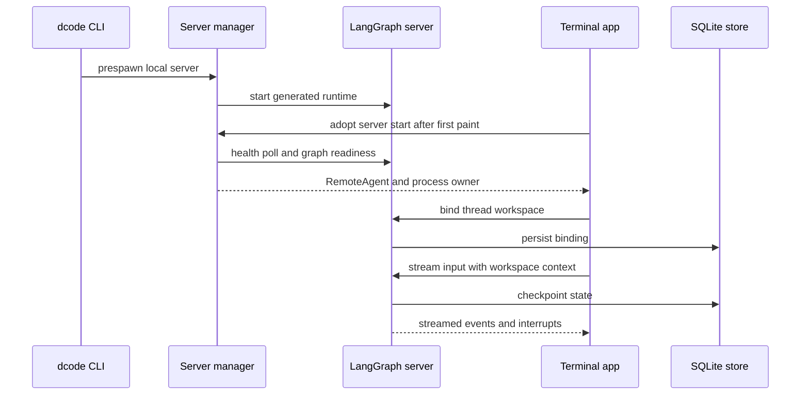
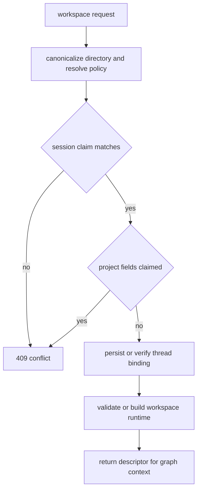
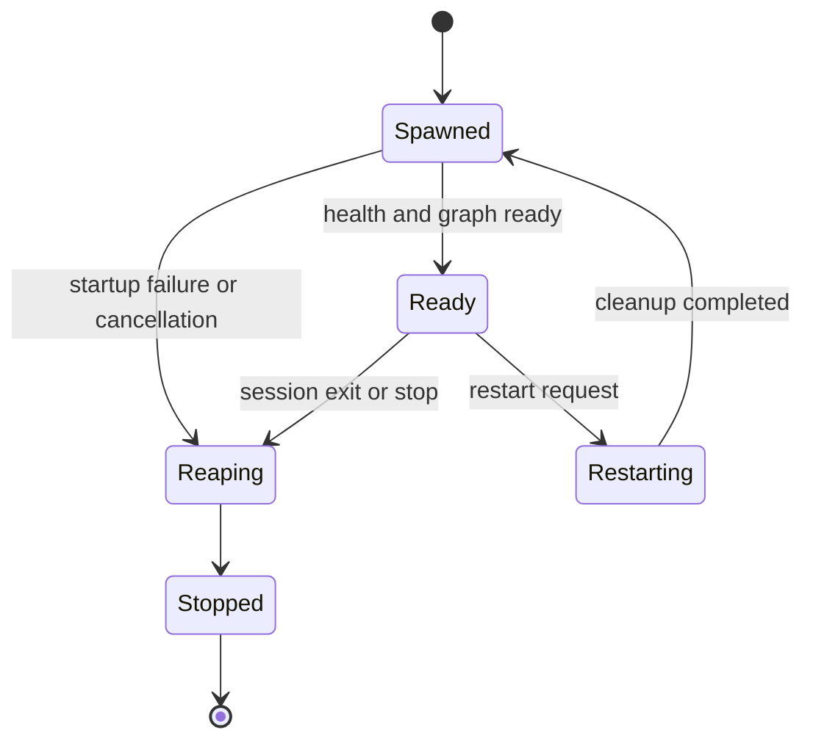

# Deep Agents Code Architecture

`deepagents-code` (`dcode`) is a reference terminal coding agent built on the `deepagents` SDK harness. It packages the harness with terminal presentation, tools, skills, approvals, persistence, and optional sandboxed execution. Its principal boundary is deliberate: the client presents and requests; the local server constructs and executes the agent.

## Runtime ownership and launch

Normal interactive and headless runs have separate processes:

- The **terminal client** owns Textual presentation, keyboard input, approval interaction, and the `RemoteAgent` transport wrapper. Headless mode uses the same remote path and renders its stream to a console.
- The **agent server** is a local `langgraph dev` process. It owns the provider model, tools and MCP sessions, skills, backend resources, compiled graph, checkpoints, and server-side operations.

`RemoteAgent` lazily creates a LangGraph `RemoteGraph`, binds or retrieves a server-validated workspace per thread, and injects its returned descriptor into graph stream context. It fails rather than making a workspace-dependent request without configured workspace state. The client consequently does not construct the provider model for a remote session.

*The subprocess may boot while the application imports, but only a health-checked, graph-ready server is handed to the terminal app.*

### Generated server runtime and readiness handoff

`ServerConfig` is the client-to-server contract. The launcher writes its serialized `DEEPAGENTS_CODE_SERVER_*` values and the server reconstructs them with `from_env`; relative paths are normalized because the child uses a generated working directory. Security-sensitive validation fails closed: a shell allow-list is absent or nonempty, and an explicit filesystem allowlist is nonempty and contains `read_file`.

The launcher preflights an explicitly supplied MCP config, creates a temporary workspace, and writes `checkpointer.py`, `pyproject.toml`, and `langgraph.json`. The generated checkpointer obtains the persistent sessions database path from the server environment, installs dcode's checkpointer forwarding compatibility patch, and yields an owned SQLite saver. `langgraph.json` registers the built-in `agent` graph and dcode's authenticated HTTP application; offload is an HTTP operation rather than another addressable graph.

`ServerProcess` binds an ephemeral loopback port by default and starts `langgraph dev`. It first polls `/ok`, then makes a separate request for the `agent` graph. The second step deliberately forces lazy graph construction before `RemoteAgent` handoff. On startup failure or cancellation, cleanup runs from `finally`, including for `CancelledError`; blocking stop work is moved off the event loop. An abandoned unsandboxed start gets a shortened grace period, while a sandboxed build retains normal graceful shutdown so server-side sandbox cleanup can run.

Interactive startup overlaps slow work without changing ownership. `PrespawnedServer` spawns before the app module finishes loading, pauses before health checking, and is adopted by the app after its paint gate releases it. If no caller adopts it, `aclose` cancels or reaps the start. `DeepAgentsApp` itself composes the startup tip, goal panel, input, and docked status bar; its mount path performs lightweight setup, import/tracing prewarm, and schedules server work after refresh. Its Textual adapter supplies rendering, approval, status, accounting, skills, and Auto-mode callbacks. The two-line status bar maintains separate hook and agent messages and stops its shared connection/busy spinner on unmount.

The subprocess environment strips inherited startup-changing variables including `PYTHONPATH`. The launch-time value is carried separately and reapplied only to the approval-gated shell backend; profile and related bootstrap-owned carrier values cannot be replaced by restart overrides.

## CLI surfaces

`cli_main` dispatches `-n` to one headless task; otherwise it launches the Textual app. The headless run uses `interactive=False`, streams the remote agent through a console loop, and defaults to disabled shell execution unless a shell allow-list is configured. Its teardown drains pending hooks and releases its thread lease.

ACP is intentionally different: it is an in-process stdio execution surface. It opens a persistent checkpointer, creates an agent per ACP session, fences sessions with thread leases, and cleans MCP sessions and leases at exit. In ACP Auto mode, a wrapper stores trusted Auto approval state, attaches prompt metadata to the user message before streaming, and delegates graph-state operations to the underlying graph. See [ACP integration](/openwiki/integrations/acp.md).

## Workspace binding is authorization

A workspace is durable, server-authoritative thread state, not the client process's current directory. The client may send only a session-policy claim and fingerprint. The server canonicalizes the target directory, rejects claimed project fields, verifies the claim against its own resolved session policy, then persists or verifies the authoritative workspace payload with the thread binding.

*The client transports a claim and descriptor; only server-resolved policy can become a durable binding.*

For graph execution with an execution context, `make_graph` requires a nonempty thread ID and workspace context, validates that context against the durable binding, then selects the workspace runtime. A client context must therefore match the stored binding rather than merely name a directory.

Directory switching fails closed. For a target outside the launch project, or when project equivalence is uncertain, resolution drops launch-project MCP config, sandbox setup, and extension paths, then rereads target extension trust. A policy fingerprint captures workspace identity and execution-access policy; drift refuses the thread. A runtime fingerprint captures model, prompt, parameters, and runtime-only settings; it can change without invalidating a compatible binding, causing runtime selection or rebuild instead. Diagnostics are structured and allowlisted rather than exposing paths, prompts, parameters, or credentials.

Workspace runtimes are protected by a lock and cached in a bounded LRU by workspace and runtime identity. This prevents duplicate MCP discovery, sandbox creation, and `atexit` registrations; the graph and offload API share the same runtime and composite backend. A configured sandbox is process-wide and is reserved to its first workspace, so a different workspace is refused rather than treated as isolated.

See [Configuration layering](/openwiki/concepts/config-layering.md).

## Persistence and server-lifetime optimizations

The generated server uses the persistent sessions SQLite database for LangGraph checkpoints. Dcode also keeps durable thread metadata and workspace bindings outside repeated graph steps. A restarted dev server can therefore retain checkpoint state while its live HTTP thread record is recreated idempotently. The client cost tracker keeps main-task and side-question subtotals separately; main-task totals are monotonic, and only presentation combines the independent values. See [State persistence](/openwiki/concepts/state-persistence.md) and [Cost and sessions](/openwiki/operations/cost-and-sessions.md).

Two guarded compatibility patches address server-side latency without changing externally visible queue or checkpoint semantics:

- The LangGraph custom-checkpointer adapter otherwise inherits the base delta-history method instead of forwarding to the SQLite saver's indexed implementation. Dcode patches the adapter only when it still has that shape; otherwise it retains the base history walk.
- The in-memory LangGraph run scheduler normally polls pending runs. During the HTTP app lifespan, dcode patches `Runs.put` to notify a waiting `Runs.next`; the original `Runs.next` still claims runs, preserving queue ordering and thread locks. Signature checks, idempotence, and a 0.5-second fallback make an upstream mismatch a no-op rather than a broken scheduler.

Tracing is a process-lifetime server concern because LangSmith uses process-wide environment caches and a default client. The first workspace reserves tracing settings; a later workspace with different tracing/redaction settings is refused. During that initialization the server installs a LangSmith runtime override that runs only known untraced `traceable` setup/end bookkeeping inline; all other calls keep LangSmith's standard thread hop. The HTTP lifespan also prebuilds the runtime and, on every shutdown path, cancels and joins prebuild work, shuts down extensions, and flushes buffered traces.

## Cleanup, cancellation, and platform boundaries

`server_session` owns headless server lifetime: its `finally` cleans MCP resources, stops the child, and emits any deferred debug-log notices. `ServerProcess.stop()` is idempotent and safe against concurrent calls. A generation counter prevents an asynchronous restart from respawning a server after terminal stop wins.

*Cancelled startup and ordinary session shutdown converge on reaping; terminal stop cannot be undone by a concurrent restart.*

On POSIX, the child is placed in its own session/process group and receives a parent-owned pipe. EOF after client death causes the bootstrap guard to signal the server and then enforce a hard-kill timeout, including when normal interpreter teardown stalls. Explicit teardown sends `SIGTERM` to the dedicated group, waits for the full group, then escalates with group `SIGKILL`, reaching descendants. On Windows, the child has a new console process group and uses Ctrl+Break with terminate fallback, but hard escalation kills only the root handle; descendants may remain orphaned.

Logs are normally deleted. In debug mode their paths enter a process-global queue and are announced only after the terminal is restored, avoiding lost output behind Textual's alternate screen. Captured child logs also let readiness failures surface provider/model startup diagnostics across the process boundary.

## Change guidance and focused tests

- Put model, tools, tracing, backend, and workspace-policy changes at the server graph/config boundary, not in Textual widgets.
- Treat `workspace_config` as a claim, preserve the policy/runtime fingerprint split, and retain single-workspace sandbox ownership.
- Any new process, session manager, lease, sandbox, prebuild task, or extension needs a cancellation-safe owner and terminal cleanup path.
- Preserve the explicit graph-readiness handoff and the POSIX/Windows escalation difference.

`test_server_manager.py` covers generated runtime wiring, session claims, startup cancellation, and sandbox-specific grace behavior. `test_app.py` covers the app's server-ready and lifecycle behavior. The focused compatibility tests exercise fast SQLite delta-history forwarding, queue wakeup/no-op safety and claims, and the untraced LangSmith override's no-executor and tracing-nesting behavior. For an operator flow, see [Run a dcode session](/openwiki/workflows/run-dcode-session.md).
