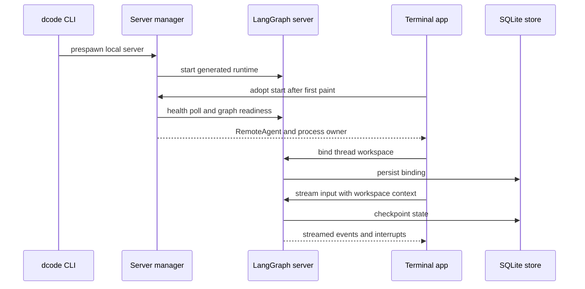
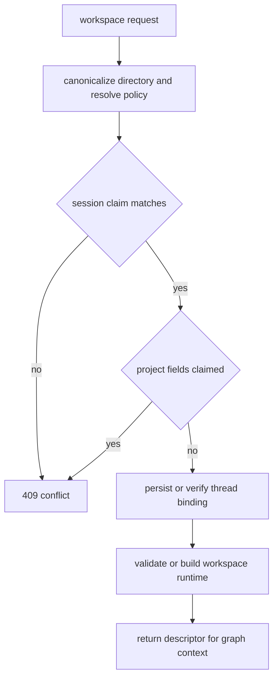
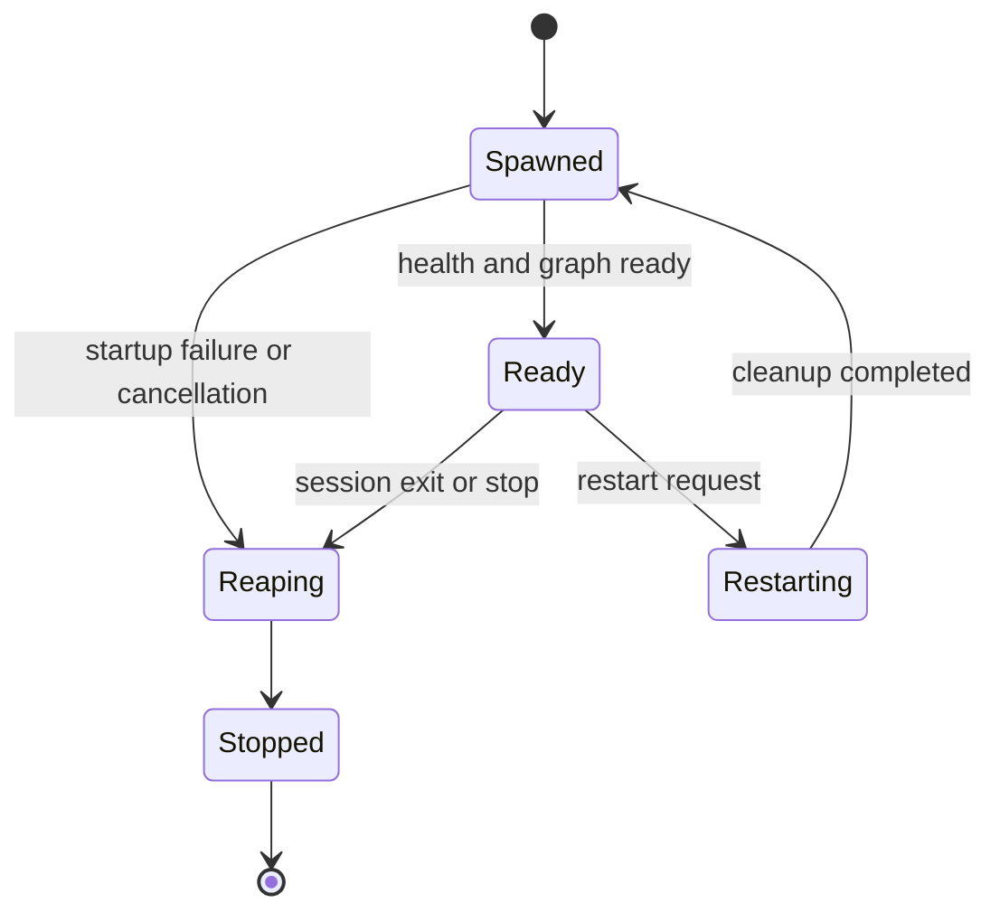

# Deep Agents Code Architecture

`deepagents-code` (`dcode`) is a reference terminal coding agent built on the `deepagents` SDK harness. It packages terminal presentation, tools, skills, approvals, persistence, and optional sandboxed execution around that harness. Its main boundary is intentional: the client presents and requests; the local server constructs and executes the agent.

## Runtime ownership and launch

Normal interactive and headless sessions use separate processes:

- The **terminal client** owns Textual presentation, keyboard input, approval interaction, and the `RemoteAgent` transport wrapper. Headless mode uses the same remote route but renders the stream to a console.
- The **agent server** is a local `langgraph dev` process. It owns the provider model, tools and MCP sessions, skills, backend resources, compiled graph, checkpoints, and server-side operations.

`RemoteAgent` lazily creates a LangGraph `RemoteGraph`, binds or retrieves a server-validated workspace per thread, and includes its returned descriptor in graph stream context. It fails rather than making a workspace-dependent request without configured workspace state. The client therefore does not construct a provider model for a remote session.

*The subprocess may boot while the application imports, but only a health-checked, graph-ready server is handed to the terminal app.*

### Generated server runtime and readiness handoff

`ServerConfig` is the client-to-server contract. The launcher writes serialized `DEEPAGENTS_CODE_SERVER_*` values and the server reconstructs them with `from_env`; relative paths are normalized because the child uses a generated working directory. Security-sensitive validation fails closed: a shell allow-list is absent or nonempty, and an explicit filesystem allowlist is nonempty and contains `read_file`.

The launcher creates a temporary workspace and writes `checkpointer.py`, `pyproject.toml`, and `langgraph.json`. The generated checkpointer obtains the persistent sessions database path from the server environment, installs dcode's compatibility patch, and yields an owned SQLite saver. `langgraph.json` registers the built-in `agent` graph and dcode's custom authenticated HTTP application; offload is an HTTP operation rather than another addressable graph.

`ServerProcess` starts `langgraph dev` on an ephemeral loopback port. It first polls `/ok`, then separately requests the `agent` graph, deliberately forcing lazy graph construction before `RemoteAgent` handoff. Startup failure or cancellation reaps the child from `finally`; an abandoned unsandboxed start has a shortened grace period, while a sandboxed build retains normal graceful shutdown so server-side cleanup can run.

Interactive startup overlaps work without changing ownership. `PrespawnedServer` spawns before the app module finishes loading, pauses before health checking, and is adopted by the app after its paint gate releases it. If no caller adopts it, `aclose` cancels or reaps the start.

`DeepAgentsApp` composes the chat scroll area, startup tip, goal panel, input, and docked status bar. Its mount path is deliberately light, starts import prewarming and the server only after refresh, and schedules nonessential setup after first paint. After prewarming, it constructs a `TextualUIAdapter` that is only a callback bridge—rendering, approvals, status, cache/accounting, skill trust, subagent, and Auto-mode events—while the agent is supplied later for execution. The two-line status bar maintains separate hook and agent messages and stops its shared connection/busy spinner on unmount.

## Execution surfaces

### Interactive Textual client

The interactive client receives streamed graph events through the adapter and keeps the Textual message pump responsive. Server construction, heavy imports, discovery, and other startup work are placed in workers or threads instead of blocking the first frame. Textual owns visual state and user decisions; server-side policy and graph execution remain remote.

The answer renderer has a deliberate live/final seam. During streaming, `AssistantMessage` mounts Textual `Markdown` and feeds a `MarkdownStream`: the first fragment is visible immediately, subsequent fragments are coalesced and throttled to protect input responsiveness. On completion or replacement it swaps the whole reply to one `FinalMarkdown` widget. `FinalMarkdown` reproduces Textual Markdown block layout but holds rows in one widget, caches layouts by width, folds long fence lines, and preserves selectable text; this avoids a long completed transcript retaining a widget for every markdown block, list item, and table cell. Because this mirrors private Textual behavior, upgrades need focused revalidation.

### Headless single-task mode

`cli_main` dispatches `-n` to one headless task; otherwise it launches the Textual app. A headless task creates the agent with `interactive=False`, runs the remote stream through a console loop, and exits with the resulting status. Shell execution is disabled unless a shell allow-list is configured; an explicit allow-list gates shell commands, while `all` allows them. A wall-clock `--timeout` cancels the task and exits 124, as does the headless HITL iteration limit; Ctrl-C exits 130. Teardown drains pending hook tasks and releases any held thread lease.

### ACP stdio mode

ACP is an intentionally different, **in-process** stdio surface. It opens a persistent checkpointer, builds an agent for each ACP session, fences session configuration with thread leases, and releases leases and MCP sessions when the ACP server exits. It resolves the model before serving, assembles builtin and MCP tools, and creates an in-memory store only for Auto mode. An Auto wrapper retains trusted approval state and adds prompt metadata before graph streaming while delegating graph-state operations to the underlying graph. See [ACP integration](/openwiki/integrations/acp.md).

## Workspace binding is authorization

A workspace is durable, server-authoritative thread state, not the client process's current directory. The client may send only a session-policy claim and fingerprint. The server canonicalizes the target directory, rejects claimed project fields, verifies the claim against its own resolved session policy, then persists or verifies the authoritative workspace payload with the thread binding.

*The client transports a claim and descriptor; only server-resolved policy can become a durable binding.*

For graph execution with an execution context, `make_graph` requires a nonempty thread ID and workspace context, validates it against the durable binding, then selects the workspace runtime. Directory switching fails closed: when target-project equivalence is unavailable, resolution drops launch-project MCP configuration, sandbox setup, and extension paths, then rereads target extension trust.

A policy fingerprint captures workspace identity and execution-access policy, so policy drift refuses the thread. A runtime fingerprint captures model, prompt, parameters, and runtime-only settings; it can change without invalidating a compatible binding and causes runtime selection or rebuild instead. Workspace runtimes are lock-protected and cached to prevent duplicate MCP discovery, sandbox creation, and `atexit` registrations; graph and offload share the runtime and composite backend. A configured sandbox is process-wide and reserved to its first workspace.

See [Configuration layering](/openwiki/concepts/config-layering.md).

## Plugin and MCP extension boundary

Plugins are installed and enabled marketplace artifacts, identified as `name@marketplace`. Discovery produces validated plugin instances with a root, per-plugin writable data directory, manifest-derived component paths, and an inventory of supported skills, MCP files, and hook files. Unsupported plugin `agents/` and `commands/` directories are inventoried rather than loaded. Discovery tolerates individual broken entries; an enabled plugin whose install directory is missing is reported separately, and shared consumers claim that repair notice once per process.

Plugin adapters, rather than the plugin manager itself, translate validated content into runtime inputs:

- The MCP adapter loads plugin `.mcp.json` layers before manifest `mcpServers`, so a manifest entry wins an intra-plugin name conflict. It namespaces every resulting server name with the plugin identity, creates the plugin data directory when needed, and emits ordinary MCP configuration layers for the standard merge/load path. ACP explicitly passes those layers into its MCP tool resolver.
- `PluginSkillsMiddleware` wraps the SDK skills middleware without changing the SDK source API. It recursively discovers nested plugin skill directories and qualifies names as `plugin_id:path:skill` before the last-one-wins merge. Reading a selected skill remains constrained to trusted roots and fails rather than reading an unchecked path.

Thus plugins contribute declarative MCP, skills, hooks, and declared Python extensions at existing trust and loading boundaries; they do not receive a privileged parallel tool-execution path. See [Plugins](/openwiki/concepts/plugins.md) and [MCP integration](/openwiki/integrations/mcp.md).

## Persistence and server-lifetime behavior

The generated server uses the persistent sessions SQLite database for LangGraph checkpoints and durable thread metadata/workspace bindings. A restarted dev server can retain checkpoint state while its live HTTP thread record is recreated idempotently. The remote cost tracker keeps main-task and side-question subtotals independently, rejects stale lower main-task totals, and combines them only for presentation.

Two guarded compatibility patches improve server behavior without changing external queue or checkpoint semantics:

- The custom-checkpointer adapter forwards delta-history reads to an inner saver only when it overrides the base method; otherwise the base history walk remains in effect.
- During HTTP lifespan, dcode may patch the in-memory LangGraph run queue so a completed `Runs.put` wakes a waiting `Runs.next`. The stock claim operation, order, and thread locking remain intact; shape checks, idempotence, and a 0.5-second fallback turn an upstream mismatch into a no-op.

Tracing is also process-lifetime server state because LangSmith caches environment and a default client. The first workspace reserves tracing settings and different later settings are refused. The runtime override runs only known untraced `traceable` setup/end bookkeeping inline; other calls retain LangSmith's normal thread hop.

## Cleanup and operational invariants

`server_session` owns headless server lifetime: its `finally` cleans MCP resources and stops the child. `ServerProcess.stop()` is idempotent and concurrency-safe; a generation counter prevents an asynchronous restart from undoing a terminal stop.

*Cancelled startup and ordinary session shutdown converge on reaping; terminal stop cannot be undone by a concurrent restart.*

On POSIX, the child has its own session/process group and a parent-owned pipe. EOF after client death makes the bootstrap guard terminate the server and enforce a hard-kill timeout, even if interpreter teardown stalls. Explicit teardown signals the dedicated group with `SIGTERM`, then group `SIGKILL`, reaching descendants. Windows uses a new console group and Ctrl+Break with terminate fallback, but hard escalation kills only the root process handle; descendants can remain.

## Change guidance and focused tests

- Put provider, tool, tracing, backend, workspace-policy, and extension-trust changes at the server graph/config boundary, not in Textual widgets.
- Treat `workspace_config` as a claim, preserve the policy/runtime fingerprint split, and retain single-workspace sandbox ownership.
- Keep a cancellation-safe owner for every process, session manager, lease, sandbox, prebuild task, or extension; preserve graph-readiness handoff and platform-specific escalation.
- For a Textual upgrade, test the streamed-to-final markdown transition, height parity, selection, theme changes, and code-fence folding. Do not assume `FinalMarkdown` is insulated from Textual internals.
- For headless changes, retain the shell-default denial, exit-code behavior, hook drain, and lease release. For plugin changes, retain plugin IDs/namespacing and route MCP/skill content through their adapters instead of bypassing trust or standard loading.

`test_app.py` exercises app startup, `ServerReady`, restart, and final-answer integration behavior. `test_non_interactive.py` exercises headless approval and launch plumbing. `test_server_manager.py` covers generated runtime wiring, claims, cancellation, and sandbox grace; focused compatibility tests cover the checkpointer adapter, run-queue wakeup, and LangSmith override. Widget tests under `tui/widgets/test_final_markdown.py` and `test_messages.py` cover the renderer seam. For an operator flow, see [Run a dcode session](/openwiki/workflows/run-dcode-session.md) and [Testing guide](/openwiki/testing/testing-guide.md).
