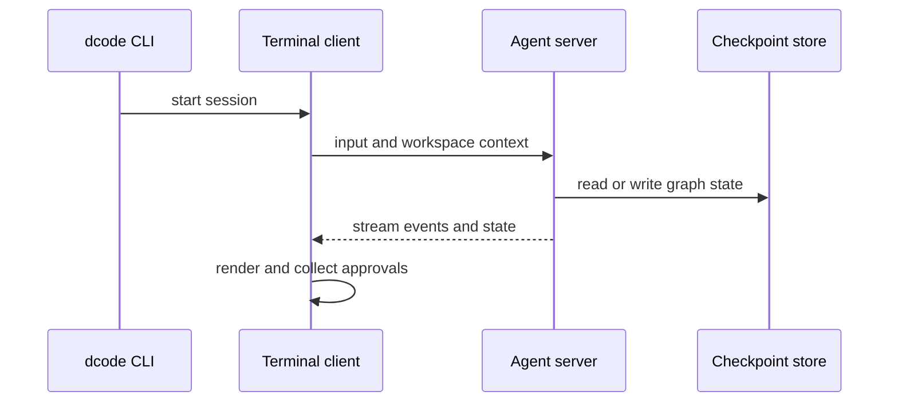
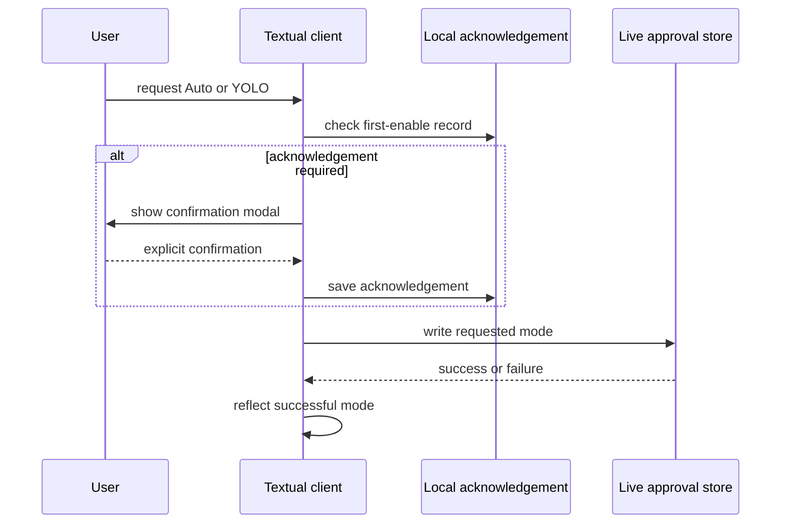
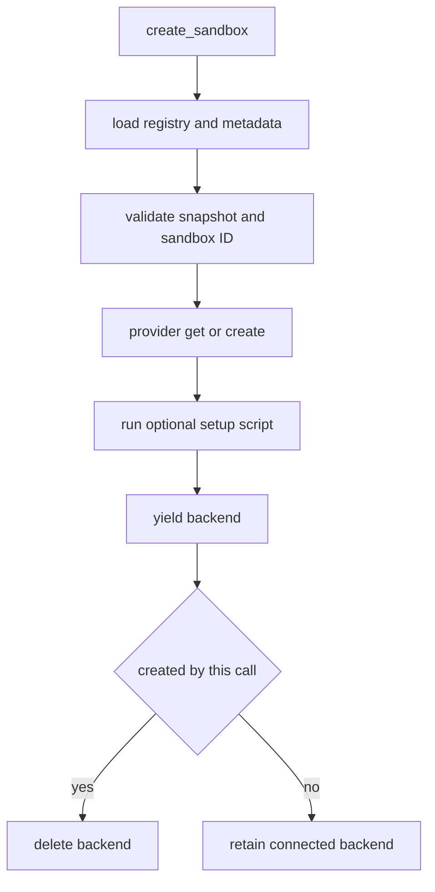

# Deep Agents Code Architecture

`deepagents-code` (`dcode`) is a prebuilt terminal coding agent and reference implementation of the `deepagents` SDK harness. It packages terminal interaction, persistence, tools, skills, approval controls, and optional sandboxed execution around the SDK rather than creating another agent harness.

## Process, configuration, and workspace ownership

The terminal client and agent server are separate processes. The client owns interactive and headless presentation, input, streamed-event rendering, and approval collection. The server owns the coding-agent graph, model, tools, memory, skills, backend, execution state, and graph checkpoints. Keep these responsibilities separate: a rendering or input-policy change belongs in the client; tool, model, graph, checkpoint, and durable-session behavior belongs in the server.

*The client presents and requests; the server executes and persists.*

`ServerConfig` is the typed process-boundary contract. The launcher serializes it as `DEEPAGENTS_CODE_SERVER_*` environment variables and the server reconstructs the same schema, so the two sides do not maintain independent flag serialization. Relative project paths are normalized before that handoff because the server subprocess has a different working directory. `None` serializes as a cleared variable rather than an empty-string setting.

A workspace binding has a deliberately narrower trust boundary than that transport contract. The client may claim only session-scoped invocation policy and its SHA-256 fingerprint. The server resolves the target canonical directory and project policy itself, rejects any client claim of project-scoped fields, then persists the server-authoritative policy with the thread binding. On a directory change, it drops launch-project MCP configuration, sandbox setup, and explicit extension paths rather than applying one checkout's execution policy to another; extension trust is re-evaluated for the target project. Cosmetic model settings can rebuild a runtime without invalidating the durable authorization binding, whereas tool, sandbox, approval, and workspace-identity changes are binding policy.

The server caches runtimes by workspace binding and runtime fingerprint. It validates a thread's workspace context before graph execution, builds or reuses its runtime under a lock, and reserves a configured process-wide sandbox for its first workspace. This makes sandbox containment a server execution resource, not an attribute of client presentation or approval mode.

## Entrypoints and terminal interaction

The distribution exposes both `dcode` and `deepagents-code`, which call the same `cli_main` entrypoint. `--version` is a fast path before heavy imports and can report installed optional dependencies. Apart from diagnostic commands such as `config`, `doctor`, and `auth path`, commands requiring managed policy refuse to run when that policy cannot be enforced.

`DeepAgentsApp` composes the startup tip, goal-status panel, chat input, and docked status bar. After first paint it constructs the Textual adapter with callbacks for rendering, approvals, status, accounting, skills, and Auto-mode events before starting background initialization. The status bar keeps hook and agent messages in separate slots: a nonempty hook message temporarily wins without erasing agent state; it renders hook-configured text as plain `Content`, shares one spinner for connection and busy indication, and stops it on unmount.

Textual is constrained to `textual>=8.2.8,<9.0.0`. Local patches and custom rendering rely on upstream behavior and private wrapping/compositor offset contracts; message pointer hit testing specifically relies on private `offset` style metadata. Startup conditions hidden by the alternate screen—such as unavailable interpreter configuration, sandbox-suppressed interpreter, disabled tracing, or failed Auto restoration—become best-effort post-refresh notices while logs remain the durable diagnostic.

A continuation that needs a modal is detached from the Textual submitted-message pump: awaiting it there would prevent Enter and Esc dispatch. Admission permits one global continuation, reports a conflict, tracks task failure, and resumes queued-message draining when it completes.

### Commands and completion

Slash commands have one declarative registry. Each `SlashCommand` supplies canonical name, description, aliases, autocomplete data, and a queue-bypass tier; derived tier sets include aliases, preventing classifications from being replicated at dispatch sites. `ALWAYS` executes through any busy state; `CONNECTING` bypasses only initial connection; `IMMEDIATE_UI` opens UI and defers actual work; `SIDE_EFFECT_FREE` performs its immediate effect but defers chat output; and `QUEUED` waits while the app is busy. `/install`, `/reload`, and `/update` are still allowed after server-startup failure even though they are normally queue-bound, because they can repair the cause of that parked queue.

The input completion manager separates command, file, and thread-reference triggers. `/` suggestions rank canonical names, aliases, hidden keywords, descriptions, and fuzzy matches; the popup displays a friendly label but inserts the machine name, which preserves namespaced skill commands. `@` is file completion and `@@` is reserved for durable thread references. A selected thread becomes `@@(thread:<id>)`, while its searchable, sanitized row label may use the saved thread name, initial prompt, or short ID. Project-file completion prefers tracked files before untracked nonignored files from `git ls-files`; it falls back to a dotpath-excluding glob only when Git is unavailable or no authoritative listing succeeded.

## Approval is a decision boundary, not sandbox containment

Approval mode is validated live state per thread, keyed by a SHA-256 digest of the thread ID. Unavailable, unreadable, or invalid records fail closed to Manual. The interactive cycle can offer Manual, classifier-backed Auto, and unrestricted YOLO subject to eligibility.

*Local acknowledgement controls first enable; the live per-thread record is the activation commit.*

Auto requires explicit Enter confirmation before its first interactive enable; YOLO requires explicit acknowledgement. Dismissal does not activate or persist either mode, and choosing Manual from the YOLO notice selects Manual. After a successful selection, dcode saves Manual or Auto as a startup preference but never YOLO; a failed preference write warns without rolling back the active session mode.

Approval decides whether a person or Auto flow reviews agent actions. It neither authorizes a provider nor contains tool execution. A remote sandbox instead determines where server-side execution runs; it may affect available tools and Auto eligibility but does not replace a review decision.

## Model failure and streamed output contract

`CodeModelRetryMiddleware` wraps the agent model node rather than an entire turn, so transient model failures can retry without replaying already-completed tool calls. Retry budget is read per request from the constructed model when present, which lets a runtime model switch carry provider-specific limits. The policy recognizes transport and provider failures—including eligible errors inside exception groups and cause chains—uses capped exponential backoff with modest jitter or valid capped `Retry-After`, and limits total interactive sleep to 60 seconds.

Every model attempt emits correlated `model_attempt` start and completion events. The middleware tracks whether a message-stream handler may have received output; a retry event then identifies the superseded attempt and tells the client whether partial output must be marked incomplete before replay. Event parsers validate lifecycle fields and safely ignore malformed newer payloads, protecting client/server version skew. The retry event writer is best effort: its failure is logged but does not replace the model request failure.

## Sandbox provider lifecycle

Sandbox discovery merges curated built-ins, third-party entry points in `deepagents_code.sandbox_providers`, and user configuration from `[sandboxes.providers]`; collision precedence is configuration, then entry point, then built-in. Metadata describes working directory, install hint, backend probe module, and support for existing sandbox IDs and snapshot names. This supports providers without making the TUI responsible for their lifecycle.

Before spawning the server, the client-side launcher can probe a known provider's backend module without importing it and return an actionable `/install` or CLI install hint. At execution time `create_sandbox()` resolves one fresh registry, verifies provider capabilities, merges configured parameters with explicit parameters, and obtains or reconnects to a backend. A snapshot name is accepted only for snapshot-capable providers and never with an existing sandbox ID.

*Only a sandbox created by this context manager is deleted on exit.*

A setup script expands `${VAR}` from the bound workspace environment, runs inside the sandbox, and aborts on nonzero exit. Once an owned sandbox has been acquired, cleanup runs even if setup or the caller's body fails. Cleanup failure is reported but never masks the primary error; an existing `sandbox_id` is never deleted. See [Sandbox partners](/openwiki/integrations/sandbox-partners.md) for provider selection.

## Configuration, cost continuity, and extension surface

The interpreter takes a consistent resolver snapshot for its timeout, memory, call/result limits, PTC policy, and unsafe acknowledgement. Invocation PTC overrides are ignored if a lower-ranked configuration source supplies that policy, preventing a weaker caller override from changing centrally supplied policy. The default interpreter is sandbox-aware: an unspecified setting resolves disabled for a remote sandbox, and enabling it with a sandbox is invalid.

The package pins `deepagents==0.7.28` exactly. SDK-dependent work must update that pin in the same change; package guidance describes CI validation against an outdated release pin. Optional dependency groups expose individual model-provider and sandbox-provider extras, plus `all-providers` and `all-sandboxes` composites.

Prompt-cache timing is reconciled from model-attempt and usage data and presented by the client. After post-paint initialization, once-per-second checks handle expiry and final-window warnings; final warnings are deduplicated by thread and expiry, withheld during reconciliation, and do not let hook-notification failure block UI work. A reconciled expired cache displays an expiry banner regardless of handoff preference, while a window that was already expired on resume is marked seen to avoid an immediate idle interruption.

With `warnings.cache_prompt = "expiry"`, a handoff is offered only when idle. A submitted expired prompt is gated through a detached modal: cancellation or handoff preserves the draft, and inability to admit the modal restores it rather than silently sending. This is continuity and cost UX, not approval or containment. See [Cost and sessions](/openwiki/operations/cost-and-sessions.md).

## Change and test guidance

Add commands through the registry and choose a queue tier deliberately. Treat client completion labels and machine insertion as a compatibility pair. Keep workspace claims minimal and server-authoritative; new `ServerConfig` fields must be classified as model-compatible, runtime-only, identity, or durable policy so a security-relevant setting cannot disappear from fingerprints.

For sandbox work, test metadata capability checks, missing-dependency guidance, ownership-sensitive cleanup, setup failure, and reconnect behavior. `tests/unit_tests/test_sandbox_factory.py` focuses on those lifecycle invariants. `tests/unit_tests/tui/widgets/test_autocomplete.py` covers command ranking, namespaced insertion, `@@` durable tokens and label sanitation, Git ordering/ignore behavior, failure logging, and glob fallback. `tests/unit_tests/test_app.py` covers application approval and detached-continuation behavior. Consult [Run a dcode session](/openwiki/workflows/run-dcode-session.md), [Configuration layering](/openwiki/concepts/config-layering.md), and [Permissions and human-in-the-loop](/openwiki/concepts/permissions-hitl.md) for operational and policy guidance.
