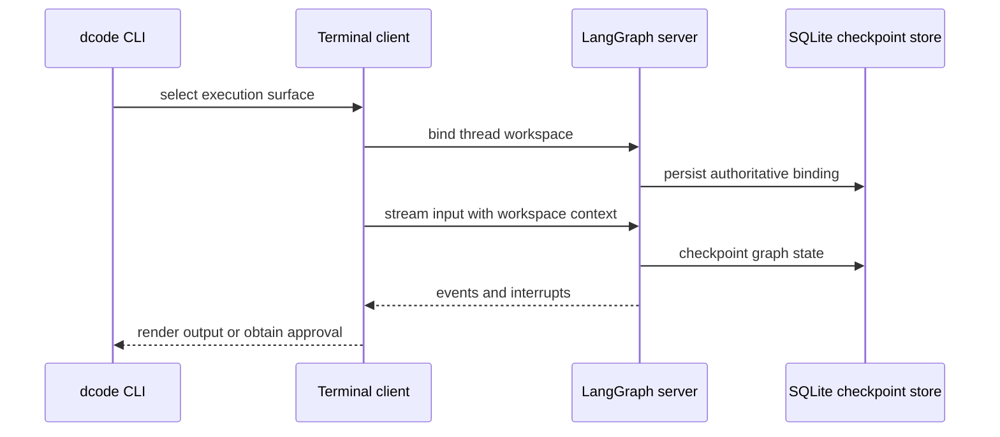
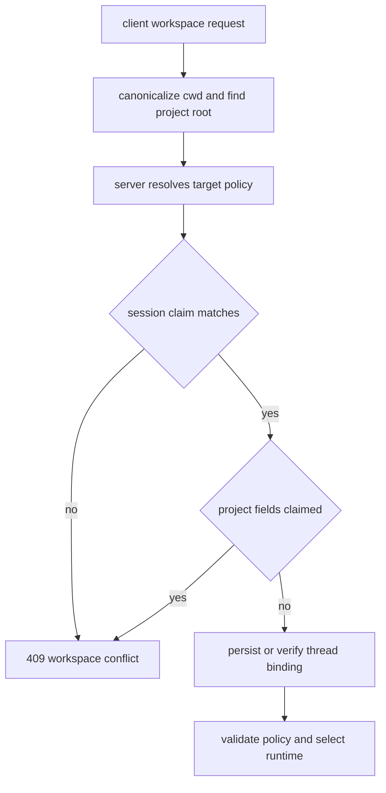

# Deep Agents Code Architecture

`deepagents-code` (`dcode`) is a prebuilt terminal coding agent and reference implementation built on the `deepagents` SDK harness. It packages that harness with terminal presentation, persistence, tools, skills, approval controls, and optional sandboxed execution. Dcode owns the product-facing CLI, process boundary, workspace authorization, and execution surfaces; the SDK is the reusable agent harness.

## Runtime ownership and request flow

Dcode normally runs two processes. The terminal client owns presentation, user input, approvals, and a `RemoteAgent` wrapper around LangGraph `RemoteGraph`. The agent server owns model construction, tools and MCP connections, skills, backend resources, compiled graph, and checkpoint execution. The launcher scaffolds a temporary `langgraph dev` workspace, including a SQLite checkpointer entrypoint, starts the server on an ephemeral local port, waits for graph readiness, then returns the remote client.

*The client transports and presents a run, while the server selects and executes the authorized workspace runtime.*

`ServerConfig` is the typed process-boundary contract. The client serializes it as `DEEPAGENTS_CODE_SERVER_*` environment variables and the subprocess reconstructs it with `from_env`; path values are normalized before serialization because the subprocess uses a separate working directory. Its validation also makes security-sensitive allowlists nonempty and requires an explicit filesystem list to contain `read_file`.

`RemoteAgent` does not create provider models locally. It lazily creates `RemoteGraph`, binds a workspace for a thread before requests that need one, adds the resulting workspace payload to graph stream context, and converts streamed message dictionaries for the UI. The server is consequently the source of model metadata and execution state, while the client caches only validated binding descriptors per thread.

## CLI dispatch and gates

Both `dcode` and `deepagents-code` invoke `cli_main`. `--version` is an early, lightweight exit. For normal commands the CLI parses flags, runs lightweight command handlers where appropriate, and requires a healthy managed configuration before commands that can read or act on managed policy. It then selects one of three execution surfaces:

- **Interactive TUI (default):** launches the Textual application, which starts and manages the local agent-server session.
- **Headless task (`-n`):** calls `run_non_interactive` for one task and exits with a scripting-oriented status.
- **ACP (`--acp`):** runs an Agent Client Protocol server over stdio rather than Textual or the local `langgraph dev` client/server pair.

The different surfaces share the dcode graph assembly boundary, but their lifecycle and trust interfaces differ. In particular, ACP builds the graph in-process for each ACP session and supplies persistent checkpointer-backed sessions; it is not a `RemoteAgent` client mode.

### Interactive TUI

`DeepAgentsApp` composes the startup tip, goal-status panel, chat input, and docked status bar. After first paint it constructs `TextualUIAdapter` with callbacks for rendering, approvals, status, accounting, skills, and Auto-mode events, then begins background initialization. Keeping graph events behind that adapter avoids coupling graph code to Textual widgets.

The two-line status bar keeps hook and agent status independently: a nonempty hook message has temporary display priority without overwriting agent state, hook-configured text is plain `Content`, and connection/busy activity shares a spinner that is stopped during unmount.

### Headless task mode

`dcode -n` still uses a server session and remote stream, but directs output through a console loop and creates the graph with `interactive=False`. It is deliberately a single-task process: its finalization drains asynchronous hook work and releases a held thread lease.

Headless approval is policy rather than an interactive prompt. Without a shell allow-list, shell access is disabled and other tools are auto-approved. A restrictive list enables shell execution but gates commands through middleware; `all` permits unrestricted shell execution. A resumable task remains subject to its thread’s workspace binding, so a workspace conflict fails the task instead of silently creating a different session.

### ACP mode

ACP is an stdio server that loads MCP tools, creates a checkpointer, and builds an agent for each ACP session context. The CLI wrapper acquires a thread lease before session restoration or checkpoint mutation and releases it when the ACP session is forgotten or the server exits; a thread open elsewhere is refused. In Auto mode, dcode’s ACP adapter writes trusted Auto approval state and attaches prompt metadata before delegating to the graph. In YOLO mode, the CLI requires prior acknowledgement, and Auto’s classifier model is rejected unless Auto is the resolved approval mode.

See [ACP integration](/openwiki/integrations/acp.md) and [MCP integration](/openwiki/integrations/mcp.md) for protocol and tool-connection details.

## Workspace binding is the trust boundary

A workspace is durable, server-authoritative state for a thread, not merely the client’s current directory. The workspace route canonicalizes and validates the supplied directory, resolves project root and project policy on the server, and persists the resulting policy payload and fingerprints with the thread. The client may claim only command/session-scoped policy and its fingerprint; project-scoped fields—MCP configuration, sandbox setup, extension paths, and project trust—are rejected from a client request.

*Only server-resolved project policy can become a durable thread binding.*

Changing directory is fail-closed for project execution policy. When the target is not the launch project (or equivalence cannot be established), dcode drops project MCP configuration, sandbox setup, and extension paths, and re-reads extension trust for the target. This prevents one checkout’s trusted code-execution configuration from following a client into another checkout.

Each binding distinguishes two compatibility concepts:

- The **policy fingerprint** covers workspace identity plus trust, tool, sandbox, and approval policy. Drift rejects use of the binding.
- The **runtime fingerprint** also reflects model, prompt, and other runtime-only settings. It changes the selected runtime without invalidating a policy-compatible thread and its checkpoints.

On each execution-context request, `make_graph` requires a nonempty thread ID and workspace context, looks up the thread binding, re-resolves current policy, and selects the matching workspace runtime. Policy or project-policy drift returns a workspace conflict with allowlisted diagnostics; paths, prompts, model parameters, and credentials are excluded. A runtime-only change logs and rebuilds instead. A process-wide sandbox cannot be claimed by a second workspace, because its resources are not safely workspace-isolated.

See [Configuration layering](/openwiki/concepts/config-layering.md) for how settings are resolved and [Profiles and models](/openwiki/concepts/profiles-models.md) for model selection.

## Graph construction and resource lifetime

The server snapshots the workspace environment and credentials, configures tracing inside that environment, resolves the model, loads tools and MCP data, optionally opens a sandbox, loads eligible extensions, and calls `create_cli_agent`. The resulting `ServerRuntime` contains the compiled graph, its composite backend, the server-owned offload operation, and model/MCP metadata.

Runtime caching is an ownership invariant rather than a micro-optimization: MCP discovery, sandbox creation, and `atexit` registration must occur once for a runtime. Workspace runtimes are keyed by workspace identity and current runtime fingerprint, maintained as a bounded LRU cache. The graph endpoint and server-side offload routes therefore use the same backend and offload operation. Runtime-construction failure at server startup records a startup failure and exits; in request scope, the operation route converts that unavailable runtime into a service error rather than terminating the server.

## Cleanup ownership and failure behavior

`server_session` is the headless owner for server startup and cleanup. Its `finally` block cleans a returned MCP session manager, stops the child, and emits any preserved debug-log notice; startup failure also stops a partially started child before ownership escapes. `ServerProcess.stop()` is idempotent and concurrency-safe. On POSIX, the server is detached into its own process group so teardown sends `SIGTERM` to that group before escalation to `SIGKILL`, preventing server descendants from surviving the terminal client.

The interactive application owns its corresponding UI and server teardown. The ACP runner owns MCP cleanup and all ACP session leases. Preserve these boundaries when adding a new execution surface: the creator of a process, session manager, lease, sandbox context, or background task must also have a `finally`/shutdown path that releases it.

## Change guidance and focused tests

- Add agent behavior at `create_cli_agent` and server configuration boundaries, not through Textual-specific code.
- Treat `workspace_config` sent by a client as a claim to verify, never as project authorization. Preserve the policy/runtime fingerprint distinction when adding settings.
- Do not share a process-wide sandbox across different workspace identities.
- Keep headless runs noninteractive and ensure their hooks, leases, server process, and MCP resources are released on every exit path.
- ACP changes need the same thread-ownership discipline as local resumable sessions, even though ACP constructs graphs in-process.

Focused tests in `test_main.py` exercise startup dispatch, ACP/approval validation, process restart behavior, and termination wiring. `test_remote_client.py` covers remote stream/context and workspace-binding behavior; workspace and server-graph tests are the key safety net for client-claim rejection, canonical directory binding, policy drift, runtime-only rebuilds, and sandbox ownership. For operational session use and accounting, see [Run a dcode session](/openwiki/workflows/run-dcode-session.md) and [Cost and sessions](/openwiki/operations/cost-and-sessions.md).
