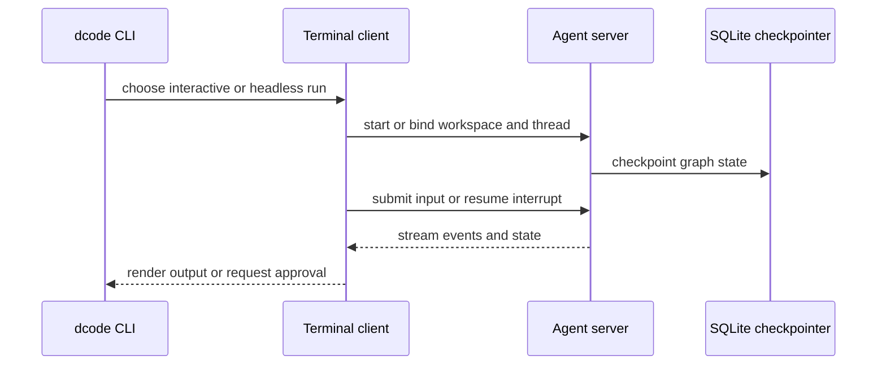
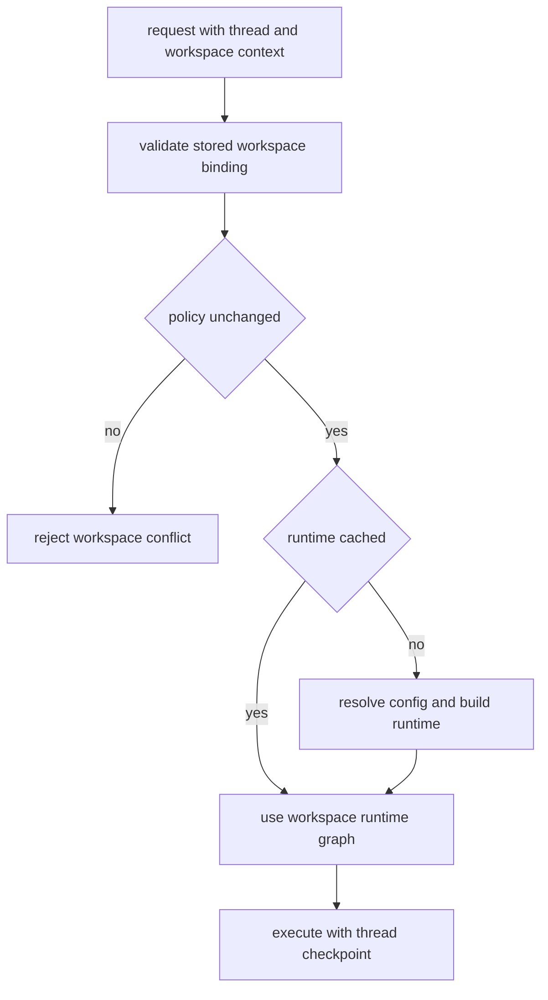

# Deep Agents Code Architecture

`deepagents-code` (`dcode`) is a prebuilt terminal coding agent and reference implementation of the `deepagents` SDK harness. It combines that harness with a terminal experience, persistence, tools, skills, approval controls, and optional sandboxed execution.

## Runtime boundary

Dcode deliberately separates the terminal client from the agent server. The client owns input, interactive rendering or headless console output, and collecting approvals. The server owns the compiled coding-agent graph, model, tools, MCP connections, skills, backend, and graph state. This division makes UI work independent of graph construction and means that a presentation change should not quietly become an execution-policy change.

*Both modes use the server-side agent runtime; they differ at the client presentation and approval boundary.*

### Process launch and configuration handoff

The package publishes both `dcode` and `deepagents-code`, pointing to `cli_main`. The CLI has a lightweight `--version` path before heavyweight imports, then parses arguments, permits a small set of diagnostic commands without a managed-policy gate, and rejects other policy-aware commands when managed configuration is unhealthy.

The launcher creates a temporary `langgraph dev` workspace containing a generated `langgraph.json` and SQLite checkpointer module, starts the server, and returns a `RemoteAgent` to the client. `ServerConfig` is the shared process-boundary schema: the launcher serializes it to `DEEPAGENTS_CODE_SERVER_*` variables and the server reads it back through `from_env`. Because the subprocess has its own working directory, relative paths must be normalized before serialization.

## CLI modes

### Interactive terminal mode

The normal CLI path resolves trust decisions and initial approval mode, generates a new thread ID unless resuming, and runs `run_textual_cli_async`. Auto is downgraded to Manual when a remote sandbox is selected; a YOLO request without acknowledgement is also downgraded to Manual. The Textual application can start before the server is ready: it exposes a connection state and starts server construction in background work after its first paint.

`DeepAgentsApp` composes the chat transcript, startup tip, goal-status panel, chat input, and docked status bar. Mount-time work is intentionally light; after branch detection and a refresh, `_post_paint_init` creates the `TextualUIAdapter`, then starts independent workers for session initialization, skills, server startup, cache checks, history sweeping, and UI prewarming. The adapter is the UI boundary: it receives agent-side streaming callbacks and exposes callbacks for message mounting, status, approval, user questions, skills, subagent events, cache/accounting, and mode fallback rather than allowing graph code to manipulate Textual widgets directly.

The two-line status bar is a small example of that boundary discipline. It keeps hook and agent status messages independently, gives a nonempty hook message display priority without losing the agent message, renders externally configured status text as plain `Content`, and uses one spinner for connection and busy states. Its unmount hook stops both the spinner and cache timer.

### Headless mode

`dcode -n` dispatches one task through `run_non_interactive` and exits. It still starts the same server through `server_session`, obtains the server's model metadata, and runs a streaming agent loop, but uses Rich/stdout rather than Textual. `--quiet` redirects diagnostic console output to stderr so response text remains suitable for piping; response streaming can be disabled to buffer it instead.

Headless operation deliberately has no human-approval conversation. With no shell allow-list, shell access is disabled and other tools are auto-approved. A restrictive allow-list enables shell execution but gates it through middleware; `all` permits any shell command. Project hooks require an explicit headless trust flag: an interactive trust grant is not inherited by CI. A headless resume is fail-closed: it never starts a replacement thread, and the thread must remain compatible with its saved workspace policy.

## Server graph and workspace ownership

The server graph factory reconstructs `ServerConfig`, snapshots the workspace environment and credentials, configures process-wide tracing compatibility, resolves a model, builds built-in and MCP tools, optionally acquires a sandbox, and calls `create_cli_agent`. It returns a `ServerRuntime` containing the compiled agent, its composite backend, the server-owned offload operation, MCP metadata, and model metadata.

The graph factory is cached because runtime construction has ownership effects: MCP discovery, sandbox creation, and `atexit` registration must happen once. A server can maintain bounded workspace-specific runtimes as well. Their cache key includes both workspace identity and runtime fingerprint, so a model/runtime change can rebuild the executable runtime without discarding an otherwise valid durable binding.

*The persisted binding authorizes execution context; a runtime cache is only a reuse mechanism.*

Workspace policy is server-authoritative. The client supplies a session-claimable policy and fingerprint when it binds a remote agent, but the server canonicalizes the target directory, resolves project policy itself, rejects client-supplied project fields, and persists the resulting authoritative payload with the thread binding. On every bound request, the server resolves current policy again and rejects project-policy or access-policy drift. Model and other runtime-only changes are not automatically refusals: their changed runtime fingerprint causes a rebuild. A process-wide sandbox is reserved to the first workspace that claims it, so a conflicting workspace is refused rather than sharing that execution resource.

This is why a thread is more than a chat identifier. Checkpoints preserve graph state, while the workspace binding preserves the directory and execution-policy assumptions under which that state is safe to continue. The remote client also treats HTTP thread registration separately from checkpoint persistence, and makes registration idempotent after a server restart.

## Shutdown and failure behavior

The CLI installs POSIX termination handlers that raise `SystemExit` so normal `finally` cleanup can run. The server-session context manager cleans MCP sessions, stops the child server, and emits any deferred debug-log notices after the terminal is available. Headless mode drains fire-and-forget hooks and releases a held thread lease in its final cleanup path.

`ServerProcess.stop()` is idempotent and concurrency-safe. On POSIX, the launcher gives the server a separate process group and shutdown first sends `SIGTERM` to the group, waits for the whole group, then escalates to `SIGKILL`; it never targets dcode's own process group. Windows requests Ctrl+Break where possible and ultimately terminates the root process, with the documented limitation that a surviving descendant can be orphaned. The app restores terminal resources on exit, and the top-level CLI can then render thread/resume hints for a thread with checkpointed content.

## Safe extension and change guidance

- Add flags at the CLI/config schema boundary, and classify them in workspace policy and runtime fingerprints. A setting that changes trust, tools, sandboxing, or approval must not be accidentally treated as cosmetic.
- Keep server graph construction free of Textual knowledge. Add client rendering or approval behavior through the adapter callback boundary.
- Treat project MCP, hooks, and extensions as trust-sensitive inputs. Headless invocations should require their own explicit authorization.
- Test lifecycle changes at the ownership boundary: startup failure must not orphan a server, cancellation must preserve cleanup, workspace drift must be rejected, and a model-only switch must rebuild rather than invalidate a valid thread.

See [Run a dcode session](/openwiki/workflows/run-dcode-session.md) for operation, [Configuration layering](/openwiki/concepts/config-layering.md) for precedence, [MCP integration](/openwiki/integrations/mcp.md) and [ACP integration](/openwiki/integrations/acp.md) for protocol surfaces, and [Security](/openwiki/operations/security.md) for trust and execution policy.
