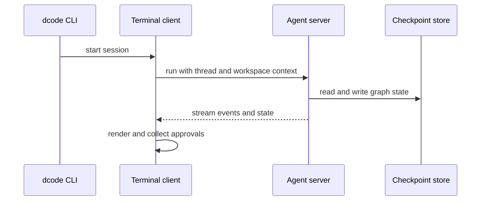
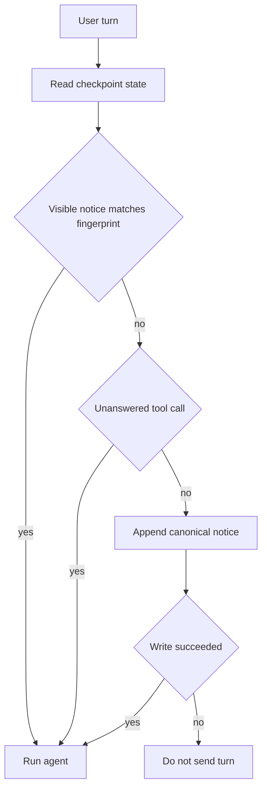
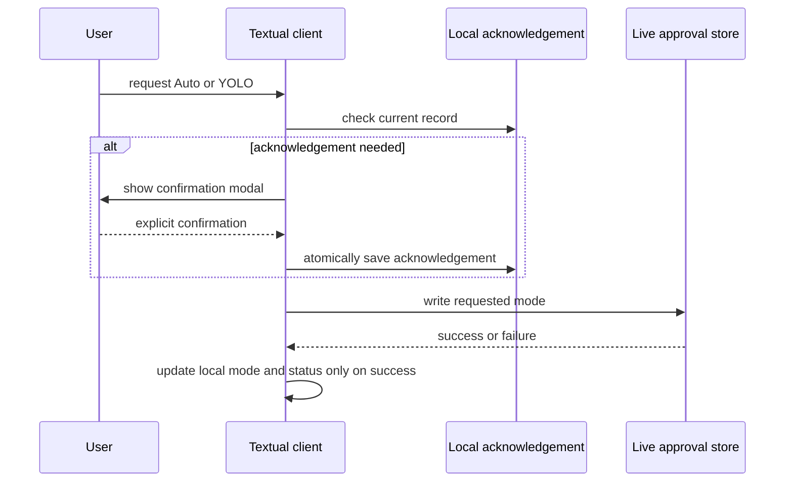

# Deep Agents Code Architecture

`deepagents-code` (`dcode`) 0.1.85 is a prebuilt terminal coding agent and reference implementation of the `deepagents` SDK harness. It packages the terminal experience, persistence, tools, skills, approval controls, and optional sandbox execution. The primary boundary is intentional: the client owns presentation and interaction; the server owns agent execution and durable graph state.

## Runtime ownership

The terminal client and agent server run in separate processes. The client presents interactive or headless I/O, renders streamed output, and obtains human approvals. The server runs the graph and owns the model, tools, memory, skills, backend, and checkpointing. Keep new display state, provisional rendering, and input policy on the client; keep execution and durable state on the server.

*The client presents the session; the server executes it and persists graph state.*

A workspace is also a server-side execution selection. A process-wide sandbox is reserved by the first workspace that claims it, and incompatible LangSmith tracing or redaction settings prevent workspace sharing in one server process. Checkpoints remain server-owned.

## Textual application lifecycle and ownership

`DeepAgentsApp` composes the welcome and message area, then a bottom chrome containing the subagent panel, optional startup tip, goal-status panel, and chat input; its two-line `StatusBar` is docked at the bottom. `on_mount` performs widget lookup and lightweight setup only. It sets the chat focus synchronously, synchronizes status from app state, and schedules first-paint-adjacent work rather than delaying the initial render. The post-paint initializer creates the `TextualUIAdapter`, wiring it to callbacks for message mounting, status, approvals, token/cost/cache updates, skills, and Auto events, then starts server and ancillary work as workers.

The status bar is presentation state, not an execution authority. It displays input mode, the three-state approval mode, workspace and branch, rubric, model and effort, connection/queue status, cache/context/tokens/cost, and a shared status-message slot. Connection and busy indicators share one spinner, stopped on unmount. Hook and agent messages retain separate source-owned values: a nonempty hook message takes display priority, and clearing it restores rather than destroys the agent message. Dynamic hook text is rendered as plain `Content`, not markup.

The model and effort labels are individually styled hit targets that dispatch to app picker actions only when actually rendered. The status bar validates connection states, clamps negative queue counts, falls back invalid approval labels to Manual, hides the CWD on narrow terminals or by environment setting, and treats unavailable widget queries as benign lifecycle races.

### Startup notices and responsive modal work

Startup warnings that would be invisible behind the alternate screen are surfaced as Textual notifications after refresh: interpreter-tool configuration without the interpreter, a remote sandbox suppressing local `js_eval`, disabled orphaned tracing, and an Auto preference that could not be restored. Notices are best-effort UI feedback; their durable diagnostic is logging at the condition site. In particular, a sandbox-caused Auto downgrade takes precedence over a stale first-enable record and explains the resulting Manual status.

The app must not await a modal continuation from the `on_chat_input_submitted` message-pump path: doing so prevents the pump from routing Enter/Esc to the modal. `_schedule_off_message_pump` detaches such continuations, admits only one globally, reports a competing request, tracks the task for cleanup, and drains queued input when it ends. Detached continuations must handle their own failures and cancellation because they no longer run in the command handler's exception scope.

UI safety belongs at the owning rendering layer. For Rich markup, externally controlled strings use `Content.from_markup` substitution; for Markdown sources, they use `_escape_markdown` (or `_markdown_table`), which also collapses line breaks. Dynamic `App.notify()` text uses `markup=False`. The first-enable Auto modal Markdown disables Textual automatic link opening and sends clicks through the checked URL opener; its dynamic model label is Markdown-escaped. These rules protect rendering without making UI state authoritative over the graph.

## Goal and rubric control context

The TUI owns editable goal and rubric selection and writes its channels to the checkpoint. It serializes out-of-run mutations with checkpoint activity and agent quiescence. Paused or complete goals withhold the public rubric while retaining `_sticky_rubric` for restoration.

Goal context is a schema-versioned, fingerprinted `HumanMessage` marked `goal_state`, classified as internal so transcripts, titles, and derived conversation paths hide it. Before a normal model call, the app requires a newest visible valid notice with the desired fingerprint. It defers replacement where effective history has unanswered tool calls; otherwise it persists a canonical replacement. A failed persistence blocks the turn.

*Goal context is reconciled at the model boundary, while tool-message ordering takes precedence.*

Notice rendering escapes and tags objective, criteria, and status content, projects actionability from persisted channels, and suppresses oversized data with do-not-work guidance. Unknown stored status is treated as paused.

## Skills and auxiliary requests

`/skill:<name> [args]` sends only a normalized skill name, optional arguments, and pinned metadata. The client renders a pending row; only a separately returned pinned instruction message fills it. An unreadable, oversized, or instruction-less skill fails rather than executing silently.

Discovery merges built-in, plugin, user, project, agent-alias, and experimental Claude roots in increasing precedence. Loading resolves paths and rejects targets outside pre-resolved allowed roots. External-directory approval stores the canonical directory displayed to the user and re-verifies it against later symlink replacement; malformed trust state is an empty allowlist.

Auxiliary tool-free model preparation deep-copies defaults, removes tool/function/parallel-call/MCP settings including nested provider options, and retains provider HTTP clients. Thread-title generation uses bounded non-hidden human/assistant text, disables callbacks, adds thread metadata, and normalizes output under manual-name safety rules. The app runs this detached work under thread/environment synchronization and side-question accounting, saving an absent automatic name only after the first completed response.

## Approval modes and first-enable notices

Per-thread live approval state is validated and keyed by a SHA-256 digest of the thread ID. Missing, invalid, unavailable, or unreadable records fail closed to Manual. The interactive cycle can offer Manual, classifier-backed Auto, and unrestricted YOLO, subject to eligibility and configuration.

Auto is a gate over normal HITL interrupts. Reviewed calls require an exact one-to-one classifier decision; a per-run classifier model can override the startup choice, and construction/inference time budgets must be positive finite values. Classifier failures, malformed output, unavailable review state, and failed counter writes do not approve calls. Repeated failures or denials fall back to a human; a repeated configured-model construction fault remains latched until successful review. The adapter accepts Auto lifecycle events only from the main agent with exact shape validation, pauses reviewed rows during review, recovers malformed completion, and filters nested `auto_mode_classifier` chunks from the transcript.

First Auto enable requires Enter confirmation; first YOLO enable requires explicit acknowledgement. Escape or programmatic dismissal does not persist or activate either mode, and YOLO's Manual choice selects Manual. The Auto notice discloses whether the reviewer is the code-writing model or a distinct classifier, escapes its model label, and owns link navigation through the shared checked opener. The status bar reflects a new approval mode only after the live-store write succeeds.

*The local acknowledgement gates first enable; the live per-thread store is the activation commit point.*

Auto and YOLO acknowledgement state shares install-local versioned `approval.json`. Updates are serialized across threads and processes, written atomically with private permissions, merge both records, and fail closed when missing, stale, or corrupt. The app persists Manual and Auto as a startup preference after a successful selection, but never persists YOLO as a recent startup mode; inability to save that preference warns while leaving the successful session mode intact.

## Compatibility and operations

Textual is a deliberately constrained UI compatibility boundary: `textual>=8.2.8,<9.0.0`. Local patches and custom rendering rely on upstream behavior and private wrapping/compositor offset contracts; message pointer hit testing uses private `offset` style metadata. Re-verify those assumptions before widening the range.

The package pins the SDK exactly at `deepagents==0.7.26`. SDK-dependent work must update that pin with the feature; CI checks that a release pin is not older than the current SDK unless explicitly bypassed, while an ahead-of-workspace pin is allowed for intentional prerelease coordination.

Remote-offload cancellation sends the operation-specific cancellation request and waits for server acknowledgement of `cancelled` or `finished` before allowing caller cancellation to propagate, bounded to ten seconds. Terminal-title rendering is cosmetic: it accepts documented template fields only, bounds and sanitizes emitted titles, operates around a successfully started TTY stream, and does not fail the session when title rendering or writing fails.

## Safe change and focused tests

When changing dcode, preserve the client/server ownership boundary, persist goal notices before model execution, and treat the TUI, streamed payloads, terminal escape output, and private Textual contracts as compatibility seams rather than graph authority. Do not turn discovery into permission to read a skill, and do not bypass explicit notice acknowledgement or the live approval-store commit.

Focused coverage includes `tests/unit_tests/test_app.py` for Textual first-enable flows, cancellation, persistence failures, and startup-mode behavior; `test_approval_mode.py` for fail-closed approval records and local acknowledgement persistence; server-graph tests for workspace/sandbox constraints; remote-client tests for cancellation; and Auto/Textual-adapter tests for review event and row lifecycle behavior. See the [Testing guide](/openwiki/testing/testing-guide.md), [Permissions and human-in-the-loop](/openwiki/concepts/permissions-hitl.md), [Profiles and models](/openwiki/concepts/profiles-models.md), [Cost and sessions](/openwiki/operations/cost-and-sessions.md), and [Run a dcode session](/openwiki/workflows/run-dcode-session.md).
