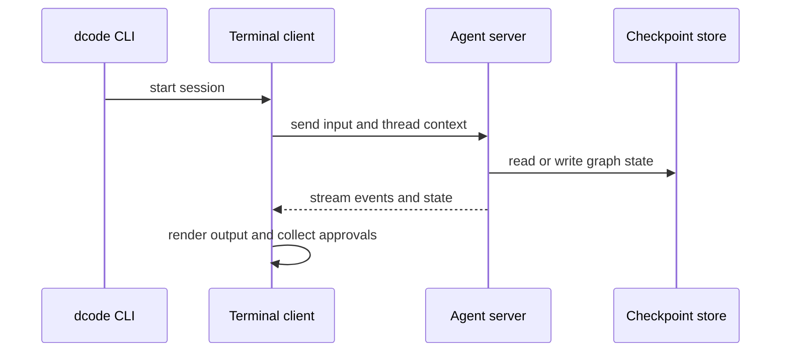
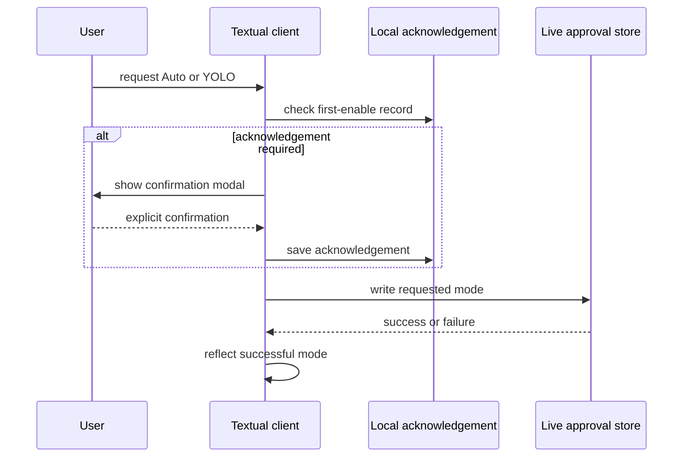

# Deep Agents Code Architecture

`deepagents-code` (`dcode`) is a prebuilt terminal coding agent and reference implementation of the `deepagents` SDK harness. It combines a terminal experience with persistence, tools, skills, approval controls, and optional sandboxed execution. It is a product architecture rather than a second agent harness: retain the SDK/graph boundary when adding product behavior.

## Process and ownership boundary

The terminal client and agent server are distinct processes. The client owns interactive and headless presentation, user input, streamed-event rendering, and collecting approvals. The server runs the coding-agent graph and connects the model, tools, memory, skills, and backend. It also owns graph checkpointing and execution state. Consequently, a rendering or input-policy change belongs in the client, while a tool/model/graph or durable-session change belongs in the server.

*The client presents the session; the server executes and persists it.*

Configuration is deliberately layered across user, project, session, and runtime scopes. Shared readers resolve a process-wide configuration generation; editing a file does not change that generation until an in-app default-config write or `/reload`. The environment tier is the exception: it is read live so dotenv bootstrap and working-directory changes are visible. See [Configuration layering](/openwiki/concepts/config-layering.md) for precedence and reload semantics.

## Entry points, commands, and install surface

The package exposes both `dcode` and `deepagents-code`, which call the same `cli_main` entrypoint. The command path keeps heavyweight agent imports out of argument parsing and trivial operations such as `--version`; version reporting can additionally show installed optional dependencies.

Slash commands have one declarative registry. A `SlashCommand` supplies its canonical name, description, aliases, autocomplete metadata, and a queue-bypass tier; derived sets prevent other code from duplicating command classification. The tiers make responsiveness explicit: `ALWAYS` runs even while busy, `CONNECTING` bypasses only initial connection, `IMMEDIATE_UI` opens a modal while deferring work, `SIDE_EFFECT_FREE` performs its effect but defers chat output, and `QUEUED` waits. `/install`, `/reload`, and `/update` are recovery exceptions when server startup failed, so a missing provider can be repaired rather than leaving the remedy behind a parked queue.

The distribution pins `deepagents==0.7.28` exactly. SDK-dependent work must update this pin in the same change; CI rejects a release pin older than the workspace SDK unless explicitly bypassed, while an ahead-of-workspace pin supports prerelease coordination.

Core providers are Anthropic, Google GenAI, and OpenAI. Optional extras add Baseten, Bedrock, Cohere, DeepSeek, Fireworks, Groq, Hugging Face, IBM, LiteLLM, Meta, Mistral, NVIDIA, Ollama, OpenRouter, Perplexity, Together, Vertex, and xAI; `all-providers` combines them. Separate sandbox extras cover AgentCore, Daytona, Modal, OpenShell, Runloop, and Vercel, with `all-sandboxes` as their composite. These extras make integrations available; they do not change the client/server ownership model or grant execution authority. See [Sandbox partners](/openwiki/integrations/sandbox-partners.md).

## Textual client lifecycle

`DeepAgentsApp.compose()` builds the header, cache-expiry banner, scrollable message area, bottom chrome (subagent panel, optional startup tip, goal-status panel, and chat input), and docked status bar. `on_mount` restricts itself to widget lookup, focus, status synchronization, and lightweight setup; it schedules expensive initialization after the first refresh. `_post_paint_init` creates `TextualUIAdapter`, wiring callbacks for rendering, approvals, active/status state, cache reconciliation, tokens/cost, tools, subagents, Auto-mode events, and skills, then starts session initialization, periodic cache checks, skill discovery, and server startup as background work.

The status bar is client presentation state rather than graph authority. It maintains separate hook and agent message slots so a nonempty hook message temporarily wins without destroying the agent message; hook-configured content is plain `Content`. Connection and busy indicators share a spinner, which is stopped on unmount. Textual is constrained to `textual>=8.2.8,<9.0.0`: local patches and custom diff/message rendering depend on upstream behavior and private wrapping/compositor offset contracts, including pointer hit testing via private `offset` metadata.

Startup conditions that would be hidden by the alternate screen are best-effort notifications after refresh: an ineffective interpreter-tools setting, a remote sandbox that suppresses local `js_eval`, disabled orphaned tracing, and an Auto startup preference that cannot be restored. Logging at the mutation site remains the durable diagnostic.

A continuation that needs a modal cannot be awaited on the Textual submitted-message pump, because the pump must return to route Enter and Esc. `_schedule_off_message_pump` detaches it, permits one global continuation, reports conflicts, records failures, and resumes queued-message draining on completion. Detached work therefore owns its own error and cancellation handling.

## Approval is a decision boundary, not sandbox containment

Approval mode is validated live state per thread, keyed by a SHA-256 digest of the thread ID. Unavailable, unreadable, or invalid records fail closed to Manual. The interactive cycle can offer Manual, classifier-backed Auto, and unrestricted YOLO subject to eligibility.

*Local acknowledgement controls first enable; the live per-thread record is the activation commit.*

Auto requires explicit Enter confirmation before its first interactive enable; YOLO requires explicit acknowledgement. Dismissal does not activate or persist either mode, and selecting Manual from the YOLO notice selects Manual. Following a successful selection, dcode saves Manual or Auto as a startup preference but never YOLO. A preference-write failure warns but does not roll back the already-active session mode. For the authorization and review model, see [Permissions and human-in-the-loop](/openwiki/concepts/permissions-hitl.md).

Approval governs whether the user or Auto flow reviews agent actions. It is not authorization for a provider, an assertion that a tool is safe, or a sandbox/containment boundary. Likewise, a remote sandbox can affect tool placement and may make Auto unavailable, but it is not implemented by the cache or UI warnings described below.

## Model failures and streamed output

`CodeModelRetryMiddleware` wraps the agent model node rather than an entire turn, so transient model connection failures can retry without replaying completed tool calls. Provider-specific retry budget is attached to constructed models, allowing runtime model switches to carry the right limit. Retry policy recognizes transient transport/provider faults, uses capped exponential backoff with modest jitter or a valid capped `Retry-After`, and bounds interactive total sleep to 60 seconds.

For streamed attempts, the middleware tracks whether output may already have reached the message stream. A retry event correlates attempts and tells the client to mark partial output as incomplete before the replay; malformed event counters degrade to a safe generic status/marker rather than trusting event text. Auxiliary synchronous and asynchronous model calls use the same policy and may pass a cumulative delay budget when operating inside another deadline.

## Prompt-cache expiry is cost and continuity UX

Cache timing is reconciled from model-attempt and usage information and displayed by the client. After post-paint initialization, one-second timers independently check expiration and the final retention window. During the final 60 seconds, the app posts one warning per thread and cache window, unless exiting, switching threads, or awaiting cache reconciliation; the same event is offered to hooks without allowing hook failures to block the UI.

When a reconciled cache has expired, the base screen displays an expiry banner independently of the user's warning preference. A lapsed window loaded during thread resume is marked seen to avoid interrupting the user immediately after resume; send-time handling still applies.

With `warnings.cache_prompt = "expiry"`, an expired cache can open a handoff dialog only while the session is idle and no competing modal, queue work, thread switch, run, or user typing is active. For an already submitted interactive prompt, the dialog offers a cache handoff, send in the current thread, or cancel; handoff and cancel preserve or restore the draft, and only an explicit send dispatches it. The handoff is suppressed by session/permanent opt-outs, a disabled threshold, or an estimate below the configured incremental-cost threshold; unavailable estimation may still offer a choice without quoting cost. If the dialog cannot be admitted because another continuation owns the modal slot, the draft is restored rather than sent silently.

This feature communicates likely prompt-cache retention and potential re-warm cost. It does **not** approve model/tool execution, authorize data access, or contain execution in a sandbox.

## Focused change guidance and tests

Keep display state and modal/input policy in the client, execution and checkpoints in the server, and treat stream payloads and private Textual APIs as compatibility seams. Add slash commands through the registry and choose their queue tier deliberately. When changing optional providers, update model configuration, the dependency extra, authentication presentation, and focused provider tests together.

`tests/unit_tests/test_app.py` covers the interactive application, including first-enable approval and detached-continuation paths. `tests/unit_tests/test_cache_expiry.py` exercises final-minute warning deduplication, reconciliation gating, banner lifecycle, idle/send-time handoff behavior, draft preservation, short-terminal modal navigation, and opt-out/threshold cases. Consult [Run a dcode session](/openwiki/workflows/run-dcode-session.md) for operational use and [Architecture overview](/openwiki/architecture/overview.md) for repository context.
