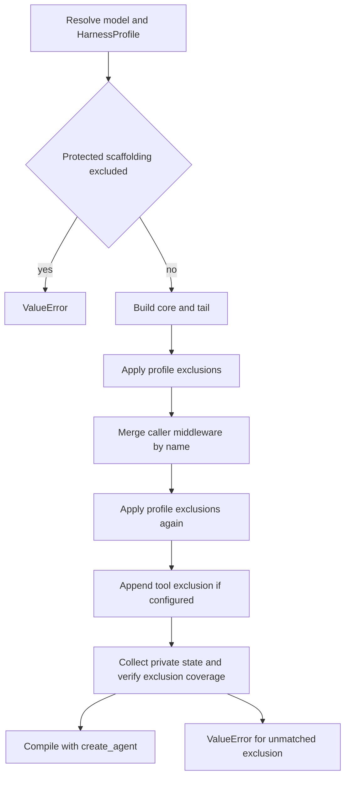
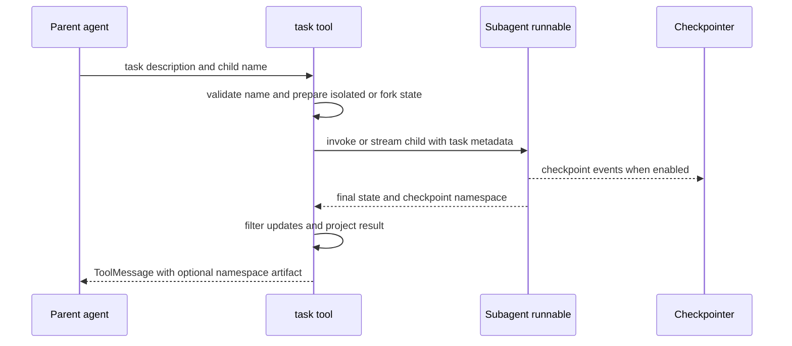

# SDK Middleware Assembly

`create_deep_agent()` is the assembly boundary for a Deep Agents graph. It resolves the model and its `HarnessProfile`, separates inline synchronous children from remote `AsyncSubAgent` specifications, constructs the appropriate middleware stacks, and passes the finalized main stack to LangChain `create_agent()`. The compiled graph is configured with a high recursion limit and Deep Agents/LangChain metadata; caller options such as state and context schemas, checkpointer, store, cache, debug, name, and response format are forwarded to `create_agent()`.

The authored main system prompt is `system_prompt` followed by the profile base prompt and suffix, separated by blank lines. A caller-supplied `SystemMessage` retains its existing content blocks (including cache markers); profile text is appended as a new text block. Middleware is the runtime extension boundary: it can change the request, prompt, messages, tools, and graph state before the model call.

## Main stack: construction and order

The effective main stack has three bands: built-in **core**, caller middleware spliced into or immediately after that core, then the profile-dependent **tail**. Profile exclusions run before and after caller merging, so this is an effective stack rather than merely constructor order.

Diagram: main-stack assembly, including the two exclusion passes that prevent caller middleware from restoring a profile-excluded member.

### Core and tail

The main core is, in order:

1. `FilesystemMiddleware`;
2. `SubAgentMiddleware` only when synchronous inline children exist;
3. `_ParentNotifierMiddleware`;
4. model-aware summarization middleware;
5. `PatchToolCallsMiddleware`; and
6. `AsyncSubAgentMiddleware` only when remote `AsyncSubAgent` specs exist.

The tail is materialized profile extras, optional `SkillsMiddleware`, provider prompt-caching middleware, optional `MemoryMiddleware`, optional `HumanInTheLoopMiddleware`, `UnsupportedContentMiddleware`, and `ModelRefusalMiddleware`. A profile's `_ToolExclusionMiddleware` is appended last, after filtering and caller merging.

`ModelRefusalMiddleware` is deliberately in the tail, after caller middleware. A caller-installed `ModelFallbackMiddleware` can therefore catch a refusal before the default refusal middleware raises `ModelRefusalError`. The default can itself be profile-excluded; without it, a refusal AI message remains in the main result rather than being raised.

Prompt caching precedes memory because memory changes the system prompt. Assembly always adds a lazy Anthropic adapter. It imports and constructs `AnthropicPromptCachingMiddleware` only when a request uses an Anthropic model, otherwise passing the request through unchanged; it exposes the real middleware name and exclusion type so name- and class-based profile policy still work. Bedrock and Fireworks adapters are appended only if their integration packages can be imported. Their middleware classes are cached, but each assembled stack receives a fresh instance; a missing optional package is cached as unavailable, while an unrelated import failure is propagated.

`MemoryMiddleware` loads sources into private state, adds formatted memory to the system message for model calls, and can put an Anthropic-only ephemeral cache-control breakpoint on the final system block. `UnsupportedContentMiddleware` is late because it must evaluate the effective request model after routing or fallback middleware. It copies and filters only outgoing `HumanMessage` and `ToolMessage` content: explicitly unsupported multimodal blocks become explanatory text for that request, while stored thread content remains available to a later compatible model.

### Custom middleware and exclusions

Caller `middleware=` is merged by `.name`, not blindly appended:

- A matching name replaces the assembled member in place; when several caller entries target that name, the last replacement wins.
- A novel name is inserted after the last surviving core member and before profile extras, skills, caching, memory, approval, compatibility, and refusal handling. Novel entries retain caller order.
- Replacing a `FilesystemMiddleware` retains the agent permissions if the replacement has none; a non-empty, different permission set is rejected.

`HarnessProfile.excluded_middleware` is separate and subtractive. It is validated before assembly, applied before the merge, and applied again after it. `FilesystemMiddleware` and `SubAgentMiddleware` are protected scaffolding: profiles cannot exclude them by class or name. Class exclusions use exact type (or a lazy adapter's declared `excluded_as` type); name exclusions require an exact `.name`. A name matching different concrete classes in one stack is rejected as ambiguous.

Every configured exclusion must match. Main-profile matches are accumulated across the main and automatic general-purpose stacks, then verified once; a declarative child independently verifies its own profile. This catches stale profile policy and typos. After the final main stack survives filtering, fields carrying `PrivateStateAttr` in the selected state schemas are supplied to every surviving `SubAgentMiddleware`, including a caller replacement, so ordinary synchronous dispatch withholds them from child state. Annotation-resolution failures only warn, however, and leave that schema's fields unprotected.

## Child stacks and execution boundaries

### Automatic general-purpose child

The automatic `general-purpose` child is added only when its profile enables it and no supplied synchronous child has that name. If it is disabled and there are no other synchronous children, no `SubAgentMiddleware` or `task` tool is present; remote async tools remain independent.

Its own stack is filesystem, summarization, patch-tool calls, profile extras, optional skills, prompt caching, and `ModelRefusalMiddleware`, followed by the same two exclusion passes and final tool exclusion. It inherits only caller middleware whose names match one of its original slots; novel main-agent middleware is not propagated. As a declarative child, compilation adds HITL when its resolved approval configuration is non-empty and adds unsupported-content filtering when absent.

### Declarative, forked, compiled, and remote children

Each declarative `SubAgent` resolves a model and harness profile of its own. Its pre-compilation stack is filesystem, summarization, patch-tool calls, profile extras, optional skills, provider caching, optional forked memory, and `ModelRefusalMiddleware`. It applies exclusions, merges spec middleware, applies exclusions again, verifies coverage, and finally applies tool exclusion. For a fork, parent caller middleware and spec middleware are combined first, with same-name spec middleware winning; this lets the fork rebuild parent prompt changes while avoiding repeated same-name updates.

A declarative child inherits top-level tools, permissions, and `interrupt_on` only when its spec omits the corresponding field. Its own permissions replace—not extend—the parent rules. Resolved filesystem interrupt rules are merged with explicit `interrupt_on`, with explicit same-tool entries winning; `create_sub_agent()` appends `HumanInTheLoopMiddleware` only when the resolved configuration is non-empty. Compiled and remote children own their schemas and approval policy.

An isolated child receives a delegated `HumanMessage` plus parent state after built-in exclusions and the parent middleware's private-state keys have been removed. A fork instead receives the parent's *effective* compacted history and a task preamble. The dispatcher drops an in-flight final AI tool-call message before constructing that history, folds a summarization event into the message list, and places any fork-specific instructions in the task message so the inherited system-prompt prefix remains cacheable.

Fork state is intentionally asymmetric. A declarative fork has a matching graph shape and retains parent channels, including private channels needed to rebuild parent-produced state, except for fork-excluded values such as `structured_response`, pending skills state, rubric, and summarization session/event state; it also receives an internal fork marker. A compiled fork is opaque, so it receives only non-private, non-excluded parent state. The marker makes the mirrored `task` tool refuse recursive delegation at call time. Forks are beta and cannot declare their own skills; they inherit the parent's skills instead.

Remote `AsyncSubAgent` specifications, identified by `graph_id`, are separated before inline construction and use `AsyncSubAgentMiddleware`; they expose background-task operations rather than the synchronous `task` result path.

## Task dispatch: filtering, projection, checkpoints, and tracing

Diagram: synchronous `task` invocation, from child-state preparation through result projection.

`SubAgentMiddleware` requires at least one uniquely named child and accepts only `isolated` or `fork` modes. A raw declarative child must supply model and tools before compilation; a compiled runnable owns its schema. At task time, a dynamic response format can compile a declarative variant, but is rejected for a compiled child because it cannot be recompiled with that schema. A task call with an unknown child type returns an allowed-types message; one without a tool-call ID fails with `ValueError`.

The task result is a `Command` that preserves only safe, changed child state. It excludes messages (which are projected separately), todos, structured output, skill bookkeeping, rubric, fork context, and parent-private keys; unchanged inherited values are also dropped to avoid reducer duplication and parallel-update conflicts. The parent instead receives one `ToolMessage` tied to the original call ID:

- `structured_response` takes priority and is JSON serialized (using `model_dump_json()` for Pydantic values and `dataclasses.asdict()` for dataclasses);
- otherwise a refusal block in the final child message becomes a retry-warning notice; or
- otherwise the dispatcher walks backward to the last non-empty `AIMessage` text, avoiding a trailing empty provider end-turn message.

A synchronous child refusal therefore becomes a tool result rather than failing the parent task loop. The sync and async paths recognize refusal content in the final response and also translate `ModelRefusalError` or a structured-output validation error caused by a refusal; unrelated validation errors still propagate.

For a compiled graph, the dispatcher streams `values` and `checkpoints` and records the first reported `checkpoint_ns` in the returned `ToolMessage.artifact`; callers can use that namespace with the same thread ID to inspect the child history. Nested calls retain the outer namespace prefix. A compiled graph that emits no checkpoint yields no artifact. A non-graph runnable is invoked and uses the surrounding task-call namespace as a fallback artifact. There is a known precision limitation for a child wrapped with `.with_retry()`: it must be invoked rather than streamed, so a retry can finish under a suffixed namespace while the artifact remains the original fallback namespace.

The invocation preserves the ambient parent configuration, callbacks, tags, and metadata through LangGraph config inheritance while binding the child runnable's declared name and adding `lc_subagent_tool_call_id` to checkpoint metadata. A LangSmith tracing context additionally merges `ls_agent_type="subagent"` without replacing existing tracing context fields. This label reaches LangSmith tracing but is intentionally not inserted into streamed callback metadata. `SubAgentMiddleware` also omits hook-input payloads from traces by default through its `TracePolicy`.

## Tools, permissions, and approval

`_ToolExclusionMiddleware` removes named tools from model requests and rejects calls to those names at the tool-call boundary. Since it is last, it also removes tools injected earlier in the request path. It maintains consistency between the advertised and executable tool surface; it is explicitly not a security boundary.

Filesystem permissions are applied by `FilesystemMiddleware` to built-in filesystem tool calls, not direct backend use. Rules are evaluated in declaration order; the first matching rule wins and unmatched calls are allowed. Assembly turns `interrupt` permissions into per-tool HITL configurations, then overlays explicit `interrupt_on` values. Filesystem middleware itself enforces `deny`; HITL is responsible for approval.

## Change and regression focus

Changes to assembly must preserve ordering and test behavior, not merely list contents: same-name replacement versus novel insertion, both exclusion passes, protected and unmatched exclusions, general-purpose override-only inheritance, child-specific profiles, provider caching under installed and missing integrations, and final tool filtering.

For subagent changes, test isolated private-state filtering, fork history compaction and recursion refusal, declarative-versus-compiled fork channels, result projection for structured and ordinary responses, unchanged-value suppression under parallel tasks, and dynamic response-format rejection for compiled children. Checkpoint tests should cover sync and async calls, nested and retried namespaces, no-checkpoint children, and plain runnables. Trace tests should verify both that LangSmith records `ls_agent_type="subagent"` and that callback metadata does not leak it.

See also [runtime behavior](/openwiki/architecture/runtime-behavior.md), [SDK construction and execution](/openwiki/architecture/sdk-construction-execution.md), [context management](/openwiki/concepts/context-management.md), [middleware catalog](/openwiki/concepts/middleware-catalog.md), and [subagents and skills](/openwiki/concepts/subagents-skills.md).
