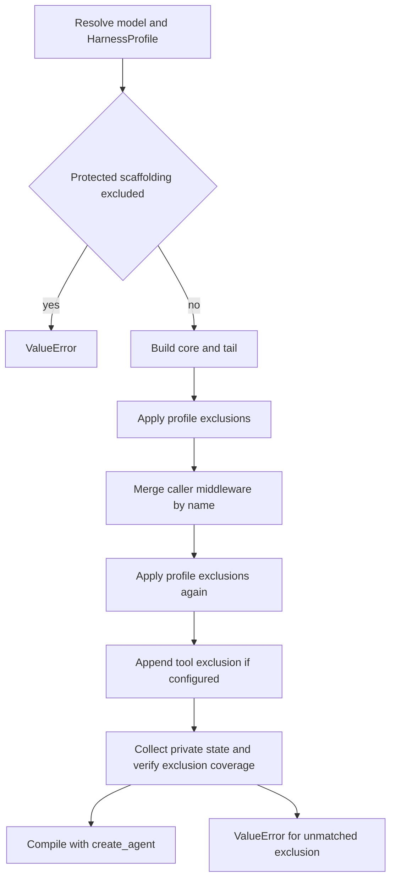

# SDK Middleware Assembly

`create_deep_agent()` resolves the requested model and `HarnessProfile`, separates synchronous inline from remote subagent specifications, assembles their middleware, and gives the finalized main list to LangChain `create_agent()`. Middleware is consequently the request-time extension boundary: it can alter model requests, prompts, messages, tools, and graph state. The `tools=` argument supplies callable tools after a model selects one.

Prompt construction precedes compilation. The main prompt is caller `system_prompt`, followed by the active profile's optional base prompt and suffix, separated by blank lines. The final `create_agent()` call receives that prompt, profile-rewritten caller tools, the effective middleware, and graph options including schemas, checkpointing, store, cache, debug, and name.

## Main stack: construction and order

The effective main stack has three bands: built-in **core**, caller middleware spliced into or immediately after that core, then the profile-dependent **tail**. Profile exclusions run before and after caller merging, so this is an effective stack rather than merely constructor order.

Diagram: main-stack assembly, including the two exclusion passes that prevent caller middleware from restoring a profile-excluded member.

### Core and tail

The main core is, in order:

1. `FilesystemMiddleware`;
2. `SubAgentMiddleware` only when synchronous inline children exist;
3. `_ParentNotifierMiddleware`;
4. model-aware summarization middleware;
5. `PatchToolCallsMiddleware`; and
6. `AsyncSubAgentMiddleware` only when remote `AsyncSubAgent` specs exist.

The tail is materialized profile extras, optional `SkillsMiddleware`, provider prompt-caching middleware, optional `MemoryMiddleware`, optional `HumanInTheLoopMiddleware`, `UnsupportedContentMiddleware`, and `ModelRefusalMiddleware`. A profile's `_ToolExclusionMiddleware` is appended last, after filtering and caller merging.

`ModelRefusalMiddleware` is deliberately in the tail, after caller middleware. A caller-installed `ModelFallbackMiddleware` can therefore catch a refusal before the default refusal middleware raises `ModelRefusalError`. The default can itself be profile-excluded; without it, a refusal AI message remains in the main result rather than being raised.

Prompt caching precedes memory because memory changes the system prompt. Assembly always adds a lazy Anthropic cache adapter, importing its delegate only for an Anthropic request; Bedrock and Fireworks adapters are added only when their integration packages are available. `MemoryMiddleware` loads sources into private state, adds formatted memory to the system message for model calls, and can put an Anthropic-only ephemeral cache-control breakpoint on the final system block.

`UnsupportedContentMiddleware` is late because it must evaluate the effective request model after routing or fallback middleware. It copies and filters only outgoing `HumanMessage` and `ToolMessage` content: explicitly unsupported multimodal blocks become explanatory text for that request, while stored thread content remains available to a later compatible model.

### Custom middleware and exclusions

Caller `middleware=` is merged by `.name`, not blindly appended:

- A matching name replaces the assembled member in place; when several caller entries target that name, the last replacement wins.
- A novel name is inserted after the last surviving core member and before profile extras, skills, caching, memory, approval, compatibility, and refusal handling. Novel entries retain caller order.
- Replacing a `FilesystemMiddleware` retains the agent permissions if the replacement has none; a non-empty, different permission set is rejected.

`HarnessProfile.excluded_middleware` is separate and subtractive. It is validated before assembly, applied before the merge, and applied again after it. `FilesystemMiddleware` and `SubAgentMiddleware` are protected scaffolding: profiles cannot exclude them by class or name. Class exclusions use exact type (or a lazy adapter's declared `excluded_as` type); name exclusions require an exact `.name`. A name matching different concrete classes in one stack is rejected as ambiguous.

Every configured exclusion must match. Main-profile matches are accumulated across the main and automatic general-purpose stacks, then verified once; a declarative child independently verifies its own profile. This catches stale profile policy and typos. After the final main stack survives filtering, private fields declared by surviving middleware state schemas are supplied to `SubAgentMiddleware`, so synchronous task dispatch withholds them from child state.

## Child stacks and execution boundaries

### Automatic general-purpose child

The automatic `general-purpose` child is added only when its profile enables it and no supplied synchronous child has that name. If it is disabled and there are no other synchronous children, no `SubAgentMiddleware` or `task` tool is present; remote async tools remain independent.

Its own stack is filesystem, summarization, patch-tool calls, profile extras, optional skills, prompt caching, and `ModelRefusalMiddleware`, followed by the same two exclusion passes and final tool exclusion. It inherits only caller middleware whose names match one of its original slots; novel main-agent middleware is not propagated. As a declarative child, compilation adds HITL when its resolved approval configuration is non-empty and adds unsupported-content filtering when absent.

### Declarative, forked, compiled, and remote children

Each declarative `SubAgent` resolves a model and harness profile of its own. Its pre-compilation stack is filesystem, summarization, patch-tool calls, profile extras, optional skills, provider caching, optional forked memory, and `ModelRefusalMiddleware`. It applies exclusions, merges spec middleware, applies exclusions again, verifies coverage, and finally applies tool exclusion. For a fork, parent caller middleware and spec middleware are combined first, with same-name spec middleware winning; this lets the fork rebuild parent prompt changes while avoiding repeated same-name updates.

A declarative child inherits top-level tools, permissions, and `interrupt_on` only when its spec omits the corresponding field. Its own permissions replace—not extend—the parent rules. Resolved filesystem interrupt rules are merged with explicit `interrupt_on`, with explicit same-tool entries winning; `create_sub_agent()` appends `HumanInTheLoopMiddleware` only when the resolved configuration is non-empty. Compiled and remote children own their schemas and approval policy.

The default synchronous child mode is isolated: it receives a delegated `HumanMessage` plus eligible non-private state. Unchanged returned values are discarded, preventing reducer duplication and parallel-update conflicts. A fork receives the parent's effective compacted history and a task preamble. Declarative forks retain non-excluded parent state, including private channels needed by the matching graph shape; compiled forks strip private channels because their runnable schemas are opaque. A fork that invokes `task` recursively is refused.

A synchronous `task` invocation converts a child refusal into a tool result rather than failing the parent task loop. It recognizes a refusal in the child's final AI message or catches `ModelRefusalError` and structured-output validation errors that represent one, and returns a notice with available category or explanation and a retry warning. This applies to sync and async task calls. Remote `AsyncSubAgent` specifications, identified by `graph_id`, are separated before inline construction and use `AsyncSubAgentMiddleware`; they launch background work and return a task ID rather than blocking.

`SubAgentMiddleware` requires at least one uniquely named child and accepts only `isolated` or `fork` modes. A raw declarative child must supply model and tools before compilation; a compiled runnable owns its schema. At task time, a dynamic response format can compile a declarative variant, but is rejected for a compiled child because it cannot be recompiled with that schema. Forks are beta and cannot declare their own skills; they inherit the parent's skills instead.

## Tools, permissions, and approval

`_ToolExclusionMiddleware` removes named tools from model requests and rejects calls to those names at the tool-call boundary. Since it is last, it also removes tools injected earlier in the request path. It maintains consistency between the advertised and executable tool surface; it is explicitly not a security boundary.

Filesystem permissions are applied by `FilesystemMiddleware` to built-in filesystem tool calls, not direct backend use. Rules are evaluated in declaration order; the first matching rule wins and unmatched calls are allowed. Assembly turns `interrupt` permissions into per-tool HITL configurations, then overlays explicit `interrupt_on` values. Filesystem middleware itself enforces `deny`; HITL is responsible for approval. Generated predicates conservatively gate bulk operations, including intersecting subtrees, pathless searches, dot-root aliases, escaping glob patterns, and resolved symlink targets where available.

## Change and regression focus

Safe changes must preserve ordering and test the observable boundary, not just list contents: same-name replacement versus novel insertion, both exclusion passes, protected and unmatched exclusion failures, general-purpose override-only inheritance, child-specific profiles, fork state behavior, final tool filtering, and approval predicates.

In particular, refusal tests cover main-agent default raising, caller fallback before the default refusal layer, profile exclusion of that layer, declarative and compiled child refusals becoming task results in synchronous and asynchronous execution, structured-output refusal handling, and remote-result formatting. `test_subagent_middleware_init.py` covers task-tool initialization, invalid modes, duplicate names, fork prompt and tool-order parity, state inheritance differences, and the declarative-only dynamic response format. Provider-payload tests pin skill disclosure placement after a relevant read result without splitting tool-result batches or preceding queued user input, including relocation after compaction. Permission tests cover recursive-delete denial plus generated approval behavior for bulk and path-sensitive operations.

See also [SDK construction and execution](/openwiki/architecture/sdk-construction-execution.md), [middleware catalog](/openwiki/concepts/middleware-catalog.md), [permissions and HITL](/openwiki/concepts/permissions-hitl.md), [profiles and models](/openwiki/concepts/profiles-models.md), and [subagents and skills](/openwiki/concepts/subagents-skills.md).
