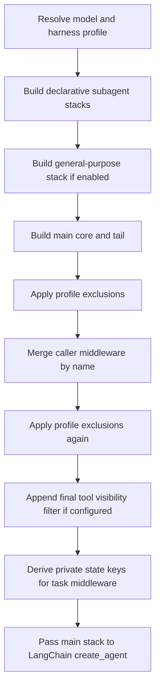

# Middleware Assembly Stack

`create_deep_agent()` is an assembler, not a separate runtime: it resolves a model and `HarnessProfile`, builds applicable subagent stacks and the main stack, and passes the main stack to LangChain `create_agent()`, which owns the model/tool loop. See [SDK construction and execution](/openwiki/architecture/sdk-construction-execution.md) and [middleware catalog](/openwiki/concepts/middleware-catalog.md).

Middleware is the request-time extension boundary. A `wrap_model_call()` hook intercepts every model request and can transform messages or prompt context, dynamically filter tools, and maintain typed cross-turn state. A callable supplied in `tools=` instead runs only after the model chooses that tool; it cannot revise that request's prompt or tool list. Caller tools are additive and do not remove built-ins.

## Main-agent assembly

The following is **list order**, with conditional members omitted. LangChain determines wrapper nesting; validate model-request and tool-call behavior, not only constructor order, when moving a member.

Diagram: construction order. Declarative specs are processed before the automatic general-purpose subagent; the latter is built before the main stack so a main-profile exclusion may match in either stack, not because its middleware is inserted into the main stack.

### Core, insertion point, and tail

The main **core** is, in order:

1. `FilesystemMiddleware`;
2. `SubAgentMiddleware` when inline declarative or compiled subagents exist (the automatic `general-purpose` subagent normally ensures this);
3. Deep Agents summarization middleware;
4. `PatchToolCallsMiddleware`; and
5. `AsyncSubAgentMiddleware` when remote async specs exist.

Fresh caller middleware with a new name is inserted immediately after this core. The **tail** then contains, in order:

1. freshly materialized `HarnessProfile.extra_middleware`;
2. `SkillsMiddleware` when skills are resolved;
3. Anthropic prompt caching, then Bedrock and Fireworks prompt caching when their optional integrations are importable;
4. `MemoryMiddleware` when `memory` is supplied;
5. `HumanInTheLoopMiddleware` when the resolved interrupt mapping is non-empty; and
6. `UnsupportedContentMiddleware`.

Anthropic caching is always appended and ignores unsupported models. Bedrock and Fireworks middleware do the same when their provider package is available; a missing integration omits only that provider middleware, while an unrelated import failure propagates. Caching precedes memory because memory changes the system prompt and should not invalidate the Anthropic cache prefix.

Skills is after profile extras and caller additions but before caching. Its disclosure therefore sees compacted history and the effective routed model; ordinary caller middleware cannot edit its newly generated prompt section. A caller member named `SkillsMiddleware` nevertheless replaces the default in its tail slot.

### Summarization and request payloads

The built-in summarization member can truncate large older tool arguments and compact history at its threshold or after a recognized `ContextOverflowError`. It offloads evicted history to the backend, records the summary event and session ID in private state, and warns if offload fails because older messages cannot then be recovered. Later prompt-producing middleware consequently sees the compacted effective conversation.

Skill disclosure is an observable reason to preserve this order. Provider-payload tests verify that deferred skill tools are disclosed immediately after the relevant read result, never split a parallel tool-result batch or jump ahead of a queued user turn, and retain a stable cached request prefix. A compaction that removes the first relevant read moves the disclosure anchor to the next retained read.

### Replacement and exclusion passes

After constructing the tail, main assembly performs **first profile-exclusion pass → caller merge → second profile-exclusion pass → final tool-exclusion append**. It then gathers explicit and middleware-contributed state schemas and assigns their derived private fields to surviving `SubAgentMiddleware` instances for task dispatch.

Merge is name-based:

- A caller entry whose `.name` remains in the base stack replaces that member in place.
- A novel name is inserted after the surviving core, before profile extras, skills, caching, memory, approval, and compatibility filtering.
- Novel entries retain caller order, and the last caller entry for a replaceable name wins.

The second filter prevents a caller from reintroducing a profile-excluded class or name. If a default was already filtered, a same-named caller member is novel rather than an in-place replacement and is removed by that second pass.

## Profile exclusions and required scaffolding

`HarnessProfile.excluded_middleware` subtracts members; it never reorders them. Validation rejects `FilesystemMiddleware` and `SubAgentMiddleware`, because the former supplies built-in file tools and permission enforcement and the latter supplies the synchronous `task` handler. Assembly raises `ValueError` rather than silently compiling a degraded agent.

Class exclusions use exact `type`, not `isinstance`, so a caller subclass survives exclusion of its base class. String exclusions match `AgentMiddleware.name` exactly, allowing public aliases such as `SummarizationMiddleware` to select an implementation whose Python class name differs. A string that matches more than one concrete class in one stack is ambiguous and raises `ValueError`; use a class-form exclusion instead.

Coverage is mandatory. Main-profile matches accumulate across the general-purpose and main stacks and are verified only after both are filtered, so an entry need occur in either stack. A declarative subagent resolves, filters twice, and verifies its own profile independently. Unknown or stale entries fail rather than silently doing nothing.

## General-purpose and declarative subagent stacks

At assembly, a spec with `graph_id` becomes an `AsyncSubAgent` served by `AsyncSubAgentMiddleware`; one with `runnable` is a supplied `CompiledSubAgent`; all others are declarative `SubAgent` definitions. Declarative and compiled forms are exposed by the parent `SubAgentMiddleware` through `task`; async specs instead expose remote-task controls.

### Automatic general-purpose stack

Unless disabled by the active profile or replaced by an inline spec named `general-purpose`, the assembler creates an automatic declarative child. Its pre-compilation stack is:

1. `FilesystemMiddleware`, summarization, and `PatchToolCallsMiddleware`;
2. separately materialized profile extras;
3. optional skills;
4. prompt-caching middleware;
5. first exclusion pass;
6. only caller middleware whose names were original general-purpose slots;
7. second exclusion pass; and
8. `_ToolExclusionMiddleware` last when the profile excludes tools.

It does not inherit arbitrary main-only additions: an override for a default general-purpose slot propagates, but a novel main middleware does not. Profile extras are materialized separately per stack. `create_sub_agent()` later appends resolved HITL and `UnsupportedContentMiddleware`.

### Declarative stack and fork variation

Each declarative spec resolves its own model and profile. Its base is `FilesystemMiddleware`, summarization, and `PatchToolCallsMiddleware`, followed by that profile's extras, its skills (or parent skills for a fork), and prompt caching. A fork with configured parent memory adds `MemoryMiddleware` after caching. It then performs first filter, name-based merge, second filter, coverage check, and final tool filter. For a fork, parent `middleware=` entries are combined with spec entries, with spec names winning, before this tail behavior is rebuilt.

A declarative child inherits top-level tools, permissions, and `interrupt_on` only where its spec omits the corresponding field; its own permissions replace parent rules rather than extend them. Its resolved interrupt mapping is compiled into HITL when non-empty. Declarative graphs receive the parent `state_schema`; supplied compiled runnables retain their own schema and policy.

`isolated` is the default, and legacy `handoff` is an alias for it. The child receives a delegated-task `HumanMessage` plus eligible public parent state. Experimental `fork` instead continues the parent's effective compacted history with a task preamble; it cannot define independent skills. Declarative forks retain non-excluded parent state, including eligible private channels, while compiled forks strip private fields because their runnable schema is opaque. A forked child cannot recursively invoke `task`.

### Task boundary and results

The synchronous boundary rejects duplicate subagent names and unsupported modes. Isolated dispatch removes middleware-private and agent-local fields, replaces history with the delegated task, and drops unchanged child values on return to avoid state conflicts and duplicate reducer updates. It returns a `ToolMessage` while eligible non-private state updates may accompany it.

A compiled result must contain `messages`; the parent serializes a structured response as JSON or otherwise uses the last non-empty AI text, then merges eligible non-private updates. Remote async subagents run as Agent Protocol background tasks, return a task ID, and retain task state in `AsyncSubAgentMiddleware`; the remote graph owns its schema and policy.

## Tool visibility, filesystem policy, and approval

`_ToolExclusionMiddleware` is appended last. It removes excluded names from model requests and rejects calls using those names at the tool-call boundary, so tool-injecting middleware and caller `wrap_model_call()` code cannot restore a hidden name. This keeps advertised and executable surfaces consistent but is explicitly not a security boundary.

Filesystem permissions are enforced at built-in filesystem tool calls by `FilesystemMiddleware`, rather than by the backend; direct backend access does not receive this policy. Rule order is first-match-wins and an unmatched call is allowed. `deny` produces a permission-denied tool result; `interrupt` is not a denial. Graph assembly converts interrupt-mode rules into `HumanInTheLoopMiddleware` configurations and merges them with explicit `interrupt_on`, with explicit entries winning on the same tool name.

The generated filesystem HITL configuration has a path-sensitive `when` predicate. Exact operations interrupt only when the requested path matches an interrupt rule (and no candidate path resolves to `deny`); bulk operations interrupt when their search subtree could intersect an interrupt rule. A pathless bulk call is conservatively interruptible, `.` is treated as the root rather than a bypass, and `glob` also checks an absolute or parent-traversing pattern that could escape its `path`. When a backend can resolve symlinks, both the named path and target are tested. Generated approval offers approve, edit, reject, and respond; an edited call still returns through filesystem permission enforcement.

`UnsupportedContentMiddleware` is compatibility filtering rather than tool or authorization policy. It runs late against the effective request model and replaces explicitly unsupported blocks only in outgoing `HumanMessage` and `ToolMessage` copies, retaining the original thread content for a later compatible model. See [permissions and human-in-the-loop](/openwiki/concepts/permissions-hitl.md).

## Focused regression surface

Graph assembly tests pin same-name replacement versus novel insertion, the skills slot before Anthropic caching, general-purpose override-only inheritance, declarative isolation, fork ordering, protected/ambiguous/unmatched exclusion failures, and final tool filtering. Provider payload tests pin skill-disclosure placement and cached-prefix stability. Permission tests cover first-match rules, denied recursive deletion, exact and bulk interrupt predicates, pathless and `.` bulk calls, absolute `glob` escapes, and symlink resolution. Preserve these tests when changing this stack: an apparently local move can alter cache behavior, model-visible tools, state handoff, or which profile policy wins.

For user-facing patterns, see [subagents and skills](/openwiki/concepts/subagents-skills.md) and [build a Deep Agent](/openwiki/workflows/build-a-deep-agent.md).
