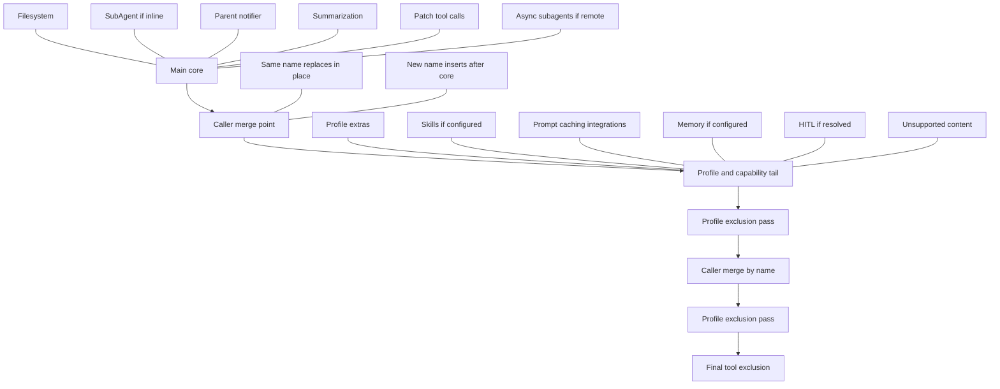
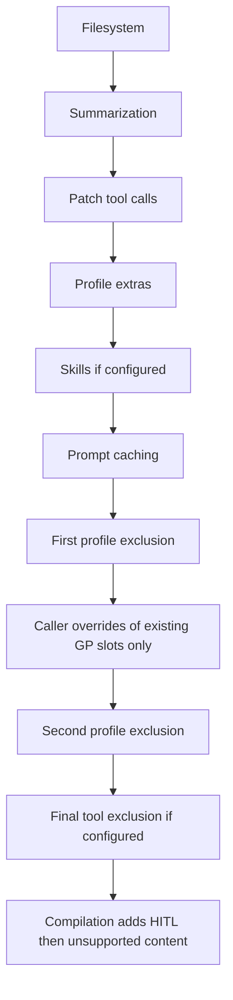

# Middleware Stack and Extension Boundaries

`create_deep_agent()` resolves the model and its `HarnessProfile`, assembles middleware and subagent specifications, then gives the main list to LangChain `create_agent()`. Middleware is therefore the request-time extension surface: it can intercept each model request, change request messages or tools, inject prompt context, and own typed state. A callable in `tools=` runs only after the model selects it; it is additive to built-ins and cannot alter that model request.

## Main-agent ordering

The diagram shows **final list order**, omitting conditional entries. It deliberately distinguishes two mechanisms that are easy to conflate: caller middleware replaces a same-named slot or is inserted after the core; profile exclusions instead remove matching entries before and after that merge. LangChain owns the resulting wrapper nesting, so changes should be tested at model-request and tool-call boundaries, not only by inspecting this list.

Diagram: final main-agent list order and the separate replacement and exclusion phases.

The main **core**, in list order, is:

1. `FilesystemMiddleware`;
2. `SubAgentMiddleware` when synchronous inline subagents exist (including the usual automatic general-purpose agent);
3. `_ParentNotifierMiddleware`;
4. Deep Agents summarization middleware;
5. `PatchToolCallsMiddleware`; and
6. `AsyncSubAgentMiddleware` when remote async specs exist.

The core is followed by the caller insertion point and then the tail: freshly materialized `HarnessProfile.extra_middleware`, `SkillsMiddleware` when configured, Anthropic/optional Bedrock/optional Fireworks prompt caching, `MemoryMiddleware` when configured, `HumanInTheLoopMiddleware` for a non-empty resolved interrupt mapping, and `UnsupportedContentMiddleware`. Caching comes before memory because memory changes the system prompt. `UnsupportedContentMiddleware` is late so it evaluates the effective request model after routing or fallback middleware.

Prompt-caching middleware is appended by the provider helper: Anthropic is unconditional and no-ops for other models; Bedrock and Fireworks are added when their optional integrations are importable. Skills is in the tail, after profile extras and caller additions but before caching. Consequently, its model-request disclosure sees the effective routed model and compacted conversation; ordinary caller middleware cannot edit the newly generated skills prompt section. A caller member named `SkillsMiddleware` can still replace that slot.

### Caller replacement is not profile exclusion

Main assembly builds its default core and tail, applies exclusions, merges `middleware=`, applies exclusions again, and only then appends `_ToolExclusionMiddleware` when the profile excludes tools. It also derives middleware-private state keys from surviving schemas and gives them to a surviving `SubAgentMiddleware` for safe task dispatch.

Caller merge is name-based:

- If a caller entry's `.name` is present in the assembled list, it replaces that member **in place**; the last caller entry for that name wins.
- A new name is inserted after the last surviving core member, before the profile/skills/cache/memory/HITL/compatibility tail. New entries retain caller order.
- A caller entry never "undoes" a profile policy: a second exclusion pass removes an excluded replacement or a same-named entry that became novel because its default was already removed.

A `HarnessProfile.excluded_middleware` is subtractive only; it does not define an insertion point or ordering policy. Required `FilesystemMiddleware` and `SubAgentMiddleware` cannot be excluded, because they provide the built-in file tools and permission enforcement, and the synchronous `task` handler respectively. Configuration is validated before assembly and invalid exclusions raise `ValueError` rather than yielding a silently degraded graph.

Class exclusions use exact `type`, not `isinstance`; a caller subclass therefore survives exclusion of its base class. String exclusions match `AgentMiddleware.name` exactly. A string matching distinct concrete classes in one stack is ambiguous and fails; unmatched exclusions also fail coverage validation. For the main profile, matches are accumulated across the main and automatic general-purpose stacks, so an exclusion need exist in either one. A declarative subagent validates and checks coverage against its own profile independently.

## General-purpose and declarative stacks

The automatic `general-purpose` subagent is created unless the active profile disables it or an inline spec of that name replaces it. It has its own list and is not a section of the main list.

Diagram: automatic general-purpose subagent ordering. Unlike the main stack, it does not accept novel caller middleware.

Its pre-compilation stack is filesystem, summarization, patch-tool calls, separately materialized profile extras, optional skills, and caching; then it takes two exclusion passes around only caller entries whose names match an **original** general-purpose slot. Novel main-only middleware is not inherited. Tool exclusion remains final in the pre-compilation list. When the declarative spec is compiled, `create_sub_agent()` appends HITL if its resolved interrupt configuration is non-empty and appends `UnsupportedContentMiddleware` unless a same-named member already exists.

Each user-provided declarative `SubAgent` resolves its own model and profile. Its stack is filesystem, summarization, and patch-tool calls; its profile extras; skills (or parent skills for a fork); prompt caching; and, for a fork with parent memory configured, memory. It then runs profile exclusion, name-based spec middleware merge, profile exclusion, coverage validation, and final tool exclusion. A fork also combines parent caller middleware with its spec middleware before this merge, with the spec's duplicate names winning. Thus subagent profile selection and profile exclusion are per child, not inherited merely because the parent has a profile.

Declarative specs inherit top-level tools, permissions, and `interrupt_on` only when the corresponding field is absent. A child `permissions` value replaces the parent rules. Its resolved filesystem interrupts and explicit `interrupt_on` compile into HITL; compiled and remote subagents instead retain their own graph policy. Declarative children receive the parent state schema, whereas a supplied compiled runnable does not.

`isolated` is the default and `handoff` is its legacy alias. An isolated task receives a delegated `HumanMessage` and eligible non-private parent state; unchanged child values are discarded on return to avoid duplicate reducer updates and conflicts. In experimental `fork` mode, the child receives the parent's effective compacted history plus a task preamble. Declarative forks carry non-excluded parent state, including eligible private channels; compiled forks strip private state because their runnable schema is opaque. A forked child attempting a recursive `task` call is refused.

Remote `AsyncSubAgent` specifications use `AsyncSubAgentMiddleware`, not `SubAgentMiddleware`: they launch Agent Protocol background work and return a task ID for later tracking and updates. Their remote graph owns its schema and policy.

## Tail safeguards: tools, permissions, and compatibility

`_ToolExclusionMiddleware` is appended after both profile filtering and caller merging. It removes excluded names from every model request and rejects calls with those names at the tool-call boundary. This protects consistency between the advertised and executable tool surface even when earlier middleware injects tools; it is explicitly not a security boundary.

Filesystem permissions are enforced by `FilesystemMiddleware` at built-in filesystem tool calls, not at direct backend access. Rules use first-match precedence and an unmatched call is allowed. Graph assembly turns `interrupt` permissions into per-tool `HumanInTheLoopMiddleware` configurations, then overlays explicit `interrupt_on` entries so explicit entries win for a matching tool name. Filesystem middleware itself enforces `deny`, not HITL.

Generated approval predicates are path-sensitive. Exact operations respect normal interrupt matching and deny precedence. Bulk operations conservatively interrupt when their search subtree intersects an interrupt rule, when a pathless search cannot be localized, when `.` aliases the root, or when an absolute or parent-traversing `glob` pattern can escape its supplied path. When available, both a named path and its resolved symlink target are checked. Generated configurations permit approve, edit, reject, and respond; an edited call still re-enters filesystem permission enforcement.

`UnsupportedContentMiddleware` is a compatibility layer rather than tool or authorization policy. It filters only outgoing `HumanMessage` and `ToolMessage` copies against the effective request model, replacing unsupported multimodal blocks with text notices. The stored thread retains original blocks, allowing a later compatible model to receive them.

## Regression focus

Keep stack-order tests alongside any change: they should cover same-name replacement versus novel insertion, exclusion-before-and-after merge, general-purpose override-only inheritance, declarative and forked assembly, and final tool filtering. Provider-payload tests additionally pin skill disclosure placement after a relevant read result without splitting tool-result batches or preceding queued user input; they also cover relocation after compaction removes the original read anchor. Permission tests cover recursive-delete denial plus exact and bulk approval behavior, pathless and dot-root searches, glob escapes, and symlink-resolved paths.

For related runtime behavior, see [runtime behavior](/openwiki/architecture/runtime-behavior.md), [SDK construction and execution](/openwiki/architecture/sdk-construction-execution.md), [context management](/openwiki/concepts/context-management.md), and [subagents and skills](/openwiki/concepts/subagents-skills.md).
