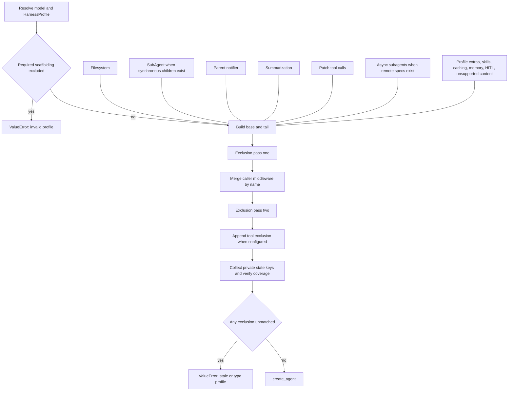

# SDK Middleware Assembly

`create_deep_agent()` resolves the requested model and its `HarnessProfile`, builds the synchronous and remote subagent specifications, then passes the final main list to LangChain `create_agent()`. Middleware is consequently the request-time extension boundary: it can change model requests, messages, tools, prompts, or graph state. `tools=` instead contributes callable tools after the model selects one.

Prompt construction precedes stack compilation. The main prompt is caller `system_prompt` (`USER`), followed by the profile's optional base and suffix (`BASE`, `SUFFIX`), separated by blank lines. The main compilation call receives that prompt, profile-rewritten caller tools, the final middleware list, and graph configuration.

## Main effective stack and assembly flow

List order below is the assembly order (conditional members are marked). It is not an authorization order or a substitute for testing request and tool-call behavior.

Diagram: the main stack's effective order and its two profile-exclusion passes. Both required-scaffolding rejection and unmatched-exclusion coverage failure are explicit assembly failures.

### Base, insertion point, and tail

The main **core** is, in order:

1. `FilesystemMiddleware`;
2. `SubAgentMiddleware` when there are synchronous inline children (declarative, compiled, or the automatic general-purpose child);
3. `_ParentNotifierMiddleware`;
4. model-aware summarization middleware;
5. `PatchToolCallsMiddleware`; and
6. `AsyncSubAgentMiddleware` when remote `AsyncSubAgent` specs are present.

The tail is materialized profile extras, `SkillsMiddleware` when configured, provider prompt-caching middleware, `MemoryMiddleware` when `memory=` is supplied, `HumanInTheLoopMiddleware` when the resolved interrupt mapping is non-empty, and `UnsupportedContentMiddleware`. The caller-middleware insertion point is after the surviving core and before that tail. `_ToolExclusionMiddleware`, when the profile has `excluded_tools`, is appended after both filtering and merging.

Prompt caching is deliberately before memory: memory changes the system prompt. The helper always adds a lazy Anthropic cache adapter; it imports and delegates only for an Anthropic request. It adds Bedrock and Fireworks adapters only if their integrations are importable, and each is configured to ignore unsupported models. `MemoryMiddleware` loads configured files once into private `memory_contents`, injects its formatted content into the system message per model request, and—when enabled—sets an Anthropic-only ephemeral breakpoint on the final system block. This preserves a cache boundary even as memory changes.

`UnsupportedContentMiddleware` is late because it must inspect the effective `request.model` after routing or fallback middleware. It only copies and filters outgoing `HumanMessage` and `ToolMessage` blocks: unsupported multimodal input becomes explanatory text in the outgoing request, while the stored conversation retains the original blocks for a later compatible model.

### Merge is replacement, not exclusion

`middleware=` is merged by `.name`:

- If a name is still in the assembled list, the caller member replaces that entry in place; if several caller entries target the same name, the last one wins.
- A new name is inserted after the last surviving core member, before profile extras, skills, caching, memory, HITL, and compatibility handling. New entries preserve caller order.
- Replacing `FilesystemMiddleware` preserves the agent's permissions if the replacement has none; a different non-empty permission set is a `ValueError`.

Profile exclusion is separate and subtractive. `HarnessProfile.excluded_middleware` is validated before stack assembly, applied before the caller merge, then applied again afterward. The second pass means a caller cannot restore policy-excluded middleware, including a replacement or a formerly default name that became novel after the first filter.

`FilesystemMiddleware` and `SubAgentMiddleware` are required scaffolding and cannot be excluded by class or name; removal would break built-in filesystem/permission behavior or the synchronous `task` handler. Class entries match exact type (with the cache adapter's declared proxy type), whereas strings match `.name` exactly. A string that matches distinct concrete classes in one stack is rejected as ambiguous. Finally, every exclusion must have matched: the main profile aggregates matches across the main and automatic general-purpose stacks, while a declarative child verifies its own profile independently.

After the final main stack is built, private state fields declared by surviving middleware schemas are found and supplied to every surviving `SubAgentMiddleware`. Synchronous task dispatch can therefore withhold those fields from child input and output.

## Child stacks and policy boundaries

### Automatic general-purpose child

The `general-purpose` child is auto-added only when its profile enables it and no supplied synchronous child has that name. If it is disabled and no other synchronous child exists, the main stack has no `SubAgentMiddleware` and does not expose `task`; remote async tools are independent.

Its stack is separately assembled as filesystem, summarization, patch-tool calls, profile extras, optional skills, and prompt caching. It receives the same two profile-exclusion passes and final tool exclusion. It inherits only caller middleware whose names matched an **original** general-purpose slot; novel main-only middleware is not propagated. Its declarative compilation appends HITL for a resolved interrupt configuration and appends unsupported-content handling unless that name is already present.

### Declarative, forked, compiled, and remote children

Each declarative `SubAgent` resolves its own model profile rather than automatically reusing the parent's. Its pre-compilation stack is filesystem, summarization, patch-tool calls, its profile extras, optional skills, and provider caching. A fork inherits the parent's selected skills and, if parent `memory=` is configured, receives memory too. It then applies exclusion, merges spec middleware, applies exclusion again, checks coverage, and appends final tool exclusion. For a fork, parent caller middleware is combined with spec middleware first; duplicate spec names win.

A declarative child inherits top-level tools, filesystem permissions, and `interrupt_on` only if its spec omits that field. A child permissions value replaces—not extends—the parent rules. Resolved filesystem interrupt rules are merged with explicit `interrupt_on`, whose same-tool entries win, and `create_sub_agent()` appends HITL only for a non-empty result. Compiled runnables and remote children retain their own approval and schema policy instead of inheriting parent settings.

The default synchronous mode is isolated. It receives a delegated `HumanMessage` plus eligible non-private state, and unchanged values returned by the child are dropped to avoid reducer duplication and parallel update conflicts. A `fork` instead receives the parent's effective compacted history and a task preamble. A declarative fork retains non-excluded parent state, including private channels needed by the same graph shape; a compiled fork removes private channels because its runnable schema is opaque. A forked invocation that calls `task` recursively is refused.

Remote specs, identified by `graph_id`, are separated before inline assembly and are exposed through `AsyncSubAgentMiddleware`; the remote graph owns its own schema and policy.

## Tools, permissions, and compatibility

`_ToolExclusionMiddleware` filters named tools from each model request and rejects those names at the tool-call boundary. Because it runs after caller middleware, it also removes tools injected earlier in the request path. This maintains consistency between the advertised and executable surface; the implementation explicitly does **not** describe it as a security boundary.

Filesystem permissions are enforced by `FilesystemMiddleware` at its built-in tool calls, not at direct backend access. Rules use declaration order and first-match precedence; unmatched operations are allowed. Graph assembly converts `interrupt` permissions into per-tool HITL configurations and overlays explicit `interrupt_on` entries so the latter take precedence. Filesystem middleware itself enforces `deny`, not HITL. Generated predicates are conservative for bulk tools: they account for intersecting subtrees, pathless searches, dot-root aliases, escaping glob patterns, and resolved symlink targets when available.

## Regression focus

Changes to assembly should keep tests for same-name replacement and new-name insertion, both exclusion passes, scaffolding and unmatched-exclusion failures, general-purpose override-only inheritance, child-specific profiles, fork behavior, and final tool filtering. Existing graph tests cover these wiring paths and the optional prompt-cache integrations. Provider-payload tests pin skills disclosure after an applicable read result without splitting tool-result batches or preceding queued user input, including relocation when compaction removes the original anchor. Permission tests cover conservative recursive deletion and generated approval behavior for bulk and path-sensitive filesystem operations.

See also [SDK construction and execution](/openwiki/architecture/sdk-construction-execution.md), [middleware catalog](/openwiki/concepts/middleware-catalog.md), [permissions and HITL](/openwiki/concepts/permissions-hitl.md), [profiles and models](/openwiki/concepts/profiles-models.md), and [subagents and skills](/openwiki/concepts/subagents-skills.md).
