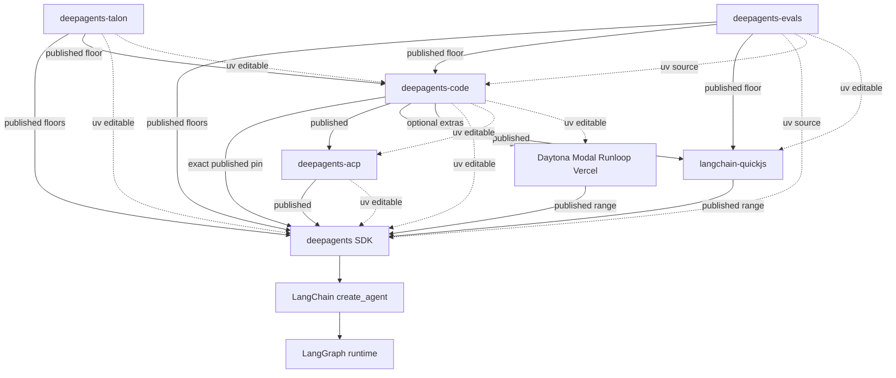
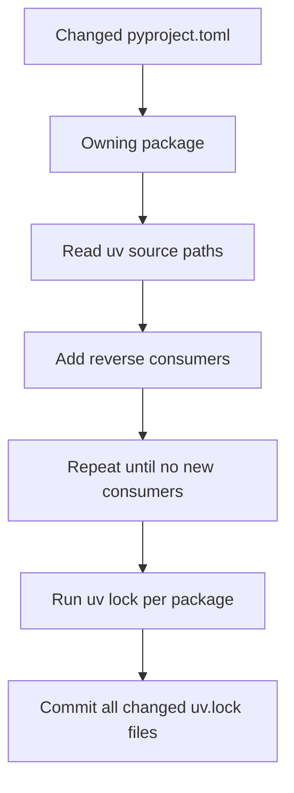

# Repository Architecture Overview

This repository is an independently versioned Python monorepo rather than one deployable service. The reusable `deepagents` SDK is its center; ACP provides the Agent Client Protocol bridge, dcode is the terminal product, Talon is an experimental local host, evals is the evaluation suite, and five partner distributions provide optional integrations. A package's `[project]` dependencies and extras are the installer-facing contract. `[tool.uv.sources]` changes resolution only in a sibling checkout; in particular, `editable = true` is not a downstream installation promise.

Related: [source map](./source-map.md), [ACP](../integrations/acp.md), [Talon](../integrations/talon.md), [sandbox partners](../integrations/sandbox-partners.md), [development](../operations/development.md), and [quickstart](../quickstart.md).

## Package roles and compatibility contracts

| Distribution | Source version | Python contract | Architectural role and entry point |
| --- | --- | --- | --- |
| `deepagents` | `0.7.42` | `>=3.11,<4.0` | Reusable agent harness. `create_deep_agent()` is the public assembly boundary. |
| `deepagents-acp` | `0.1.0` | `>=3.11,<4.0` | Agent Client Protocol bridge. |
| `deepagents-code` / `dcode` | `0.2.15` | `>=3.14,<3.15` | Terminal coding-agent product. Both scripts invoke `deepagents_code:cli_main`. |
| `deepagents-talon` | `0.1.2` | `>=3.14,<3.15` | Experimental local host for channels, schedules, and agent lifecycle. `deepagents-talon` invokes its host. |
| `deepagents-evals` | `0.0.1` | `>=3.14,<3.15` | Evaluation suite and Harbor integration. `deepagents-evals` invokes its CLI. |
| `langchain-daytona`, `langchain-modal`, `langchain-runloop` | `0.0.9`, `0.0.8`, `0.0.7` | `>=3.11,<4.0` | Optional Daytona, Modal, and Runloop sandbox integrations. |
| `langchain-vercel-sandbox`, `langchain-quickjs` | `0.0.2`, `0.4.0` | `>=3.11,<4.0` | Optional Vercel Sandbox integration and JavaScript REPL middleware. |

Deep Agents is an opinionated harness built on LangChain `create_agent()` and the LangGraph runtime. `create_deep_agent()` composes middleware, backends, skills, memory, profiles, and delegation. Normal task-tool subagents are distinct from `AsyncSubAgent` specifications, which are handled by separate async-subagent middleware for remote or background work.



*Solid edges are wheel metadata visible to an installer. Dotted edges are local `uv` source substitutions used only while resolving this checkout.*

### Floors and optional integrations

Dcode declares `deepagents==0.7.42`, `deepagents-acp>=0.1.0,<1.0.0`, and `langchain-quickjs>=0.4.0,<0.5.0`. Its exact SDK pin is a compatibility assertion: raise it in the change that begins to require newer SDK behavior, because an editable checkout can otherwise conceal an inadequate PyPI requirement. ACP deliberately declares `deepagents` without a version constraint.

Talon declares `deepagents>=0.7.42` and `deepagents-code>=0.2.15,<1.0.0`. Evals has lower bounds of `deepagents>=0.7.32`, `deepagents-code>=0.2.1`, and `langchain-quickjs>=0.3.3`. Every partner distribution declares `deepagents>=0.7.42,<0.8.0` and Python `>=3.11,<4.0`, while mapping the SDK sibling editable for checkout development.

Dcode's sandbox extras select Daytona, Modal, Runloop, and Vercel packages; its `quickjs` extra remains empty for compatible install commands because QuickJS is a normal dependency. Talon extras select local or remote history, OpenShell, MongoDB or PostgreSQL persistence, and media implementations. `media` and `media-cpu` conflict; on Linux the latter explicitly resolves `torch` and `torchaudio` from the `pytorch-cpu` index.

The checkout graph intentionally differs from the published graph:

- ACP substitutes only the SDK sibling, editable.
- Dcode substitutes the SDK, ACP, and all five partner siblings, editable, even where a sandbox provider is an optional extra.
- Evals substitutes SDK and QuickJS editable, but its dcode source is deliberately non-editable.
- Talon substitutes its direct SDK and dcode siblings editable.

## Runtime ownership boundaries

The SDK owns harness composition, not ACP transport or product policy. `AgentServerACP` accepts either a compiled graph or a factory supplied with `AgentSessionContext`; session-specific working directory, mode, model, MCP configuration, cancellation, and command allowances stay in the ACP server. Dcode's ACP adapter sits above that generic translation: for Auto mode it writes trusted approval state, attaches prompt metadata to the last user message, and passes CLI context into the graph.

Talon is a single-operator, single-event-loop local host for channel adapters, cron schedulers, and agent lifecycle, not a multi-tenant containment boundary. Selecting a sandbox moves shell and filesystem work to that provider; startup failure exits rather than reverting to host execution. MCP and web tools, channel-media handling, skills, and memory remain host-side. Accordingly, sandboxing and channel approval prompts are not complete isolation or authorization controls.

Talon selects SQLite, PostgreSQL, MongoDB, or a trusted entry-point checkpoint backend by URI. Checkpoint persistence and conversation-history persistence are distinct, and remote checkpoint thread IDs are not automatically namespaced by assistant. Its assistant-local `tools.json` maps exact tool names to approval booleans. Updates use compare-and-swap; active work retains its policy snapshot; an invalid file fails closed when the next invocation loads policy.

## Releases are per distribution

Release Please manages separate draft release PRs for the SDK, ACP, dcode, Talon, and the five partner distributions; evals is not a managed package. Release Please is configured not to create GitHub releases itself. A merged managed release PR triggers the repository release workflow, which publishes PyPI artifacts and creates the GitHub release.

The release manifest is a released-version baseline rather than dependency metadata. It records SDK `0.7.42`, ACP `0.1.0`, dcode `0.2.15`, Talon `0.1.2`, Daytona `0.0.9`, Modal `0.0.8`, Runloop `0.0.7`, Vercel `0.0.2`, and QuickJS `0.4.0`. Adding a release-managed distribution therefore requires both its Release Please configuration and a manifest baseline; evals intentionally has neither.

## Lockfile propagation

Each package-local `uv.lock` is a generated concrete resolution for development and CI, not another package manifest. The refresh helper starts with changed manifests, reads every package's `[tool.uv.sources]` path, and computes reverse consumers to a fixed point. It does not inspect `editable`, so the non-editable dcode source in evals still makes evals a consumer of a dcode manifest change.



*The refresh closure is based on all local path sources, including non-editable substitutions.*

An SDK manifest change propagates to ACP, dcode, evals, Talon, and all five partners, then to their consumers. A dcode manifest change propagates to dcode, Talon, and evals. Run the helper from the repository root rather than choosing locks manually:

```bash
python .github/scripts/checks/refresh_lockfiles.py libs/deepagents/pyproject.toml
```

For a dcode-only manifest change, pass `libs/code/pyproject.toml`. The helper runs locks for ACP, dcode, evals, and Talon with Python 3.14, and uses Python 3.12 for other discovered lock-owning directories. Review wheel requirements separately from source substitutions and commit every resulting lockfile.

## Safe change checklist

- Treat a requirement range or exact pin as a public compatibility contract, never as an inference from local editable resolution.
- When dcode starts to rely on newer SDK behavior, update its exact `deepagents==` pin in the same change.
- When changing any manifest, refresh the entire reverse-local-source closure, validate with the selected lock interpreter, and commit every changed `uv.lock`.
- Keep dcode's Auto-mode approval and CLI policy in its adapter; do not move product behavior into generic ACP translation.
- Treat Talon sandboxing and approval prompts as operational controls, not a tenant-security boundary. Exercise the affected persistence, lifecycle, or policy tests when changing them.
- For a managed release, review the package-specific draft release PR and changelog, and ensure source metadata and Release Please baselines agree.
