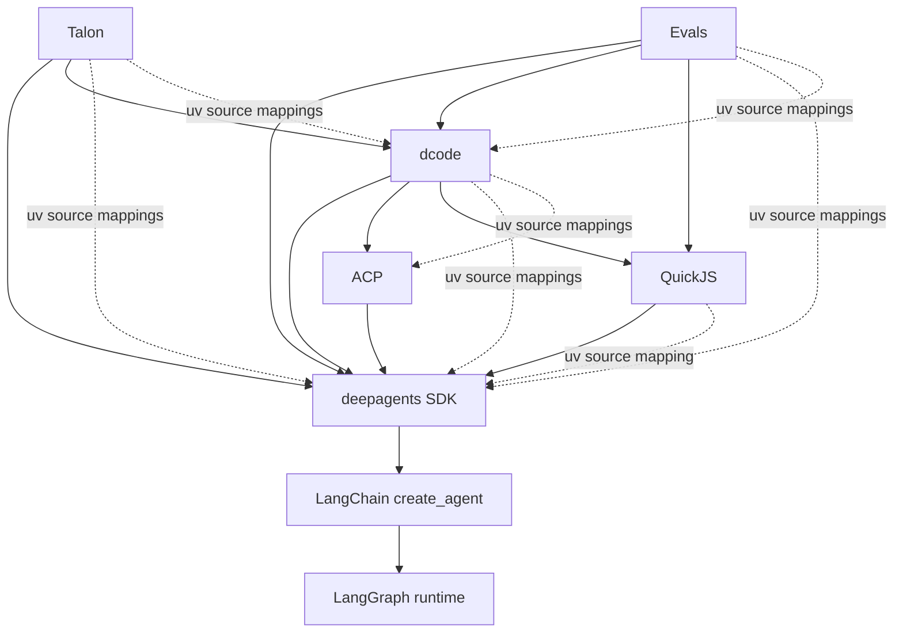
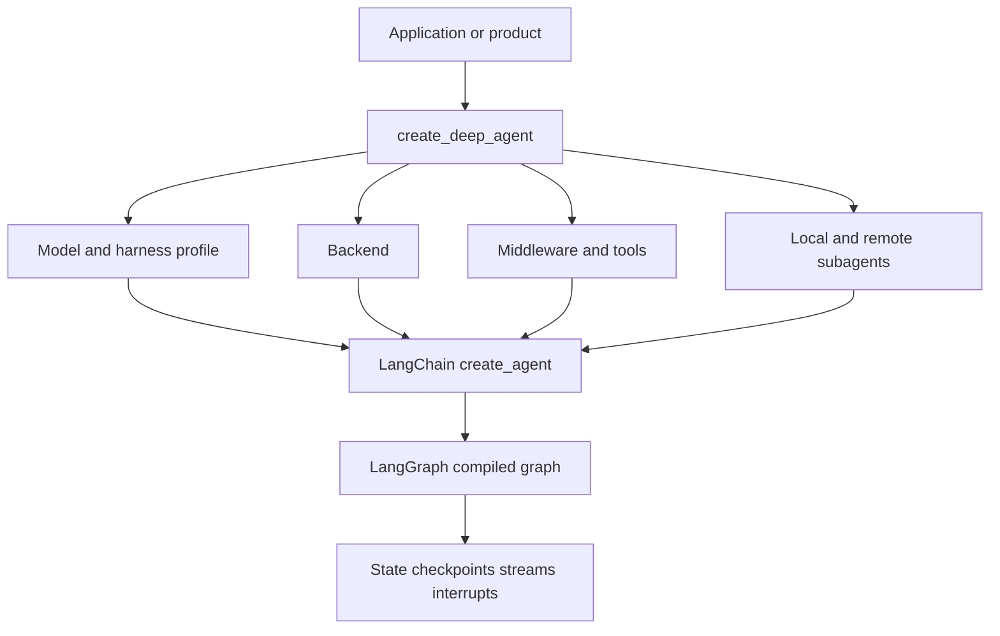
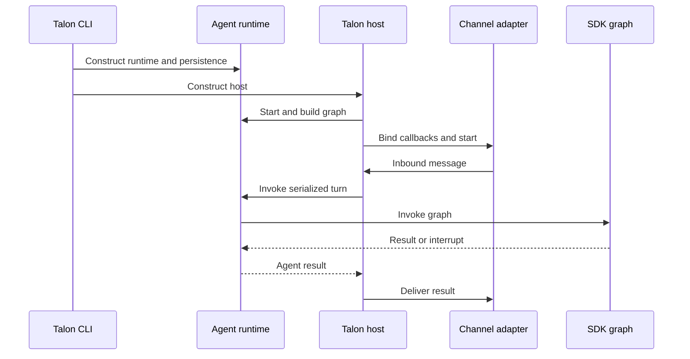

# Repository Architecture Overview

This is a monorepo of independently versioned Python packages, not one deployable service. The reusable `deepagents` SDK builds agent graphs. dcode packages that SDK as a terminal coding-agent product; ACP exposes graphs to Agent Client Protocol clients; `deepagents-evals` measures behavior; and Talon is a separate, experimental local host for channel and scheduled work. Partner packages add optional integrations rather than becoming a required SDK layer.

- [SDK construction and execution](./sdk-construction-execution.md)
- [Code agent](./code-agent.md)
- [ACP integration](../integrations/acp.md)
- [Talon integration](../integrations/talon.md)
- [Development](../operations/development.md)

## Packages, releases, and dependency direction

| Package | Source version and Python range | Architectural role |
| --- | --- | --- |
| `deepagents` | `0.7.28`; `>=3.11,<4.0` | Core SDK: graph construction, middleware, and backends. |
| `deepagents-acp` | `0.0.13`; `>=3.11` | Agent Client Protocol server bridge. |
| `deepagents-code` (`dcode`) | `0.1.86`; `>=3.12,<4.0` | Reference terminal coding-agent product and agent server. |
| `deepagents-talon` | `0.0.9`; `>=3.12` | Experimental local host for channels, turns, and cron schedules. |
| `deepagents-evals` | `0.0.1`; `>=3.12,<3.14` | Behavioral evaluation and Harbor benchmark suite. |
| `langchain-quickjs` | `0.3.9`; `>=3.11,<4.0` | Optional JavaScript REPL middleware integration. |

Release Please has independent managed release lines for the SDK, ACP, dcode, Talon, and five partners: Daytona, Modal, Runloop, Vercel, and QuickJS. `deepagents-evals` is not a managed release line. Release Please creates a separate draft release PR per package and is configured not to create the GitHub release itself; merging the generated release PR triggers the repository release workflow, which publishes to PyPI and creates the GitHub release. The manifest is the latest-release baseline, so its entries should not be treated as a complete list of packages or as every package's editable source version.

### Published constraints are not monorepo source mappings

Published dependencies flow toward lower layers. ACP declares `deepagents`; dcode pins exactly `deepagents==0.7.28`, depends on ACP and QuickJS; Talon requires the SDK and dcode; evals requires the SDK, dcode, and QuickJS; and QuickJS supports the SDK's `0.7.x` line. Those are distribution constraints consumed outside this checkout.

Each package may separately use `[tool.uv.sources]` for local development. Such a mapping replaces resolution of that dependency with a sibling source tree; mappings explicitly marked `editable = true` are editable installs. For example, dcode maps the SDK, ACP, and partner packages to editable siblings; Talon maps the SDK and dcode to editable siblings; ACP maps the SDK; and evals maps the SDK and QuickJS as editable but maps dcode by path without the editable flag. Do not infer a published pin from a `uv` mapping, or assume that every local source mapping is editable.

Solid arrows are published dependency constraints. Dotted arrows are development-only `uv` source mappings; they do not change what a published wheel requires. An arrow points from a consumer to a required package or runtime layer.

The SDK base distribution depends on LangChain, LangChain Core, Anthropic and Google model integrations, LangSmith, `packaging`, and `wcmatch`. AWS, QuickJS, and video support are extras, so consuming products choose integrations rather than imposing them on all SDK users.

## Graph runtime and SDK responsibilities

Deep Agents is a three-layer stack:

- **LangGraph** owns graph execution state, checkpoints, streaming, and interrupts.
- **LangChain `create_agent()`** builds the model, tool, and middleware agent loop on that runtime.
- **Deep Agents** supplies the opinionated harness: filesystem backends, delegation, skills, memory, context management, profiles, and tool policy.

`create_deep_agent()` is the SDK assembly point. It resolves model and profile, resolves the backend, assembles the main middleware stack, constructs default and caller-provided subagents, composes the prompt, and calls LangChain's `create_agent(...)` to produce the runnable graph. Applications extend this boundary through tools, middleware, subagents, skills, memory, permissions, schemas, checkpointer, store, cache, and graph name—not by importing product transports into the SDK.

This shows the SDK construction boundary: products supply configuration and integrations; the SDK composes a graph on the LangChain and LangGraph layers.

Required middleware protects core invariants: a harness profile cannot remove `FilesystemMiddleware` or synchronous `SubAgentMiddleware`. Filesystem permissions are ordered first-match rules for built-in filesystem tools only: `deny` returns a permission error, while `interrupt` contributes approval behavior. A custom state schema must extend `DeepAgentState`, retaining its `DeltaChannel` message reducer; shared fields updated concurrently by subagents need an appropriate reducer or LangGraph raises `InvalidUpdateError`.

### Delegation ownership

Synchronous declarative and compiled subagents are exposed through the main graph's `task` tool. The SDK adds the default `general-purpose` synchronous subagent unless its active profile disables it; without synchronous subagents there is no `task` tool. Declarative subagents inherit the parent's custom state schema and top-level approval configuration unless overridden. A compiled subagent is already assembled, so it must be schema-compatible and owns its own approval configuration.

`AsyncSubAgent` is deliberately different: a specification with `graph_id` is routed to `AsyncSubAgentMiddleware`, which uses the LangGraph SDK and Agent Protocol to create a remote background run and immediately returns a task ID. Persisted task state keeps remote thread ID, run ID, timestamps, and status so the parent can check, update, cancel, or list work. A remote task owns its graph schema and approvals. In-process ASGI transport requires an asynchronous parent call such as `ainvoke`; synchronous use requires a reachable server URL.

| Boundary | Owns | Does not own |
| --- | --- | --- |
| SDK | Harness composition, backend routing, middleware, profile policy, and subagent integration. | UI, editor protocol, channel connections, or schedules. |
| LangGraph | Graph state, checkpoints, streams, and interrupts. | Product transport and host lifecycle. |
| dcode | Terminal client/server product and coding-agent policy. | Generic SDK composition. |
| ACP | Protocol and session translation around a graph. | Terminal presentation or channel policy. |
| Talon | Process lifecycle, channel adapters, serialized turns, schedules, and host stores. | Production multi-tenant containment. |
| Evals | Repeatable measurement and benchmark integration. | Online request serving. |

## Product and protocol boundaries

### dcode and ACP

`deepagents-code` is a reference terminal coding-agent product on the SDK. Its terminal client and agent server run in separate processes: the client owns presentation, input, and approval interaction, while the server runs the graph and streams events. Headless mode reuses that server runtime rather than creating a separate agent architecture.

`AgentServerACP` accepts either a compiled graph or a factory given an `AgentSessionContext` containing working directory, mode, and optional model. When `load_sessions=True`, it advertises and implements durable session loading, which requires a checkpointer that survives restarts. Dcode's ACP specialization wraps the session graph to set trusted Auto-mode approval state and attach prompt metadata during streaming. Keep generic ACP translation in `deepagents-acp` and dcode-specific terminal or approval policy in `deepagents-code`.

### Evaluations and partners

`deepagents-evals` is a quality boundary rather than an online service. It runs agents against real LLMs, captures tool calls, file mutations, and final responses, then scores correctness and efficiency. Its Harbor integration runs sandboxed benchmarks such as Terminal Bench 2.0.

Partner packages add optional execution or middleware capabilities. `langchain-quickjs`, for example, is JavaScript REPL middleware compatible with `deepagents>=0.7.0,<0.8.0` and depends on LangChain and LangGraph. Configure a partner at the consuming SDK, dcode, eval, or host boundary rather than making it a universal SDK requirement.

## Talon: experimental long-running local host

Talon is an alpha, single-event-loop local host, not a production containment or multi-tenant security boundary. Treat channel access as access to configured agent capabilities, credentials, MCP tools, and host resources. Its opt-in sandbox moves shell and filesystem work, but MCP tools, web tools, and channel media handling remain on the host.

The `deepagents-talon` CLI builds channel adapters and a cron store, then runs `TalonHost`. With no configured model it uses `EchoAgentRuntime`, allowing lifecycle and channel wiring checks without provider credentials. With a model it creates `DeepAgentRuntime`, optionally opens a sandbox, and attaches persistent scheduling when channels are configured.

This separates CLI construction, host-owned transport and delivery, and runtime-owned graph invocation.

### Runtime and lifecycle invariants

At `DeepAgentRuntime.start()`, Talon resolves subagents, loads the tool-approval snapshot, and builds an SDK graph. Its composition layers Talon filesystem behavior, selected-model summarization and model selection, progress messages, task tools, background subagents, and caller middleware before `create_deep_agent()`.

Each `invoke()` rejects calls before startup, refreshes runtime tools, and rebuilds the graph when the approval snapshot changes. A turn binds request-scoped approval policy, authorization, archive scope, cron origin, selected model, progress delivery, invocation graph, and pending background results, then resets those bindings in `finally`. This prevents one channel or scheduled turn's state from leaking into another. `stop()` cancels background workers before clearing the graph or closing the checkpointer; if cancellation fails, it intentionally leaves resources open rather than permitting a live worker to write to a closed saver.

`TalonHost` starts the runtime before binding and starting channels, and then starts the optional scheduler. A failed partial start unwinds in reverse order. Shutdown cancels active work first, then stops channels, scheduler, and runtime; failures stopping one component are isolated so later components are still stopped. Host tests cover normal and partial startup, cancellation and interruption recovery, authorization routing, and reply delivery.

### Persistence and extension points

Persistence is intentionally split:

- The SDK passes a LangGraph checkpointer through graph construction for execution state.
- A Deep Agents backend independently governs filesystem, memory, and execution capability.
- Talon can wrap checkpoints in `ConversationSaver` for its channel conversation archive, and keeps cron jobs separately.

Talon selects checkpoint storage from `DEEPAGENTS_TALON_CHECKPOINT_URI`: built-in SQLite or `file`, PostgreSQL, and MongoDB schemes take precedence, followed by exactly one trusted `deepagents_talon.checkpoint_backends` entry-point plugin. The plugin receives the unchanged URI and owns setup and cleanup. Unexpected open failures are converted into a credential-safe configuration error. Remote checkpoint thread IDs are not automatically namespaced by assistant ID, so separate assistants need separate remote databases.

A channel adapter supplies the provider transport lifecycle: start and stop, inbound handler registration, text and media sending, editing, typing, and connection status. Built-in exports cover WhatsApp, Telegram, Discord, and Slack. Treat both adapter implementations and checkpoint/history plugins as trusted operator-installed extensions.

## Safe change and test starting points

- Put reusable graph composition changes in `deepagents`, beginning at `create_deep_agent()`; do not import terminal, editor, channel, or cron policy into the SDK.
- Keep synchronous `task` delegation separate from `AsyncSubAgent` remote orchestration; apply schema, approval, and cancellation changes on the graph that owns them.
- Preserve the distinction between published dependency constraints and local `uv` source mappings when changing package metadata or release pins. In particular, update dcode's exact SDK pin in the feature change that requires it.
- Put terminal product behavior in dcode, generic ACP streaming/session behavior in ACP, and Talon delivery/serialization/scheduling in `TalonHost` versus graph composition/request context in `DeepAgentRuntime`.
- For Talon lifecycle or cancellation changes, start with `libs/talon/tests/test_host.py`, then run focused runtime and package tests. The monorepo workflow is package-local `uv sync` and `make` targets; use `make lock-check` from `libs/` for cross-package lockfile validation.
