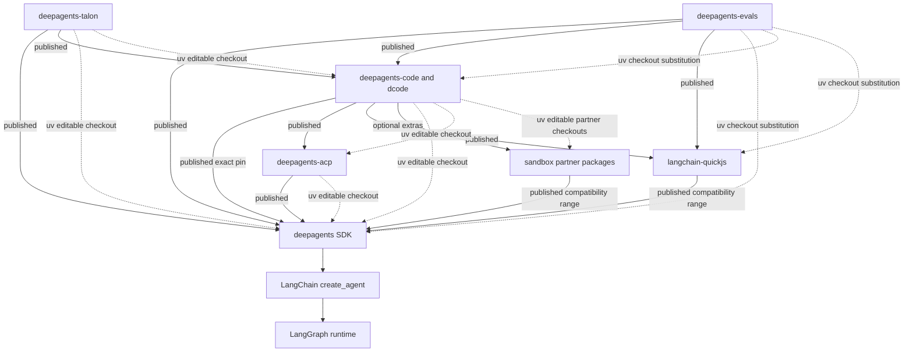
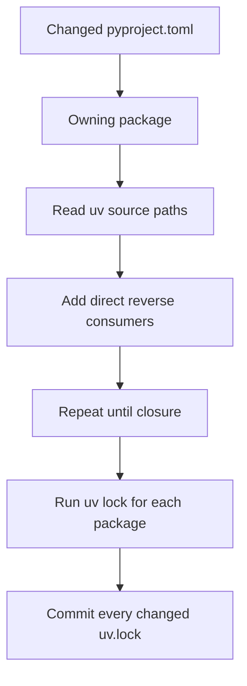

# Repository Architecture Overview

This is an independently versioned Python monorepo, not one deployable service. The reusable `deepagents` SDK is the center; ACP adapts it to Agent Client Protocol, dcode is the terminal coding-agent product, Talon is a local long-running host, evals measures behavior, and partner packages add optional integrations. A distribution's `pyproject.toml` defines its installer-facing contract; a checkout's `uv` source mapping does not.

Related: [runtime behavior](./runtime-behavior.md), [source map](./source-map.md), [ACP](../integrations/acp.md), [Talon](../integrations/talon.md), [development](../operations/development.md), and [quickstart](../quickstart.md).

## Package roles and public contracts

| Distribution | Source version | Python range | Role and entry point |
| --- | --- | --- | --- |
| `deepagents` | `0.7.42` | `>=3.11,<4.0` | Reusable agent harness; `create_deep_agent()` is its assembly boundary. |
| `deepagents-acp` | `0.1.0` | `>=3.11,<4.0` | Agent Client Protocol bridge. |
| `deepagents-code` / `dcode` | `0.2.15` | `>=3.14,<3.15` | Terminal coding-agent product; both console scripts call `deepagents_code:cli_main`. |
| `deepagents-talon` | `0.1.2` | `>=3.14,<3.15` | Experimental local host for channels, schedules, and agent lifecycle; `deepagents-talon` starts it. |
| `deepagents-evals` | `0.0.1` | `>=3.14,<3.15` | Evaluation suite and Harbor integration; `deepagents-evals` runs its CLI. |
| `langchain-daytona`, `langchain-modal`, `langchain-runloop` | `0.0.9`, `0.0.8`, `0.0.7` | `>=3.11,<4.0` | Optional sandbox integrations. |
| `langchain-vercel-sandbox`, `langchain-quickjs` | `0.0.2`, `0.4.0` | `>=3.11,<4.0` | Optional Vercel sandbox and JavaScript REPL middleware integrations. |

Deep Agents is an opinionated layer over LangChain `create_agent()`, whose graph runtime is LangGraph. `create_deep_agent()` composes middleware, backends, skills, memory, profiles, and delegation. Synchronous task-tool subagents and non-blocking deployed `AsyncSubAgent` specifications are distinct delegation mechanisms; products should build on the SDK rather than introduce another runtime.

`[project.dependencies]`, optional dependencies, and scripts are wheel metadata. Conversely, `[tool.uv.sources]` replaces a named dependency with a local path only while `uv` resolves this checkout. `editable = true` is a development-resolution choice, not a promise made to downstream installers.



*Solid edges are installer-visible requirements. Dotted edges are checkout-only `uv` substitutions.*

### Compatibility floors, extras, and checkout mappings

Dcode publishes `deepagents==0.7.42`, ACP `>=0.1.0,<1.0.0`, and QuickJS `>=0.4.0,<0.5.0`. Its exact SDK pin is an explicit compatibility promise: raise it in the same change that requires newer SDK behavior, because an editable checkout can hide an inadequate PyPI requirement. ACP declares `deepagents` without a version constraint.

Talon publishes `deepagents>=0.7.41` and `deepagents-code>=0.2.14,<1.0.0`. Evals instead has floors of `deepagents>=0.7.32`, `deepagents-code>=0.2.1`, and `langchain-quickjs>=0.3.3`. Each of the five partner distributions supports Python `>=3.11,<4.0`, requires `deepagents>=0.7.41,<0.8.0`, and maps the sibling SDK editable during checkout development.

The development graph intentionally differs from the wheel graph:

- ACP maps only the SDK sibling, editable.
- Dcode maps SDK, ACP, and all five partner siblings editable, even though sandbox providers are extras.
- Evals maps SDK and QuickJS editable, but its dcode mapping is deliberately non-editable.
- Talon maps its direct SDK and dcode siblings editable; it does not map ACP or QuickJS directly.

Extras select implementations rather than providing credentials or authorization. The SDK offers `aws`, `quickjs`, and `video`. Dcode includes QuickJS and `langsmith[sandbox]` as normal dependencies, offers model-provider and sandbox-provider extras, and preserves an empty `quickjs` extra for compatible install commands. Talon's history, remote-persistence, OpenShell, and media extras select optional implementations; `media` and `media-cpu` conflict, and Linux `media-cpu` directs `torch` and `torchaudio` to the explicit `pytorch-cpu` index.

## Runtime ownership boundaries

| Boundary | Owns | Does not own |
| --- | --- | --- |
| SDK | Harness composition, middleware, backends, profiles, and subagent integration. | ACP transport, terminal UI, channels, or schedules. |
| ACP | Protocol translation and session-local state. | Dcode terminal policy. |
| dcode | Terminal product behavior and ACP specialization. | Generic ACP semantics or provider implementations. |
| Talon | One local process's channels, cron, lifecycle, checkpoints, history, and approval integration. | Production multi-tenant containment. |
| Evals | Repeatable evaluation and Harbor benchmarks. | Online serving. |
| Partners | Optional sandbox or middleware implementations. | A required SDK installation. |

`AgentServerACP` accepts either a compiled graph or a factory receiving `AgentSessionContext` with working directory, mode, and optional model. It keeps modes, models, plans, working directories, MCP configuration, cancellation, and command allowances local to the protocol session. Dcode's wrapper remains above this generic translation: it writes trusted Auto-mode approval state, annotates the last user message with prompt metadata, and passes CLI context to the graph.

Talon is experimental and operates channel adapters, cron schedulers, and agent lifecycle on one local event loop. Its default shell and filesystem tools execute on the host. Selecting a sandbox moves that work to a provider; startup failure exits rather than falling back to host execution. MCP and web tools, channel-media handling, skills, and memory remain host-side, so sandboxing is neither complete containment nor a multi-tenant boundary. Talon removes a sandbox it created at shutdown but never deletes an attached existing sandbox.

Talon selects SQLite, PostgreSQL, MongoDB, or a trusted entry-point checkpoint backend by URI. Checkpoint and conversation-history storage are separate; remote checkpoint thread IDs are not automatically assistant-namespaced. History has its own trusted entry-point extension boundary. An assistant-local `tools.json` maps exact tool names to approval booleans: updates are atomic compare-and-swap, an active invocation retains its policy snapshot, and an invalid policy file fails closed on the next invocation. Prompt approval is not authorization or sandbox isolation.

## Release ownership and baselines

Release Please creates distinct draft release pull requests for the SDK, ACP, dcode, Talon, and five partner distributions; evals has no managed-package configuration. The configuration disables Release Please's own GitHub-release action. Merging a managed release PR triggers the repository workflow that publishes PyPI artifacts and creates the GitHub release.

The release manifest is a released-version baseline, not ordinary dependency metadata. It currently records SDK `0.7.42`, ACP `0.1.0`, dcode `0.2.15`, Talon `0.1.2`, Daytona `0.0.9`, Modal `0.0.8`, Runloop `0.0.7`, Vercel `0.0.2`, and QuickJS `0.4.0`. Source manifests describe prospective distributions, so adding a managed package requires both release configuration and a manifest baseline; evals intentionally remains outside this process.

## Lockfile propagation

Each package-local `uv.lock` is a generated concrete development and CI resolution, not another manifest. The lock helper parses every package's `[tool.uv.sources]` path and finds reverse consumers to a fixed point. It does not filter on `editable`, so evals' non-editable dcode substitution still propagates a dcode manifest change.



*Refresh starts at the changed manifest and follows all local-source reverse consumers, including non-editable substitutions.*

An SDK manifest change reaches ACP, dcode, evals, Talon, and all five partners, then continues to their consumers. A dcode manifest change reaches dcode plus Talon and evals. Run the helper from the repository root instead of selecting lockfiles manually:

```bash
python .github/scripts/checks/refresh_lockfiles.py libs/deepagents/pyproject.toml
```

Use `libs/code/pyproject.toml` for a dcode-only change. The helper locks ACP, dcode, evals, and Talon with Python 3.14 and other discovered package directories with Python 3.12. Validate under each package's declared Python contract, review published requirements separately from source substitutions, and commit every changed lockfile.

## Safe change checklist

- Start SDK construction, middleware, profile, backend, or delegation changes at `create_deep_agent()` and focused SDK tests. Keep task-tool subagents distinct from deployed async subagents.
- Treat dependency floors as installer-facing promises. Update dcode's exact SDK pin whenever it relies on newer SDK behavior; never infer a floor from an editable mapping.
- For a manifest change, validate its Python contract, refresh the full reverse-consumer closure, and commit every resulting `uv.lock`.
- For ACP changes, retain the compiled-graph versus session-context factory distinction. Keep dcode-specific approval and CLI policy in its wrapper, not generic ACP translation.
- For Talon, test the affected lifecycle, persistence, channel, cron, MCP, or policy boundary. Do not represent sandboxing or approval prompts as complete security controls.
- For a managed release, review the package-specific draft release PR and changelog, and confirm dcode's exact SDK pin remains its true minimum.
