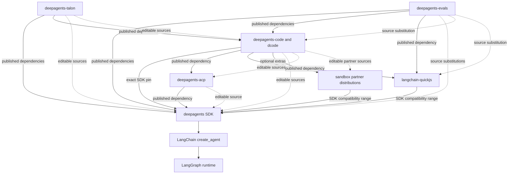
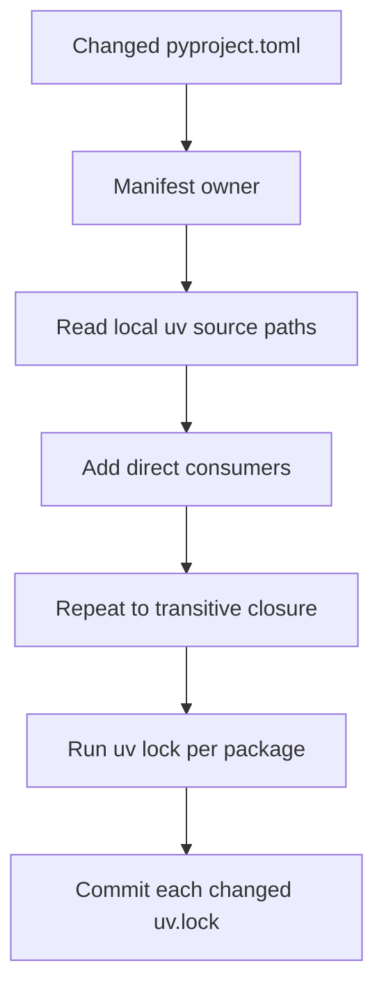

# Repository Architecture Overview

This is an independently versioned Python monorepo, not one deployable service. The reusable `deepagents` SDK supplies the harness; ACP adapts graphs to the Agent Client Protocol; dcode packages a terminal coding-agent product; Talon is a local long-running host; evals is the quality boundary; and partner distributions provide optional sandbox or middleware capabilities. Installing one distribution does not import another package's UI, credentials, or runtime policy.

Related: [dcode](./code-agent.md), [SDK construction and execution](./sdk-construction-execution.md), [ACP](../integrations/acp.md), [sandbox partners](../integrations/sandbox-partners.md), [development](../operations/development.md), and [quickstart](../quickstart.md).

## Distribution roles and installer contracts

A package's `pyproject.toml` is its downstream contract: version, `requires-python`, normal dependencies, extras, and console scripts are installed from the published distribution. The repository-level package map is:

| Distribution | Source version | Python contract | Role |
| --- | --- | --- | --- |
| `deepagents` | `0.7.41` | `>=3.11,<4.0` | Reusable, opinionated agent-harness SDK. |
| `deepagents-acp` | `0.0.13` | `>=3.11,<4.0` | ACP protocol-to-graph bridge. |
| `deepagents-code` / `dcode` | `0.2.12` | `>=3.14,<3.15` | Prebuilt terminal coding-agent product; both script names invoke the same CLI. |
| `deepagents-talon` | `0.1.1` | `>=3.14,<3.15` | Experimental local host for channels, schedules, and agent lifecycle. |
| `deepagents-evals` | `0.0.1` | `>=3.14,<3.15` | Evaluation suite and Harbor integration, not an online-serving component. |
| `langchain-daytona`, `langchain-modal`, `langchain-runloop` | `0.0.9`, `0.0.8`, `0.0.7` | `>=3.11,<4.0` | Optional sandbox integrations. |
| `langchain-vercel-sandbox`, `langchain-quickjs` | `0.0.2`, `0.4.0` | `>=3.11,<4.0` | Optional Vercel sandbox and JavaScript-REPL middleware integrations. |

Deep Agents is an opinionated harness over LangChain `create_agent()`, which uses LangGraph as the agent runtime. `create_deep_agent()` is the SDK assembly boundary. It supports synchronous task-tool subagents and non-blocking deployed `AsyncSubAgent` specifications as distinct delegation mechanisms. ACP, dcode, and Talon consume that SDK boundary rather than providing alternate SDK runtimes.

## Published dependencies versus checkout wiring

`[project.dependencies]` and `[project.optional-dependencies]` specify what a wheel exposes to downstream installers. `[tool.uv.sources]` is a checkout-only `uv` substitution mechanism and is not published package metadata. A mapping is editable only when it explicitly has `editable = true`.



*Solid edges are installer-visible requirements; dotted edges are development-only `uv` source substitutions.*

### Compatibility floors and extras

Dcode pins `deepagents==0.7.41`; raise that exact pin in the same change that begins using newer SDK behavior, because an editable checkout can otherwise conceal an insufficient PyPI requirement. It also requires ACP `>=0.0.13,<1.0.0` and QuickJS `>=0.4.0,<0.5.0`. ACP deliberately declares `deepagents` without a version bound.

Talon declares `deepagents>=0.7.41` and `deepagents-code>=0.2.11,<1.0.0`. Each of Daytona, Modal, QuickJS, Runloop, and Vercel declares `deepagents>=0.7.41,<0.8.0`. These are published minimum-compatibility promises, not instructions to resolve the SDK from PyPI while developing in this checkout. Evals retains separately chosen floors: `deepagents>=0.7.32`, `deepagents-code>=0.2.1`, and `langchain-quickjs>=0.3.3`.

The source-map graph intentionally differs from the wheel graph:

- ACP maps only the SDK sibling, editable.
- Dcode maps the SDK, ACP, and all five partner packages editable, although sandbox providers remain optional dcode extras.
- Evals maps dcode non-editably, but maps SDK and QuickJS editable.
- Talon maps its direct SDK and dcode siblings editable; ACP and QuickJS may arrive through dcode but are not Talon direct requirements or source mappings.
- Every partner package maps the local SDK editable.

Extras select implementations; they do not supply credentials, create a remote resource, or create an authorization boundary. The SDK's AWS, QuickJS, and video capabilities are optional. Dcode makes QuickJS and `langsmith[sandbox]` normal dependencies, offers provider extras for AgentCore, Daytona, Modal, OpenShell, Runloop, and Vercel, and keeps an empty `quickjs` extra for compatible install commands.

Talon includes local SQLite support in its base wheel. Its history extras select local, Voyage, or OpenAI-compatible semantic history; its `mongodb` and `postgres` extras select remote persistence; and `openshell` draws the provider through `deepagents-code[openshell]`. `media` and `media-cpu` conflict. On Linux, `media-cpu` directs `torch` and `torchaudio` to the explicit `pytorch-cpu` index.

## Release ownership and baseline

Release Please manages separate draft release PRs for SDK, ACP, dcode, Talon, and all five partner distributions; evals is not configured as a managed package. The configuration suppresses Release Please's own GitHub-release action. Merging a managed release PR invokes the repository release workflow that publishes to PyPI and creates the GitHub release.

The release manifest is the released-version baseline, separate from package source metadata: it records SDK `0.7.41`, ACP `0.0.13`, dcode `0.2.12`, Talon `0.1.1`, plus partner baselines of Daytona `0.0.9`, Modal `0.0.8`, Runloop `0.0.7`, Vercel `0.0.2`, and QuickJS `0.4.0`. Release Please updates this manifest; it should not be treated as normal dependency metadata. When adding a managed distribution, its own package manifest describes the prospective wheel while the release manifest establishes the already-shipped baseline.

## Lockfile propagation

Each package-local `uv.lock` is the generated concrete resolution used in development and CI, not a second manifest; do not hand-edit it. The lock helper reads all `[tool.uv.sources]` paths, finds reverse consumers to a transitive fixed point, and includes non-editable local sources.



*Lock refresh begins at a changed manifest and includes the complete reverse local-source-consumer closure.*

An SDK manifest change therefore reaches ACP, dcode, evals, Talon, and every partner package that maps the SDK sibling. The closure continues through dcode consumers, so Talon and evals are included for a dcode change. Evals' non-editable dcode map participates just like an editable path source.

Run the helper from the repository root rather than choosing locks manually:

```bash
python .github/scripts/checks/refresh_lockfiles.py libs/deepagents/pyproject.toml
```

For a dcode-only manifest change, substitute `libs/code/pyproject.toml`; this refreshes dcode plus its Talon and evals consumers. The helper resolves ACP, dcode, evals, and Talon locks with Python 3.14 and other discovered package directories with Python 3.12. Validate a package under its declared Python contract, inspect installer-visible requirements separately from source mappings, and commit every changed lockfile.

## Runtime ownership boundaries

| Boundary | Owns | Does not own |
| --- | --- | --- |
| SDK | Harness composition, backends, profiles, middleware, and subagent integration. | ACP transport, terminal UI, channels, or schedules. |
| ACP | Session-local protocol state and ACP-to-graph translation. | Dcode terminal policy. |
| dcode | Terminal product behavior, including ACP specialization. | Generic ACP semantics or provider implementations. |
| Talon | One local process's channel adapters, cron, and agent lifecycle. | Production multi-tenant containment. |
| Evals | Repeatable behavioral measurement and Harbor benchmarks. | Online serving. |
| Partner distributions | Optional middleware or sandbox-provider implementations. | Mandatory SDK installation. |

`AgentServerACP` accepts a compiled graph or a factory receiving `AgentSessionContext`, including working directory, mode, and optional model, and maintains state per protocol session. Dcode's ACP wrapper belongs above that generic bridge: Auto mode supplies trusted approval state, adds prompt metadata to the last user message, and supplies CLI context for the graph.

Talon is experimental and operates one local event loop; it is not a production security or multi-tenant boundary. By default, shell and filesystem tools run on the host. Selecting a sandbox moves that work to the provider and startup exits rather than falling back to host execution if the sandbox cannot start. MCP, web tools, channel-media handling, skills, and memory remain host-side, so a sandbox is not complete containment. A Talon-created sandbox is deleted on shutdown unless the operator attached an existing sandbox.

Talon selects SQLite, PostgreSQL, or MongoDB checkpoint storage by URI, and trusted entry-point packages can supply additional schemes. Checkpoint and conversation-history persistence are separate; remote checkpoint thread IDs are not automatically assistant-namespaced. Its assistant-local `tools.json` maps exact tool names to approval booleans. Updates are compare-and-swap, each active invocation keeps its policy snapshot, and an invalid policy file fails closed for the next invocation. This is a prompting control, not authorization or sandbox isolation.

## Safe change checklist

- Start SDK construction, middleware, profile, or delegation changes at `create_deep_agent()` and focused SDK tests; keep synchronous `task` delegation distinct from deployed async subagents.
- Treat a dependency floor as a published promise. Update dcode's exact SDK pin whenever new SDK behavior is required, and never infer that floor from an editable workspace mapping.
- For any package-manifest change, validate its Python contract, distinguish wheel requirements from `uv` mappings, refresh the full reverse-consumer closure, and commit each changed lock.
- For ACP work, preserve the compiled-graph versus factory distinction and keep dcode-specific policy in its wrapper rather than generic ACP translation.
- For Talon work, do not characterize sandboxing or approval prompts as complete security controls; exercise the affected lifecycle, persistence, channel, cron, MCP, or policy boundary.
- For managed releases, review the package-specific draft release PR and changelog, and confirm that dcode's exact SDK pin remains the minimum version it uses.
