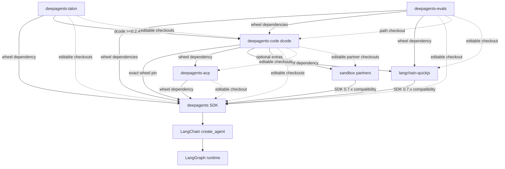

# Repository Architecture Overview

This repository is a Python monorepo of independently packaged components rather than one deployable service. `deepagents` is the reusable harness; first-party packages expose it through an ACP bridge, the dcode terminal product, the Talon local host, and an evaluation suite. Partner distributions add optional capabilities. A package dependency says what a wheel installs; it does **not** transfer ownership of that provider or runtime concern.

- [Code agent](./code-agent.md)
- [Source map](./source-map.md)
- [ACP](../integrations/acp.md)
- [Sandbox partners](../integrations/sandbox-partners.md)
- [Talon](../integrations/talon.md)
- [Development](../operations/development.md)
- [Quickstart](../quickstart.md)

## Package, Python, and release boundaries

| Distribution | Source version | Python contract | Architectural role |
| --- | --- | --- | --- |
| `deepagents` | `0.7.32` | `>=3.11,<4.0` | Reusable agent-harness SDK. |
| `deepagents-acp` | `0.0.13` | `>=3.11,<4.0` | Agent Client Protocol bridge for Deep Agents graphs. |
| `deepagents-code` / `dcode` | `0.2.4` | `>=3.14,<3.15` | Terminal coding-agent product. |
| `deepagents-talon` | `0.1.0` | `>=3.14,<3.15` | Experimental local host for channels and schedules. |
| `deepagents-evals` | `0.0.1` | `>=3.14,<3.15` | Behavioral-evaluation and Harbor benchmark suite. |
| `langchain-daytona` | `0.0.9` | `>=3.11,<4.0` | Daytona sandbox integration. |
| `langchain-modal` | `0.0.7` | `>=3.11,<4.0` | Modal sandbox integration. |
| `langchain-runloop` | `0.0.7` | `>=3.11,<4.0` | Runloop sandbox integration. |
| `langchain-vercel-sandbox` | `0.0.2` | `>=3.11,<4.0` | Vercel Sandbox integration. |
| `langchain-quickjs` | `0.3.11` | `>=3.11,<4.0` | JavaScript REPL middleware partner. |

Release Please separately manages the SDK, ACP, dcode, Talon, and five partners; `deepagents-evals` is not managed. The release manifest is the released baseline, while a package's `pyproject.toml` is source distribution metadata. Managed components receive separate draft release PRs. Merging one runs release checks, PyPI publication, and GitHub release creation; Release Please itself is configured not to create the GitHub release.

Keep dcode's exact SDK pin aligned with the first SDK functionality it needs. It is a compatibility floor, not release-time cleanup.

## Published dependencies versus checkout wiring

`[project.dependencies]` and `[project.optional-dependencies]` are published wheel contracts. `[tool.uv.sources]` is checkout-only resolver wiring: it substitutes sibling source during repository development and is not published. A path source is editable only when it explicitly declares `editable = true`.



*Solid arrows are published package relationships; dotted arrows are local `uv` substitutions and do not alter released wheel metadata.*

### Published and optional contracts

ACP requires unbounded `deepagents`, `agent-client-protocol>=0.10.1`, and `python-dotenv>=1.2.2`. dcode pins `deepagents==0.7.32`, requires ACP `>=0.0.13,<1.0.0`, and installs QuickJS `>=0.3.11,<0.4.0` normally. Its current LangChain-ecosystem floor set includes `langchain>=1.4.8,<2.0.0`, `langchain-core>=1.7.5,<2.0.0`, and `langgraph-sdk>=0.4.12,<1.0.0`. Talon requires SDK `>=0.7.32`, dcode `>=0.2.4,<1.0.0`, `langchain>=1.4.8,<2.0.0`, and `langchain-core>=1.7.4,<2.0.0`; evals requires SDK `>=0.7.32`, dcode `>=0.2.1`, QuickJS `>=0.3.3`, and `langchain[mcp]>=1.4.1`. QuickJS and the sandbox-partner wheels declare SDK compatibility `>=0.7.32,<0.8.0`.

The SDK keeps AWS, QuickJS, and video support optional, allowing consumers to choose these integration dependencies. dcode deliberately has a larger normal install surface, including `langsmith[sandbox]` and QuickJS. It offers six external sandbox extras—`agentcore`, `daytona`, `modal`, `openshell`, `runloop`, and `vercel`—and `all-sandboxes` aggregates them. Its compatibility `quickjs` extra is empty because QuickJS is already a normal dependency.

Talon keeps history embedding adapters optional: `history-local` installs `sentence-transformers` and `transformers`; `history-voyage` installs the LangChain Voyage adapter and `voyageai`; and `history-openai` installs `langchain-openai`. Its `openshell` extra installs `deepagents-code[openshell]>=0.2.4,<1.0.0`, matching the provider boundary used when `DEEPAGENTS_TALON_SANDBOX=openshell`. `mongodb`, `postgres`, and `media` likewise add their selected storage or media integration dependencies rather than expanding the base host install. Extras make an adapter package available; credentials, remote resource lifecycle, and implementation remain at the provider boundary.

### Local sources and lockfile fan-out

ACP maps SDK editable. dcode maps SDK, ACP, and Daytona, Modal, QuickJS, Runloop, and Vercel sibling packages editable. Talon maps SDK and dcode editable. Evals maps SDK and QuickJS editable but dcode through a non-editable path. The five partner packages map the SDK editable.

The lockfile helper follows **every** local path source, whether or not it is editable. Starting with a changed manifest, it includes that package and repeatedly adds local consumers. A dcode manifest change therefore re-locks dcode, Talon, and evals because both latter packages consume its path source. Do not hand-edit lockfiles:

```bash
python .github/scripts/checks/refresh_lockfiles.py libs/code/pyproject.toml
```

A local test can succeed against sibling code while the published constraint is incompatible. For a manifest change, review both the wheel constraint and local source mapping.

### Automated LangChain-ecosystem minimums

`raise_langchain_minimums.yml` is the maintenance entrypoint for published dependency floors. It runs daily at 09:00 UTC for every release-managed package, or can be dispatched for one package (or `all`) and optionally an exact CSV list of distribution names. It considers `langchain*`, `langgraph*`, `langsmith*`, and `deepagents*` requirements in normal dependencies, extras, and dependency groups. A narrowed run fails when a requested name is not a raiseable requirement; this prevents a misspelled filter from reporting success.

For each in-scope requirement with a `>=` or `~=` floor, the helper queries PyPI and raises only to the newest stable, non-yanked release still admitted by the existing requirement. It preserves upper bounds, extras, and environment markers. Exact `==` pins are intentionally not changed—dcode's SDK pin has separate ownership through `bump_code_sdk_pin.yml`—and a prerelease-coordination floor ahead of stable PyPI is never lowered. A local `uv` path source does not exempt a published requirement: its candidate is capped at the sibling manifest's declared version so checkout locking remains resolvable.

The workflow creates or refreshes one `chore(deps):` PR per selected package/dependency-set identity. It regenerates the edited package lockfiles and, by default, their reverse local consumers. `skip_dependent_locks` deliberately limits regeneration to directly edited packages and leaves reverse-dependent locks stale; use it only as an explicit compatibility-repair handoff. Failures to query PyPI or rewrite a manifest fail the run rather than silently skipping a dependency, and the workflow files or refreshes one tracking issue on failure. It uses an app installation token for PR creation so required `pull_request` checks run.

**Safe change sequence:** inspect compatibility comments and published ranges; run or review the minimums PR; validate every reported lockfile with its package's required Python version; then merge only after normal checks. Treat the generated PR as a dependency-contract change, not merely a lockfile update. Keep an exact dcode SDK pin synchronized with the first SDK behavior dcode uses, even though the floor-raising workflow will not alter it.

## Runtime layering and ownership

Deep Agents composes three layers:

1. **LangGraph** owns graph state, checkpoints, streaming, and interrupts.
2. **LangChain `create_agent()`** assembles the model, tools, and middleware loop on that runtime.
3. **Deep Agents** provides the opinionated harness: backend selection, profiles, filesystem and execution behavior, context management, skills, memory, delegation, and tool policy.

`create_deep_agent()` is the SDK assembly boundary. It resolves model, profile, and backend; constructs default, profile, and caller middleware; builds default and supplied subagents; merges permissions into interrupt policy; and calls `create_agent()` with `DeepAgentState` by default plus caller persistence and graph configuration. Required middleware and state assumptions are protected. Profile exclusions must match the main or general-purpose subagent stack, and tool exclusion runs last so caller middleware cannot restore an excluded tool.

The default general-purpose subagent is added unless its profile disables it or a caller supplies the same name. Synchronous delegation is supplied by `SubAgentMiddleware` and the main graph's `task` tool. An `AsyncSubAgent` instead installs `AsyncSubAgentMiddleware` for a non-blocking deployed run rather than in-process delegation. UI, transport approvals, channel routing, and schedules belong above this reusable SDK boundary.

| Boundary | Owns | Does not own |
| --- | --- | --- |
| SDK | Harness composition, profiles, backends, middleware, and subagent integration. | Terminal UI, ACP session transport, or host scheduling. |
| ACP | ACP session and event translation to and from a graph. | Terminal-specific policy and presentation. |
| dcode | Coding-agent terminal experience, CLI policy, and client/server operation. | Generic SDK semantics or sandbox-provider implementation. |
| Talon | Local host lifecycle, channels, schedules, and graph invocation. | Production multi-tenant containment. |
| Evals | Repeatable trajectory measurement and benchmark execution. | Online request serving. |
| Partners | Optional sandbox, provider, or middleware capability. | A mandatory SDK dependency. |

## Protocol, product, host, and evaluation boundaries

### ACP and dcode

`deepagents-acp` bridges ACP clients to a compiled graph or a graph factory receiving `AgentSessionContext`. The server holds session-local mode, model, working directory, MCP configuration, plan, and cancellation state. It advertises durable ACP `session/load` only when explicitly enabled; that configuration requires a graph checkpointer that survives server restarts.

Dcode is a prebuilt terminal coding product packaged as `deepagents-code`, with `dcode` and `deepagents-code` console entry points. Its terminal client and agent server are separate processes: the client owns input, rendering, and approvals, while the server owns graph execution and event streaming. Interactive and headless use the same server runtime.

Dcode's ACP wrapper specializes the generic bridge rather than changing ACP itself: it persists trusted Auto approval mode for the session, annotates the final user message with prompt metadata, and invokes the graph with CLI context. Keep that terminal policy out of generic protocol translation.

### Talon: local long-running host

Talon is an experimental single-event-loop host for channels, cron, and agent execution. It supports graceful shutdown, per-conversation interrupt-and-continue and `/stop`, WhatsApp, Telegram, Discord, and Slack adapters, persistent cron, MCP loading, and optional LangSmith tracing. Without `AGENT_MODEL`, it starts an echo runtime for host-wiring checks. Assistant state defaults to `~/.deepagents/<assistant_id>/`; workspace and invocation recursion limit are environment-configurable.

Talon is not a production security or multi-tenant isolation boundary. Channel access effectively grants configured agent capabilities, credentials, MCP tools, and host-resource access. By default shell and filesystem tools run on the host. An opt-in sandbox moves them to a remote provider, but MCP tools, web tools, and channel-media handling remain host-side. Startup failure exits instead of falling back to host execution. Sandbox files are deleted on shutdown unless attaching an existing sandbox; host-side skills and memory remain usable.

`DEEPAGENTS_TALON_CHECKPOINT_URI` selects built-in SQLite, PostgreSQL, or MongoDB checkpoint storage. Trusted installed entry-point plugins can supply other schemes; built-ins take precedence, while unknown or duplicate schemes fail startup. Checkpoints and conversation-history stores are independent. Remote checkpoint thread IDs are not automatically assistant-namespaced, so operators must isolate assistant databases; the history archive is separately assistant-namespaced.

Talon's persistent tool-approval policy is assistant-local and maps exact tool names to booleans. Updates use atomic compare-and-swap revisions; saved changes apply to the next invocation, current turns retain their snapshots, and an invalid policy file fails closed. This governs approval prompts, not tool availability or sandbox isolation.

### Evals and partners

`deepagents-evals` is a quality boundary rather than a serving component. Each evaluation runs an agent against a real LLM, captures its trajectory—tool calls, file mutations, and final response—and scores correctness and efficiency. Its Harbor integration runs sandboxed benchmarks such as Terminal Bench 2.0. Use it to measure whole trajectories, not to define runtime behavior.

QuickJS is the JavaScript REPL middleware partner. Sandbox partners are selected by a product or host; test provider behavior at that integration boundary rather than promoting it into the SDK base dependency set.

## Operations and focused verification

- For construction, profiles, backends, middleware, or delegation, start at `create_deep_agent()` and SDK tests. Distinguish a missing tool from a visible tool later denied by backend or permission policy.
- For ACP work, use `libs/acp/tests/test_agent.py`, session/model tests, and utility tests. Preserve the compiled-graph versus factory distinction.
- For dcode, first localize a symptom to terminal client or agent server. Test the relevant side; its architecture intentionally separates presentation/input from graph execution.
- For Talon, use focused host, runtime, channel, cron, checkpoint/history, sandbox, MCP, and approval-policy tests. Do not claim sandboxing is complete containment.
- For eval work, cover the relevant eval or Harbor adapter tests, then run the intended real-LLM evaluation when credentials, provider access, and cost permit.
- For manifest edits, inspect published requirements and `uv` mappings, run closure-aware lock refresh, and commit each resulting lockfile.
- For a managed release, wait for the generated draft release PR and lockfile update, review the package-scoped changelog, and ensure dcode's SDK pin reflects its source requirements.
