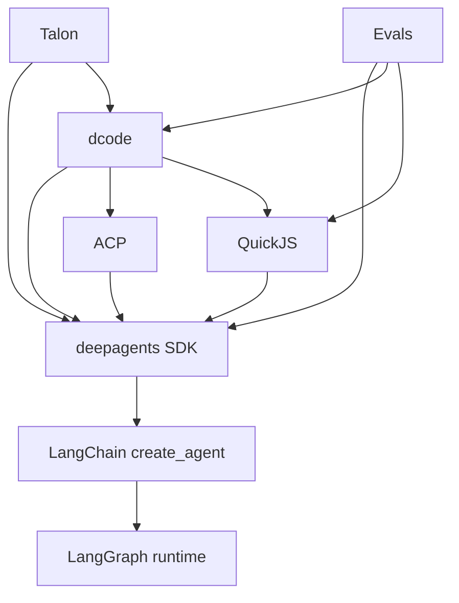
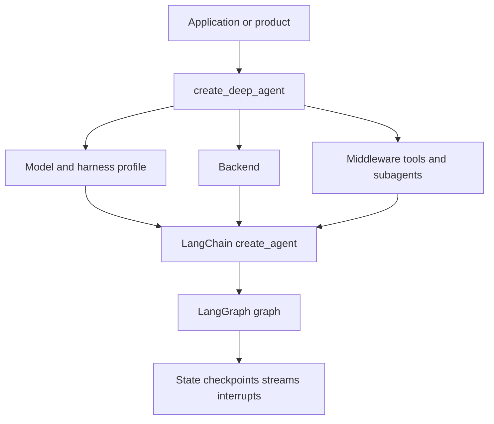

# Repository Architecture Overview

This repository is a Python monorepo of independently versioned distributions, not one deployable service. `deepagents` is the reusable SDK. The other first-party packages make that SDK available through a protocol bridge, a terminal coding product, a local long-running host, and an evaluation suite. Partner packages are optional integrations, not a required layer of the SDK.

- [SDK construction and execution](./sdk-construction-execution.md)
- [Code agent](./code-agent.md)
- [ACP integration](../integrations/acp.md)
- [Talon integration](../integrations/talon.md)
- [Development](../operations/development.md)

## Package and release boundaries

| Distribution | Version | Python | Responsibility |
| --- | --- | --- | --- |
| `deepagents` | `0.7.30` | `>=3.11,<4.0` | The agent harness SDK. |
| `deepagents-acp` | `0.0.13` | `>=3.11,<4.0` | Agent Client Protocol bridge for Deep Agents graphs. |
| `deepagents-code` / `dcode` | `0.2.0` | `>=3.14,<3.15` | Reference terminal coding-agent product. |
| `deepagents-talon` | `0.1.0` | `>=3.14,<3.15` | Experimental local host for channels and schedules. |
| `deepagents-evals` | `0.0.1` | `>=3.14,<3.15` | Behavioral evaluation and Harbor benchmark suite. |
| `langchain-quickjs` | `0.3.9` | `>=3.11,<4.0` | Optional JavaScript REPL middleware. |

Release Please manages independent release lines for the SDK, ACP, dcode, Talon, and five partner distributions: Daytona, Modal, Runloop, Vercel, and QuickJS. It does not manage `deepagents-evals`. The manifest records the current managed release baselines; package metadata is the source for an individual distribution's installed version and compatibility constraints.

For a managed package, Release Please creates or updates a separate draft release PR. The configuration deliberately skips direct GitHub-release creation; after a release PR is merged, the release workflow publishes to PyPI and creates the GitHub release. Release work is therefore package-scoped: a change need not—and should not—be released as a repository-wide unit.

## Published dependencies versus checkout wiring

A package's `dependencies` are constraints for consumers installing wheels from an index. `[tool.uv.sources]` is different: it tells `uv` to resolve a named dependency from a sibling checkout while developing this repository. A source mapping becomes an editable installation **only** when it includes `editable = true`; do not infer editability from a path mapping.

Published dependency direction: arrows point from a consumer to its required layer or package.

The important published constraints are:

- ACP requires `deepagents` without pinning an SDK patch version.
- dcode requires `deepagents==0.7.30`, ACP `>=0.0.10,<1.0.0`, and QuickJS `>=0.3.4,<0.4.0`. The exact SDK pin is a compatibility commitment; update it in the feature change that makes dcode require a newer SDK.
- Talon requires the SDK `>=0.7.24` and dcode `>=0.1.71,<1.0.0`.
- Evals requires the SDK `>=0.6.12`, dcode `>=0.1.27`, and QuickJS `>=0.3.3,<0.4.0`.
- QuickJS requires `deepagents>=0.7.0,<0.8.0`.

Local mappings intentionally need not mirror those published relationships. ACP maps the SDK editable; dcode maps the SDK, ACP, and partner packages editable; Talon maps SDK and dcode editable; and evals maps SDK and QuickJS editable but maps dcode by path without `editable = true`. This distinction lets maintainers test coordinated checkout changes while retaining independently installable packages.

The SDK itself keeps integrations optional where possible. Its base distribution depends on LangChain, LangChain Core, Anthropic and Google model integrations, LangSmith, `packaging`, and `wcmatch`; AWS, QuickJS, and video support are extras. Products and hosts select additional providers, sandboxes, transports, or storage rather than making them universal SDK requirements.

## Runtime layering and SDK ownership

Deep Agents is a layered stack, with a deliberately small ownership boundary between reusable graph construction and product hosting:

1. **LangGraph** owns graph execution state, checkpoints, streaming, and interrupts.
2. **LangChain `create_agent()`** builds the model/tool/middleware agent loop on that runtime.
3. **Deep Agents** is the opinionated harness above `create_agent()`: it supplies filesystem and execution backends, subagent delegation, skills, memory, context management, profiles, and tool policy.

`create_deep_agent()` is the SDK's construction boundary. It resolves the requested model and profile, resolves a backend, constructs default and caller-supplied subagents, assembles middleware and the final prompt, and delegates to LangChain's `create_agent(...)` with the checkpointer, store, state schema, and other graph configuration. It returns a LangGraph-backed runnable graph; it does not own a terminal UI, protocol connection, channel adapter, or scheduler.

The SDK composes a graph from application configuration; LangChain supplies the agent loop and LangGraph supplies its runtime semantics.

Applications extend the SDK at this construction boundary with tools, middleware, subagents, skills, memory, permission rules, schemas, checkpointers, stores, caches, and graph names. The default general-purpose synchronous subagent is added unless the selected profile disables it or the caller supplies a replacement. If there are synchronous subagents, `SubAgentMiddleware` exposes delegation through the `task` tool. Remote `AsyncSubAgent` specifications take a different path: `AsyncSubAgentMiddleware` launches a non-blocking deployed run through the LangGraph SDK and Agent Protocol rather than treating it as an in-process task.

For a safe reusable change, begin at `create_deep_agent()` and preserve that boundary. Product transports, UI approval flow, channel recipient routing, and cron policy belong above the SDK, even when they eventually invoke the same graph.

## Product, protocol, host, and quality roles

| Boundary | Owns | Must not become responsible for |
| --- | --- | --- |
| SDK | Harness composition, backends, profiles, middleware, and subagent integration. | Product presentation, transport, or scheduler lifecycle. |
| ACP | Translation between ACP sessions and a graph. | Terminal-specific policy and UI. |
| dcode | Terminal experience and coding-agent server/product policy. | Generic SDK behavior. |
| Talon | A local host process, channel adapters, schedules, and invocation of SDK graphs. | Production multi-tenant containment. |
| Evals | Repeatable behavioral measurement and benchmark execution. | Online request serving. |
| Partners | Optional provider, sandbox, or middleware capability. | A mandatory SDK dependency. |

### ACP and dcode

`deepagents-acp` is the protocol boundary. Its server imports and constructs Deep Agents graphs, converts protocol content and events, and works with LangGraph compiled graphs and checkpointing. dcode depends on it but specializes it: its `AgentServerACP` wrapper injects trusted Auto-mode approval state and prompt metadata into the graph invocation. Keep this dcode policy out of generic ACP translation.

`deepagents-code` is a reference packaging of the SDK as a coding-agent product. Its terminal client and agent server run in separate processes: the client owns input, presentation, and approval interaction; the server owns graph execution and streams events back. Interactive and headless operation share that server runtime. It is therefore the appropriate layer for terminal configuration, skills, MCP servers, sandboxes, hooks, and project/user configuration—not the SDK.

### Talon

Talon is an alpha local host for long-running Deep Agents. A single event loop owns channel adapters, the cron scheduler, and the agent runtime. It has built-in WhatsApp, Telegram, Discord, and Slack adapters, loads MCP tools from explicit configuration paths or `~/.deepagents/.mcp.json`, and can use an echo runtime when no model is configured for lifecycle and wiring checks.

Talon is explicitly not a production or enterprise security boundary. Channel access should be treated as access to configured agent capabilities, model credentials, MCP tools, and host resources. Sandboxing is opt-in and only moves shell and filesystem work; MCP tools and channel media handling remain on the host. Treat third-party checkpoint/history plugins and channel adapters as trusted operator-installed code.

Talon depends on the SDK and dcode because it reuses the graph and product-provided capability layers, but it owns host lifecycle and local deployment concerns. Its optional extras select history, checkpoint, sandbox, and media integrations; its checkpoint URI can select built-in SQLite, PostgreSQL, or MongoDB storage, while other checkpoint schemes use trusted entry-point plugins.

### Evals and partners

`deepagents-evals` is a quality boundary rather than a serving component. Each evaluation runs an agent against a real LLM, captures its tool calls, file mutations, and final response, then scores correctness and efficiency. Its Harbor integration executes sandboxed benchmarks such as Terminal Bench 2.0. Use it to measure a change across realistic trajectories rather than conflating evaluation with runtime hosting.

Partner packages add discrete optional capability. For example, `langchain-quickjs` provides JavaScript REPL middleware compatible with the SDK's `0.7.x` line. Sandbox partners similarly plug in at a consuming product or host. Configure and test an integration at that consumer boundary; do not add it as a core SDK dependency unless every SDK consumer needs it.

## Change planning and focused checks

- Change `deepagents` when the reusable construction contract, middleware, backend, profile, or graph behavior changes. Validate the corresponding SDK tests and use [SDK construction and execution](./sdk-construction-execution.md) to identify the assembly path.
- Change ACP for protocol/session translation, and dcode for terminal-specific graph policy, UI, persistence, or configuration. The first debugging question for dcode is whether a symptom belongs to the client or agent server.
- Change Talon for channel transport, local lifecycle, scheduling, checkpoint/history configuration, or host security posture. Do not represent its current sandbox as full containment.
- Change evals when measurement, trajectories, scoring, or Harbor adapters change; do not use it to define production serving behavior.
- When metadata changes, review both the published constraint and the `uv` source mapping. A local editable test can pass while a released distribution is incompatible, and a valid published relationship does not imply that developers work on editable siblings.
- For release work, use the generated per-package release PR and keep dcode's exact SDK pin synchronized with the SDK functionality it uses.
