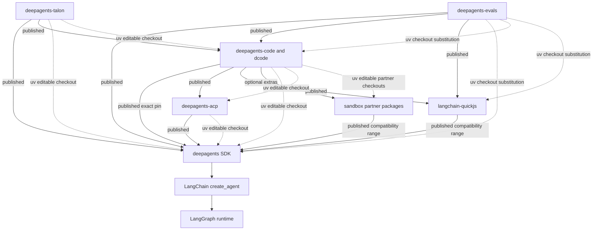
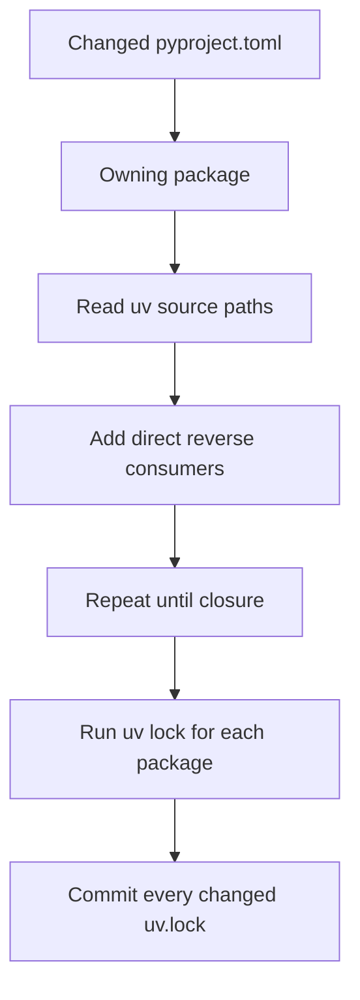

# Repository Architecture Overview

This repository is an independently versioned Python monorepo rather than a single deployable service. The `deepagents` SDK is the reusable harness; ACP adapts it to the Agent Client Protocol; dcode is a terminal coding-agent product; Talon hosts long-running local agents; evals measures behavior; and partner distributions add optional sandbox or JavaScript capabilities. A package's `pyproject.toml`, rather than a workspace checkout, defines the contract an installer sees.

Related: [runtime behavior](./runtime-behavior.md), [source map](./source-map.md), [ACP](../integrations/acp.md), [Talon](../integrations/talon.md), [development](../operations/development.md), and [quickstart](../quickstart.md).

## Package roles and published contracts

| Distribution | Source version | Python range | Architectural role and entry point |
| --- | --- | --- | --- |
| `deepagents` | `0.7.41` | `>=3.11,<4.0` | Reusable agent harness. `create_deep_agent()` assembles the graph. |
| `deepagents-acp` | `0.1.0` | `>=3.11,<4.0` | Agent Client Protocol bridge. |
| `deepagents-code` / `dcode` | `0.2.13` | `>=3.14,<3.15` | Terminal coding-agent product; both console scripts call `deepagents_code:cli_main`. |
| `deepagents-talon` | `0.1.1` | `>=3.14,<3.15` | Experimental local host for channels, schedules, and agent lifecycle; `deepagents-talon` starts it. |
| `deepagents-evals` | `0.0.1` | `>=3.14,<3.15` | Evaluation suite and Harbor integration; `deepagents-evals` runs its CLI. |
| `langchain-daytona`, `langchain-modal`, `langchain-runloop` | `0.0.9`, `0.0.8`, `0.0.7` | `>=3.11,<4.0` | Optional sandbox integrations. |
| `langchain-vercel-sandbox`, `langchain-quickjs` | `0.0.2`, `0.4.0` | `>=3.11,<4.0` | Optional Vercel sandbox and JavaScript-REPL middleware integrations. |

Deep Agents is an opinionated layer over LangChain `create_agent()`, whose agent runtime is LangGraph. `create_deep_agent()` is the SDK composition boundary for middleware, backends, skills, memory, profiles, and delegation. Synchronous task-tool subagents and non-blocking deployed `AsyncSubAgent` specifications are separate delegation mechanisms; consumers build on this SDK rather than introducing a competing runtime.

`[project.dependencies]`, optional dependencies, and scripts are published wheel metadata. In contrast, `[tool.uv.sources]` replaces a named dependency with a local path only while `uv` resolves this checkout. A source is editable only where its mapping says `editable = true`; it is not a downstream installation guarantee.



*Solid edges are installer-visible published requirements. Dotted edges are `uv` checkout substitutions and are not published dependency edges.*

### Compatibility floors, extras, and workspace mappings

Dcode publishes `deepagents==0.7.41`, ACP `>=0.0.13,<1.0.0`, and QuickJS `>=0.4.0,<0.5.0`. The exact SDK pin is an explicit compatibility promise: raise it in the same change that starts depending on newer SDK behavior, because an editable checkout can otherwise mask an inadequate PyPI requirement. ACP declares `deepagents` without a version constraint.

Talon publishes `deepagents>=0.7.41` and `deepagents-code>=0.2.12,<1.0.0`. Evals uses separately selected floors—`deepagents>=0.7.32`, `deepagents-code>=0.2.1`, and `langchain-quickjs>=0.3.3`. All five partner distributions require `deepagents>=0.7.41,<0.8.0`; their local SDK mappings are editable.

The checkout graph deliberately differs from the wheel graph:

- ACP maps only the SDK sibling, editable.
- Dcode maps SDK, ACP, and all five partner siblings editable, even though its sandbox providers are optional extras.
- Evals maps SDK and QuickJS editable, but its dcode path mapping is deliberately non-editable.
- Talon maps its direct SDK and dcode siblings editable; it does not map ACP or QuickJS directly.

Extras choose implementations; they neither provide credentials nor create an authorization boundary. The SDK has `aws`, `quickjs`, and `video` extras. Dcode includes QuickJS and `langsmith[sandbox]` as normal dependencies, exposes model-provider and sandbox-provider extras, and retains an empty `quickjs` extra for compatible install commands. Talon's `history-local`, `history-voyage`, and `history-openai` extras select semantic-history implementations; `mongodb` and `postgres` select remote persistence; and `openshell` pulls the corresponding dcode provider. Its `media` and `media-cpu` extras conflict; on Linux, the CPU variant directs `torch` and `torchaudio` to the explicit `pytorch-cpu` index.

## Runtime ownership boundaries

| Boundary | Owns | Does not own |
| --- | --- | --- |
| SDK | Harness composition, middleware, backends, profiles, and subagent integration. | ACP transport, terminal UI, channels, or schedules. |
| ACP | Protocol translation and session-local state. | Dcode terminal policy. |
| dcode | Terminal product behavior and its ACP specialization. | Generic ACP semantics or provider implementations. |
| Talon | One local process's channels, cron, lifecycle, checkpoints, history, and approval integration. | Production multi-tenant containment. |
| Evals | Repeatable evaluation and Harbor benchmarks. | Online serving. |
| Partners | Optional sandbox or middleware implementations. | A required SDK installation. |

`AgentServerACP` accepts either a compiled graph or a factory receiving `AgentSessionContext` with working directory, mode, and optional model. It tracks modes, models, plans, working directories, MCP configuration, cancellation, and command allowances by protocol session. Dcode's subclass belongs above this generic bridge: for each prompt it supplies trusted Auto-mode approval state, annotates the last user message with prompt metadata, and passes CLI context to the graph.

Talon is experimental and has one local event loop for channel adapters, cron schedulers, and agent lifecycle. By default its shell and filesystem tools run on the host. Selecting a sandbox moves that work to a provider; failure to start the sandbox exits instead of falling back to host execution. MCP tools, web tools, channel-media handling, skills, and memory remain host-side, so sandboxing is not complete containment or a multi-tenant boundary. Talon deletes a sandbox it created at shutdown, but never deletes an attached existing sandbox.

Talon selects SQLite, PostgreSQL, MongoDB, or a trusted entry-point checkpoint backend by URI. Checkpoint and conversation-history storage are independent; remote checkpoint thread IDs are not automatically assistant-namespaced. History backends have their own trusted entry-point extension point. Assistant-local `tools.json` maps exact tool names to approval booleans: updates are atomic compare-and-swap, active turns retain a snapshot, and an invalid next policy fails closed. This prompt-approval control is not authorization or sandbox isolation.

## Release ownership and baselines

Release Please creates separate draft release pull requests for the SDK, ACP, dcode, Talon, and five partner distributions; evals has no managed package configuration. The configuration disables Release Please's own GitHub-release action. When a managed release PR is merged, the repository workflow publishes PyPI artifacts and creates the GitHub release.

The release manifest is a released-version baseline rather than ordinary dependency metadata. It currently records SDK `0.7.41`, ACP `0.1.0`, dcode `0.2.13`, Talon `0.1.1`, Daytona `0.0.9`, Modal `0.0.8`, Runloop `0.0.7`, Vercel `0.0.2`, and QuickJS `0.4.0`. Release Please updates this shared baseline; package manifests describe the prospective source distribution. Adding a managed package requires both configuration and a manifest baseline, while evals remains intentionally outside that system.

## Lockfile propagation

Each package-local `uv.lock` is a generated concrete development and CI resolution, not a second manifest. The lock helper parses every package's `[tool.uv.sources]` path, then finds reverse consumers to a fixed point. It does not filter on `editable`, so non-editable local dcode consumed by evals still propagates changes.



*Refresh starts with a changed manifest and follows every local-source reverse consumer, including non-editable substitutions.*

An SDK manifest change reaches ACP, dcode, evals, Talon, and all five partners, then continues through any transitive consumers. A dcode manifest change reaches dcode plus its Talon and evals consumers. Run the helper from the repository root rather than selecting lockfiles manually:

```bash
python .github/scripts/checks/refresh_lockfiles.py libs/deepagents/pyproject.toml
```

Use `libs/code/pyproject.toml` as the argument for a dcode-only change. The helper uses Python 3.14 for ACP, dcode, evals, and Talon locks, and Python 3.12 for other discovered package directories. Validate a package under its declared Python range, review published requirements separately from workspace substitutions, and commit every resulting lockfile.

## Safe change checklist

- Start SDK construction, middleware, profile, backend, or delegation changes at `create_deep_agent()` and focused SDK tests. Keep task-tool subagents distinct from deployed async subagents.
- Treat a dependency floor as an installer-facing promise. Update dcode's exact SDK pin whenever new SDK behavior is required; never infer that floor from an editable source mapping.
- For a package-manifest change, validate its Python contract, refresh the complete reverse-consumer closure, and commit every changed `uv.lock`.
- For ACP work, preserve the compiled-graph versus session-context factory distinction. Keep dcode-specific approval and CLI policy in its wrapper, not generic ACP translation.
- For Talon work, test the affected lifecycle, persistence, channel, cron, MCP, or policy boundary. Do not describe sandboxing or approval prompts as complete security controls.
- For managed releases, review the package-specific draft release PR and changelog, and ensure dcode's exact SDK pin remains the minimum version its code needs.
