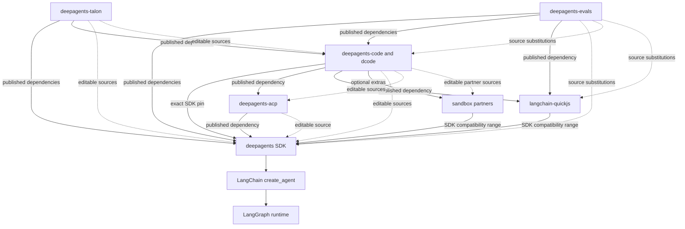

# Repository Architecture Overview

This is an independently versioned Python monorepo, not one deployable service. The `deepagents` SDK is the reusable harness. ACP translates an ACP client session into a graph invocation; dcode packages the SDK as a terminal coding product; Talon is a local long-running host; evals measures behavior; and partner packages add optional provider or middleware capabilities. Installing a dependency makes a distribution available—it does not make its provider, user interface, or runtime policy an SDK responsibility.

Related: [middleware stack](./middleware-stack.md), [SDK construction and execution](./sdk-construction-execution.md), [source map](./source-map.md), [ACP](../integrations/acp.md), [Talon](../integrations/talon.md), [development](../operations/development.md), and [quickstart](../quickstart.md).

## Package, Python, and release contracts

| Distribution | Source version | Python contract | Role |
| --- | --- | --- | --- |
| `deepagents` | `0.7.34` | `>=3.11,<4.0` | Reusable agent-harness SDK. |
| `deepagents-acp` | `0.0.13` | `>=3.11,<4.0` | Agent Client Protocol bridge. |
| `deepagents-code` / `dcode` | `0.2.5` | `>=3.14,<3.15` | Prebuilt terminal coding-agent product. |
| `deepagents-talon` | `0.1.0` | `>=3.14,<3.15` | Experimental local host for channels and schedules. |
| `deepagents-evals` | `0.0.1` | `>=3.14,<3.15` | Behavioral evaluation and Harbor benchmark suite. |
| `langchain-daytona`, `langchain-modal`, `langchain-runloop` | `0.0.9`, `0.0.7`, `0.0.7` | `>=3.11,<4.0` | Sandbox integrations. |
| `langchain-vercel-sandbox`, `langchain-quickjs` | `0.0.2`, `0.3.11` | `>=3.11,<4.0` | Vercel sandbox and JavaScript-REPL middleware integrations. |

Release Please manages separate release lines for the SDK, ACP, dcode, Talon, and all five partner distributions; evals is deliberately outside that configuration. It creates a separate draft release PR per managed package. Once that PR is reviewed and merged, the release workflow performs checks and creates the PyPI and GitHub releases; `skip-github-release` means Release Please itself does not publish the GitHub release.

The manifest is the release baseline, while each package's `pyproject.toml` is its source distribution metadata. In particular, dcode's exact SDK pin is a compatibility contract: update it in the change that begins using new SDK behavior, rather than as release housekeeping.

## Published dependency graph versus checkout wiring

`[project.dependencies]` and `[project.optional-dependencies]` define the wheel contract received by downstream users. `[tool.uv.sources]` is local resolver wiring only: it substitutes a sibling checkout during monorepo development and is not published. A path mapping becomes an editable installation only when it says `editable = true`.



*Solid edges are published package relationships; dotted edges are development-only `uv` substitutions.*

ACP declares `deepagents` without a version bound and maps it to the editable SDK checkout. dcode publishes `deepagents==0.7.34`, ACP `>=0.0.13,<1.0.0`, and QuickJS `>=0.3.11,<0.4.0`; in its checkout it maps the SDK, ACP, and Daytona, Modal, QuickJS, Runloop, and Vercel partners editable. Talon publishes `deepagents>=0.7.32` and `deepagents-code>=0.2.4,<1.0.0`, then maps both sibling packages editable. Evals maps dcode by a **non-editable** path but maps the SDK and QuickJS editable. The five partner packages publish `deepagents>=0.7.32,<0.8.0` and map the SDK editable.

The SDK base distribution keeps AWS, QuickJS, and video capabilities in extras. Conversely, dcode installs QuickJS and `langsmith[sandbox]` normally, then offers optional sandbox extras for AgentCore, Daytona, Modal, OpenShell, Runloop, and Vercel; `all-sandboxes` aggregates them. Its retained `quickjs` extra is empty because QuickJS is already normal dependency. Talon's history embedding, PostgreSQL, MongoDB, media, and OpenShell integrations are likewise optional packages. Extras select an implementation dependency; they do not transfer credentials, remote-resource lifecycle, or security responsibility into the SDK.

### Lockfile consequence

The lockfile tooling computes the transitive reverse-consumer closure of **all** `uv` path sources, regardless of `editable`. Thus a `libs/code/pyproject.toml` change re-locks dcode and its Talon and evals consumers. Use the helper rather than manually editing locks:

```bash
python .github/scripts/checks/refresh_lockfiles.py libs/code/pyproject.toml
```

A local checkout can test successfully even when the published range would not resolve for a downstream user. Review both the wheel requirement and source mapping when changing a manifest.

## SDK construction and runtime ownership

The runtime layers are intentionally distinct:

1. **LangGraph** supplies graph execution, checkpoints, streaming, and interrupts.
2. **LangChain `create_agent()`** assembles an agent loop from model, tools, and middleware on that runtime.
3. **Deep Agents** adds the opinionated harness: profiles, backend and filesystem behavior, context management, skills, memory, delegation, and tool policy.

`create_deep_agent()` is the assembly boundary. It resolves the model and model-specific profile, chooses the supplied backend or `StateBackend`, prepares prompts and subagents, and then invokes `create_agent()` with `DeepAgentState` unless the caller provides a state schema. It rejects profile attempts to exclude protected middleware, private names, ambiguous middleware classes, or exclusions that match no assembled stack. It applies exclusions again after caller middleware and appends tool exclusion last, preventing caller middleware from reintroducing excluded tools.

The SDK auto-adds the general-purpose subagent unless the active profile disables it or the caller supplies a subagent with that name. Inline subagents are exposed through `SubAgentMiddleware` and the main graph's `task` tool. An `AsyncSubAgent` (`graph_id` specification) is instead registered with `AsyncSubAgentMiddleware`, which launches a non-blocking deployed run rather than performing in-process delegation.

| Boundary | Owns | Does not own |
| --- | --- | --- |
| SDK | Harness composition, profiles, backends, middleware, and subagent integration. | ACP transport, terminal presentation, host channels, or schedules. |
| ACP | ACP session state and protocol-to-graph translation. | Terminal-specific policy. |
| dcode | Terminal UI/client policy and the coding-agent server product. | Generic ACP semantics or sandbox-provider implementations. |
| Talon | Local process lifecycle, channel adapters, cron, and invocation. | Production multi-tenant containment. |
| Evals | Repeatable trajectory measurement and benchmarks. | Online serving. |
| Partner distributions | Optional middleware or sandbox-provider implementations. | Mandatory SDK installation. |

## Protocol, product, host, and evaluation boundaries

### ACP and dcode

`AgentServerACP` accepts either a compiled graph or a factory receiving `AgentSessionContext` (`cwd`, mode, and optional model). It stores session-local mode, model, plan, working directory, MCP configuration, and cancellation/command-approval state. Durable ACP session loading is advertised only when the caller enables it; the graph then must use a checkpointer that survives process restart.

Dcode is the reference terminal product built on the SDK. Its terminal client and agent server are separate processes: the client owns user input, rendering, and approvals; the server owns graph execution and event streaming. Interactive and headless operation share that server runtime. Its ACP specialization wraps the generic bridge: Auto mode persists trusted approval state, annotates the final user message with prompt metadata, and passes a CLI context to the graph. Keep that policy above generic ACP translation.

### Talon

Talon is an experimental single-event-loop local host, not a production security or multi-tenant boundary. It owns channel adapters, persistent cron scheduling, and runtime lifecycle. It can start an echo runtime when `AGENT_MODEL` is unset, which permits host-wiring checks without model credentials. By default assistant state is under `~/.deepagents/<assistant_id>/`; `DEEPAGENTS_TALON_WORKSPACE` and `DEEPAGENTS_TALON_RECURSION_LIMIT` configure the workspace and per-invocation recursion limit.

By default shell and filesystem tools execute on the host. Selecting `DEEPAGENTS_TALON_SANDBOX` moves that work to a provider and startup fails rather than falling back to host execution. This is still not complete containment: MCP tools, web tools, and channel-media handling remain host-side, while skills and memory remain on the host. Talon deletes a created sandbox at shutdown unless configured to attach to an existing one.

`DEEPAGENTS_TALON_CHECKPOINT_URI` selects built-in SQLite, PostgreSQL, or MongoDB checkpoint storage. Other URI schemes come from trusted installed entry-point plugins; unknown or duplicate schemes fail startup. Checkpoints and conversation-history persistence are separate, and remote checkpoint thread IDs are not automatically assistant-namespaced. The assistant-local `tools.json` approval policy maps exact tool names to booleans. Its compare-and-swap updates apply on the next invocation, current turns keep their snapshot, and invalid policy files fail closed; this prompts for actions but does not establish tool authorization or sandbox isolation.

### Evals and partners

`deepagents-evals` is a quality boundary, not a serving component. It runs agents against real LLMs, captures tool calls, file mutations, and final responses, and scores correctness and efficiency. Its Harbor integration runs sandboxed benchmarks such as Terminal Bench 2.0. Partner distributions, including QuickJS and sandbox integrations, should be selected and tested at the product/host integration boundary instead of becoming mandatory SDK dependencies.

## Change and verification guide

- For harness construction, profile behavior, middleware ordering, or delegation, begin at `create_deep_agent()` and its SDK tests. Treat absent tools separately from tools that later require an approval or backend permission.
- For ACP, preserve the compiled-graph versus factory distinction and test session configuration and load-session capability behavior.
- For dcode, localize a failure to client presentation/input or server graph execution before changing code; the process split is intentional.
- For Talon, test the affected lifecycle, channel, cron, checkpoint/history, sandbox, MCP, or approval-policy behavior. Do not represent sandbox selection as complete isolation.
- For package edits, validate under the package's declared Python contract, inspect both published requirements and `uv` mappings, refresh the full reverse-consumer lock closure, and commit every changed lockfile.
- For a release-managed package, wait for its generated draft release PR and lockfile update, review its package-scoped changelog, and ensure dcode's exact SDK pin matches its actual minimum SDK behavior.
