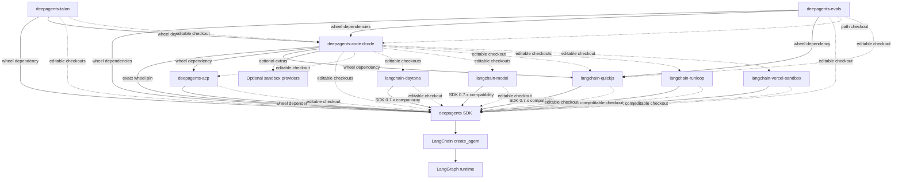

# Repository Architecture Overview

This repository is a Python monorepo of independently packaged components, not one deployable service. `deepagents` is the reusable agent harness; first-party packages expose it through an ACP protocol bridge, the dcode terminal coding product, the Talon local host, and an evaluation suite. Partner packages add discrete capabilities. A package dependency identifies what a wheel installs; it does **not** make the dependent package the owner of that provider or runtime concern.

- [SDK construction and execution](./sdk-construction-execution.md)
- [Code agent](./code-agent.md)
- [Source map](./source-map.md)
- [Sandbox partners](../integrations/sandbox-partners.md)
- [Development](../operations/development.md)
- [Quickstart](../quickstart.md)

## Package, Python, and release boundaries

| Distribution | Source version | Python contract | Architectural role |
| --- | --- | --- | --- |
| `deepagents` | `0.7.32` | `>=3.11,<4.0` | Reusable agent-harness SDK. |
| `deepagents-acp` | `0.0.13` | `>=3.11,<4.0` | Agent Client Protocol bridge for Deep Agents graphs. |
| `deepagents-code` / `dcode` | `0.2.2` | `>=3.14,<3.15` | Terminal coding-agent product. |
| `deepagents-talon` | `0.1.0` | `>=3.14,<3.15` | Experimental local host for channels and schedules. |
| `deepagents-evals` | `0.0.1` | `>=3.14,<3.15` | Behavioral-evaluation and Harbor benchmark suite. |
| `langchain-daytona` | `0.0.9` | `>=3.11,<4.0` | Daytona sandbox integration. |
| `langchain-modal` | `0.0.7` | `>=3.11,<4.0` | Modal sandbox integration. |
| `langchain-runloop` | `0.0.7` | `>=3.11,<4.0` | Runloop sandbox integration. |
| `langchain-vercel-sandbox` | `0.0.2` | `>=3.11,<4.0` | Vercel Sandbox integration. |
| `langchain-quickjs` | `0.3.11` | `>=3.11,<4.0` | JavaScript REPL middleware partner. |

Release Please separately manages the SDK, ACP, dcode, Talon, and the five partners; `deepagents-evals` is not managed. The manifest is the latest released baseline, while each package's `pyproject.toml` is source distribution metadata. Release Please creates a separate draft release PR per managed component. On merging that PR, the release workflow performs checks, publishes to PyPI, and creates the GitHub release; Release Please itself skips GitHub release creation.

Keep dcode's exact SDK pin aligned with the first SDK functionality it needs. It is a compatibility floor, not a release-time cleanup.

## Dependency contracts versus checkout wiring

`[project.dependencies]` and `[project.optional-dependencies]` are published wheel contracts. `[tool.uv.sources]` is checkout-only resolver wiring: it substitutes sibling source during repository development and is not published. A path source is an editable install only if it explicitly has `editable = true`.



*Solid arrows are published package relationships; dotted arrows are local `uv` substitutions and do not alter released wheel metadata.*

### Published and optional contracts

ACP requires `deepagents` without a version bound, `agent-client-protocol>=0.10.1`, and `python-dotenv>=1.2.2`. dcode pins `deepagents==0.7.32`, requires ACP `>=0.0.13,<1.0.0`, and includes QuickJS `>=0.3.11,<0.4.0` as a normal dependency. Talon requires SDK `>=0.7.32` and dcode `>=0.2.2,<1.0.0`; evals requires SDK `>=0.7.32`, dcode `>=0.2.1`, and QuickJS `>=0.3.3`. QuickJS and each sandbox-partner wheel require SDK `>=0.7.32,<0.8.0`.

The SDK keeps AWS, QuickJS, and video support optional, allowing a consumer to choose these integration dependencies. dcode deliberately has a larger normal install surface, including `langsmith[sandbox]` and QuickJS. It exposes six external sandbox-provider extras—`agentcore`, `daytona`, `modal`, `openshell`, `runloop`, and `vercel`—with `all-sandboxes` aggregating them. Its compatibility `quickjs` extra is empty because QuickJS is already installed normally. Extras make an adapter package available; provider credentials, remote resource lifecycle, and implementation stay at the provider boundary.

### Local sources and lockfile fan-out

ACP maps SDK editable. dcode maps SDK, ACP, and Daytona, Modal, QuickJS, Runloop, and Vercel partner checkouts editable. Talon maps SDK and dcode editable. Evals maps SDK and QuickJS editable but dcode through a non-editable path. Each of the five partner packages maps the SDK editable.

The lockfile helper follows **every** local path source, regardless of `editable`. Starting with a changed manifest, it includes that package and repeatedly adds local consumers. Thus a dcode manifest change requires re-locking dcode, Talon, and evals because both latter packages consume its source path. Do not hand-edit lockfiles:

```bash
python .github/scripts/checks/refresh_lockfiles.py libs/code/pyproject.toml
```

A local test can consequently succeed against sibling code while the published constraint is incompatible. For any manifest change, review both the wheel constraint and the local source mapping.

## Runtime layering and responsibility

Deep Agents composes three layers:

1. **LangGraph** owns graph state, checkpoints, streaming, and interrupts.
2. **LangChain `create_agent()`** assembles the model, tools, and middleware loop on that runtime.
3. **Deep Agents** provides the opinionated harness: backend selection, profiles, filesystem and execution behavior, context management, skills, memory, delegation, and tool policy.

`create_deep_agent()` is the SDK assembly boundary. It resolves the model/profile and backend; assembles default, profile, and caller middleware; produces default and supplied subagents; merges permissions into interrupt policy; and delegates to `create_agent()` with a `DeepAgentState` default plus caller checkpointer, store, cache, schemas, and graph name. Required middleware and state assumptions are protected, profile exclusions must actually match, and tool exclusion runs last so caller middleware cannot reintroduce an excluded tool.

The default general-purpose subagent is added unless its profile disables it or a caller supplies a spec with the same name. Synchronous delegation comes from `SubAgentMiddleware` and the main graph's `task` tool. An `AsyncSubAgent` instead installs `AsyncSubAgentMiddleware`, starting a non-blocking deployed run rather than in-process delegation. Keep UI, transport approvals, channel routing, and scheduling above this reusable SDK boundary.

| Boundary | Owns | Does not own |
| --- | --- | --- |
| SDK | Harness composition, profiles, backends, middleware, and subagent integration. | Terminal UI, ACP session transport, or host scheduling. |
| ACP | ACP session/event translation to and from a graph. | Terminal-specific policy and presentation. |
| dcode | Coding-agent terminal experience, CLI policy, and client/server operation. | Generic SDK semantics or sandbox-provider implementation. |
| Talon | Local host lifecycle, channels, schedules, and graph invocation. | Production multi-tenant containment. |
| Evals | Repeatable trajectory measurement and benchmark execution. | Online request serving. |
| Partners | Optional sandbox, provider, or middleware capability. | A mandatory SDK dependency. |

## Protocol, product, host, and evaluation boundaries

### ACP and dcode

`deepagents-acp` bridges ACP clients to a compiled graph or a graph factory receiving `AgentSessionContext`. The server tracks session-local model, mode, working directory, MCP configuration, plan, and cancellation state. Durable ACP `session/load` is advertised only when enabled and depends on a graph checkpointer that survives server restarts.

Dcode is a reference terminal product packaged as `deepagents-code`, with `dcode` and `deepagents-code` console entry points. Its terminal client and agent server are separate processes: the client owns input, rendering, and approval interaction; the server owns graph execution and event streaming. Interactive and headless operation use the same server runtime.

Dcode's ACP wrapper specializes the generic bridge rather than changing ACP itself. Per prompt, it persists trusted Auto approval mode for the ACP session, annotates the last user message with prompt metadata, and invokes the graph with CLI context. Keep this terminal policy out of the generic protocol translation.

### Talon: local long-running host

Talon is an experimental single-event-loop host for channels, cron, and the agent runtime. It has graceful shutdown, per-conversation interrupt-and-continue and `/stop`; adapters for WhatsApp, Telegram, Discord, and Slack; persistent cron; MCP loading; and optional LangSmith tracing. Without `AGENT_MODEL`, it starts an echo runtime to validate host wiring.

Talon is not a production security or multi-tenant isolation boundary. Channel access effectively grants access to configured agent capabilities, credentials, MCP tools, and host resources. By default shell and filesystem tools execute on the host. An opt-in sandbox can move them to a remote provider, but MCP tools, web tools, and channel-media handling remain host-side. Startup failure exits rather than falling back to host execution. Sandbox files are deleted on shutdown unless attaching an existing sandbox ID; host-side skills and memory remain usable.

The `DEEPAGENTS_TALON_CHECKPOINT_URI` scheme selects built-in SQLite, PostgreSQL, or MongoDB checkpoint storage. Trusted installed entry-point plugins can provide other schemes, with built-ins taking precedence and unknown or duplicate schemes failing startup. Checkpoint and conversation-history stores are independent; remote checkpoint thread IDs are not automatically assistant-namespaced, so operators must isolate assistant databases. Talon's persisted history archive is separately assistant-namespaced.

### Evals and partners

`deepagents-evals` is a quality boundary, not a serving component. Each evaluation runs an agent against a real LLM, captures the trajectory—tool calls, file mutations, and final response—and scores correctness and efficiency. Its Harbor integration runs sandboxed benchmarks such as Terminal Bench 2.0. Use it to measure whole trajectories, not to define product runtime behavior.

QuickJS is the JavaScript REPL middleware partner. Sandbox partners are selected by a product or host; test provider behavior at that integration boundary rather than promoting it into the SDK's base dependency set.

## Operations and focused verification

- For graph construction, profiles, backends, middleware, or delegation, start at `create_deep_agent()` and the SDK unit/integration tests; distinguish a missing tool from a visible tool later denied by backend or permission policy.
- For ACP work, use `libs/acp/tests/test_agent.py`, session/model tests, and utility tests. Preserve the distinction between compiled-graph and factory configuration.
- For dcode, first locate a symptom on the terminal-client or agent-server side. Use targeted unit or integration coverage; integration tests require `ANTHROPIC_API_KEY`, with `LANGSMITH_API_KEY` enabling tracing.
- For Talon, exercise the focused host, runtime, channel, cron, checkpoint/history, sandbox, MCP, and approval-policy tests. Do not claim sandboxing is complete containment.
- For eval changes, cover the relevant eval/Harbor adapter tests, then run the intended real-LLM evaluation when credentials, provider access, and cost permit.
- For manifest edits, inspect published requirements and `uv` mappings, run closure-aware lock refresh, and commit every resulting lockfile.
- For a managed release, wait for the generated draft release PR and lockfile update, review the package-scoped changelog, and ensure dcode's SDK pin reflects what its source uses.
