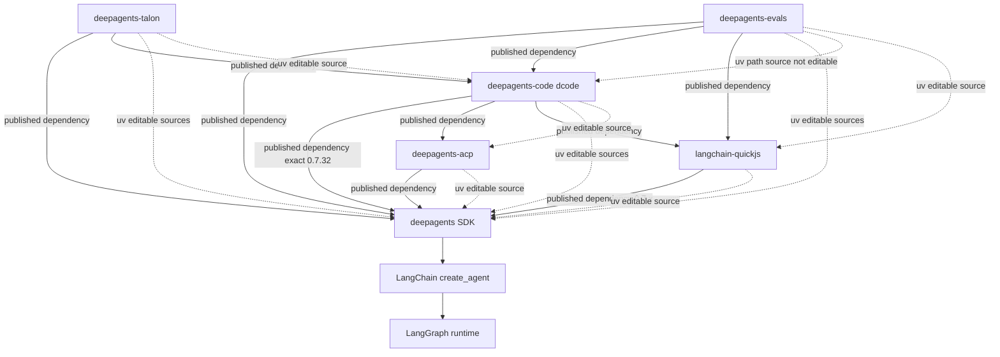

# Repository Architecture Overview

This repository is a Python monorepo of independently versioned distributions, not one deployable service. `deepagents` is the reusable SDK. First-party packages expose it through a protocol bridge, terminal coding product, local long-running host, and evaluation suite; partner packages supply optional integration capability rather than a mandatory SDK layer.

- [SDK construction and execution](./sdk-construction-execution.md)
- [Code agent](./code-agent.md)
- [Source map](./source-map.md)
- [Sandbox partners](../integrations/sandbox-partners.md)
- [Development](../operations/development.md)

## Package and release boundaries

| Distribution | Source version | Python | Role |
| --- | --- | --- | --- |
| `deepagents` | `0.7.32` | `>=3.11,<4.0` | Reusable agent-harness SDK. |
| `deepagents-acp` | `0.0.13` | `>=3.11,<4.0` | Agent Client Protocol bridge for Deep Agents graphs. |
| `deepagents-code` / `dcode` | `0.2.1` | `>=3.14,<3.15` | Terminal coding-agent product. |
| `deepagents-talon` | `0.1.0` | `>=3.14,<3.15` | Experimental local host for channels and schedules. |
| `deepagents-evals` | `0.0.1` | `>=3.14,<3.15` | Behavioral evaluation and Harbor benchmark suite. |
| `langchain-quickjs` | `0.3.9` | `>=3.11,<4.0` | Optional JavaScript REPL middleware. |

Release Please manages independent release lines for the SDK, ACP, dcode, Talon, and the Daytona, Modal, Runloop, Vercel, and QuickJS partners; it does not manage `deepagents-evals`. The release manifest is the latest released baseline used by Release Please, while each package's `pyproject.toml` declares the source distribution version and interpreter constraint.

A managed component gets its own draft release PR. When it is merged, the release workflow—not Release Please's built-in GitHub-release action—performs pre-release checks, publishes to PyPI, and creates the GitHub release. In particular, update dcode's exact SDK pin in the feature PR when dcode begins to require newer SDK behavior; do not defer that compatibility change to release time.

## Published dependencies versus checkout wiring

`project.dependencies` describes what an index-installed wheel requires. In contrast, `[tool.uv.sources]` tells `uv` to substitute a sibling checkout while working in this repository. A path source is editable only when it explicitly has `editable = true`; a path alone is not an editable install.

Published metadata uses solid arrows; dotted arrows are development-only `uv` source substitutions and do not change the dependencies embedded in a released wheel.

The material published constraints are:

- ACP depends on `deepagents` without an SDK version bound.
- dcode pins `deepagents==0.7.32`, requires ACP `>=0.0.13,<1.0.0`, and requires QuickJS `>=0.3.9,<0.4.0`.
- Talon requires SDK `>=0.7.32` and dcode `>=0.2.1,<1.0.0`.
- Evals requires SDK `>=0.6.12`, dcode `>=0.1.27`, and QuickJS `>=0.3.3,<0.4.0`.
- QuickJS supports the SDK `>=0.7.32,<0.8.0` line.

The local wiring deliberately differs. ACP maps the SDK editable; dcode maps the SDK, ACP, and partner packages editable; Talon maps the SDK and dcode editable; evals maps the SDK and QuickJS editable but dcode by a non-editable path. This enables coordinated checkout work without changing what downstream users install.

The base SDK keeps integration choice with consumers: AWS, QuickJS, and video support are extras rather than base dependencies. Products and hosts choose additional model providers, sandbox integrations, transports, and storage as needed.

## Runtime layering and ownership

Deep Agents has a narrow reusable construction boundary:

1. **LangGraph** runs graph state, checkpoints, streaming, and interrupts.
2. **LangChain `create_agent()`** builds the model, tool, and middleware agent loop on that runtime.
3. **Deep Agents** supplies the opinionated harness: backends, profiles, filesystem and execution behavior, subagent delegation, skills, memory, context management, and tool policy.

`create_deep_agent()` is the SDK assembly boundary. It accepts the model, tools, backend, middleware, subagents, state/context schemas, checkpointer, store, and cache; resolves profiles and graph components; protects required middleware and `DeepAgentState` invariants; and returns a LangGraph compiled graph. It does not own a terminal UI, protocol session, channel adapter, or scheduler.

Applications extend the SDK here with tools, middleware, subagents, skills, memory, permissions, schemas, checkpointers, stores, caches, and graph names. The general-purpose synchronous subagent is added unless a profile disables it or the caller replaces it. Synchronous delegation is presented through `SubAgentMiddleware` and the main graph's `task` tool. `AsyncSubAgent` specifications instead install `AsyncSubAgentMiddleware`, which starts a non-blocking deployed run rather than an in-process delegation.

For safe reuse, preserve this boundary: transport approval flow, terminal presentation, channel routing, and cron policy belong in a product or host above the SDK.

## Product, protocol, host, and quality roles

| Boundary | Owns | Does not own |
| --- | --- | --- |
| SDK | Harness composition, backends, profiles, middleware, and subagent integration. | Product presentation, transport, or scheduler lifecycle. |
| ACP | Translation between ACP sessions/events and a graph. | Terminal-specific approval policy and UI. |
| dcode | Terminal client/server product policy and coding-agent experience. | Generic SDK behavior. |
| Talon | Local host lifecycle, channel adapters, schedules, and graph invocation. | Production multi-tenant containment. |
| Evals | Repeatable behavioral measurement and benchmark execution. | Online request serving. |
| Partners | Optional provider, sandbox, or middleware capability. | A mandatory SDK dependency. |

### ACP and dcode

`deepagents-acp` is the protocol boundary: it constructs or accepts Deep Agents graphs, converts ACP content and events, and works with compiled LangGraph graphs and checkpointing. dcode specializes that general translation. Its `AgentServerACP` wrapper writes trusted Auto-mode approval state, attaches prompt metadata to the final user message, and invokes the wrapped graph with CLI context. Keep that terminal policy out of generic ACP.

`deepagents-code` is a reference product packaging of the SDK. Its terminal client and agent server run in separate processes: the client owns input, presentation, and approval interaction; the server owns graph execution and event streaming. Interactive and headless operation share the server runtime. Terminal configuration, skills, MCP servers, sandboxes, hooks, and user/project configuration consequently belong at this layer rather than in the SDK.

### Talon

Talon is an experimental local host: one event loop owns its channel adapters, cron scheduler, and agent runtime. It provides WhatsApp, Telegram, Discord, and Slack adapters, persistent cron jobs, MCP loading from explicit paths or `~/.deepagents/.mcp.json`, and an echo runtime when no model is configured so operators can validate lifecycle and wiring.

It is not a production or enterprise security boundary. Channel access is effectively access to configured agent capabilities, model credentials, MCP tools, and host resources. Sandboxing is opt-in: it moves shell and filesystem work, but MCP tools and channel media remain on the host. A sandbox startup failure exits rather than silently falling back to host execution.

Talon selects built-in SQLite, PostgreSQL, or MongoDB checkpoint storage by URI. Other schemes are supplied by trusted installed entry-point plugins. Checkpoint storage and conversation-history storage are independent; for remote checkpoints, thread IDs are not automatically namespaced by assistant ID, so operators must isolate assistant databases themselves.

### Evals and partners

`deepagents-evals` is a quality boundary, not a serving component. An evaluation uses a real LLM, records tool calls, file mutations, and the final response, then scores correctness and efficiency. Harbor integration runs sandboxed benchmarks, including Terminal Bench 2.0. Use it to measure a change across complete trajectories rather than to define product serving behavior.

Partner distributions add discrete optional capability. QuickJS, for example, is JavaScript REPL middleware compatible with the SDK's `0.7.x` line. Sandbox partners are similarly selected at a consuming host or product. Configure and test an integration at that boundary rather than promoting it to a core dependency unless every SDK consumer needs it.

## Change planning and focused checks

- For reusable graph construction, middleware, backend, profile, or delegation changes, start at `create_deep_agent()` and the SDK graph tests such as `libs/deepagents/tests/unit_tests/test_graph.py`.
- For ACP translation or dcode approval behavior, keep the generic server and dcode wrapper separate; investigate whether a dcode symptom is in its terminal client or agent-server process first.
- For Talon changes, exercise the focused tests nearest the boundary: channel adapters, scheduler/cron behavior, checkpoint backends, sandbox behavior, or history persistence. Do not represent its sandbox as complete containment.
- For eval changes, use the relevant trajectory and Harbor adapter tests, then run the intended real-LLM evaluation when credentials and cost permit.
- When changing manifests, review both the published constraint and the `uv` mapping. A checkout test can pass through an editable sibling while the released wheel remains incompatible.
- For a managed release, wait for its generated release PR and lockfile refresh, review its package-scoped changelog, and keep the dcode SDK pin synchronized with the functionality it uses.
