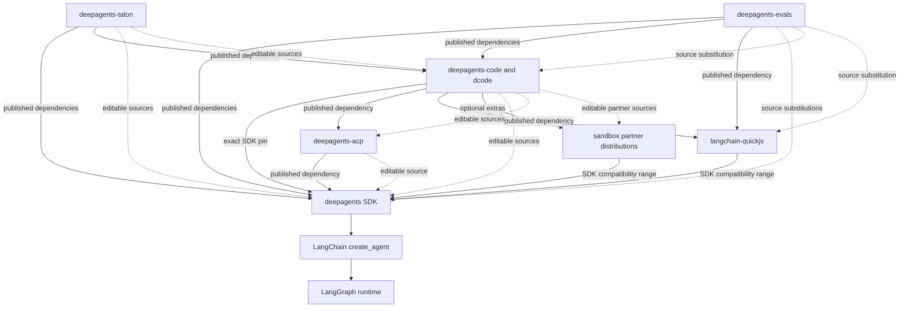
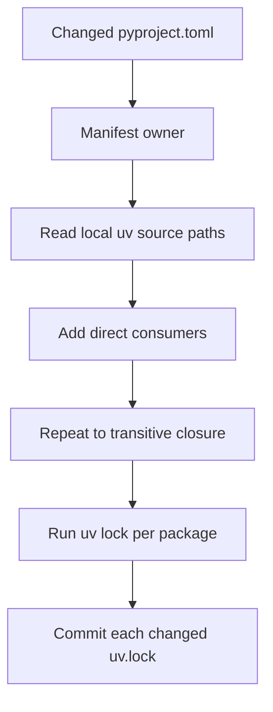

# Repository Architecture Overview

This repository is an independently versioned Python monorepo, not one deployable service. The reusable `deepagents` SDK supplies the harness; ACP adapts a graph to the Agent Client Protocol; dcode packages a terminal coding-agent product; Talon is a local long-running host; evals is the quality boundary; and partner distributions supply optional sandbox or middleware capabilities. Installing a package makes that distribution available—it does not transfer its user interface, provider credentials, or runtime policy into the SDK.

Related: [SDK construction and execution](./sdk-construction-execution.md), [system source map](./source-map.md), [ACP integration](../integrations/acp.md), [sandbox partners](../integrations/sandbox-partners.md), [development](../operations/development.md), and [quickstart](../quickstart.md).

## Distribution contracts and roles

A package's `pyproject.toml` is its installer-visible contract: its version, `requires-python`, normal dependencies, extras, and console scripts are what downstream users receive. The current source packages are:

| Distribution | Source version | Python contract | Architectural role |
| --- | --- | --- | --- |
| `deepagents` | `0.7.38` | `>=3.11,<4.0` | Reusable, opinionated agent-harness SDK. |
| `deepagents-acp` | `0.0.13` | `>=3.11,<4.0` | ACP protocol-to-graph bridge. |
| `deepagents-code` / `dcode` | `0.2.8` | `>=3.14,<3.15` | Prebuilt terminal coding-agent product; both script names call the same CLI. |
| `deepagents-talon` | `0.1.0` | `>=3.14,<3.15` | Experimental local host for channels, schedules, and agent lifecycle. |
| `deepagents-evals` | `0.0.1` | `>=3.14,<3.15` | Evaluation suite and Harbor integration, not an online-serving component. |
| `langchain-daytona`, `langchain-modal`, `langchain-runloop` | `0.0.9`, `0.0.8`, `0.0.7` | `>=3.11,<4.0` | Optional sandbox integrations. |
| `langchain-vercel-sandbox`, `langchain-quickjs` | `0.0.2`, `0.3.12` | `>=3.11,<4.0` | Optional Vercel sandbox and JavaScript-REPL middleware integrations. |

Deep Agents sits above LangChain's `create_agent()`, which builds the agent loop on LangGraph. `create_deep_agent()` is the SDK assembly boundary: it composes the harness around that stack. It supports inline, task-tool subagents and non-blocking deployed `AsyncSubAgent` specifications as separate delegation mechanisms. ACP, dcode, and Talon are consumers of that SDK boundary rather than alternative SDK runtimes.

## Published dependencies versus checkout wiring

`[project.dependencies]` and `[project.optional-dependencies]` define the published wheel contract. In contrast, `[tool.uv.sources]` tells `uv` to substitute a sibling checkout while developing in this repository; it is not published metadata. A source is editable only when its mapping explicitly sets `editable = true`.



*Solid edges are installer-visible dependency relationships; dotted edges are development-only `uv` source substitutions.*

### Coordinated SDK floors

The source manifests now encode three distinct compatibility policies. Dcode pins `deepagents==0.7.38`: raise that pin in the change that starts requiring newer SDK behavior, because an editable checkout can otherwise hide an insufficient PyPI requirement. Dcode also requires ACP `>=0.0.13,<1.0.0` and QuickJS `>=0.3.12,<0.4.0`.

Talon requires `deepagents>=0.7.38` and `deepagents-code>=0.2.7,<1.0.0`. Each of the five partner distributions—Daytona, Modal, QuickJS, Runloop, and Vercel—requires `deepagents>=0.7.38,<0.8.0`. These are lower-bound compatibility promises, not assertions that a checkout must resolve the SDK from PyPI at that floor. ACP deliberately declares `deepagents` without a version bound. Evals retains its independently chosen floors of `deepagents>=0.7.32`, `deepagents-code>=0.2.1`, and `langchain-quickjs>=0.3.3`.

The checkout graph is deliberately not identical to this dependency graph:

- ACP maps only `deepagents` to its editable sibling.
- Dcode maps the SDK, ACP, and all five partner distributions to editable siblings, even though provider packages remain optional wheel extras.
- Evals maps its dcode sibling **non-editably**, while its SDK and QuickJS mappings are editable.
- Talon maps only the direct SDK and dcode siblings editable. ACP or QuickJS may occur in its resolved local closure through dcode; they are not Talon direct source mappings or direct wheel requirements.
- All five partner packages map the local SDK editable for checkout development.

### Extras are install choices, not policy or isolation

Extras add implementation dependencies but do not configure credentials, create remote resources, or constitute an authorization boundary. The SDK keeps AWS, QuickJS, and video support optional. Dcode includes QuickJS and `langsmith[sandbox]` in its base requirements, provides provider extras for AgentCore, Daytona, Modal, OpenShell, Runloop, and Vercel, and retains an empty `quickjs` extra for compatible install commands because QuickJS is now a normal dependency.

Talon's base wheel contains its host dependencies and default SQLite support. Its `history-local`, `history-voyage`, and `history-openai` extras select semantic-history implementations; `mongodb` and `postgres` install matching remote persistence implementations; and `openshell` obtains the provider through `deepagents-code[openshell]`. Its `media` and `media-cpu` extras are mutually exclusive. On Linux, the latter routes only `torch` and `torchaudio` through the explicit `pytorch-cpu` index; it does not alter published wheel metadata.

## Release lines and baseline

Release Please manages distinct draft release PRs for the SDK, ACP, dcode, Talon, and the five partner distributions. Evals is intentionally absent from that configuration. The release configuration uses separate draft PRs and suppresses Release Please's own GitHub-release step; merging a managed release PR triggers the repository release workflow, which performs checks and creates the PyPI and GitHub releases.

The release manifest is the current released-version baseline: `0.7.38` for the SDK, `0.0.13` for ACP, `0.2.8` for dcode, `0.1.0` for Talon, and the table's five partner versions. It is distinct from a package source manifest. Release Please updates it; it is not ordinary dependency metadata. This separation matters when adding a managed package: the baseline represents what has already shipped, while the package's own source version represents what its wheel will declare.

## Lockfile lifecycle

A package-local `uv.lock` is the generated concrete development/CI resolution, not a second manifest. Do not hand-edit it. A manifest edit can invalidate more than the owner's lock: the lock tooling reads every `[tool.uv.sources]` path, finds all reverse consumers transitively, and includes non-editable paths as well as editable ones.



*Lock refresh begins at a changed manifest and includes its full reverse local-source-consumer closure.*

A floor change in `libs/deepagents/pyproject.toml` therefore reaches every package that maps the SDK locally: ACP, dcode, evals, Talon, and all five partners. The closure continues through consumers of dcode, so evals and Talon are included even when a dcode manifest change is the starting point. The non-editable evals-to-dcode mapping still participates.

Use the helper from the repository root rather than selecting locks manually:

```bash
python .github/scripts/checks/refresh_lockfiles.py libs/deepagents/pyproject.toml
```

For a dcode-only manifest change, substitute `libs/code/pyproject.toml`; it re-locks dcode plus its Talon and evals consumers. The helper selects Python 3.14 for ACP, dcode, evals, and Talon locks, and Python 3.12 for other discovered package directories. Local success only proves the resolved workspace graph; review the published requirement, optional extra, source mapping, and refreshed locks when changing a dependency boundary.

## Runtime ownership boundaries

| Boundary | Owns | Does not own |
| --- | --- | --- |
| SDK | Harness composition, backends, profiles, middleware, and subagent integration. | ACP transport, terminal UI, channels, or schedules. |
| ACP | Session-local protocol state and ACP-to-graph translation. | Dcode's terminal-specific policy. |
| dcode | Terminal product behavior, including its ACP specialization. | Generic ACP semantics or sandbox provider implementations. |
| Talon | One local process's channel adapters, cron, and agent lifecycle. | Production multi-tenant containment. |
| Evals | Repeatable behavioral measurement and Harbor benchmarks. | Online serving. |
| Partner distributions | Optional middleware or sandbox-provider implementations. | Mandatory SDK installation. |

`AgentServerACP` accepts either a compiled graph or a factory receiving `AgentSessionContext` with the working directory, mode, and optional model. It retains protocol state by session. Dcode's ACP wrapper belongs above this generic bridge: in Auto mode it records trusted approval state, annotates the final user message with prompt metadata, and supplies CLI context to the graph.

Talon is explicitly experimental and is a single-event-loop local host, not a production security or multi-tenant boundary. Its default shell and filesystem work runs on the host. Configuring a sandbox moves that work to the selected provider and startup fails if the sandbox cannot start rather than falling back to host execution. MCP, web, and channel-media handling remain on the host, as do skills and memory, so sandbox selection is not complete containment. A sandbox Talon creates is deleted on shutdown unless the operator attached an existing one.

Talon selects built-in SQLite, PostgreSQL, or MongoDB checkpoint storage by URI, and trusted installed entry-point packages can provide other schemes. Checkpoints and conversation history are separate persistence concerns; remote checkpoint thread IDs are not automatically assistant-namespaced. Its assistant-local `tools.json` maps exact tool names to approval booleans. Updates use compare-and-swap, an active invocation keeps its policy snapshot, and an invalid policy file fails closed for the next invocation. This is a prompting control, not authorization or sandbox isolation.

## Safe change checklist

- Start SDK construction, middleware, profile, or delegation work at `create_deep_agent()` and its focused SDK tests; keep inline `task` delegation distinct from asynchronous deployed subagents.
- Treat a floor update as a published compatibility promise. Change dcode's exact pin with any new SDK usage; keep Talon and partner floors aligned with the minimum SDK behavior they require; do not infer a published floor from a workspace source mapping.
- For a package change, validate under its declared Python contract. Inspect installer-visible requirements separately from `uv` source mappings, refresh the full reverse-consumer lock closure, and commit every changed lock.
- For ACP changes, retain the compiled-graph versus factory distinction and verify session configuration, state, and durable-load behavior. Keep dcode policy in its wrapper rather than generic ACP translation.
- For Talon, do not describe sandboxing or approval prompts as a complete security boundary. Test the affected lifecycle, persistence, channel, cron, MCP, or policy behavior at the host boundary.
- For a managed release, review the package-specific draft release PR and changelog, and ensure dcode's exact SDK pin reflects the minimum SDK behavior it uses.
