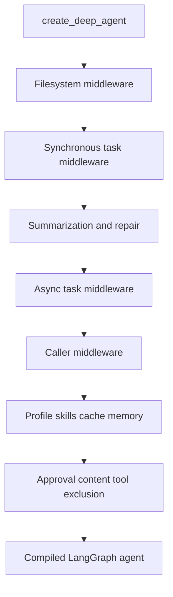
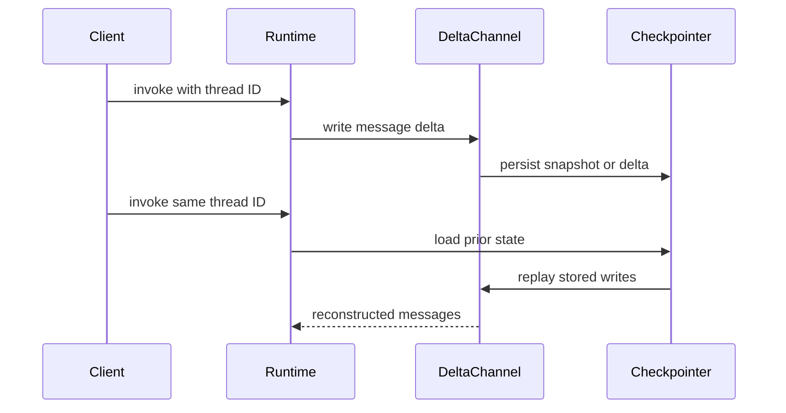

# Runtime Behavior, State, and Delegation

`create_deep_agent()` is the runtime assembly boundary. It calls LangChain `create_agent()` with caller tools, the selected backend's middleware, the assembled Deep Agents stack, and optional `context_schema`, `checkpointer`, `store`, `cache`, and state schema. The resulting graph has recursion limit `9_999` and Deep Agents integration/version metadata. Deep Agents forwards persistence objects; it does not select or operate a durable checkpointer for the application.

A caller chooses continuation by invoking the graph with the same LangGraph `thread_id`. In particular, configure a checkpointer before depending on multi-turn continuation or a human-approval pause. See [State Persistence](/openwiki/concepts/state-persistence.md) for persistence operations, [Backends](/openwiki/concepts/backends.md) for file-storage ownership, and [Subagents and Skills](/openwiki/concepts/subagents-skills.md) for configuration guidance.

## Assembly and enforcement order

The main graph begins with `FilesystemMiddleware`; `SubAgentMiddleware` follows when synchronous subagents are available. Summarization and `PatchToolCallsMiddleware` follow, and `AsyncSubAgentMiddleware` is added when remote specs are configured. User middleware is inserted after that base stack and before the profile/skills/prompt-cache/memory tail, unless it replaces a named built-in in place. Human approval and unsupported-content handling are tail layers. Profile middleware exclusion is applied around user customization, while `_ToolExclusionMiddleware` is deliberately appended last: a custom model wrapper cannot restore a tool that the profile excluded.

The default synchronous `general-purpose` subagent is added unless the active harness profile disables it or a spec of that name was supplied. Consequently, async-only subagents do not imply the synchronous `task` tool, and a graph without synchronous specs and with the default disabled has no `task` tool. Async specs are recognized and routed separately into `AsyncSubAgentMiddleware`.

This is the middleware assembly order. Replacement and exclusion rules can alter individual layers, but tool exclusion remains the final tool visibility boundary.

Filesystem permissions are enforced at built-in filesystem tools, not at direct backend access. Rules are evaluated in declaration order; the first match can allow, deny, or interrupt and unmatched calls are allowed. Interrupting filesystem rules become `interrupt_on` entries; explicit `interrupt_on` entries win for a duplicate tool name. A top-level configuration installs `HumanInTheLoopMiddleware`; declarative subagents inherit it unless their specification supplies its own. Compiled and remote subagents are separate graphs and own their own approval policy.

## Checkpointed state and recovery

`DeepAgentState.messages` is a `DeltaChannel` using the local message reducer and a snapshot frequency of 50. It stores/replays deltas between snapshots rather than repeatedly storing the full transcript, reducing message checkpoint growth from O(N²) to O(N). A custom `state_schema` must preserve that channel.

The reducer accepts raw message-like values, coerces them to messages, and uses stable IDs as its merge identity: new IDs append and an existing ID replaces its prior record. `RemoveMessage` removes an ID, and the last `REMOVE_ALL_MESSAGES` sentinel discards the replay base and earlier writes in that batch. It also treats a missing replay base as empty. IDs must be assigned before checkpoint serialization rather than generated during replay, or the replay would not be deterministic.

This is the continuation path for a checkpointed conversation.

`PatchToolCallsMiddleware` handles a different resume hazard before the agent loop begins. It detects AI tool calls, including invalid calls, with no matching `ToolMessage`; it appends a correlated error result that distinguishes malformed/truncated arguments from a call that may have been cancelled or interrupted. It replaces message state atomically with `REMOVE_ALL_MESSAGES` followed by the repaired history, so the resumed model does not receive a dangling call.

### Private and middleware state

State schemas supplied by the caller and assembled middleware are scanned for `PrivateStateAttr`. Those names are installed on every final `SubAgentMiddleware`, including a caller replacement. Ordinary inline delegation removes private keys before child invocation and again before merging child updates. It also excludes messages, todos, structured output, skill bookkeeping, rubric state, and other delegation-inappropriate channels. Unchanged inherited values are not merged back, preventing conflicts or double application when multiple tasks return concurrently.

The protection depends on resolving annotations at runtime. If a schema refers to a type imported only under `TYPE_CHECKING`, discovery logs a warning and none of that schema's private fields can be protected. Treat this as a security and correctness configuration failure, not a harmless typing limitation.

## Binary payload offload and hydration

Binary base64 content in message blocks can be stored outside graph state under `{artifacts_root}/blobs/<sha256>`. The checkpointed block retains its non-payload fields and a `deepagents_blob` SHA-256 reference. Upload is best effort: an upload exception or per-file error leaves that payload inline instead of losing it.

Before portable content is sent to a remote fork, blob references are hydrated from a request-scoped cache or the backend. Downloaded content is accepted only when its SHA-256 matches the reference; unavailable, failed, or tampered downloads become a textual notice rather than unverified bytes. The transient `_blob_payloads` cache is private, untracked state, so it does not become part of the checkpoint contract.

## Synchronous `task` delegation

The `task` tool selects an inline child, invokes it through `invoke` or `ainvoke`, and returns a `Command` containing a `ToolMessage` correlated to the parent tool-call ID. A child `structured_response` is JSON-serialized; otherwise the result is the last non-empty `AIMessage` text, avoiding an empty terminal message. A compiled child must return state with `messages`, or delegation raises `ValueError`.

An isolated child receives a new `HumanMessage` containing the task description plus eligible non-private state. A declarative child is compiled by Deep Agents with the parent state schema. By contrast, a `CompiledSubAgent` is opaque: it does not inherit that schema and must be independently compiled with compatible channels.

Forks are experimental and intentionally narrower:

- A declarative fork receives the parent effective conversation, including an applied summarization event, its permitted inherited state, and a task message. It sets an internal fork marker so its visible `task` tool refuses recursive delegation at call time.
- Fork-specific state excludes prior structured response, pinned skills, rubric state, summarization session/event bookkeeping, and prior skill disclosure. A declarative fork can rebuild compatible private channels; a compiled fork strips private keys because its channels are unknown.
- A fork cannot specify its own `skills`, because doing so would diverge from the inherited prompt context. Its own tool configuration remains allowed.

Parent configuration and callbacks propagate through the LangGraph runtime; Deep Agents adds an `ls_agent_type="subagent"` tracing marker without manually duplicating ambient callback/tags configuration.

## Remote asynchronous delegation

`AsyncSubAgentMiddleware` exposes five tools: `start_async_task`, `check_async_task`, `update_async_task`, `cancel_async_task`, and `list_async_tasks`. It uses LangGraph SDK clients against Agent Protocol servers. A launch creates a remote thread and run, immediately returns a task ID (the remote thread ID), and records the agent name, thread/run IDs, timestamps, and status under `async_tasks`. Its reducer merges entries by task ID, allowing state to retain task tracking across graph transitions and context reduction.

A check fetches the current remote run and, on success, fetches thread values to report the final message content. An update starts a new run on the same remote thread with `multitask_strategy="interrupt"`, replaces the tracked run ID, and keeps the task ID. Cancellation calls the SDK for the tracked run. List fetches live status for nonterminal entries but falls back to cached status if that lookup fails; it filters on cached state before the live lookup. Errors launching, checking, updating, or cancelling return tool-error text rather than corrupting the stored task record.

Async isolated launches send only the task description. An experimental async fork snapshots the parent's effective history, clears nonportable tool artifacts and local eviction metadata, hydrates portable blobs, then serializes messages for the remote graph. It inherits conversation at launch only: remote tools, prompt, checkpointing, credentials, and approval configuration remain the remote graph's responsibility.

A remote specification may provide headers; the SDK defaults `x-auth-scheme` to `langsmith` unless supplied. Omitting `url` chooses local ASGI transport, which is valid only from an async parent entrypoint such as `ainvoke`; synchronous `invoke` requires a reachable URL.

## Change and test checklist

- Preserve the `DeltaChannel` on `messages`, its reducer semantics, and the `REMOVE_ALL_MESSAGES` repair path when changing state or resume behavior.
- Test private-state stripping in both directions and parallel inline tasks; runtime-resolvable annotations are required for the protection to apply.
- Keep `ToolMessage` results correlated with the originating call. Verify structured and empty-terminal child result cases and the compiled-child `messages` failure.
- Treat blob references as integrity-checked backend data. Test upload failure, cold-cache hydration, missing blob degradation, and remote-fork hydration.
- Treat compiled and remote children as ownership boundaries. Test their approval, schema, storage, credentials, and lifecycle independently of the parent.
- Exercise remote launch/check/update/cancel/list behavior, including stale cached status and the local-ASGI async-only restriction.
