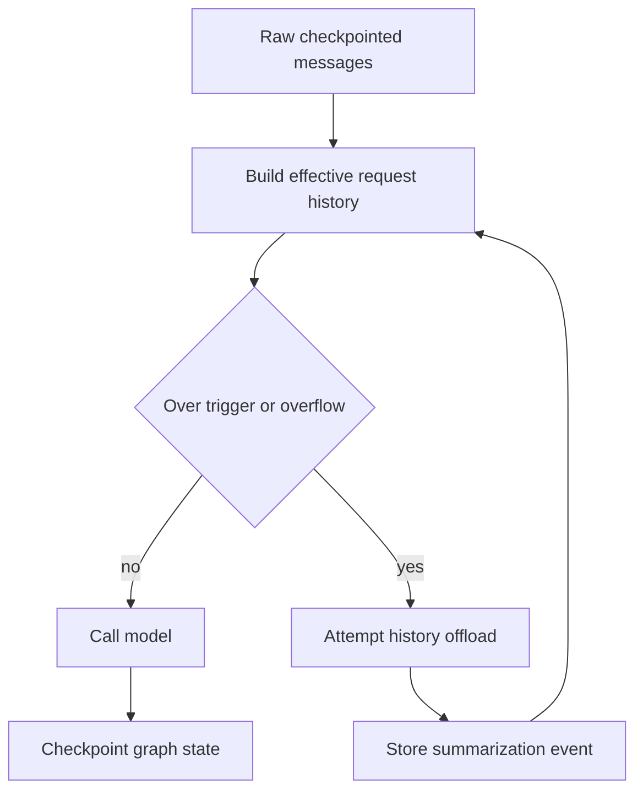
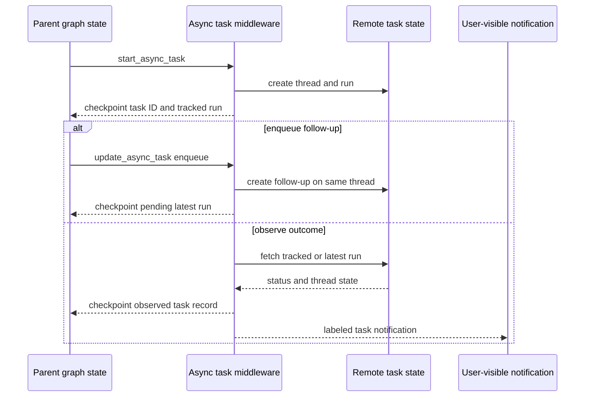
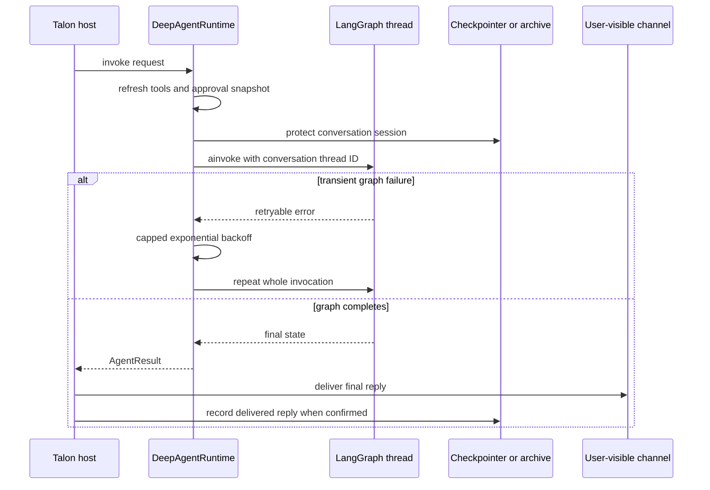

# Runtime Behavior and Failure Boundaries

This page describes execution-time ownership rather than API shape. A Deep Agents graph can checkpoint its parent state when supplied a checkpointer, while an async subagent is a separate Agent Protocol thread and run. Task records in the parent graph are durable only to the degree that the graph's checkpointer is durable; they are a cached tracking record, not the remote service's authority. Notifications, remote observation, and Talon channel delivery are deliberately best-effort at their respective boundaries. See [State Persistence](/openwiki/concepts/state-persistence.md), [Context Management](/openwiki/concepts/context-management.md), and [Talon Integration](/openwiki/integrations/talon.md).

## Execution state and request shaping

`create_deep_agent` is the composition boundary: it assembles caller tools, a selected backend, ordered Deep Agents middleware, and optional checkpointer, store, cache, context, and state schemas into a LangGraph agent. The graph is configured with recursion limit `9_999` and Deep Agents integration/version metadata. A checkpointer is what makes graph state resumable; construction alone does not make it durable.

`DeepAgentState.messages` uses a `DeltaChannel` with snapshot frequency 50. Its reducer coerces message-like writes, deduplicates or replaces by ID, applies removals and the last reset sentinel, and replays an absent base as empty. IDs are assigned before checkpoint serialization, preserving deterministic replay. Before execution, `PatchToolCallsMiddleware` repairs an interrupted history with unmatched AI tool calls by appending error `ToolMessage` records and resetting the repaired sequence; a fully answered history is unchanged.

Summarization shapes the next model request without deleting the raw message log. It records `_summarization_event`, which describes a summary, cutoff, and optional backend-history path; effective history combines that event with the preserved tail. It attempts history offload before summarization, but an offload failure does not stop compaction and leaves no recovery path for those older messages. Claude-bound reasoning blocks are removed only from the preserved messages used to build summarized effective history, not from raw state. Recognized context overflow receives at most one recovery attempt with strictly smaller input; an unchanged or irreducible request raises `ContextOverflowError`, and unrelated bad requests propagate.

Caption: compaction records an effective-history event while raw messages remain the parent graph's history.

`SummarizationToolMiddleware` exposes manual-only `compact_conversation`. It shares `_summarization_event` with automatic summarization and uses an eligibility threshold of roughly half the automatic trigger. If nothing is eligible or summary generation fails, it returns a tool message without changing that event.

## Skills are cached state with progressive disclosure

`SkillsMiddleware` lists valid `SKILL.md` metadata from backend sources before an agent run and stores `skills_metadata` and load errors in state. Sources are read in order; a later source replaces an earlier skill with the same name. A list, including an empty list, means the metadata is already cached for that thread. Setting `skills_metadata` to `None` requests a reload. Load diagnostics are logged and, when the prompt fragment is enabled, are bounded, HTML-escaped, and explicitly presented as untrusted diagnostics.

The model initially receives locations and metadata, not every skill body. It can read a skill through `read_file`; alternatively `pinned_skills` appends selected readable `SKILL.md` bodies as human messages before a model call and then clears the pin request. This is stateful prompt shaping: pinning is checkpointed as messages, whereas the system listing is reconstructed from cached metadata on each request.

A skill may declare `metadata.include_tools`. Such a tool is not registered as generally callable: reading or pinning the declaring skill causes the next model request to disclose it, records that disclosure in state, and the tool-call wrapper resolves it again before execution. An undisclosed name reaches the normal invalid-tool path. A dynamic `SkillToolResolver` therefore needs stable, cheap results within a thread; it runs on model calls after a relevant read and on a gated execution.

Talon fingerprints host-readable `<source>/<skill>/SKILL.md` entries for each conversation. When the fingerprint changes, it sends `skills_metadata=None` in the next graph payload so middleware reloads it. This detects additions, edits, and removals visible to the host, but it is not a content transaction and the scan is capped; failure during an invocation forgets the process-local fingerprint so a later turn retries detection.

## Async tasks: two authorities and a stable task identity

`AsyncSubAgentMiddleware` provides `start_async_task`, `check_async_task`, `update_async_task`, `cancel_async_task`, and `list_async_tasks`. Starting creates a remote child thread and background run, immediately returns the child thread ID as `task_id`, and writes a task record under `async_tasks` in parent graph state. The record's tracked `run_id`, status, and timestamps are a local observation cache. A remote Agent Protocol server owns the actual thread and run; check and list refresh parent state when possible, and lookup failures retain cached state rather than deleting the task.

Caption: remote task state executes the work, parent graph state tracks observations, and notifications are user-visible inputs rather than a remote delivery guarantee.

A local no-`url` specification uses ASGI transport and requires an async parent entrypoint such as `ainvoke`; synchronous invocation requires a reachable URL. Child threads carry subagent and parent-thread metadata. Local tasks may additionally receive the parent assistant ID, enabling direct wake-up. URL targets and `notify_parent=False` omit that assistant ID while retaining parent-thread association; webhooks, when configured, are passed to run creation. `mode="isolated"` sends only delegated work; experimental `mode="fork"` sends a serialized, portable snapshot of the parent’s effective conversation, which is a one-way launch-time handoff rather than shared state.

### Updates, supersession, waiting, and cancellation

A task keeps its thread-based `task_id` while its tracked run changes. The default `update_strategy="interrupt"` creates replacement work on the same thread. `update_strategy="enqueue"` creates a follow-up without interrupting active work, records the new run as `pending`, and retains earlier run IDs as `superseded_run_ids`. Only one enqueued follow-up per task per model turn is accepted, preventing simultaneous calls that saw the same old state from corrupting tracking.

An earlier run may report after a queued follow-up exists. At parent-run entry, middleware rewrites that notification to say it is an earlier-run update, preserving its result but preventing the model from treating it as the current follow-up’s outcome. Cancellation marks the parent record `cancelled`; queued cancellation also attempts the pending or running superseded runs newest-first.

A successful run paired with an interrupted child thread represents nonterminal `waiting`, including the child-thread interrupt details; the user must answer on that child thread. A server run whose status is `interrupted` instead maps to `cancelled`. Observation follows externally replaced work where appropriate, but never revives a task the parent already cancelled. A waiting task needs no remote cancellation request, and later checks preserve the parent's cancellation.

## Notifications are best effort; polling closes the gap

Every Deep Agents graph includes `_ParentNotifierMiddleware`. On the asynchronous path, only the outermost graph reports a task run's final success or model-call failure; `GraphInterrupt` is re-raised, not reported as a result. Reported run IDs suppress duplicate notification attempts.

Direct wake-up is deliberately opportunistic. A locally linked child reads its parent thread and creates a notification run with `multitask_strategy="reject"` only while the parent is `idle` or `error`. It does not interrupt a busy or approval-paused parent. Missing threads, races, and SDK failures are logged but do not fail the child, so direct delivery is never evidence that the parent recorded the outcome.

The async parent path compensates by polling unfinished tasks at agent start, before model calls, and once after a final answer that has no tool calls. A changed reportable outcome is inserted as a notification and can cause one additional model turn; unchanged observations are not repeated. Each remote observation is limited to five seconds. An SDK failure or timeout skips only that task and leaves it eligible for a later poll. The synchronous hooks expose task tools but do not poll.

Notifications are marked as non-user input and wrapped in a task header. Child text is escaped and clipped; standard image, audio, video, and file blocks pass through, while reasoning, tool-call, and unknown assistant-only blocks are discarded. Automatically reported errors disclose the failure class rather than exception details. Use `check_async_task` when full output or pause details are needed.

## Talon request lifecycle and retry boundary

`DeepAgentRuntime.start()` resolves subagents and approvals, then creates the graph. For each request, `invoke()` refreshes runtime tools, rebuilds the graph if the approval snapshot changed, binds request-scoped authorization, hooks, scheduling, history, progress, and model-selection context, and protects the conversation session when using `ConversationSaver`. It invokes the graph with the request’s conversation ID as LangGraph `thread_id`. On a successful turn it acknowledges background results to the runtime; later host delivery remains a separate concern.

Caption: the graph/checkpointer owns conversation state, whereas channel delivery and the archive promotion of a reply happen outside the graph invocation.

Talon retries the **whole asynchronous graph invocation** for its configured transient classification, with cancellation propagated and exponential backoff capped at ten seconds. This scope can replay work already begun by the graph, unlike `CodeModelRetryMiddleware`, which retries only a model node and consequently does not replay completed tool calls. Talon also sends continuation nudges after empty output and finally a forced-summary prompt; those are new graph invocations, not a provider retry.

When a persistent `ConversationSaver` is configured, host-confirmed final delivery is what makes a reply eligible for archive history recording. A graph result acknowledged by the runtime is therefore not equivalent to an observed user delivery. Recovery after interruption reads the latest checkpoint, repairs dangling tool calls, and appends an interruption marker to that checkpoint.

## Change and test focus

- Keep parent-side task records and remote state distinct in code and tests. Cover enqueue, superseded notifications, externally replaced runs, waiting, cancellation, and cached-status fallback independently.
- Test delivery separately from polling: direct wake-up may be rejected or lost, while a five-second polling error must leave the task eligible for the next observation.
- Preserve notification boundaries: escaped and clipped child text, allowed media, dropped assistant-only blocks, non-user metadata, and redacted automatic failure details.
- Test skills as state transitions: source precedence, cache/reload with `skills_metadata=None`, pinned content, load-warning sanitization, and gated tool disclosure/execution.
- Test Talon’s whole-invocation retries separately from model-node retries and test that archive promotion follows confirmed channel delivery rather than merely a graph result.
