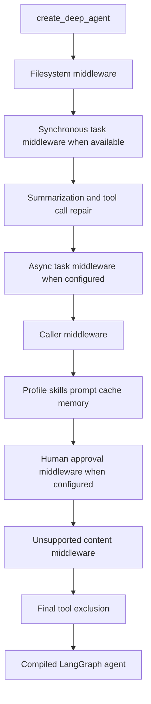
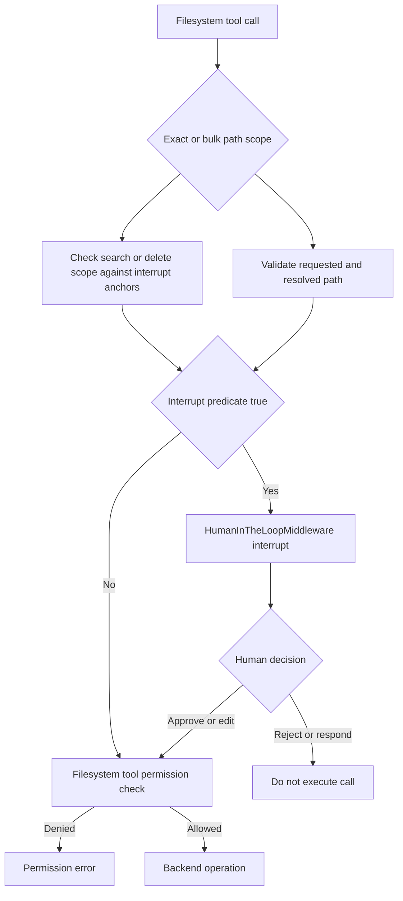
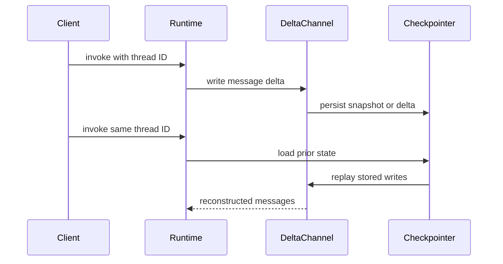
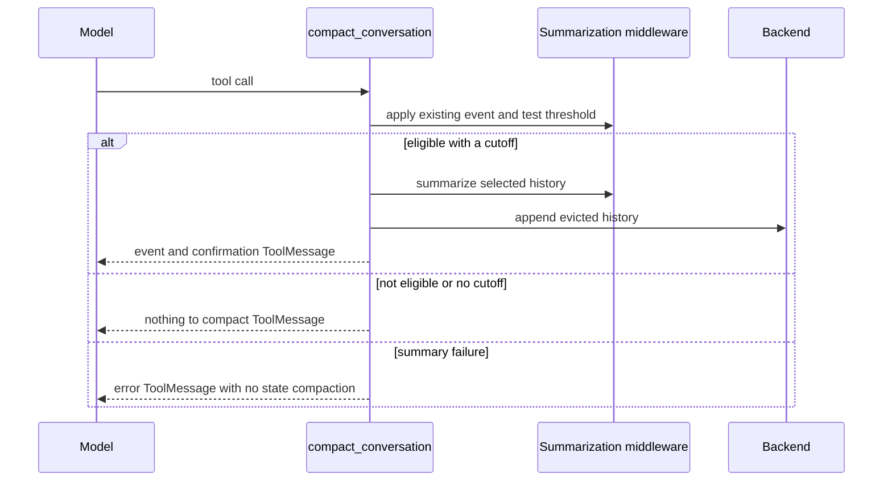
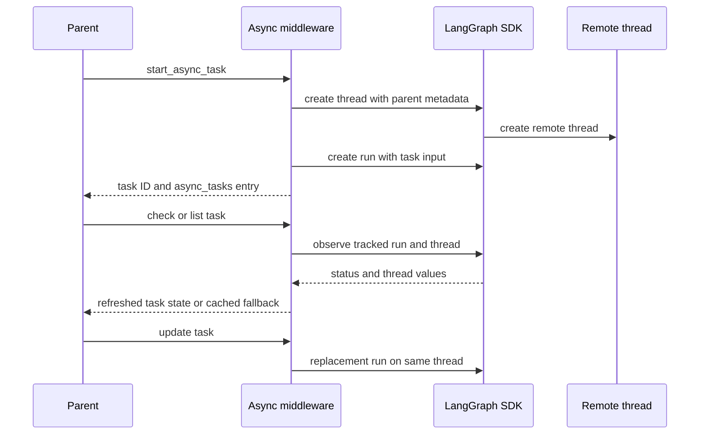

# Runtime Behavior, State, and Delegation

`create_deep_agent()` is the runtime assembly boundary. It calls LangChain `create_agent()` with caller tools, the selected backend's middleware, the assembled Deep Agents stack, and optional `context_schema`, `checkpointer`, `store`, `cache`, and state schema. The resulting graph has recursion limit `9_999` and Deep Agents integration/version metadata. Deep Agents forwards persistence objects; it does not select or operate a durable checkpointer for the application.

A caller chooses continuation by invoking the graph with the same LangGraph `thread_id`. Configure a checkpointer before depending on multi-turn continuation or a human-approval pause. See [State Persistence](/openwiki/concepts/state-persistence.md), [Permissions and Human-in-the-Loop](/openwiki/concepts/permissions-hitl.md), and [Filesystem Tools](/openwiki/concepts/tools-filesystem.md).

## Assembly and enforcement order

The main graph begins with `FilesystemMiddleware`; `SubAgentMiddleware` follows when synchronous subagents are available. Summarization and `PatchToolCallsMiddleware` follow, and `AsyncSubAgentMiddleware` is added when remote specs are configured. User middleware is inserted after that base stack and before the profile/skills/prompt-cache/memory tail, unless it replaces a named built-in in place. The filesystem-derived or explicit `HumanInTheLoopMiddleware`, `UnsupportedContentMiddleware`, and finally tool exclusion are tail layers. `_ToolExclusionMiddleware` is deliberately appended after custom middleware: a custom model wrapper cannot restore a tool that the profile excluded.

The default synchronous `general-purpose` subagent is added unless the active harness profile disables it or a spec of that name was supplied. Consequently, async-only subagents do not imply the synchronous `task` tool, and a graph without synchronous specs and with the default disabled has no `task` tool. Async specs are recognized and routed separately into `AsyncSubAgentMiddleware`.

Caption: `create_deep_agent()` builds the main middleware stack in this order; replacement and profile filtering can alter individual layers, while tool exclusion remains the final model-facing tool boundary.

### Path-sensitive filesystem approval

Filesystem permissions are enforced by `FilesystemMiddleware` for built-in filesystem tools, not by direct backend access. A rule applies to `read` and/or `write` operations over absolute glob paths; rules are evaluated in declaration order and an unmatched ordinary operation is allowed. `deny` remains a tool-level enforcement decision. An `interrupt` rule instead contributes a path-sensitive `when` predicate to the `HumanInTheLoopMiddleware` configuration assembled by `create_deep_agent()`.

The assembly helper registers only filesystem tools whose operation has an interrupt rule: `ls`, `read_file`, `glob`, and `grep` for reads; `write_file`, `edit_file`, and `delete` for writes. Its generated entries permit the standard human decisions `approve`, `edit`, `reject`, and `respond`. Explicit `interrupt_on` entries are merged afterward and therefore replace a generated entry with the same tool name. That replacement changes approval routing, not filesystem denial enforcement.

Exact-path tools (`read_file`, `write_file`, and `edit_file`) pause only when the requested path resolves to an interrupt decision. The predicate validates the path and, when a backend is available, evaluates both the requested path and its symlink-resolved target. A deny decision suppresses the pause because the tool will return a permission error instead.

Bulk tools use a different safety rule: `ls`, `glob`, `grep`, and recursive `delete` can affect or disclose descendants, so their predicate pauses when the requested subtree overlaps the literal anchor of an interrupt glob. A missing bulk path and current-directory aliases are treated as root and pause whenever that operation has an interrupt rule. `glob` also gates an absolute `pattern`, which can ignore its nominal `path`; a relative pattern containing `..` is conservatively interrupting. These rules prevent a benign-looking search root from bypassing review of a protected subtree. After approval, interrupt-mode results are retained; only `deny` results are filtered.

Caption: interrupt rules route only calls whose path or bulk scope can reach an interrupt pattern; the filesystem tool still enforces denial when execution is attempted.

Permissions do not constrain arbitrary direct backend calls. They also cannot represent policy for a shell-capable default backend: a nonempty permission set is rejected when that backend supports command execution, except when every pattern is scoped to a route of a `CompositeBackend`. Treat this as a containment boundary, not a reason to assume `execute` is permission-filtered.

## Checkpointed state and recovery

`DeepAgentState.messages` is a `DeltaChannel` using the local message reducer and a snapshot frequency of 50. It stores/replays deltas between snapshots rather than repeatedly storing the full transcript, reducing message checkpoint growth from O(N²) to O(N). A custom `state_schema` must preserve that channel.

The reducer accepts raw message-like values, coerces them to messages, and uses stable IDs as its merge identity: new IDs append and an existing ID replaces its prior record. `RemoveMessage` removes an ID, and the last `REMOVE_ALL_MESSAGES` sentinel discards the replay base and earlier writes in that batch. It also treats a missing replay base as empty. IDs must be assigned before checkpoint serialization rather than generated during replay, or the replay would not be deterministic.

Caption: a configured checkpointer, keyed by the caller's thread ID, owns continuation storage while `DeltaChannel` reconstructs the message history.

`PatchToolCallsMiddleware` handles a different resume hazard before the agent loop begins. It detects AI tool calls, including invalid calls, with no matching `ToolMessage`; it appends a correlated error result that distinguishes malformed/truncated arguments from a call that may have been cancelled or interrupted. It replaces message state atomically with `REMOVE_ALL_MESSAGES` followed by the repaired history, so the resumed model does not receive a dangling call.

### Compaction and recoverable history

The default `create_deep_agent()` stack uses Deep Agents summarization. Automatic compaction is tracked as `_summarization_event` rather than rewriting `messages`: the event identifies a cutoff, a summary `HumanMessage`, and an optional backend history path. The effective model context is the summary plus the retained tail, but the raw message log remains available for replay, evaluation, and delegation. Evicted history is appended under `/conversation_history/{session_id}.md`; failure to offload is represented by a `None` path rather than preventing a summary. The middleware can also truncate old large `write_file` and `edit_file` arguments and retries with summarization after a provider `ContextOverflowError`.

`SummarizationToolMiddleware` optionally exposes `compact_conversation`. It shares the automatic middleware's event/session state, but never runs by itself: the model or an external action must call the tool. To avoid premature loss of working context, it requires the effective conversation to reach roughly half the configured automatic trigger, then determines a cutoff, creates a summary, and attempts offload. A backend-offload failure still produces a compaction event; a summary-generation failure returns a correlated error `ToolMessage` and leaves the conversation unmodified.

Caption: manual compaction operates on the effective summarized context while preserving the raw message channel; it reports failures as tool results instead of partially replacing state.

### Private and middleware state

State schemas supplied by the caller and assembled middleware are scanned for `PrivateStateAttr`. Those names are installed on every final `SubAgentMiddleware`, including a caller replacement. Ordinary inline delegation removes private keys before child invocation and again before merging child updates. It also excludes messages, todos, structured output, skill bookkeeping, rubric state, and other delegation-inappropriate channels. Unchanged inherited values are not merged back, preventing conflicts or double application when multiple tasks return concurrently.

The protection depends on resolving annotations at runtime. If a schema refers to a type imported only under `TYPE_CHECKING`, discovery logs a warning and none of that schema's private fields can be protected. Treat this as a security and correctness configuration failure, not a harmless typing limitation.

## Binary payload offload and hydration

Binary base64 content in message blocks can be stored outside graph state under `{artifacts_root}/blobs/<sha256>`. The checkpointed block retains its non-payload fields and a `deepagents_blob` SHA-256 reference. Upload is best effort: an upload exception or per-file error leaves that payload inline instead of losing it.

Before portable content is sent to a remote fork, blob references are hydrated from a request-scoped cache or the backend. Downloaded content is accepted only when its SHA-256 matches the reference; unavailable, failed, or tampered downloads become a textual notice rather than unverified bytes. The transient `_blob_payloads` cache is private, untracked state, so it does not become part of the checkpoint contract.

## Synchronous `task` delegation

The `task` tool selects an inline child, invokes it through `invoke` or `ainvoke`, and returns a `Command` containing a `ToolMessage` correlated to the parent tool-call ID. A child `structured_response` is JSON-serialized; otherwise the result is the last non-empty `AIMessage` text, avoiding an empty terminal message. A compiled child must return state with `messages`, or delegation raises `ValueError`.

An isolated child receives a new `HumanMessage` containing the task description plus eligible non-private state. A declarative child is compiled by Deep Agents with the parent state schema. By contrast, a `CompiledSubAgent` is opaque: it does not inherit that schema and must be independently compiled with compatible channels.

Declarative children have their own filesystem middleware and effective permission/HITL configuration. Omitted `permissions` inherits the parent rules, while a supplied subagent list replaces them. Its explicit `interrupt_on` similarly replaces the inherited parent map, after filesystem-derived entries are merged for that child's effective permissions. The auto-added general-purpose child uses the parent rules. Compiled children and remote async children are separate graphs: they inherit neither the parent filesystem permissions nor its approval configuration.

Forks are experimental and intentionally narrower:

- A declarative fork receives the parent effective conversation, including an applied summarization event, its permitted inherited state, and a task message. It sets an internal fork marker so its visible `task` tool refuses recursive delegation at call time.
- Fork-specific state excludes prior structured response, pinned skills, rubric state, summarization session/event bookkeeping, and prior skill disclosure. A declarative fork can rebuild compatible private channels; a compiled fork strips private keys because its channels are unknown.
- A fork cannot specify its own `skills`, because doing so would diverge from the inherited prompt context. Its own tool configuration remains allowed.

Parent configuration and callbacks propagate through the LangGraph runtime; Deep Agents adds an `ls_agent_type="subagent"` tracing marker without manually duplicating ambient callback/tags configuration.

## Remote asynchronous delegation

`AsyncSubAgentMiddleware` exposes five tools: `start_async_task`, `check_async_task`, `update_async_task`, `cancel_async_task`, and `list_async_tasks`. It uses LangGraph SDK clients against Agent Protocol servers. A launch creates a remote thread and run, immediately returns a task ID (the remote thread ID), and records the agent name, thread/run IDs, timestamps, and status under `async_tasks`. Its reducer merges entries by task ID, allowing state to retain task tracking across graph transitions and context reduction.

Launches attach `parent_thread_id` to the child thread metadata when the parent has a configured thread. They also pass a `deepagents_parent` configurable reference containing the parent thread and, when available, assistant ID into the child run. For an in-process deployment, tracing can additionally send parent trace headers that ask the receiver to nest the remote run; these headers are not sent to another server. This is discoverability and trace linkage, not shared state or authorization.

A check observes the tracked run and, after a successful run, reads the thread. A thread interrupted for human input becomes the nonterminal `waiting` task status and returns the pending interrupts; a normal success returns the last thread message. If that successful tracked run is followed by a busy or error thread, observation reads the latest run instead, covering a resume initiated by another client. An update starts a new run on the same remote thread with `multitask_strategy="interrupt"`, replaces the tracked run ID, and keeps the task ID; updating a waiting task explicitly replaces its pending human request. Cancellation calls the SDK for a non-waiting run, but merely records `cancelled` for a waiting task because no active run exists. A later check preserves `cancelled` rather than reclassifying its still-paused thread as `waiting`.

List filters using cached state first, then observes every selected nonterminal task and writes the refreshed status/run ID back to `async_tasks`. Terminal entries are not queried. If live observation fails, list logs the failure and returns the cached status; launch, check, update, and cancellation errors similarly return tool-error text rather than corrupting the stored task record.

Caption: remote task identity is the remote thread ID; runs may be replaced while the locally checkpointed task record is refreshed independently.

Async isolated launches send only the task description. An experimental async fork snapshots the parent's effective history, clears nonportable tool artifacts and local eviction metadata, hydrates portable blobs, then serializes messages for the remote graph. It inherits conversation at launch only: remote tools, prompt, checkpointing, credentials, filesystem permissions, and approval configuration remain the remote graph's responsibility.

A remote specification may provide headers; the SDK defaults `x-auth-scheme` to `langsmith` unless supplied. Omitting `url` chooses local ASGI transport, which is valid only from an async parent entrypoint such as `ainvoke`; synchronous `invoke` requires a reachable URL.

## Change and test checklist

- Preserve the assembly order: filesystem enforcement must exist before generated HITL routing is added, and `_ToolExclusionMiddleware` must remain last after custom middleware.
- Test exact and bulk filesystem interrupts independently, including missing paths, current-directory aliases, absolute and escaping glob patterns, symlink resolution, and an earlier deny decision.
- Preserve the `DeltaChannel` on `messages`, its reducer semantics, and the `REMOVE_ALL_MESSAGES` repair path when changing state or resume behavior.
- Test private-state stripping in both directions and parallel inline tasks; runtime-resolvable annotations are required for the protection to apply.
- Keep `ToolMessage` results correlated with the originating call. Verify structured and empty-terminal child result cases and the compiled-child `messages` failure.
- Treat blob references as integrity-checked backend data. Test upload failure, cold-cache hydration, missing blob degradation, and remote-fork hydration.
- Treat compiled and remote children as ownership boundaries. Test their approval, schema, storage, credentials, and lifecycle independently of the parent.
- Exercise remote launch/check/update/cancel/list behavior, including stale cached status and the local-ASGI async-only restriction.
