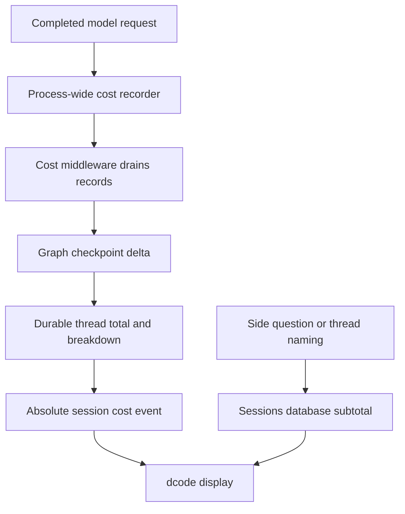
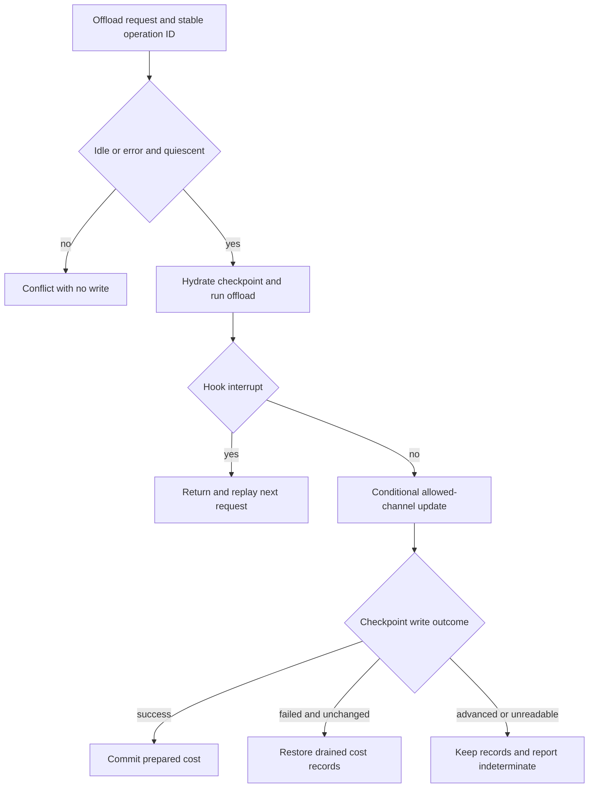
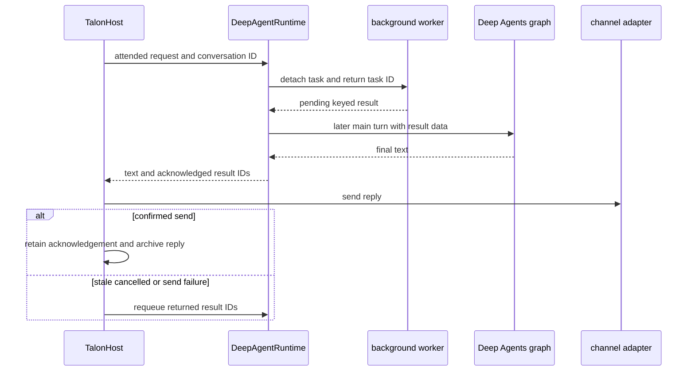

# Runtime Behavior and Failure Boundaries

A successful model call, a durable graph checkpoint, and a delivered reply are deliberately different events. Deep Agents owns graph composition and checkpointed state; dcode owns local streaming presentation and server-side checkpoint mutations; Talon owns the conversion of an agent result into channel delivery. This separation makes interruption and retry behavior intelligible rather than treating every completed coroutine as user-visible success. See [SDK Construction and Execution](/openwiki/architecture/sdk-construction-execution.md), [dcode Costs, Traces, and Session Operations](/openwiki/operations/cost-and-sessions.md), [Talon Scheduling](/openwiki/concepts/talon-scheduling.md), and [Talon](/openwiki/integrations/talon.md).

## Ownership and durability

| Concern | Durable authority | Important boundary |
|---|---|---|
| Agent conversation | LangGraph state through its configured checkpointer | A thread can resume graph state, but that does not establish channel delivery. |
| History compaction | Raw messages plus a summarization event, or a conditional server offload update | Effective history is derived without discarding the raw history on the normal summarization path. |
| dcode cost | Private graph checkpoint channels | The client renders and locally aggregates streaming information; it does not own the thread lifetime total. |
| dcode server process | `ServerProcess` | Reachable server health and usable graph readiness are separate startup barriers. |
| Attended Talon delegation | Process-local `BackgroundSubagents` job table | A worker result is not durable and must be reconciled with a later main-agent turn and send outcome. |
| Scheduled Talon delegation | The scheduled graph turn itself | A cron run waits for delegated work inline because it has no later attended turn to receive it. |
| User-visible reply | `TalonHost` plus channel adapter | Persistent delivery-backed history follows a confirmed send, not graph completion. |

## Graph assembly, context shaping, and refusal semantics

`create_deep_agent()` assembles the built-in filesystem, subagent, summarization, interrupted-tool-call repair, and optional async-subagent middleware, then places caller middleware before tail middleware. Ordering is behavioral: skills see already-compacted, routed model state, and the default `ModelRefusalMiddleware` is installed after the ordinary main-stack fallback opportunity. Consequently a main-agent refusal normally raises `ModelRefusalError`; an earlier fallback can handle it, while a harness can exclude that middleware when the provider refusal message is the desired result.

Summarization retains raw `messages` and records the effective-history `_summarization_event`. Automatic and manual events include both a cutoff index and `cutoff_message_id`; reconstruction anchors to the ID when it remains in raw state and uses the index only for legacy or missing-ID data. The synchronous path saves historical content before generating a summary, whereas the async path concurrently runs independent persistence and summary work. History offload failure remains non-fatal and produces `file_path=None`.

A delegated child has a narrower, intentional error translation. For `task` and `atask`, a final refusal message, `ModelRefusalError`, or refusal-bearing structured-output validation is returned to the parent as a refusal result. Other exceptions propagate: a parent may report a refusal as task outcome, but must not silently convert an execution failure into one.

## dcode client streaming and durable cost accounting

The graph, not a dcode UI process, owns the cumulative cost estimate. `CostTrackingMiddleware` checkpoints normal graph deltas; server-owned work prepares a rollback-safe delta that commits with its state update. A process-wide recorder observes completed model requests—including direct summarization/offload calls and subagents—and the middleware drains and prices them on the parent checkpoint path. It avoids double-counting the agent response when its message ID has already been charged, while still falling back to message usage when callbacks are unavailable. Nested graphs checkpoint their private spend first and transfer completed deltas through owner-scoped state to the parent, protecting completed work from a later approval interruption.

Pricing is explicitly best effort: missing rates or malformed usage do not fail a model turn. The private breakdown preserves request/token detail and completeness flags, so an unpriceable request is distinguishable from a genuine zero-cost estimate. The pricing package is lazily imported; its periodic catalog update can be disabled with `DEEPAGENTS_CODE_PRICES_AUTO_UPDATE=0` or `[update].prices_auto_update = false`, and `DEEPAGENTS_CODE_OFFLINE` suppresses the network update.

In non-interactive dcode, `StreamState.stats` is presentation-oriented per-run accounting. Its request ledger is monotonic across HITL resume passes and finalizes each pass so replayed messages or chunks do not add tokens and cost again. The stream records usage even for hidden internal model calls; it suppresses synthetic summarization messages from user rendering rather than from accounting. This means a terminal display total is useful telemetry, but it is not a substitute for checkpointed thread cost.

*The graph checkpoint is the cost authority; independently persisted side-operation spend is combined only when the client presents a session total.*

## dcode server lifecycle and offload commit boundary

The client launcher manages `langgraph dev` as a subprocess. Lifecycle operations are serialized; startup cleans up a spawned process on failure or cancellation. `start()` waits for server health, while `wait_for_graph_ready()` separately fetches the registered graph and turns an exited process, transport failure, or non-200 result into a diagnostic startup error with logs. A stop generation prevents a restart racing a terminal `stop()` from respawning the server.

The server offload API is a server-owned, checkpoint-conditional mutation. It accepts only idle or error threads, separately requires checkpoint quiescence, allows only `OffloadStateUpdate` channels rather than `messages`, and conflicts if the checkpoint advanced. An `operation_id` identifies replayable work: a hook interrupt returns to the caller without retaining a suspended server coroutine; a subsequent request re-executes with accumulated hook responses. Keep that ID stable through hook rounds.

The HTTP request cannot choose credentialed model transport. The service strips client endpoint, proxy, client, and header transport settings, substitutes checkpointed model specification/parameters where present, and takes summarization-model selection from server configuration. This prevents a local caller from redirecting server-credentialed model work.

*An offload interruption is replay-based, and cost rollback is safe only when readback proves that the state update did not land.*

If the state write fails, the service rolls back drained cost records only after readback proves the checkpoint is unchanged. An advanced or unreadable checkpoint is indeterminate: records remain committed to avoid a future double charge. Treat an indeterminate response as an investigation boundary rather than blindly retrying an offload that might already have committed.

## Talon invocation, attended work, and scheduled work

`DeepAgentRuntime.start()` resolves subagents, snapshots approvals, and builds its Deep Agents graph. Every `invoke()` refreshes runtime tools; if approvals changed, it rebuilds the graph under a tool lock. Invocation uses the request conversation ID as LangGraph `thread_id`, and `ConversationSaver.protect_session()` protects that session for the call. Retryable graph failures repeat the asynchronous invocation with exponential backoff capped at ten seconds, while cancellation propagates. Empty-output continuation prompts are also fresh graph invocations, not model-call retries.

Attended `task` and `start_async_task` calls detach work into in-memory jobs keyed by the owning conversation and return a task ID. Capacity is shared across conversations and configured with `DEEPAGENTS_TALON_MAX_BACKGROUND_TASKS`; only the owning thread can inspect, message, or cancel a worker. Workers run on their own thread IDs, inherit required scoped context, clear authorization handling, prohibit nested delegation, convert failure/timeout/approval interruption into safe result text, and do not survive a process restart. The runtime acknowledges results only after a main-agent turn succeeds; `AgentResult.background_results` tells the host exactly which IDs were acknowledged so it can undo that acknowledgement when no reply is delivered. Results repeatedly unprocessable by the main turn are eventually dropped rather than retried forever.

A scheduled request (`trigger: "cron"`) changes that contract. Its delegation runs inline to completion in the same graph turn and leaves no job for a later delivery turn. Scheduled-specific guidance hides asynchronous worker-management tools, nested delegation stays blocked, and a separate semaphore queues inline fan-out without consuming attended-worker capacity. Timeout and ordinary failure become safe tool-error results so an escaping error cannot cause a graph retry that relaunches sibling delegations.

*For attended work, consumption by a successful graph turn precedes delivery; the host reconciles that optimistic acknowledgement with the real channel outcome.*

The host serializes work by conversation root and uses generations to keep a stale turn from sending after replacement. It records a final reply in persistent conversation history only after confirmed channel delivery. If settlement is stale, cancelled, or undeliverable, consumed background results are requeued rather than treated as delivered. Scheduled runs instead use a separate conversation ID, have a bounded runtime, and use interruption recovery on timeout or sender revocation where possible.

## Focused change and test boundaries

- Preserve middleware order when altering SDK graph construction: it determines fallback/refusal behavior, state visibility, and compaction inputs.
- Test dcode accounting separately at the durable checkpoint and non-interactive stream layers; HITL replay must not inflate the latter, and missing pricing must not fail turns.
- For offload, exercise hook replay, thread/checkpoint conflicts, forbidden `messages` updates, trusted model settings, write readback, and prepared-cost settlement.
- Run `libs/talon/tests/unit_tests/test_background.py` after changing worker ownership, capacity, authorization isolation, acknowledgement/requeue, inline cron behavior, failure limits, or shutdown. It specifically verifies that scheduled delegation creates no detached job and that an undelivered attended result can be offered again.
- Test delivery independently from graph completion: channel confirmation gates archive promotion, while stale/cancelled settlement must preserve a path to reprocess background results.
