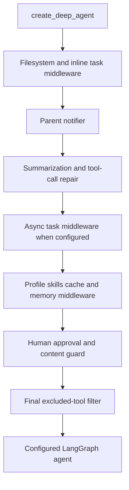
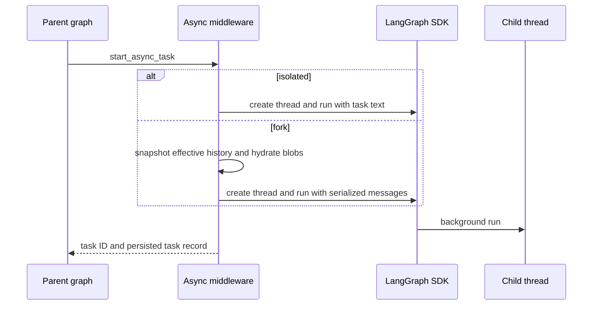
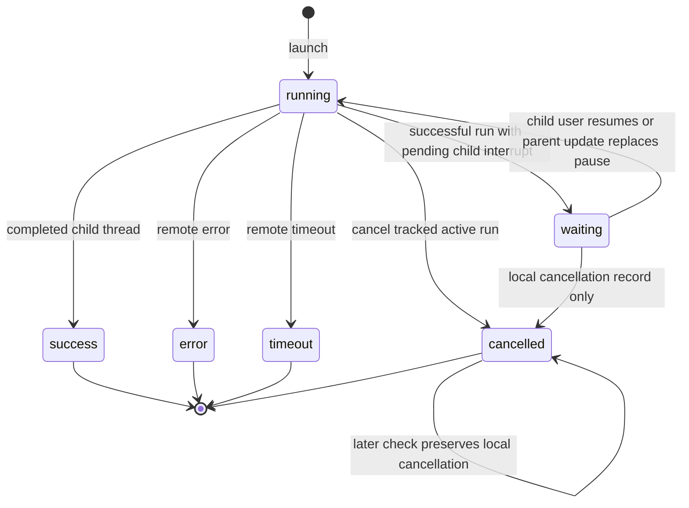
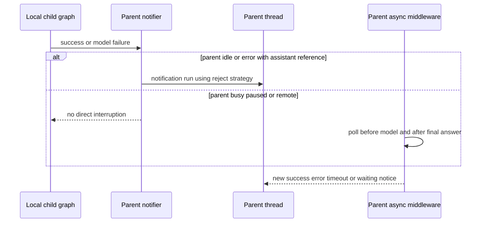

# Runtime Behavior and Failure Boundaries

`create_deep_agent()` is the assembly boundary for a LangGraph agent. It combines caller tools and model/backend selection with ordered Deep Agents middleware, and passes optional context and state schemas, checkpointer, store, cache, and response format to LangChain. The resulting graph has recursion limit `9_999` and Deep Agents integration/version metadata. Durable continuation remains a caller/graph concern: provide a checkpointer and reuse the LangGraph `thread_id` to continue a conversation, approval interrupt, or persisted task records. See [SDK Construction and Execution](/openwiki/architecture/sdk-construction-execution.md) and [State Persistence](/openwiki/concepts/state-persistence.md).

## Graph-owned state and context recovery

The core stack starts with filesystem handling and optional inline `task` delegation, then parent notification, summarization, and tool-call repair. `AsyncSubAgentMiddleware` is added only for remote specifications. Profile middleware, skills, prompt caching, and memory follow; human approval and unsupported-content handling are near the tail. Custom middleware can replace a named core layer or be spliced ahead of the profile tail. Excluded tools are filtered again after custom middleware so a custom wrapper cannot restore them to a model request.

Caption: the graph owns ordered middleware composition; remote task execution and notification are separate integration layers.

`DeepAgentState.messages` is a `DeltaChannel` using the local message reducer with snapshot frequency 50. The reducer coerces message-like inputs, merges by stable ID, supports removals and the last `REMOVE_ALL_MESSAGES` reset, and treats a missing replay base as empty. Stable IDs are assigned before checkpoint serialization, not during replay. This makes checkpoint growth linear rather than repeatedly writing full message history. Before resumption, `PatchToolCallsMiddleware` repairs unmatched AI tool calls by appending correlated error `ToolMessage` records and atomically replacing messages with a reset and repaired history.

Summarization changes the **effective model history**, not the raw messages channel. It records a private event with cutoff, generated summary, and optional offloaded-history path; the model receives that summary and retained tail while raw history remains available for replay and forks. It can offload older history, shorten old large tool arguments, and recover from a provider context overflow through summarization plus a bounded smaller retry. The optional `compact_conversation` tool shares that event/session state, triggers at roughly half the automatic threshold, and returns a `ToolMessage` without changing summary state when no cutoff exists or generation fails.

## Remote tasks: ownership and transferred data

Inline delegation blocks until its child returns a correlated `ToolMessage`. In contrast, `AsyncSubAgentMiddleware` uses the LangGraph SDK against an Agent Protocol server and immediately returns a task ID. It adds `start_async_task`, `check_async_task`, `update_async_task`, `cancel_async_task`, and `list_async_tasks`.

A task ID is the remote thread ID. The parent graph persists records in `async_tasks`, whose reducer merges updates by task ID. Each record carries the agent name, thread ID, current run ID, status, and timestamps. This is **local parent state**, not an authoritative copy of the remote service: checks and lists refresh it, and SDK errors return tool text instead of destroying a known record. A remote child owns its own graph, prompt, tools, approvals, credentials, filesystem resources, and persistence.

An async specification with `url` targets that server; no `url` uses local ASGI transport and requires an async parent path such as `ainvoke`. The synchronous path needs a reachable URL. Clients default `x-auth-scheme` to `langsmith` unless headers override it. Local launches and updates can forward trace-nesting headers; those trace headers are deliberately not sent to a remote URL.

For every launch, thread metadata carries `subagent_name` and the parent thread ID where available. A local task also retains the parent assistant ID, enabling a later child run—such as one started when the child user answers a pause—to locate and wake its parent. JSON-serializable local context is forwarded after stripping `deepagents_parent`; when it cannot be forwarded, a configurable parent reference is used instead. A URL-targeted child gets only the parent thread reference, not the assistant ID: association across deployments does not grant the ability to run or wake the parent.

`mode="isolated"` sends only the task description. Experimental `mode="fork"` takes a launch-time snapshot of the parent’s effective conversation, appends a preambled task message, clears `ToolMessage.artifact` and parent-local eviction metadata, hydrates portable blob content, and serializes the messages for dispatch. Later parent edits do not alter the snapshot.

Caption: fork transfers one portable message snapshot; it does not share live state or runtime resources.

## Lifecycle: pause is not cancellation or failure

The tracked `run_id` is replaceable while the task/thread identity remains stable. A normal launch starts as `running`. `update_async_task` creates a replacement run on the same thread with `multitask_strategy="interrupt"`; an update to a paused task drops its human request. Cancelling a non-waiting task calls the SDK to cancel its tracked run and records `cancelled`. Cancelling `waiting` does **not** issue SDK cancellation because that pause has no active run; it records a local cancellation, and later checks preserve `cancelled` rather than reclassifying the still-paused child as waiting.

A child that calls `interrupt()` is distinct from a failed or terminally cancelled run: its run can be `success`, but its thread is `interrupted` with pending interrupts. Observation maps that combination to nonterminal `waiting`, returns interrupt IDs and values, and tells the parent agent that the child user must answer on the child’s own thread. If a tracked successful run has been superseded by an externally resumed busy or error thread, observation selects the newest run. `list_async_tasks` filters cached records first, live-fetches selected nonterminal tasks, and falls back to cached status on lookup failure; terminal records are not polled.

Caption: `waiting` is an actionable child-owned input pause, while `cancelled`, `error`, `timeout`, and server-run `interrupted` are terminal task outcomes.

## Reporting: direct wake-up versus polling

`create_deep_agent()` installs `_ParentNotifierMiddleware` on every Deep Agents graph. On the async path, only the outermost graph of an async-launched local child reports its own completion: `aafter_agent` reports success and `awrap_model_call` reports a model-call exception. It re-raises `GraphInterrupt` without reporting it, so a child paused for its own approval or question does not masquerade as a parent-visible success or failure. Per-run tracking suppresses duplicates; nested Deep Agents graphs do not independently notify.

A direct wake-up is opportunistic and local. When the child has both parent thread and assistant IDs, the notifier starts a reject-strategy notification run only if the parent thread is `idle` or `error`. It does not interrupt a busy or approval-paused parent, and delivery failures (including missing parent or a race to busy) are logged but cannot fail the child. URL-targeted children lack the assistant ID, so they cannot directly wake the parent.

Polling is the fallback and is also what surfaces pauses. On async parent runs, `AsyncSubAgentMiddleware` polls unfinished tasks at run start and before each model call; after a final non-tool answer it polls once more and requests another model turn only when it found a new notification. Polling emits new notifications for `success`, `error`, `timeout`, and `waiting`; it does not wake the parent for cancellation or server-run `interrupted`. Thus a child waiting for its own user requires status polling (or the next parent run), whereas a locally linked child success or model failure can attempt a direct wake-up. A polling timeout or SDK failure merely skips that task until the next check.

Caption: direct notification is restricted to locally routable completion/failure; polling is required to discover a child-owned pause and is the resilient fallback for all outcomes.

Notifications are marked as non-user input and carry a `deepagents_notification` event. Child-controlled text is HTML-escaped; long text is clipped to `NUM_CHARS_PER_TOKEN * 20_000` and directs the parent to `check_async_task` for full details. Standard image, audio, video, and file blocks can pass through, while reasoning, tool calls, and other assistant-only blocks are removed. Automatic failure reports expose a failure class rather than exception details.

## Retry boundaries

`CodeModelRetryMiddleware` is deliberately scoped to the model node, so retrying a transient provider failure does not rerun completed tool calls. The runtime-selected model may carry a provider-specific retry budget, which takes precedence over middleware’s startup fallback. Retry classification accepts retryable `ModelError`s, selected status codes and 5xx responses, known provider/transport failures, and transport failures found through exception groups or cause chains; graph control flow (`GraphBubbleUp`) is immediately re-raised. A Groq 128-tool request rejection is converted to a stable actionable error, while a non-retryable or exhausted model failure is re-raised rather than represented as an AI answer.

Backoff begins at 0.2 seconds, doubles with modest jitter, caps at 10 seconds, honors a valid `Retry-After` up to 60 seconds, and has a 60-second cumulative interactive delay budget. Each model attempt emits correlated `model_attempt` start/complete events. A retry emits a `model_retry` event with the failed attempt and whether output may already have streamed, allowing clients to mark superseded partial output rather than presenting it as a finished answer. Event-emission failures are logged but do not replace the model result or failure.

Talon adds a host-level retry boundary around the entire asynchronous graph invocation. Its configured `max_retries` counts total attempts and uses 1, 2, then capped-10-second exponential sleeps. It immediately propagates `asyncio.CancelledError`, and otherwise retries connection/timeout/provider transport conditions plus configured status- and message-based transient signals. This is broader than model-node retry: it may repeat a graph invocation after a retryable graph-level failure, so it belongs to the host runtime rather than the graph’s completed-tool safety guarantee.

## Change and test focus

- Preserve the DeltaChannel reducer and repair unmatched tool calls before changing checkpoint or resume behavior.
- Test pause, terminal cancellation, server interruption, failure, and timeout as separate states. A paused child must expose its interrupts and never be reported as an automatic child failure.
- Test direct local notification separately from polling: only an idle/error parent with local assistant routing can be woken; busy, approval-paused, missing, and cross-deployment parents rely on subsequent polls.
- Exercise parent notification escaping, clipping, media forwarding, removal of assistant-only blocks, failure-detail redaction, and duplicate suppression.
- Test fork snapshot cleanup/hydration and ensure it remains independent of parent resources and later parent state.
- For retries, test exception-group classification, `Retry-After` and cumulative-delay boundaries, graph control-flow propagation, streamed partial-output correlation, and Talon cancellation propagation.

For configuration examples, see [Subagents and Skills](/openwiki/concepts/subagents-skills.md). For test execution conventions, see the [Testing Guide](/openwiki/testing/testing-guide.md), and for a hosted invocation workflow see [Run DCode Session](/openwiki/workflows/run-dcode-session.md).
