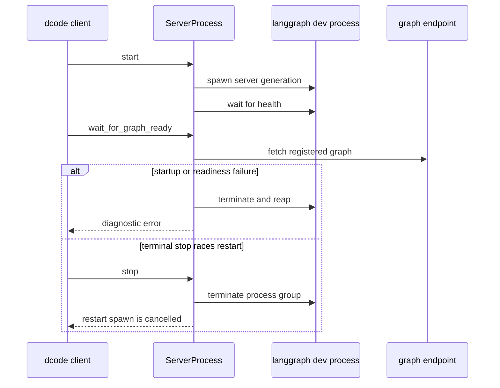
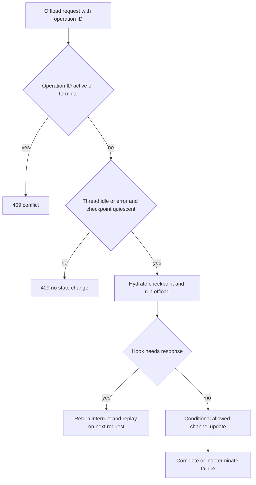
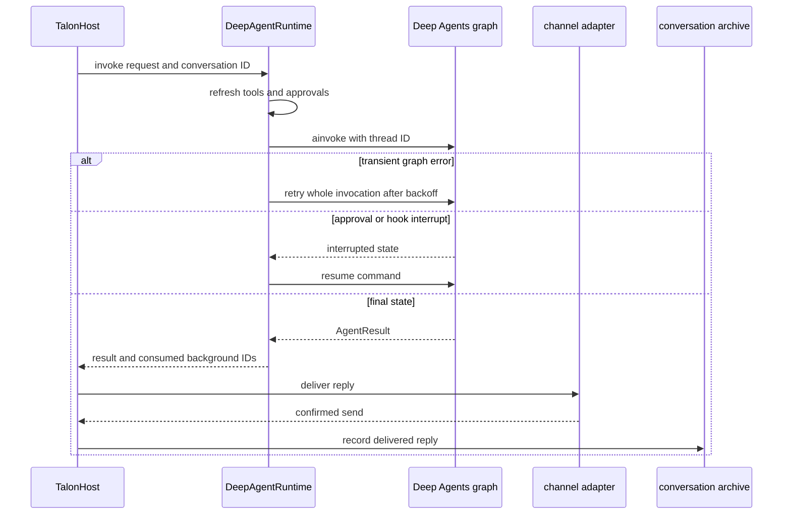

# Runtime Behavior and Failure Boundaries

This page describes runtime ownership rather than just API shape. A graph/checkpointer owns conversational state; a dcode development server owns its process and server-side checkpoint operations; Talon owns channel scheduling and delivery. These boundaries matter because a successful local operation, a checkpoint write, and a user-observed reply are different events. See [Code Agent](/openwiki/architecture/code-agent.md), [State Persistence](/openwiki/concepts/state-persistence.md), [Talon Scheduling](/openwiki/concepts/talon-scheduling.md), and [Security](/openwiki/operations/security.md).

## Ownership map

| Concern | Owner and durable authority | Boundary behavior |
|---|---|---|
| Graph conversation | LangGraph thread state through the configured checkpointer | A checkpointer makes a graph resumable; channel delivery does not. |
| Context compaction | Deep Agents summarization event and, for dcode HTTP offload, the server checkpoint update | Raw messages remain available to the summarization mechanism; effective history is reconstructed for later model calls. |
| dcode server process | `ServerProcess` and its spawned `langgraph dev` process | Startup health and graph readiness are separate checks; stop/restart races are serialized and terminal stop wins. |
| Talon turn | `DeepAgentRuntime` graph invocation for the request conversation ID | The runtime can acknowledge background results after the model consumes them, before a host has delivered a reply. |
| User-visible reply | `TalonHost` and its channel adapter | Archive delivery recording follows a confirmed send, not merely an `AgentResult`. |

## Deep Agents state shaping and refusal boundaries

`create_deep_agent` composes the backend, tools, middleware, optional subagents, and optional checkpointer into the graph. Its core stack includes filesystem handling, parent notification, summarization, and interrupted-tool-call repair; asynchronous subagents are added only when configured. The middleware tail installs `ModelRefusalMiddleware` after the usual main-stack fallback opportunity. Thus the default main-agent contract is to raise `ModelRefusalError`, while an earlier `ModelFallbackMiddleware` can handle the exception; a harness profile can exclude the refusal middleware when a provider refusal message itself is desired.

Summarization preserves raw `messages` and stores an effective-history `_summarization_event`. New automatic and manual events include both a cutoff index and `cutoff_message_id`; reconstruction prefers the ID if it remains in raw state, and uses the index only for legacy or missing-ID cases. This avoids index drift when messages are later added or removed. Automatic synchronous compaction persists old history before generating the summary; its asynchronous path runs independent persistence and summary work concurrently. Failure to offload history is non-fatal to compaction and yields `file_path=None`.

A child delegation deliberately has a different failure boundary from the main graph. For both `task` and `atask`, a final refusal message, `ModelRefusalError`, or refusal-bearing structured-output validation failure becomes a parent-visible refusal result. Other failures propagate, so the parent can reframe a blocked task without silently hiding execution errors.

## dcode server lifecycle

The client launcher manages `langgraph dev` as a subprocess. `start()` serializes lifecycle work, spawns the server, optionally runs caller work after spawn, then waits for health. `wait_for_graph_ready()` is an explicit second barrier that fetches the registered graph so lazy import/build failures are reported early with a diagnostic log tail. If startup is cancelled or fails, the manager performs cleanup in `finally`, including `CancelledError`, so it does not leave the new subprocess behind.

On POSIX the process is launched in a new session through `_server_bootstrap`; the parent pipe and session-lock file descriptors give the bootstrap a parent-lifetime signal and keep the installation protected while serving. `stop()` is idempotent, terminates the process group with a grace period, closes its log resources, and optionally removes manager-owned workspace files. A restart performs its blocking stop off the event loop and captures a stop generation: if a terminal `stop()` occurs during that restart, the replacement spawn aborts rather than resurrecting the server. One-shot environment overrides are scoped to a restart and cleared only after a successful return; `persist_env()` permits only application-owned server environment names.

Caption: health confirms that the server is reachable; graph readiness forces lazy graph construction and is the useful startup boundary for callers.

## Server-side offload: quiescent, checkpoint-conditional work

The private dcode routes expose `/dcode/threads/{thread_id}/offload`, `/handoff`, and per-operation cancellation. The thread ID comes from the URL, while the request carries a stable `operation_id`, runtime context, and accumulated hook responses. A hook interrupt does not retain a suspended server coroutine: the client resubmits the same operation, the operation re-executes, and prior hook responses are replayed. Therefore callers must keep the operation ID stable across hook rounds.

Before compaction, the server requires the registered thread to be `idle` or `error` and separately checks that its checkpoint is quiescent. Allowing `error` permits recovery after a failed turn, but still excludes active or interrupted work. It reads and hydrates the checkpoint itself, permits only the channels in `OffloadStateUpdate`, and refuses a `messages` write. The update is conditional on the checkpoint that was read; an advanced thread is a conflict rather than an overwrite.

The HTTP boundary does not trust client-selected model transport. It validates consumed context fields, strips endpoint/proxy/client/header model parameters, then replaces request model selection with trusted `_model_spec` and `_model_params` checkpoint values where available. A supplied summarization model is discarded in favor of server launch configuration. This prevents a local client from redirecting a server-credentialed summarization request.

Caption: server offload never writes while a thread is active, and hook resumption is replay-based rather than a retained in-memory continuation.

Commit and cost settlement are coordinated. If the checkpoint update raises, the service rereads the thread: an unchanged checkpoint rolls back drained cost records, while an advanced or unreadable thread commits those records conservatively to avoid double charging and reports an indeterminate outcome. Cancellation during the commit is deferred until the commit reaches a terminal state, then re-raised. The bounded completed/cancelled operation cache closes cancellation/request races; cancelling an active operation waits for its task to become terminal.

Use status codes operationally: `422` means malformed input and no work; `409` means an active, interrupted, unregistered, non-quiescent, or changed thread and no commit; `503` means the server runtime could not be built; and `500` can mean an unexpected fault or an explicitly indeterminate state write. An indeterminate `500` must be investigated with `/context` before retrying offload, because a summary may already have committed.

## Talon invocation, scheduling, and delivery

`DeepAgentRuntime.start()` resolves subagents, loads an approval snapshot, and creates the graph. Each `invoke()` refreshes runtime tools, rebuilds the graph when the approval snapshot changes, and binds per-turn authorization, hooks, progress, question handling, history scope, selected model, and scheduling context. It invokes using the request conversation ID as LangGraph `thread_id`; `ConversationSaver.protect_session()` guards that session during the call.

Talon retries a complete asynchronous graph invocation only for its transient classification. It propagates cancellation, backs off exponentially up to ten seconds, and retries the same payload/configuration. This differs from dcode's `CodeModelRetryMiddleware`, which retries a model call boundary rather than replaying the whole graph invocation. Empty final output also leads to continuation nudges and eventually a forced-summary prompt; each is a new graph invocation, not a provider retry.

Approvals and hooks are an interrupt/resume loop. After a graph state with interrupts is returned, Talon lets hooks resolve first, obtains any needed approval decisions, builds a `Command(resume=...)`, and reinvokes with the same conversation ID. It enforces a finite approval-round limit. Interrupted-process recovery instead reads the latest checkpoint, uses `PatchToolCallsMiddleware` to repair dangling calls, and appends a human interruption marker.

Caption: Talon distinguishes graph completion from confirmed channel delivery; only the latter promotes a final reply into delivery-backed archive history.

The host serializes work for a conversation root and uses generations to prevent an obsolete turn from sending a reply after replacement. If a completed turn is stale, cancelled during settlement, or cannot be delivered, its consumed background-result IDs are requeued for a later turn. When a reply is successfully delivered, the host records it through `record_delivered_reply`; recording failure is logged and does not retroactively fail channel delivery. Scheduled runs use a separate conversation ID, are bounded by a timeout, and call interruption recovery on timeout or sender revocation where possible.

## Change and test focus

- Treat launcher health and graph readiness as separate assertions. Test cancellation during startup, restart versus terminal stop, cleanup, and surfaced log diagnostics.
- For server offload, test malformed versus conflict versus unavailable versus indeterminate responses; assert no `messages` write, stable operation-ID hook replay, conditional checkpoint conflict, cost rollback/commit classification, and cancellation races.
- Regression-test the server trust boundary: client endpoint, proxy, transport, and header overrides must not reach credentialed model calls; checkpointed server settings may.
- Test Talon whole-invocation retry separately from model-node retry, approval/hook resume limits, and interruption repair.
- Test host delivery separately from graph completion: stale or cancelled settlement must requeue background results, while archive promotion occurs only after a successful channel send.
- Preserve the distinct refusal and compaction contracts described above, including async/sync offload ordering and cutoff-message-ID reconstruction.
