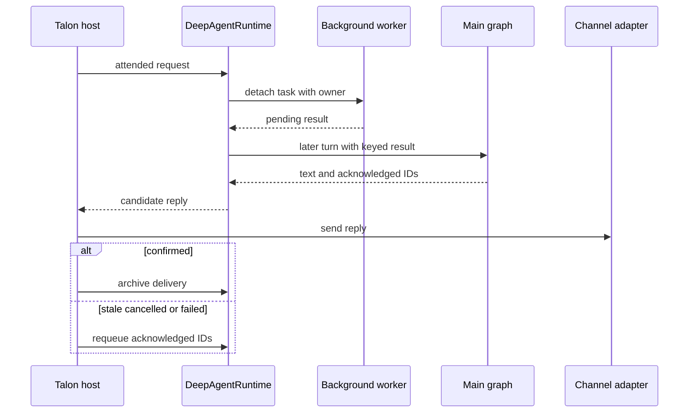

# Runtime Behavior and Failure Boundaries

Talon distinguishes a completed worker, a main-agent turn that processed its result, and a reply confirmed by a channel. Those are separate lifecycle milestones with different owners. This page covers the delegation and delivery boundary; see [State Persistence](/openwiki/concepts/state-persistence.md), [Subagents and Skills](/openwiki/concepts/subagents-skills.md), [Talon Scheduling](/openwiki/concepts/talon-scheduling.md), [Talon](/openwiki/integrations/talon.md), and [Security](/openwiki/operations/security.md).

## Lifecycle and ownership

`DeepAgentRuntime.start()` resolves subagents, snapshots the approval policy, and builds the graph. Each `invoke()` refreshes runtime tools and, under a tool lock, rebuilds the graph if the approval snapshot changed. The invocation uses the request conversation ID as LangGraph's `thread_id`; a `ConversationSaver` session is protected for the invocation when configured.

`BackgroundSubagents` is an in-memory middleware owned by that runtime. Its job table, task handles, final results, and delivery counters are process-local: they are not checkpoint state and are lost on restart. A job has an owning conversation thread. Listing, inspection, messaging, cancellation, and result injection are scoped to that owner, so another conversation cannot control or consume it. The table also holds limited externally supplied results, which follow the same acknowledgement and requeue rules.

*An attended result is only settled after both the graph turn and reply-delivery boundary have been reconciled.*

## Attended delegation: detached and deliberately bounded

For an ordinary conversation, the middleware intercepts the SDK `task` and `start_async_task` calls and returns a task ID immediately. It creates a worker only when the call has a non-empty conversation `thread_id`; otherwise it returns a tool error. The runtime-wide worker limit is shared by configured middleware copies and all conversations. When either the total job table or active-worker limit is reached, the tool refuses the new launch rather than queueing it. `DEEPAGENTS_TALON_MAX_BACKGROUND_TASKS` configures the positive active-worker limit; the default is four.

The worker runs with a fresh task ID as its LangGraph `thread_id`, a recursion limit of 500, and a copied state. It retains scoped context needed by supported tools, such as history scope and cron origin, but marks itself as a subagent, prevents nested `task` or `start_async_task` delegation, and clears the authorization handler. That removal is intentional: a detached worker can outlive the originating host turn, so it must not leave an authorization prompt stranded in a conversation. Approval interrupts likewise cannot wait for a human in the background: an interrupted child becomes the safe result text that the protected action needs approval and did not run.

A local worker can be sent guidance only when it is a Talon-built local subagent; messages are queued for its next model step, not an interruption of a running model or tool call. Remote `start_async_task` targets stream to their configured graph with cancellation on disconnect. Task definitions and tool capability are fixed for a running worker: later reloads affect subsequent turns, not that worker.

Detached execution has a one-hour timeout. Cancellation marks the job cancelled and produces no result; ordinary exceptions and timeouts become bounded, safe text rather than propagating tool arguments, credentials, or provider payloads into the main conversation. Recognized HTTP status codes produce a generic actionable hint, while unknown failures use a generic message. Result extraction includes answer text only, excludes reasoning blocks, and limits output to 64,000 characters.

## Scheduled delegation is inline

A request whose metadata has `trigger: "cron"` enters a different mode. It hides the attended-only management tools and tells the model that `task` and `start_async_task` return their completed result in the same turn. The middleware waits inline instead of creating a job record, so scheduled delegation neither consumes the attended-worker capacity nor relies on a future delivery turn. A background-delivery turn is still an attended conversation for this decision and therefore detaches new work.

Inline work sets the subagent guard, preserving the no-nested-delegation invariant. A distinct semaphore permits scheduled fan-out while bounding concurrent inline calls; calls beyond the limit wait rather than fail, and their timeout begins only after obtaining a slot. The default inline timeout is ten minutes and can be set with `DEEPAGENTS_TALON_INLINE_SUBAGENT_TIMEOUT` as a positive integer in seconds.

Timeouts and ordinary exceptions are caught and returned as error `ToolMessage` values. Nothing escapes the inline wrapper because an escaping retryable timeout could make the runtime rerun the whole graph and relaunch sibling tool calls from the same assistant message. The error text is sanitized just as it is for detached workers.

## Result processing, retry, and delivery settlement

On each runtime invocation, pending results for that conversation are injected as keyed synthetic user messages before the current request. A context-local tracker records only results actually exposed to the main-agent turn, including results read through `list_subagents`. The runtime acknowledges those IDs only after the turn completes successfully and returns them in `AgentResult.background_results`. If the graph fails, it increments the offered results' delivery count; after three failed processing turns, the result is marked dropped rather than retried forever. Cancellation does not count as a failed delivery.

The graph invocation itself retries retryable exceptions up to the configured attempt count, with exponential backoff of 1, 2, 4 seconds and a ten-second cap; cancellation propagates. Empty-output continuation nudges are separate graph invocations, not a replay of an individual model call. Inline delegation must therefore convert its own failures before they meet that retry boundary.

The host dispatches a completed background result only when its conversation has no active turn and is not blocked, then starts a follow-up turn marked `background_delivery`. That marker removes operator approval authority for the delivery turn. After a successful graph turn, the host still cannot regard the result as user-visible: the reply may be suppressed, replaced by a newer generation, cancelled during settlement, or fail channel delivery. In the non-deliberate loss paths, it requeues exactly the acknowledged IDs from `AgentResult`; already delivered, cancelled, or pruned IDs are not resurrected. Persistent history promotion likewise happens only after the channel confirms a non-silent send.

## Operations and shutdown

The default limits are intentionally different: detached work can run up to 3,600 seconds because it costs an independent worker, whereas a scheduled inline call defaults to 600 seconds because it holds up the scheduled turn. Monitor capacity refusals, worker timeouts, repeated result-processing failures, and generic safe failure text; the latter deliberately omits sensitive exception detail.

Shutdown first cancels background workers and waits up to ten seconds. If a worker survives that wait, `DeepAgentRuntime.stop()` raises and leaves the graph/checkpointer resources open rather than allowing a live worker to write against closed resources. The host treats this as a component failure and continues its own shutdown.

## Focused regression coverage

- `libs/talon/tests/unit_tests/test_background.py` exercises owner isolation, shared capacity and its environment setting, independent worker thread IDs, cancellation, sanitised timeout/failure results, authorization removal, acknowledgement/requeue, delivery-attempt dropping, shutdown, and the separate inline cron path.
- Its scheduled tests verify no job is created, nested delegation is blocked, fan-out is concurrent but semaphore-bounded, queued work does not spend its execution timeout while waiting, and inline failures cannot escape into graph retry.
- `libs/talon/tests/unit_tests/test_research_subagents.py` verifies fresh subagent context and explicit tool capability boundaries, including that a background subagent cannot obtain an interactive approval and reports an approval interrupt as its result.
- Delivery tests should always distinguish graph success from confirmed send: a result acknowledged by the runtime must be requeued if the host discards or cannot deliver that turn's reply.
