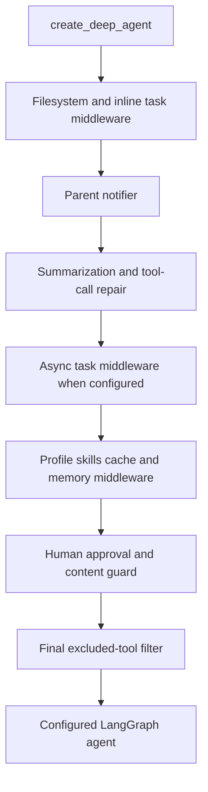
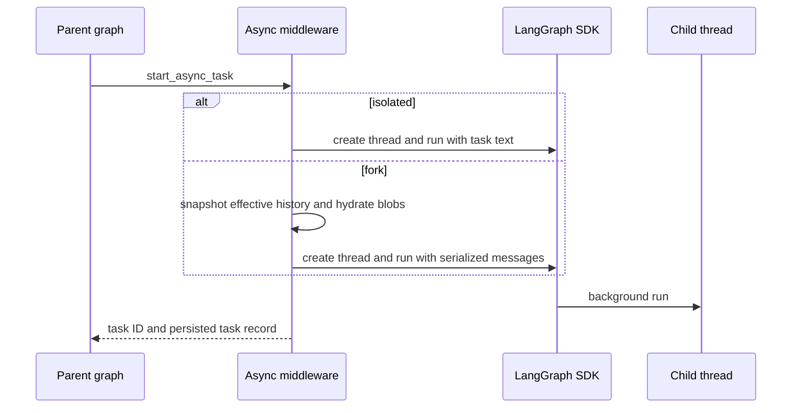
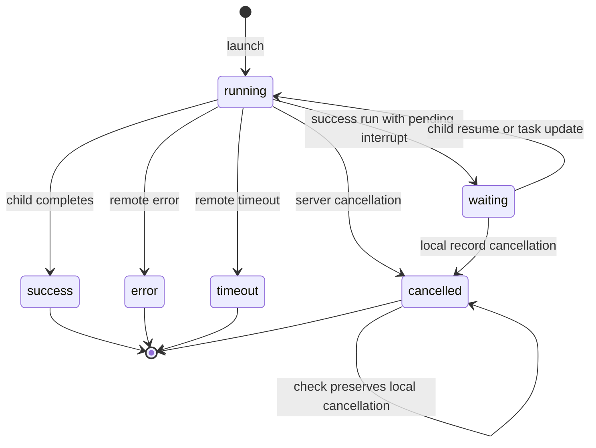
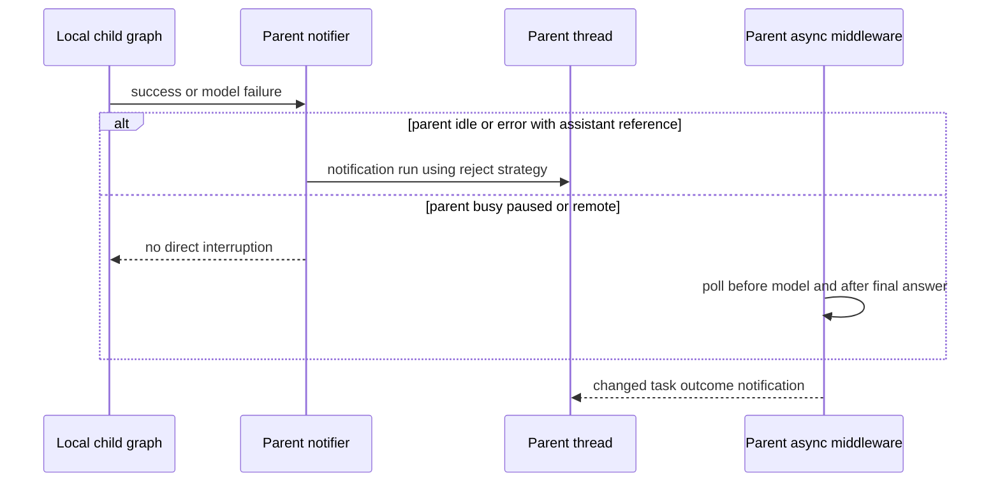

# Runtime Behavior and Failure Boundaries

`create_deep_agent()` is the composition boundary for a LangGraph agent. It supplies caller tools, model and backend selection, an ordered Deep Agents middleware stack, and optional context/state schemas, checkpointer, store, cache, and response format to LangChain. The compiled graph is configured with recursion limit `9_999` and Deep Agents metadata. Persistence itself is delegated to the optional LangGraph checkpointer: callers that need continuation provide it and reuse a LangGraph `thread_id`. See [SDK Construction and Execution](/openwiki/architecture/sdk-construction-execution.md) and [State Persistence](/openwiki/concepts/state-persistence.md).

## Durable message state and recovery

The main stack begins with filesystem and optional inline-subagent middleware, then parent notification, summarization, and dangling-tool-call repair. `AsyncSubAgentMiddleware` is added only when remote specifications are configured. Profile middleware, skills, prompt caching, and optional memory form the tail; approval and unsupported-content handling follow. Custom middleware can replace named core layers or be inserted ahead of the profile tail. Tool exclusion is applied again after custom middleware, so a wrapper cannot reintroduce an excluded tool.

Caption: graph construction owns middleware order, while async task execution is an integration layer added only when configured.

`DeepAgentState.messages` uses a `DeltaChannel` with snapshot frequency 50. Its reducer converts raw message-like input, deduplicates or replaces messages by stable ID, applies removals, honors the last `REMOVE_ALL_MESSAGES` reset, and treats an absent replay base as empty. Message IDs must already have been assigned before checkpoint serialization; assigning random IDs in a reducer would make replay unstable. The delta representation avoids repeatedly checkpointing the full transcript.

On entry, `PatchToolCallsMiddleware` makes a resumed history valid for another model call. If an `AIMessage` has a tool call or invalid tool call with no corresponding tool result, it appends an error `ToolMessage` for that call and returns a reset plus the repaired history. It does not alter a history whose calls are already answered.

### Effective history is separate from the raw log

Summarization preserves `state["messages"]` and records a private `_summarization_event` instead. The model receives an effective history consisting of a generated summary and preserved tail; the event stores the raw-log cutoff, summary message, and optional backend history path. This leaves the raw log available for replay, evaluation, and forks. Before compaction, older oversized tool arguments can be shortened; selected history can be offloaded to the backend. A recognized provider context-overflow error falls back to summarization and at most one strictly smaller request; irreducible input raises `ContextOverflowError`.

`SummarizationToolMiddleware` separately exposes the explicit `compact_conversation` tool. It shares the automatic middleware's event and session state, but never runs automatically: eligibility begins at about half of the configured automatic trigger. A successful call updates the summary event and returns a confirmation `ToolMessage`. No eligible cutoff, or an exception while generating the summary, returns a `ToolMessage` without modifying the summary event. See [Context Management](/openwiki/concepts/context-management.md).

## Async subagents: state ownership and transfer boundary

Unlike inline delegation, which blocks for a correlated `ToolMessage`, `AsyncSubAgentMiddleware` uses the LangGraph SDK to start background work on an Agent Protocol server and immediately returns a task ID. It registers `start_async_task`, `check_async_task`, `update_async_task`, `cancel_async_task`, and `list_async_tasks`.

The task ID is the child thread ID. Parent graph state holds an `async_tasks` map whose reducer merges records by task ID. A record contains the configured agent name, remote thread, current run, status, and timestamps. This is a durable *parent-side tracking record*, not an authoritative remote copy: checks and lists refresh it, while an SDK failure returns tool output or retains cached status rather than deleting the task. The child owns its own prompt, tools, approvals, credentials, filesystem resources, and persistence.

A specification with `url` targets that server; without one, the SDK uses local ASGI transport. Local ASGI requires an async parent entrypoint such as `ainvoke`; synchronous invocation needs a reachable URL. The SDK resolves authentication headers, defaulting `x-auth-scheme` to `langsmith` when callers do not provide it. Trace-nesting headers are sent only to a local deployment, not to a `url` target.

Each child thread is tagged with its `subagent_name` and, when known, the parent thread ID. A local launch also carries the parent assistant ID, which lets a later child-thread run—such as one created when the child user answers a pause—locate the parent. JSON-shaped local context is forwarded after removing `deepagents_parent`; if it cannot be forwarded, a configurable parent reference is used. A URL-targeted child receives only the parent thread reference, not the assistant ID, so cross-deployment association does not grant authority to wake the parent.

`mode="isolated"` sends only the delegated task. Experimental `mode="fork"` snapshots the parent's **effective** conversation at launch, adds a task preamble, clears local tool artifacts and eviction metadata, hydrates portable blob content, and serializes the result for dispatch. The snapshot does not synchronize later parent edits or share runtime resources.

Caption: a fork transfers one portable message snapshot; it neither shares live state nor inherits the parent's resources.

## Lifecycle: waiting, interruption, and cancellation

Task identity stays stable while its `run_id` can change. Launch records `running`; `update_async_task` starts a replacement run on the same thread with `multitask_strategy="interrupt"`. Updating a `waiting` task drops its pending human request and returns it to `running` under the new run ID.

A pause from `interrupt()` has special semantics: the run can report `success`, while the thread reports `interrupted` and holds pending interrupts. Observation maps that combination to nonterminal `waiting`, returns interrupt IDs and values, and tells the parent that the child user must answer on the child thread. Conversely, a server run whose status is `interrupted` is reported as task status `cancelled`. When a tracked successful run has been followed by an externally resumed busy or error thread, observation follows the latest run instead.

Cancellation preserves this distinction. Cancelling a non-waiting task requests SDK cancellation of its tracked run and records `cancelled`. A waiting child has no active run, so cancellation only marks the parent record; later checks must not turn its unchanged paused thread back into `waiting`. Listing filters on cached status, refreshes selected nonterminal records live, and falls back to cached status if lookup fails; terminal records are not fetched.

Caption: `waiting` is a child-owned input pause; `cancelled`, `error`, and `timeout` are terminal task statuses.

## Parent notification and polling

`create_deep_agent()` installs `_ParentNotifierMiddleware` on each Deep Agents graph. On the async path, the outermost graph of a locally launched child reports success after completion and reports model-call failures. It re-raises `GraphInterrupt` without reporting it, so a child that pauses for approval or a question is not represented as child completion or failure. Per-run tracking prevents duplicate reports, and nested graphs do not independently notify.

Direct wake-up is deliberately local and opportunistic. If the child has both parent thread and assistant IDs, it reads the parent thread and creates a reject-strategy notification run only while that thread is `idle` or `error`. It does not interrupt a busy or human-paused parent. Missing parents, races, and delivery failures are logged but cannot fail the child. A URL-targeted child lacks the assistant ID and cannot directly wake the parent.

Polling supplies resilience and discovers pauses. On the async path, the parent middleware records an incoming notification and polls unfinished tasks at run start and before every model call. After a final answer without tool calls, it polls once more and jumps back to the model only if a new task notification was added. Changed outcomes can be reported for `success`, `error`, `timeout`, `cancelled`, or `waiting`; a task already marked cancelled is not polled. Each task fetch has a five-second limit, and a timeout or SDK error skips that task until a later poll.

Caption: direct notification is restricted to locally routable completion or failure; polling is the fallback and the mechanism that discovers a child-owned pause.

Notifications are tagged with `deepagents_notification` and explicitly framed as non-user input. Child-controlled text is HTML-escaped and long text is clipped to `NUM_CHARS_PER_TOKEN * 20_000`, directing the parent to `check_async_task` for full details. Text plus standard image, audio, video, and file blocks may pass through; reasoning, tool calls, and unknown assistant-only blocks are removed. Automatic failure notices expose only a failure class or generic failure text, not exception details.

## Retry boundaries

`CodeModelRetryMiddleware` is scoped to the model node. It reads the runtime-selected model's retry budget in preference to its startup fallback and retries only classified transient failures, so completed tool calls are not replayed. Graph control flow (`GraphBubbleUp`) and exhausted or non-retryable failures are re-raised rather than converted into an AI response. Classification includes supported model and HTTP failures, provider SDK and transport failures, and errors located through exception groups or cause chains.

Its retry delay honors a valid `Retry-After` up to 60 seconds or uses capped, jittered exponential backoff; a cumulative interactive-delay guard bounds retry time. Each attempt emits correlated `model_attempt` start and complete stream events. A retry emits `model_retry`, including the failed attempt and whether visible streamed output may have begun, so clients can discard superseded partial output. Event writer failures are logged and do not replace the model result or error.

Talon places a separate host-level retry loop around the complete asynchronous graph invocation. It invokes the graph with the conversation ID as the LangGraph thread ID, propagates `asyncio.CancelledError`, and retries configured transient errors with capped exponential sleep. This broader boundary can repeat an invocation after a graph-level failure; it is therefore not the completed-tool safety guarantee provided by the model-node middleware. See [Talon Integration](/openwiki/integrations/talon.md).

## Change and test focus

- Preserve delta reduction and dangling-tool repair when changing checkpoint or resume behavior.
- Test `waiting`, server cancellation, locally recorded cancellation, error, timeout, and successful completion separately. A child pause must expose its interrupts and must not be reported as automatic failure.
- Test direct local delivery separately from polling: only an idle or error parent with local assistant routing is eligible for wake-up; busy, human-paused, missing, and cross-deployment parents rely on later polling.
- Cover notification escaping, clipping, media forwarding, removal of assistant-only blocks, failure-data redaction, and duplicate suppression.
- Verify fork cleanup and blob hydration, and verify that the child remains independent of subsequent parent state and resources.
- For retries, cover exception-chain classification, `Retry-After`, delay-budget boundaries, graph control-flow propagation, streamed-output correlation, and Talon cancellation propagation.

For configuration examples, see [Subagents and Skills](/openwiki/concepts/subagents-skills.md). For Agent Protocol deployment context, see [ACP Integration](/openwiki/integrations/acp.md).
