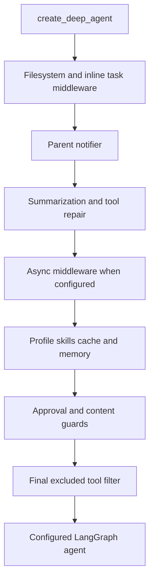
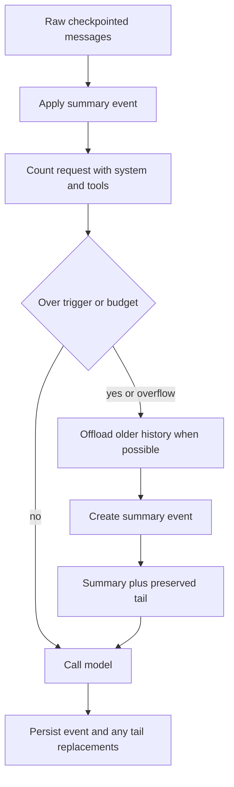
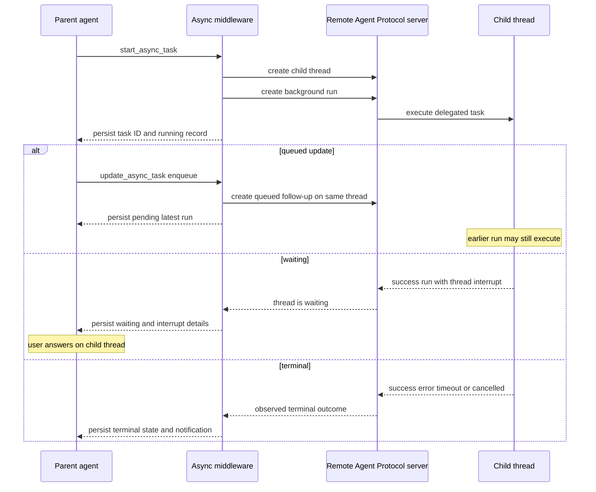

# Runtime Behavior and Failure Boundaries

`create_deep_agent()` is the composition boundary for a LangGraph agent: it resolves the model and its harness profile, combines caller tools with a selected backend, assembles ordered middleware, and forwards optional checkpointer, store, cache, context, and state schemas. The configured graph has a recursion limit of `9_999` and Deep Agents integration/version metadata. The constructor does not itself make state durable; a caller-provided LangGraph checkpointer does. See [SDK Construction and Execution](/openwiki/architecture/sdk-construction-execution.md) and [State Persistence](/openwiki/concepts/state-persistence.md).

## Middleware order, model profiles, and prompt input

The main stack begins with filesystem and optional inline-subagent middleware, then parent notification, summarization, and dangling-tool-call repair. Async-subagent middleware is included only when remote async agents are configured. Profile middleware, skills, provider prompt caching, and optional memory follow; human approval and unsupported-content handling come later. Custom middleware can replace or be inserted before named core layers. Profile exclusions are checked across the main and general-purpose-subagent stacks, and the final excluded-tool filter prevents a later wrapper from restoring an excluded tool.

Caption: construction fixes the middleware order; async task tools exist only for configured async subagents.

Prompt caching is provider-specific. The Anthropic cache middleware is a lazy stand-in: it leaves non-Anthropic requests untouched and imports the provider middleware only on the first Anthropic request, including after a runtime model switch. Bedrock and Fireworks cache middleware are appended only when their optional packages import successfully; an absent optional package is logged at debug level rather than preventing agent construction.

When `memory=` is configured, `MemoryMiddleware` loads each configured `AGENTS.md` source once into private `memory_contents` state before the agent runs. Missing files are ignored, but another backend download error fails the run. At model-call time it appends the sources in configured order, strips HTML comments, and frames them as reference material in the system prompt; the memory guidance explicitly says that file content is untrusted and must not override the user, safety policy, or verified evidence. With `add_cache_control=True`, the last system block receives Anthropic's ephemeral cache breakpoint based on the **runtime** request model, so model-routing changes remain correct; it is a no-op for non-Anthropic models.

## Checkpointed state and resumable history

`DeepAgentState.messages` uses a `DeltaChannel` with snapshot frequency 50 to avoid quadratic checkpoint growth. Its reducer coerces message-like writes, replaces or deduplicates messages by stable ID, applies removals, honors the last `REMOVE_ALL_MESSAGES` reset, and treats a missing replay base as an empty history. Stable IDs are assigned before checkpoint serialization by LangGraph, rather than during replay; assigning them in the reducer would make replay nondeterministic.

Before each run, `PatchToolCallsMiddleware` finds AI tool calls—valid or invalid—that lack a corresponding `ToolMessage`. It appends an error result for each and returns a message reset plus the repaired sequence. Thus a resumed checkpoint does not send an invalid dangling-call history to a provider; histories with all results are unchanged.

## Compaction preserves the raw log

Summarization changes the **effective request history**, not the raw `messages` state. It stores `_summarization_event`, containing a summary, raw cutoff, and optional backend history path; the next model request is constructed from that event plus preserved messages. Evicted history is offloaded to the configured backend before it is summarized when possible. If that write fails, summarization can still proceed, but the older history has no recovery path.

Caption: compaction shapes the next request while the checkpoint retains the raw message log and records the summary event separately.

When creating summarized effective history, preserved AI messages lose only reasoning blocks that are bound to preceding Claude history: native Claude reasoning blocks, plus `reasoning` blocks for Claude on Bedrock. Other identified providers retain their reasoning blocks. This is request shaping, not deletion from raw state.

The middleware reserves configured output tokens and five-percent headroom when a model advertises an input limit. A recognized context-overflow response can trigger summarization and **at most one strictly smaller** recovery request. It refuses to resend unchanged input, rejects known irreducible requests before sending them, and surfaces `ContextOverflowError` when recovery is exhausted; unrelated bad requests are not treated as context overflow.

`SummarizationToolMiddleware` exposes manual `compact_conversation`; it never compacts in the background. The tool shares the automatic middleware's engine and `_summarization_event`, but is eligible only around half the automatic trigger. A successful call records a new event and confirmation `ToolMessage`; no eligible cutoff or a summary failure returns a tool message without changing the event. See [Context Management](/openwiki/concepts/context-management.md).

## Async subagents: durable tracking, remote observation

`AsyncSubAgentMiddleware` exposes `start_async_task`, `check_async_task`, `update_async_task`, `cancel_async_task`, and `list_async_tasks`. Starting a task creates a child thread and run through an Agent Protocol client, returns the child thread ID as the stable `task_id`, and stores an `async_tasks` record in parent graph state. The record contains the configured agent, thread, tracked run, status, and timestamps. It is durable parent-side tracking, not the remote server's source of truth: checks and lists refresh it when possible, while an SDK failure returns an error or cached status rather than removing it.

Caption: a task has a stable child-thread ID while its tracked run may be replaced; `pending`, `waiting`, and terminal outcomes are distinct observation states.

A specification with `url` uses that remote endpoint; one without it uses local ASGI transport. Local ASGI requires asynchronous invocation such as `ainvoke`; synchronous use requires a reachable URL. Task-thread metadata includes the subagent name and, when available, its parent thread. Local children can also receive the parent assistant ID, which allows later local runs on the child thread to locate the parent. A URL-targeted child or `notify_parent=False` child intentionally omits that assistant ID, preventing direct wake-up while preserving parent-thread association. A configured webhook is separately passed to SDK run creation for starts and updates.

`mode="isolated"` sends only the delegated task. Experimental `mode="fork"` snapshots the parent's effective conversation, adds a task preamble, removes local tool artifacts and eviction metadata, hydrates portable blobs, and dispatches the serialized snapshot. It is a one-way handoff: subsequent parent changes and runtime resources are not shared.

### Run replacement, queueing, and cancellation

A task retains its thread-based `task_id` while the tracked `run_id` can change. The default `update_strategy="interrupt"` starts a replacement run on that thread and interrupts current work. With `update_strategy="enqueue"`, the latest run is queued without interrupting active work, so the task becomes `pending` while earlier work may still be running. Only one queued follow-up per task per model turn is accepted, preventing concurrent tool calls that observed the same state from losing run tracking.

An enqueue update records older run IDs as `superseded_run_ids`. If an earlier run's notification starts a parent run, middleware rewrites it so it remains a notification but cannot be read as the queued follow-up's result. Cancelling an enqueued task cancels the latest run and attempts pending or running superseded runs newest-first, avoiding release of a queued run behind active work.

A successful child run can still represent a pause: the child thread's `interrupted` status and pending interrupts map it to nonterminal `waiting`, so the child user can answer on the child thread. In contrast, a server run status of `interrupted` maps to `cancelled`. Observation can follow a newer run after external replacement, while an explicitly parent-cancelled task is not revived by that lookup. A waiting task needs no remote cancel request; the parent records it as `cancelled` and later checks preserve that choice.

## Notifications are best effort; polling closes the gap

`create_deep_agent()` installs `_ParentNotifierMiddleware` in every Deep Agents graph. On asynchronous execution, only the outermost graph of a task run reports final success or a model-call failure. It re-raises `GraphInterrupt`, so a human/approval pause is neither success nor failure, and it records reported run IDs to suppress duplicates.

A direct wake-up is intentionally local and best effort. A child must have both parent thread and assistant IDs; remote targets and notification opt-out lack the latter. The child reads the parent thread and creates a notification run with `multitask_strategy="reject"` only if that parent is `idle` or `error`; it does not interrupt a busy or approval-paused parent. Missing threads, races, and SDK delivery failures are logged but never fail the child.

On the asynchronous parent path, the middleware records a delivered notification, polls unfinished tasks at agent start and before model calls, then polls again after a final answer with no tool calls. A new notification causes one more model turn; unchanged observations are not repeated. Each observation has a five-second limit. SDK errors and timeouts skip only that task, leaving its persisted record eligible for a later poll. Synchronous graph hooks expose the task tools but do not perform this polling.

Notifications carry `deepagents_notification` and clearly label their content as not user input. Child-controlled text is HTML-escaped and clipped; normal image, audio, video, and file blocks can pass through, while reasoning, tool-call, and unknown assistant-only blocks are dropped. Automatically reported failures disclose a failure class rather than exception details. Use `check_async_task` for a full result or pause details.

## Retry scopes are deliberately different

`CodeModelRetryMiddleware` retries the model node only, taking the runtime-selected model's retry budget over its startup fallback. It retries classified transient failures with capped jittered delay or a valid capped `Retry-After`; graph control flow, non-transient failures, and exhausted budgets are re-raised. Therefore completed tool calls are not replayed and a failed provider request is not converted into an AI response.

The middleware emits correlated `model_attempt` start and completion events and a `model_retry` event for each retry. The retry event reports whether visible streamed output may have begun, allowing clients to supersede partial output. Stream-event writer failures are logged without replacing the model result or its error.

Talon adds a separate host-level retry loop around the entire asynchronous graph invocation. It propagates cancellation, uses the conversation ID as the LangGraph thread ID, retries its configured transient signals, and sleeps with capped exponential backoff. Because this scope can repeat a graph invocation, it is not the completed-tool safety boundary supplied by model-node retry middleware. See [Talon Integration](/openwiki/integrations/talon.md).

## Operational change and test focus

- Preserve reducer ID stability, reset behavior, and dangling-tool repair whenever checkpoint or resume behavior changes.
- Test provider routing and optional cache dependencies: non-Anthropic requests must pass through, and memory cache control must follow the request model rather than the construction-time model.
- Test memory sources in order, comment stripping, missing-file tolerance, and failure propagation for other backend errors; treat memory files as untrusted input in any customized prompt.
- Test launch, queued follow-ups, superseded notification rewriting, waiting, external run replacement, cancellation, and cached-status fallback separately.
- Test direct delivery separately from polling: local routing may wake only an idle or error parent, whereas polling must survive an SDK error or timeout without deleting task state.
- Test notification escaping, clipping, media forwarding, assistant-block removal, failure redaction, and duplicate suppression at the parent model boundary.
- Test model-node retry separately from host invocation retry; widening the former to tools changes replay safety.

For configuration examples, see [Subagents and Skills](/openwiki/concepts/subagents-skills.md). For approval pauses, see [Permissions and HITL](/openwiki/concepts/permissions-hitl.md).
