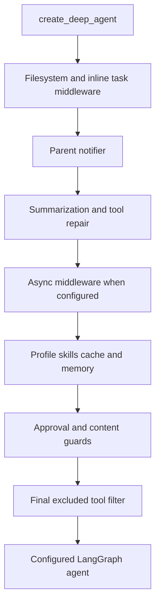
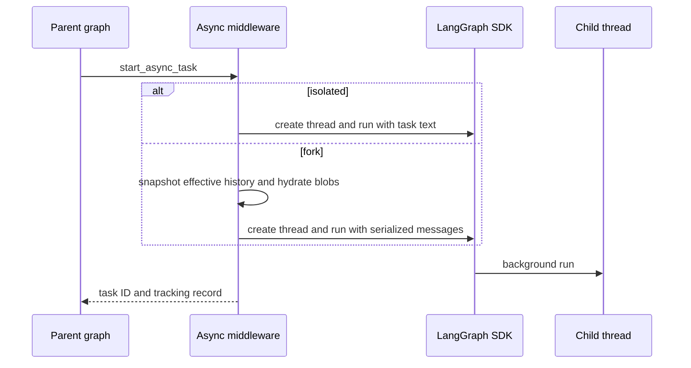
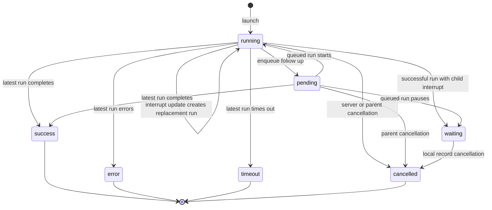
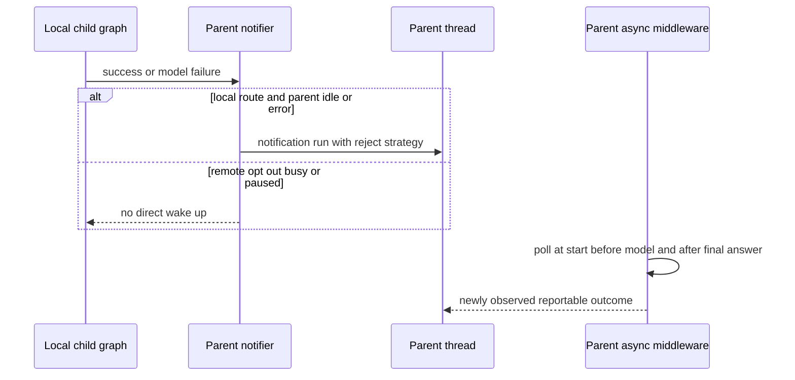

# Runtime Behavior and Failure Boundaries

`create_deep_agent()` is the composition boundary for a LangGraph agent. It combines caller tools, selected model and backend, ordered Deep Agents middleware, and optional context/state schemas, checkpointer, store, cache, and response format. The resulting graph uses recursion limit `9_999` and Deep Agents integration/version metadata. Persistence is supplied by the caller's LangGraph checkpointer rather than by this constructor. See [SDK Construction and Execution](/openwiki/architecture/sdk-construction-execution.md) and [State Persistence](/openwiki/concepts/state-persistence.md).

## Durable message state and recovery

The core stack places filesystem and optional inline-subagent middleware ahead of parent notification, summarization, dangling-tool-call repair, and, when configured, async-subagent middleware. Profile middleware, skills, prompt caching, and optional memory follow; human approval and unsupported-content handling are later. Custom middleware can replace or be inserted ahead of named core layers. A final excluded-tool filter prevents custom wrappers from restoring a profile-excluded tool.

Caption: construction fixes middleware order and adds asynchronous task behavior only when async subagents are configured.

`DeepAgentState.messages` is a `DeltaChannel` with snapshot frequency 50, limiting checkpoint growth from O(N²) to O(N). Its reducer coerces message-like data, replaces or deduplicates by stable message ID, processes removals and the last `REMOVE_ALL_MESSAGES` reset, and treats an absent replay base as empty. IDs must be assigned before serialization, not opportunistically during replay.

`PatchToolCallsMiddleware` repairs a resumed history before the next model call. For an AI message with unmatched normal or invalid tool calls, it appends error `ToolMessage` records and returns a reset followed by the repaired history. Histories whose calls already have results are left intact.

### Effective history does not replace the raw log

Summarization stores a private `_summarization_event` while retaining raw `messages`. The event supplies a summary and preserved tail as the model's effective history, records the raw cutoff and optional backend history path, and permits raw history to remain available for replay, evaluation, and forks. Older large tool arguments may be shortened, and prior history may be offloaded to the backend.

When creating the effective summarized request, the middleware removes reasoning blocks that are bound to pre-summary history from preserved AI messages—Claude native reasoning and Claude-on-Bedrock `reasoning` blocks—but does not remove reasoning for other identified providers. This is request shaping, not raw-history deletion.

A recognized context-overflow response triggers summarization and at most one strictly smaller tail-recovery attempt. The request is checked against a budget that reserves configured output tokens and headroom; an unchanged, still-oversized, or otherwise irreducible request raises `ContextOverflowError` instead of being retried indefinitely.

`SummarizationToolMiddleware` exposes the explicitly invoked `compact_conversation` tool; it does not compact in the background. It shares the automatic middleware's engine, event, and session state, but gates eligibility at about half the automatic trigger. Success writes a new summary event and a confirmation `ToolMessage`; no eligible cutoff or a summary-generation failure produces only a `ToolMessage` and leaves the event unchanged. See [Context Management](/openwiki/concepts/context-management.md).

## Async subagents: durable parent tracking

`AsyncSubAgentMiddleware` supplies `start_async_task`, `check_async_task`, `update_async_task`, `cancel_async_task`, and `list_async_tasks`. It starts work through the LangGraph SDK on an Agent Protocol server and immediately returns the child thread ID as `task_id`; the parent continues rather than waiting for a correlated result.

The parent state owns an `async_tasks` map whose reducer merges updates by task ID. Each record tracks the configured agent name, child thread ID, currently tracked run ID, status, and timestamps. It is a durable parent-side observation record, not a remote source of truth: check and list refresh it when possible, while an SDK failure returns an error or cached status instead of deleting the record. The child retains its own prompt, tools, approvals, credentials, filesystem resources, and persistence.

A specification with `url` uses that remote endpoint; without it, the SDK uses local ASGI transport. Local ASGI requires an asynchronous parent entrypoint such as `ainvoke`, while synchronous invocation requires a reachable URL. Remote headers default `x-auth-scheme` to `langsmith`; trace nesting headers are sent only to local deployments.

Task-thread metadata always includes the configured subagent name and includes the parent thread when available. For a local launch, the parent assistant ID is also retained so a later child-thread run can locate the parent. JSON-shaped local context is forwarded after removing `deepagents_parent`; when no transferable context exists, a configurable parent reference is used. A URL-targeted child, and a child whose specification sets `notify_parent=False`, receives no parent assistant ID: it can be associated with the parent thread but cannot wake its parent.

A configured `webhook` is passed to `runs.create` for task starts and follow-up runs. It is independent of the local parent-notification mechanism: it is an SDK run option, whereas direct wake-up requires the local parent assistant reference.

`mode="isolated"` dispatches only the delegated task. Experimental `mode="fork"` snapshots the parent's effective conversation, adds the task preamble, clears local tool artifacts and eviction metadata, hydrates portable blobs, and serializes that snapshot for dispatch. The transfer is one-way: later parent changes and runtime resources are not shared with the child.

Caption: launch persists a parent tracking record while a fork transfers only a portable point-in-time message snapshot.

## Follow-ups, pending work, and terminal statuses

A task keeps its thread-based `task_id` while its tracked `run_id` changes. The default `update_strategy="interrupt"` creates a replacement run on the same thread and interrupts current work. With `update_strategy="enqueue"`, the new run is queued without interrupting a running or pending one; its task status is `pending`, meaning the latest run has not started and an earlier run can still be working. To avoid losing tracking for parallel queue requests that read the same state, only the first queued follow-up for a task is accepted in a model turn.

An enqueue update records preceding run IDs as `superseded_run_ids`. When a notification from one of those earlier runs later starts a parent run, middleware rewrites its notification to say it is not the queued follow-up's result instead of recording that old outcome as the task's current state. Cancelling an enqueued task cancels its latest run and attempts earlier pending or running superseded runs newest-first, so cancellation does not release a queued run behind active work.

Caption: `pending` belongs to an enqueued latest run; earlier superseded runs can still be active until the queue advances or cancellation stops them.

A child pause has distinct semantics. A run that calls `interrupt()` can report `success`, while its thread is `interrupted` with pending interrupts; observation maps this to nonterminal `waiting`, exposing interrupt IDs and values for the child user to answer on the child thread. A run whose server status is `interrupted` instead maps to task status `cancelled`. If a tracked successful run is followed by a busy or error thread, observation switches to the latest run. These checks preserve the task identity while following current child work.

Cancelling a task that is not waiting asks the SDK to cancel the tracked run before recording `cancelled`. A waiting task has no active run, so cancellation is a parent-side status change only; later checks preserve `cancelled` rather than reviving it from the still-paused thread. List filters by cached state, then obtains live state for selected nonterminal tasks; lookup failures fall back to the cached status, and terminal tasks are not fetched.

## Notification, direct wake-up, and polling

`create_deep_agent()` installs `_ParentNotifierMiddleware` in every Deep Agents graph. On the asynchronous path, the outermost graph of a launched child reports a final result after completion and reports model-call failures. It re-raises `GraphInterrupt`, so a pause is neither automatic success nor automatic failure. Notification reporting is bounded to once per run.

Direct delivery is deliberately local and best effort. A child can wake a parent only when it has both the parent thread and assistant IDs—which `url` targets and `notify_parent=False` intentionally lack. It reads the parent thread and creates a notification run using `multitask_strategy="reject"` only when the parent is `idle` or `error`; it does not interrupt busy or human-paused parents. Missing threads, races, and delivery errors are logged but cannot fail the child.

Polling is the resilient observation path and is also what discovers a child-owned pause. On asynchronous parent execution, middleware records a delivered notification and polls unfinished tasks at agent start and before every model call. After a final answer without tool calls, it polls again and jumps back to the model only if new task-notification messages were added. It reports newly observed `success`, `error`, `timeout`, `cancelled`, or `waiting` outcomes; unchanged observations are not repeated. Each task observation has a five-second limit, and timeouts or SDK errors skip that task until a later poll.

Caption: direct wake-up is optional and local; polling provides the durable notification boundary for all unfinished tracked tasks.

Task notifications carry `deepagents_notification` and explicitly say they are not user input. Child-controlled text is HTML-escaped and clipped at `NUM_CHARS_PER_TOKEN * 20_000`; normal image, audio, video, and file blocks can pass through, while reasoning, tool-call, and unrecognized assistant-only blocks are dropped. Automatic failure reporting exposes a failure class rather than exception details. For a full result or waiting interrupt, the parent uses `check_async_task`.

## Retry boundaries

`CodeModelRetryMiddleware` wraps the model node only. It uses the runtime-selected model's retry budget in preference to its startup fallback and retries classified transient failures, so it neither repeats completed tools nor converts a failed provider request into an AI response. Graph control flow and exhausted or non-retryable failures are re-raised.

Classification recognizes retryable model, HTTP status, provider SDK, transport, exception-group, and cause-chain failures. Backoff is jittered and capped, or honors a valid capped `Retry-After`, subject to a cumulative interactive-delay guard. Every attempt emits correlated `model_attempt` start and completion events; a `model_retry` event identifies a failed attempt and whether visible streamed output may have started, allowing clients to discard superseded output. Stream-event writer failures are logged without replacing the model result or error.

Talon has a separate host-level retry loop around the entire asynchronous graph invocation. It propagates cancellation, retries configured transient signals with capped exponential sleeps, and uses a conversation-derived LangGraph thread ID. This broader retry can repeat a graph invocation and is not the completed-tool safety boundary supplied by model-node retry middleware. See [Talon Integration](/openwiki/integrations/talon.md).

## Change and test focus

- Preserve delta reduction and dangling-tool repair when changing checkpoint or resume behavior.
- Test launch, `pending` enqueued follow-ups, superseded notification rewriting, running, waiting, success, error, timeout, server cancellation, and locally recorded cancellation separately.
- Test `notify_parent=False`, URL targets, and webhook propagation separately from direct local wake-up. Only an idle or error parent with local assistant routing may receive a direct notification run.
- Test polling after transient observation errors and timeouts: it must skip the affected task without deleting or fabricating state, then retry on a later lifecycle hook.
- Test escaping, clipping, media forwarding, assistant-block removal, failure redaction, and duplicate suppression at the parent model boundary.
- Test that compaction's effective history removes only source-supported bound reasoning and that raw `messages` remain available.

For configuration examples, see [Subagents and Skills](/openwiki/concepts/subagents-skills.md). For Agent Protocol deployment context, see [ACP Integration](/openwiki/integrations/acp.md).
