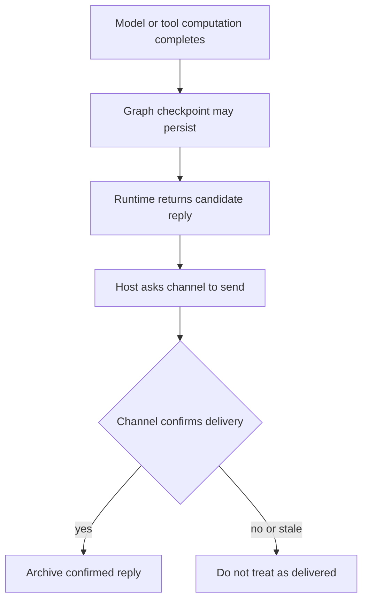
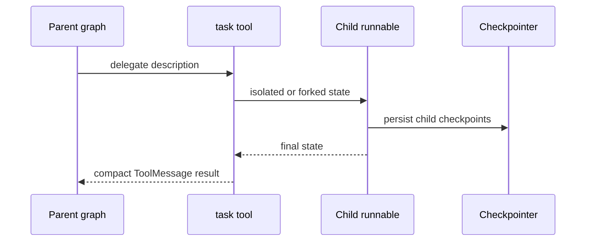
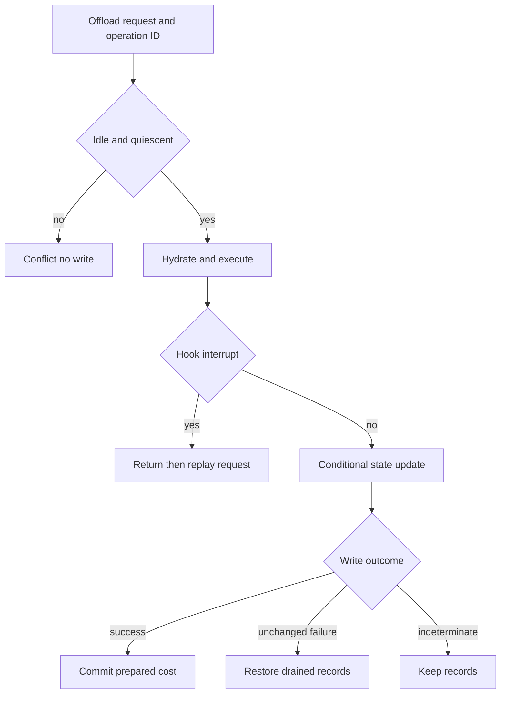
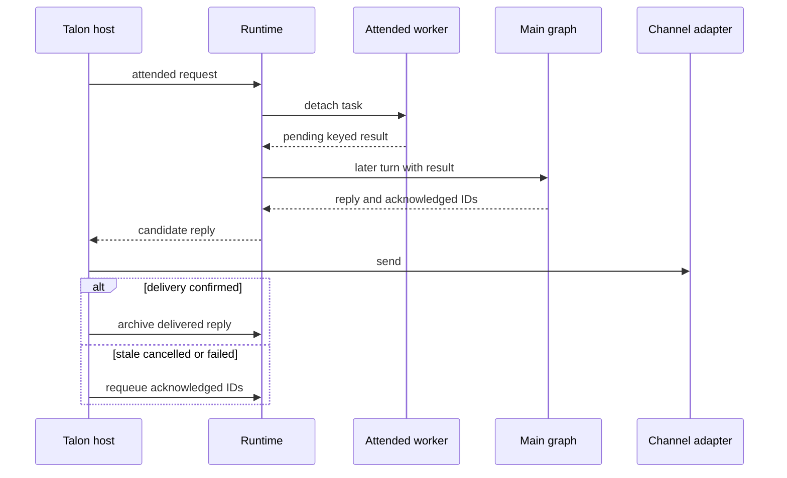

# Runtime Behavior and Failure Boundaries

A completed model call, a durable graph checkpoint, and a reply confirmed by a channel are different events. Deep Agents composes and checkpoints the graph; dcode presents local execution and makes conditional server mutations; Talon turns a graph result into an attended or scheduled interaction and owns channel settlement. Keeping these boundaries separate prevents retries or process loss from being mistaken for a confirmed user outcome. See [SDK Construction and Execution](/openwiki/architecture/sdk-construction-execution.md), [State Persistence](/openwiki/concepts/state-persistence.md), [Subagents and Skills](/openwiki/concepts/subagents-skills.md), [Cost and Sessions](/openwiki/operations/cost-and-sessions.md), and [Talon](/openwiki/integrations/talon.md).

## Ownership at a glance

| Concern | Authority | Boundary to preserve |
|---|---|---|
| Conversation and tool state | LangGraph checkpointer | Resumable state does not prove a response reached the user. |
| Messages | Delta-channel checkpoint state | Stored messages have stable IDs; replacement with `REMOVE_ALL_MESSAGES` discards earlier state and earlier writes in that batch. |
| Files held by a state backend | `FilesystemState.files` delta channel | Updates merge by path and `None` deletes; this is graph state, not an independent file service. |
| SDK child work | Parent graph plus child namespace | The parent receives a task result, not an unrestricted merge of child state. |
| dcode cost | Graph checkpoint channels | Client totals are presentation; checkpointed cost is thread authority. |
| Talon attended background work | In-memory `BackgroundSubagents` jobs | Jobs and result records are process-local and **do not survive a process restart**. |
| Talon scheduled delegation | The scheduled graph turn | It runs inline and has no later attended turn to consume a detached result. |
| User-visible reply | `TalonHost` and channel adapter | Archive/history promotion waits for confirmed send. |

*Completion, durable state, and confirmed delivery are intentionally separate milestones.*

## SDK graph state and synchronous delegation

`create_deep_agent()` builds the main middleware stack around filesystem tools, local subagents, summarization, tool-call repair, optional deployed async subagents, skills, caching, memory, approvals, unsupported-content handling, and refusal handling. Stack order is behavioral: skills see compacted/routed state, and `ModelRefusalMiddleware` is appended after the ordinary main-stack fallback opportunity. Thus a main-agent refusal normally raises `ModelRefusalError`; an earlier fallback can handle it, and a harness can exclude the middleware to retain the provider refusal message.

A normal local `task` child receives an isolated task message. The experimental declarative `mode="fork"` instead starts from compacted parent history but excludes parent-only coordination state, preserves the parent system-prompt prefix, appends fork instructions and the task, forbids fork-specific skills, and blocks recursive delegation. The parent returns a compact `ToolMessage`/`Command` outcome rather than merging the complete child state. Its wrapper relies on LangGraph ambient-config merge: parent tags and user metadata reach the child, child-bound settings win collisions, and the wrapper adds subagent tracing metadata plus the parent tool-call ID.

*The child may persist its own run, but the parent consumes a bounded task outcome.*

For compiled child graphs, `task` and `atask` stream checkpoint events to put the actually saved `checkpoint_ns` in the parent `ToolMessage` artifact; nested namespaces retain ancestry. A `.with_retry()` child is the documented exception: the fallback artifact can name the failed run instead of the successful `|1` retry. Refusal is a deliberately narrower error boundary: a final refusal, `ModelRefusalError`, or refusal-bearing structured-output validation becomes a parent-visible result, while non-refusal errors propagate. The separately deployed async-subagent formatter renders the same final-message refusal notice.

Summarization retains raw `messages` and stores an effective-history `_summarization_event`. It prefers `cutoff_message_id` to reconstruct history when available and uses `cutoff_index` only for legacy or missing IDs. Automatic and manual events record both. The synchronous path writes history before summary generation; the asynchronous path runs independent persistence and summary work concurrently. An offload failure leaves `file_path=None` rather than failing summarization.

### Checkpoint-safe messages and filesystem work

Message IDs are assigned before checkpoint serialization, including dictionary-form input, so state reads return non-`None`, stable IDs across repeated reads and resumed sync or async turns. This supports message-identity-based reconstruction and delivery/result injection. A full message reset is explicit: `RemoveMessage(id=REMOVE_ALL_MESSAGES)` removes prior state and writes earlier in the same reducer batch.

`FilesystemState.files` uses a delta reducer: later path values replace earlier ones and `None` is a deletion marker. Independently, filesystem middleware rejects multiple mutating tool calls for the same normalized path in one model response. That guard is only for `write_file`, `edit_file`, and `delete`; it returns a tool error for the later call rather than allowing concurrent same-path mutation.

## dcode cost, server lifecycle, and offload

dcode graph cost is durable checkpoint state: a process-wide recorder captures completed model requests, `CostTrackingMiddleware` prices and drains them on graph checkpoint paths without double-charging already-recorded main responses, and nested graphs transfer completed private deltas to their parent through owner-scoped state. Non-interactive dcode keeps a per-run usage ledger across HITL resume passes and finalizes each pass so replayed messages or chunks do not inflate displayed token and cost statistics; hidden internal calls are still accounted for and synthetic summarization messages are suppressed only from rendering.

JavaScript subagent execution has an additional receipt transport. `CostAwareCodeInterpreterMiddleware` leaves synchronous tool execution unchanged but, for asynchronous interpreter calls, wraps `task` tools with a request-isolated checkpoint namespace and a shared accounting owner. It forces synchronous graph durability for the child call, cancels still-active child invocations when the interpreter call ends, and turns ordinary child exceptions into bounded retryable result data while preserving cancellation and graph-bubble exceptions. A root interpreter call totals owner-tagged receipt checkpoints and emits an owner-scoped transfer to its parent.

A receipt is written before its node update returns, in a namespace derived from the accounting owner and child namespace. A receipt namespace is written only once, so replay does not replace it. Aggregation scans the thread for that owner, counts each receipt namespace once, preserves incomplete legacy attribution, and marks malformed values as historically incomplete instead of inventing cost.

The client launcher serializes server lifecycle operations and cleans up a spawned subprocess if startup fails or is cancelled. Health and graph readiness are separate barriers: `start()` waits for health, while `wait_for_graph_ready()` fetches the graph and produces diagnostics for process exit, transport failure, or a non-200 response. A stop generation keeps a terminal stop from racing with restart and respawning the server.

Server offload is a checkpoint-conditional mutation. It accepts only idle or error threads, requires quiescent checkpoint state, restricts updates to allowed `OffloadStateUpdate` channels rather than `messages`, and conflicts if the checkpoint advanced. Hook interruption is replay-based: retain the stable `operation_id`, return the interrupt, then re-execute later with accumulated hook responses. Client model transport settings are stripped; checkpointed model settings and server configuration select credentialed model work. If the write fails, drained costs are restored only when readback proves the checkpoint unchanged; an advanced or unreadable checkpoint is indeterminate and records remain committed to avoid double charge.

*Offload is replayable work plus a conditional checkpoint commit, not a suspended request coroutine.*

## Talon graph lifecycle, reload, and memory

`DeepAgentRuntime.start()` resolves subagents, snapshots approval policy, and constructs the Deep Agents graph. Graph construction binds backend, checkpointer, tools, attachments, task tools, background middleware, approvals, selected-model summarization, hooks, and Talon-specific memory. Before every request, `invoke()` refreshes runtime tools; under its tool lock it rebuilds the graph when approval state changes, and uses the request conversation ID as LangGraph `thread_id`. A `ConversationSaver` protects that session around the invocation.

Talon memory intentionally reloads configured sources every turn. `TalonMemoryMiddleware` occupies the SDK memory middleware's stack position, copies incoming state, removes cached `memory_contents`, and then delegates to the base loader. Consequently, an edit to a configured memory source on one checkpointed turn is visible on the next rather than being masked by checkpointed memory content.

Tool and subagent reload are transactional boundaries. The explicit subagent reload tool reports failure without exposing configuration values, retains the prior graph on failure, and says successful definitions become available on the next turn; work already running keeps its original graph. The runtime also treats an unavailable selected model as a fallback-to-default condition rather than making every later turn fail.

Retryable graph failures rerun the asynchronous graph invocation with exponential backoff capped at ten seconds; cancellation propagates. Continuation nudges for empty output are new invocations, not a retry of the preceding model call. On shutdown, Talon cancels background workers before closing the checkpointer. If a worker outlives cancellation, it raises and deliberately leaves runtime resources open rather than allowing a live worker to write against closed resources.

## Talon attended background work versus scheduled delegation

In an attended conversation, `task` and `start_async_task` detach process-local, owner-scoped jobs subject to a shared running-worker limit. Only the owning conversation can inspect, message, or cancel a job. Workers use an independent task ID as `thread_id`, clear authorization handling so they cannot strand a later approval prompt, block nested delegation, and turn timeouts, ordinary exceptions, and approval interrupts into safe result text. The in-memory job table is an availability mechanism, not persistence: restart loses jobs and unconsumed results.

Finished results are offered to a later main-agent turn as keyed synthetic user data. The runtime acknowledges IDs only after that turn succeeds and returns those IDs in `AgentResult.background_results`. If graph processing fails, each offered result has a bounded delivery-attempt count and is eventually dropped. If the graph turn succeeds but its reply is later stale, cancelled, or undeliverable, the host requeues exactly the acknowledged IDs, so the next turn can process them again.

A scheduled request (`trigger: "cron"`) is different. `task` and `start_async_task` run inline in the scheduled graph turn; they create no job record and do not consume attended-worker capacity. Nested delegation remains blocked. A separate semaphore queues inline fan-out, so a queued call spends its timeout budget on execution rather than waiting. Inline timeout and ordinary failure are converted to safe tool errors, preventing a graph-level retry from relaunching sibling calls. Do not describe scheduled delegation as attended background work.

*Only attended work has a later-turn result handoff; scheduled work waits inline.*

## Delivery settlement and focused tests

The host serializes work by conversation root and uses generations to stop a stale turn from sending after replacement. It calls persistent `record_delivered_reply` only after the channel confirms the final send. Therefore graph completion or background acknowledgement is not user delivery; stale, cancelled, and failed settlement paths preserve reprocessing of the affected background results.

Focused tests should keep these invariants explicit:

- `libs/deepagents/tests/unit_tests/test_messages_reducer.py` covers stable message IDs across checkpoint reads and resumed sync/async turns, dictionary input, replay from an empty checkpoint, and reset semantics.
- Test filesystem changes with same-turn parallel writes to the same normalized path and with state-backend update/deletion reduction.
- Test JavaScript subagent cost with replay, cancellation, receipt ownership, and parent transfer; do not replace checkpoint receipts with a UI-only counter.
- `libs/talon/tests/test_runtime.py` covers tool refresh, transactional graph replacement, runtime wiring, retry classification, and preservation of checkpointed progress across retry.
- `libs/talon/tests/unit_tests/test_background.py` covers owner isolation, cleared authorization, cancellation/shutdown, acknowledgement/requeue, and the separate inline scheduled path, including its fan-out limit and safe failure output.
- Test delivery separately from graph success: confirmation gates archive promotion, while an undelivered attended result must be eligible for a later turn.
