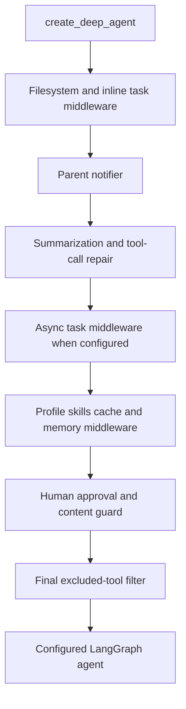
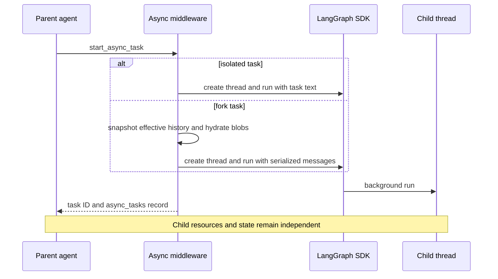
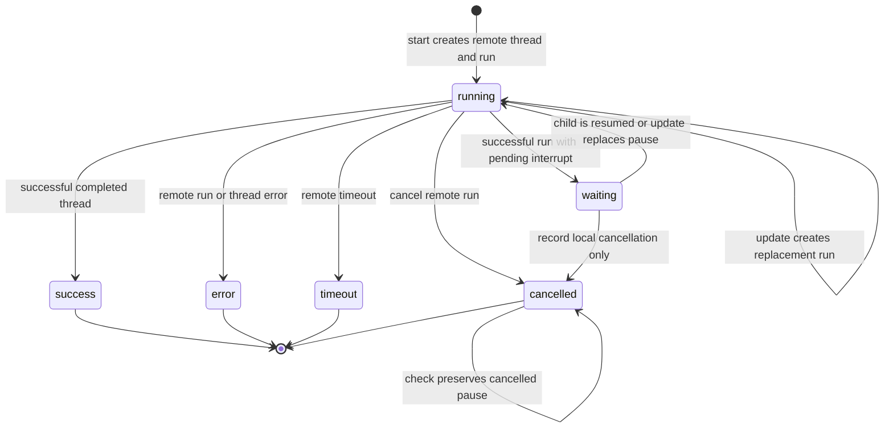
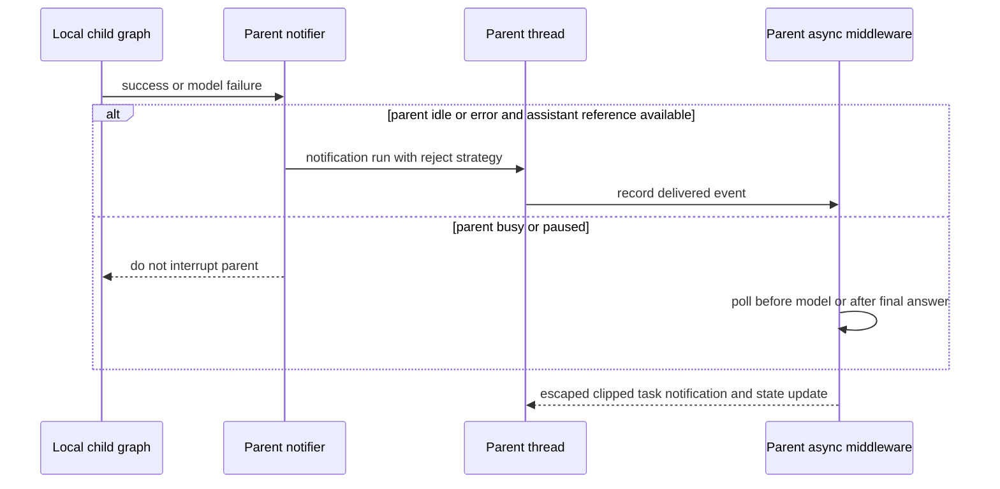

# Runtime Behavior and Delegated Execution

`create_deep_agent()` is the assembly boundary for the LangGraph agent loop. It supplies caller tools and the selected backend along with Deep Agents middleware and optional context schema, state schema, checkpointer, store, cache, and response format. The compiled graph has recursion limit `9_999` and integration/version metadata. A caller owns durable continuation: pass a checkpointer and reuse the LangGraph `thread_id` when a conversation, approval interrupt, or task state must continue. See [SDK Construction and Execution](/openwiki/architecture/sdk-construction-execution.md) and [State Persistence](/openwiki/concepts/state-persistence.md).

## Loop composition and recoverable context

The main stack starts with filesystem handling, then inline `task` delegation when configured, `_ParentNotifierMiddleware`, summarization, and tool-call repair. `AsyncSubAgentMiddleware` is added only when remote specifications exist. Profile, skills, prompt-cache, and memory layers follow; human approval, unsupported-content handling, and finally excluded-tool filtering are applied at the tail. Custom middleware can replace a named core layer or be spliced before the profile tail, but excluded tools are removed after custom middleware so they cannot be reintroduced to a model call.

Caption: the graph is assembled as an ordered middleware loop; remote task polling and parent notification are separate layers rather than properties of the remote graph.

`DeepAgentState.messages` uses a `DeltaChannel` with the local reducer and snapshot frequency 50. The reducer coercively merges message-like values by stable ID, supports removal and the last `REMOVE_ALL_MESSAGES` reset, and treats an absent replay base as empty. This preserves deterministic replay while avoiding repeated full-history checkpoint writes. Before an agent resumes, `PatchToolCallsMiddleware` repairs unmatched AI tool calls by appending correlated error results and replacing the messages channel atomically with a reset followed by the repaired history.

Summarization changes **model context**, not the raw history channel. It records a private summarization event containing a cutoff, generated summary message, and optional backend history path, then supplies the summary plus retained tail to the model. It can offload old history and trim older large write/edit arguments; a provider context-overflow rejection triggers a smaller recovery attempt through summarization. This leaves the full message record available for replay and a fork snapshot. `SummarizationToolMiddleware` optionally offers an explicitly called `compact_conversation` tool: it shares the event/session state, gates compaction at about half of the automatic trigger, and returns a correlated `ToolMessage` without changing summary state when no cutoff exists or summary generation fails. See [Context Management](/openwiki/concepts/context-management.md).

## Delegation boundaries

Inline subagents and asynchronous subagents are different execution models:

- An inline `task` invocation runs a child through `invoke` or `ainvoke` and blocks until it returns a correlated `ToolMessage`. It can receive eligible inherited state, while private and delegation-inappropriate state is excluded.
- `AsyncSubAgentMiddleware` launches an Agent Protocol run through the LangGraph SDK and returns immediately. It owns five model-facing tools: `start_async_task`, `check_async_task`, `update_async_task`, `cancel_async_task`, and `list_async_tasks`.
- A remote child is its own graph. Parent tools, prompt, checkpointer, filesystem permissions, approval policy, credentials, and state are not shared merely because a task was launched.

An async task ID is the remote thread ID. The local `async_tasks` state map stores the selected agent name, current remote run ID, status, and timestamps; its reducer merges records by task ID, so state updates from task operations survive graph transitions and context reduction. Launch, check, update, cancel, and list return tool text on SDK failures rather than overwriting a known task record.

### Local deployment versus remote server

An async specification with `url` uses that remote Agent Protocol server. Omitting `url` uses local ASGI transport and therefore requires an asynchronous parent entrypoint such as `ainvoke`; a synchronous parent needs a reachable URL. The SDK defaults `x-auth-scheme` to `langsmith` unless the specification supplies one.

Every launch creates a child thread with `parent_thread_id` metadata when available. For a local deployment, metadata also retains the parent assistant ID, which lets a later run on the child thread find and wake the parent. The launch forwards JSON-serializable runtime context to the local child after removing `deepagents_parent`; if context cannot be forwarded, it instead sends the `deepagents_parent` configurable reference. For a `url` remote server, the reference contains only the parent thread ID—the parent assistant is intentionally omitted because another deployment cannot wake that parent. These fields are association and routing data, not shared state or authorization.

When tracing is active, a local launch or update may include trace headers that ask the receiver to nest its span under the parent. Those headers are not sent to a remote URL. The parent reference can also be recovered from child-thread metadata, so a child resumed directly by its user can still identify the original local parent.

### Launch and context forwarding

`mode="isolated"` sends only the delegated description. Experimental `mode="fork"` snapshots the parent’s *effective* conversation at launch, including any summary event, appends a preambled task message, removes local `ToolMessage.artifact` data and parent-local eviction metadata, hydrates portable blob references, and serializes the resulting messages. The snapshot is made before network work, so later parent changes do not alter it. The remote graph nevertheless owns its own prompt, tools, runtime resources, and persistence.

Caption: both forms return before the child completes; fork transfers a launch-time message snapshot, not a live parent context.

## Task lifecycle, polling, and waiting

A launch records `running`. A check reads the tracked run; only a successful run causes a thread read. A successful run whose thread has pending interrupts is `waiting`, not complete, and check returns the interrupt IDs and values. If its successful tracked run has been superseded and the thread is busy or errored, observation switches to the newest run. A normal completed thread returns the final thread message.

`update_async_task` starts a replacement run on the same thread with `multitask_strategy="interrupt"`; the task ID remains stable and the run ID becomes the new run. Updating a waiting task therefore drops its pending human request. `cancel_async_task` cancels a non-waiting remote run, but a waiting task has no active run to cancel, so it only records local `cancelled`. A later check deliberately preserves that cancellation instead of reclassifying the still-paused thread as `waiting`.

`list_async_tasks` first filters from cached state, then reads live state only for selected nonterminal records and writes refreshed status/run IDs back. A lookup failure logs a warning and returns the cached record. Terminal records are not polled.

Caption: `waiting` is a thread-level human pause, whereas `interrupted` is a terminal server-run status; task identity remains the child thread across replacement runs.

## Parent notification path and safety

`create_deep_agent()` attaches `_ParentNotifierMiddleware` to every Deep Agents graph. On the asynchronous path, the outermost graph of an asynchronously launched child reports successful completion after the agent and reports a model-call exception as an error. It ignores `GraphInterrupt`, so a child paused for human input is not falsely reported as failed or complete. A bounded per-run set prevents duplicate reports; nested Deep Agents graphs do not report independently.

For a child with both local parent thread and assistant IDs, the notifier attempts to start a notification run on the parent only when the parent thread is `idle` or `error`, using `multitask_strategy="reject"`. It never interrupts a busy or approval-paused parent. Delivery errors—including a missing parent or a race to busy—are logged and do not fail the child. If the parent is active, it discovers changes itself during asynchronous polling before a model call and once more after a final answer; a new notification causes another model turn. A run begun by a notification records that event so it is not emitted again.

Notifications are explicitly framed as system notification content rather than user input and carry a `deepagents_notification` event marker. Result text and structured details are HTML-escaped so child-controlled text cannot close the envelope; text is clipped to `NUM_CHARS_PER_TOKEN * 20_000` characters and directs the parent to `check_async_task` for full details. Image, audio, video, and file blocks may pass through, while reasoning, tool calls, and unsupported assistant-only blocks are dropped. Automatic error notifications reveal only a failure class such as `RuntimeError`, not the exception message or remote error detail.

Caption: direct wake-up is local and opportunistic; polling provides the fallback and does not turn a notification-delivery failure into a child failure.

## Change and test focus

- Keep `_ParentNotifierMiddleware` in graph assembly and preserve its async-only reporting semantics. Test success, model failure sanitization, `GraphInterrupt`, nested graphs, unavailable parents, and busy or interrupted parent threads.
- Test parent-reference routing separately for local ASGI and `url` remote deployments: forwarded context must exclude `deepagents_parent`; remote references must not contain the parent assistant ID.
- Exercise notification escaping, clipping, media forwarding, assistant-only block removal, duplicate suppression, status refresh before a model call, and the extra turn after a final answer.
- Exercise task transitions independently: a paused child is `waiting`; update replaces its run on the same thread; cancellation of waiting is local; list uses cached filtering and a live-status fallback.
- Preserve raw messages and the `DeltaChannel` reducer contract when changing context middleware. Fork tests should cover summary-effective snapshots, artifact/eviction cleanup, blob hydration, isolation from parent resources, and snapshot stability.

For configuration examples and subagent selection guidance, see [Subagents and Skills](/openwiki/concepts/subagents-skills.md). For test execution conventions, see the [Testing Guide](/openwiki/testing/testing-guide.md).
