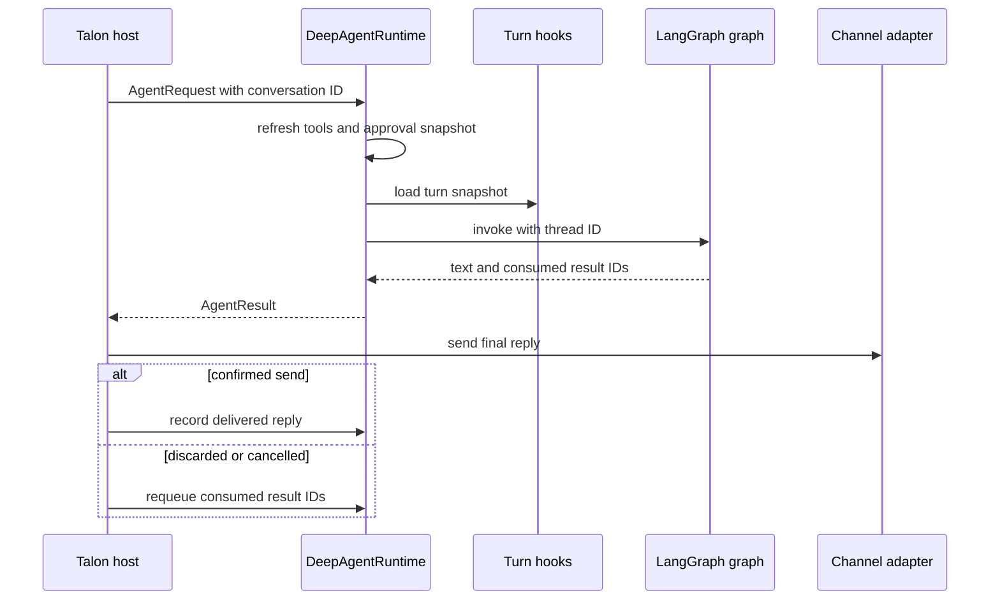
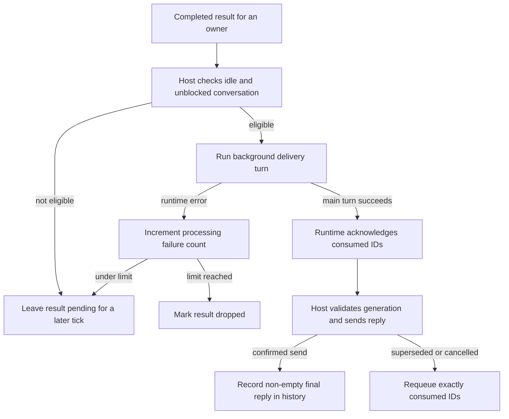

# Runtime Behavior and Failure Boundaries

> **Experimental:** Talon is an experimental runtime and can change or be removed. In particular, do not equate a worker finishing, a main-agent turn completing, and a channel delivery succeeding: they are distinct milestones.

Talon's host owns channel interaction and the final delivery decision; `DeepAgentRuntime` owns graph invocation and the in-memory `BackgroundSubagents` middleware owns local task/result state. This boundary is important for safe retries: runtime acknowledgement means the main graph processed a result, **not** that a user received it. See [Subagents and Skills](/openwiki/concepts/subagents-skills.md), [Talon Channel Admission](/openwiki/concepts/talon-channel-admission.md), [Talon Scheduling](/openwiki/concepts/talon-scheduling.md), [Talon](/openwiki/integrations/talon.md), and [Security](/openwiki/operations/security.md).

## Turn construction and request context

`start()` resolves subagents, ensures and snapshots tool approvals, and constructs the graph. At every `invoke()`, Talon refreshes runtime tools; it serializes tool changes under a lock and rebuilds the graph if the persisted approval snapshot changed. The request conversation ID is the LangGraph `thread_id`. When the checkpointer is a `ConversationSaver`, the invocation holds that conversation's protected session.

The invocation binds context only for its duration: selected model/effort, approval-operator eligibility, authorization and breakout handlers, cron origin, pending-result tracking, progress/questions, file delivery, history scope, and hooks. An operator flag is effective only for an attended, non-cron, non-background-delivery turn. This prevents a synthetic delivery turn from inheriting authority from the person who started the original conversation.

Hooks are also request-scoped. Talon loads the trusted assistant hook snapshot once per turn, explicitly excludes workspace/project hooks, records committed messages before hook fulfilment, validates snapshot/thread/prompt identities on hook interrupts, and leaves remaining tool approvals to Talon. Child subagents receive independent hook identities and transcripts while sharing the turn snapshot.

*The request flow separates runtime completion from host-confirmed channel delivery.*

## Approvals, retries, and history protection

The graph contains both hook and human-in-the-loop middleware; hook decisions run before approval resolution. Talon resolves hook interrupts first, then batches remaining approval interrupts, audits the outcome, resumes the graph, and enforces a maximum approval-round limit. Cron runs and requests without an approval handler auto-deny gated calls rather than leaving an interrupt without an operator.

Graph invocation retries retryable failures up to the configured attempt count with exponential backoff (1, 2, 4 seconds, capped at 10 seconds); cancellation is propagated. If an invocation produces no text, continuation nudges and finally a summary prompt are new graph invocations. Consequently, tool wrappers that can time out after sibling calls have begun must contain those failures rather than letting a whole graph retry relaunch work.

Pending background results are injected before the request as keyed synthetic user messages. Only after successful main-turn completion does the runtime acknowledge the consumed IDs and return them in `AgentResult.background_results`. A failed main turn increments an offered result's delivery count and drops it at the configured limit; cancellation does not count as a failure. `record_delivered_reply()` promotes non-empty text to persistent semantic history only after the host reports a confirmed send.

## Attended delegation: detached, owner-scoped work

For attended conversations, `task` and `start_async_task` are intercepted and return a task ID immediately. A non-empty calling `thread_id` is required. Jobs, task handles, results, and counters are in-memory/process-local rather than checkpoint state, so they do not survive a restart. The capacity ceiling is shared by configured middleware copies and conversations; when either the active-worker limit or job table limit is full, launch is refused rather than queued.

Each worker runs on a fresh task ID with recursion limit 500 and copied task state. It marks itself as a subagent, blocks nested delegation, clears operator authority and the authorization handler, and turns approval interrupts into safe result text. A detached worker therefore cannot strand an interactive approval prompt after its originating host turn ends. Timeout and ordinary errors become bounded, sanitized results; cancellation marks the job cancelled without producing a result. Remote asynchronous targets stream with `on_disconnect="cancel"`.

The management tools enforce the same owner boundary: a conversation may list, inspect, message, or cancel only its jobs. Guidance is supported only for Talon-built local workers and is queued for the next model step; it does not interrupt an active model/tool call. Saved subagent configuration is not automatic: reload changes later turns, while running tasks retain their original graph and capabilities.

## Scheduled delegation runs inline

A turn with `trigger: "cron"` has no interactive audience and uses a separate path. Its `task` and `start_async_task` calls run inline to completion instead of adding a job or waiting for a follow-up delivery turn. Nested delegation remains forbidden. A chat's later `background_delivery` turn is not cron, so it continues to detach work.

A separate semaphore bounds scheduled inline fan-out. Calls wait for a slot, then start their timeout, so queue time does not consume execution budget. The default inline timeout is ten minutes; `DEEPAGENTS_TALON_INLINE_SUBAGENT_TIMEOUT` accepts a positive integer seconds value. Inline wrappers catch ordinary errors and timeouts and return sanitized error `ToolMessage` values. That containment avoids retrying the graph and launching sibling tool calls again.

`DEEPAGENTS_TALON_MAX_BACKGROUND_TASKS` sets the positive attended worker limit (default four). Treat capacity refusals, safe timeout/error results, and repeated result-processing failures as operational signals rather than evidence that work was delivered.

## Background-result settlement and channel delivery

The host polls completed result owners and starts a synthetic `background_delivery` turn only when the conversation has no active turn, is not blocked, and has pending results. It removes both approval and authorization handlers for that follow-up. The runtime's keyed messages make re-injection idempotent, while the returned IDs let the host settle only work the graph actually consumed.

*Acknowledgement follows successful graph processing; delivery confirmation follows host settlement and channel success.*

During settlement, a superseded generation, cancellation while waiting to deliver, or a failed/withheld candidate reply must not silently consume background work. The host requeues precisely `AgentResult.background_results` for unintentional loss. Deliberate suppression—for example, terminal authorization or a silent scheduled run—keeps the results acknowledged. Results that were already delivered, pruned, or cancelled are not resurrected.

## Scoped `send_file` capability

The runtime installs `send_file` over the same filesystem backend used by agent file tools and binds the host-provided file handler only for the current invocation. The tool reads one bounded file, derives a sanitized display filename, and sends it to the chat that started that turn. It does not provide a destination argument, does nothing when the run has no receiving chat, and refuses calls from a subagent; a child must report a path to its main agent instead.

The host handler additionally checks that the turn is still active and still reaches its originating chat. It stages bytes in a fresh private directory below Talon's outbound-media root, writes with exclusive no-follow permissions, asks the channel adapter to send media with retry, and removes the staging directory afterwards. Tool output reports only a generic failure while channel transport detail is logged. File-send success is a separate channel operation; it neither establishes final-text delivery nor changes the background-result settlement boundary.

## Shutdown and focused tests

Runtime shutdown cancels background workers before closing the graph/checkpointer. It waits up to ten seconds; if any worker survives, `stop()` raises and deliberately leaves resources open rather than permit a live worker to write to closed resources. The host treats that as a component failure while continuing shutdown.

Focused regression coverage includes:

- `libs/talon/tests/test_host.py`: a background delivery turn drops interactive authority; superseded and cancelled turns requeue consumed IDs; deliberate suppression does not; and an agent file is sent to the originating chat then removed from outbound staging.
- `libs/talon/tests/unit_tests/test_background.py`: owner isolation, capacity, task lifecycle, cancellation, safe failures, approval handling, acknowledgement/requeue, shutdown, and the distinct cron-inline path.
- `libs/talon/tests/unit_tests/test_research_subagents.py`: fresh child context/capabilities and the inability of background subagents to complete interactive approvals.

When changing this area, test the three settlement milestones independently: worker completion, successful main-graph processing, and confirmed channel delivery.
