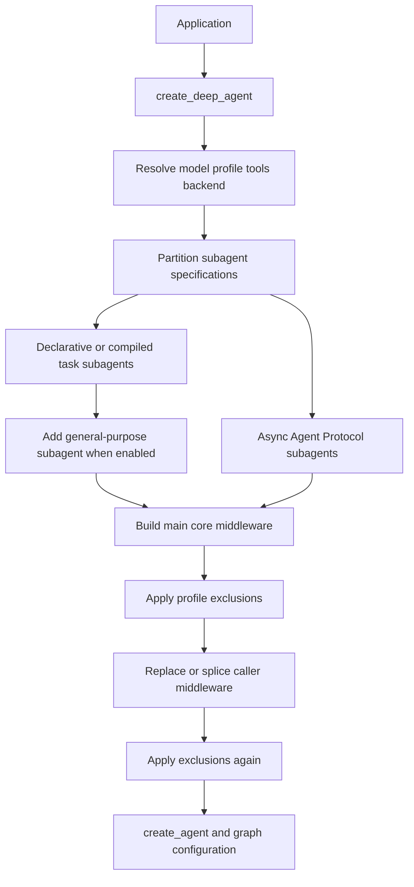
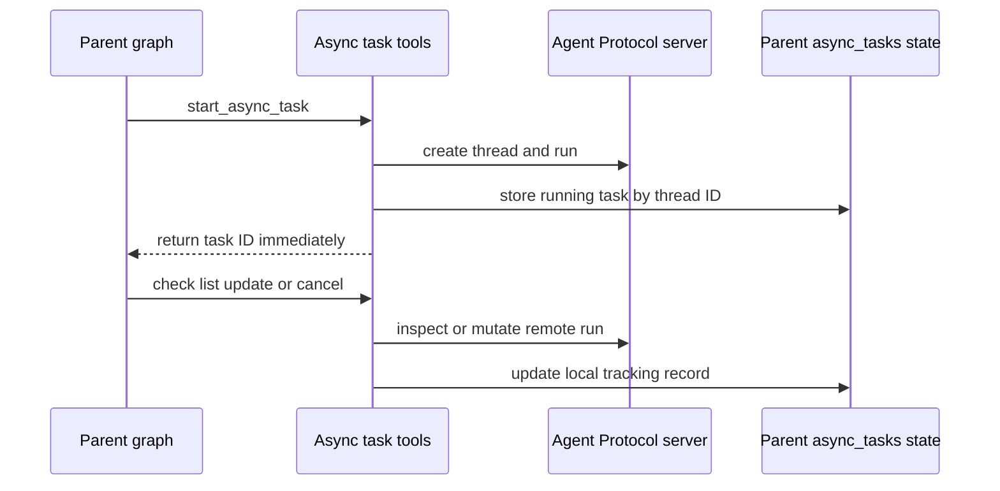

# SDK Construction and Execution

`create_deep_agent()` is the SDK assembly boundary, not a separate agent loop. It resolves the model and harness profile, establishes backend and policy, builds a LangChain middleware list, and returns a configured LangGraph compiled by `create_agent()`. The compiled graph owns ordinary agent execution, state, checkpoints, and interrupts. Remote async work is instead executed by an Agent Protocol server; the parent graph persists only its tracking records.

## Construction and partitioning

Caption: `graph.py` classifies a specification with `graph_id` as remote; only inline specifications create the synchronous `task` surface.

A `SubAgent` is declarative, a mapping with `runnable` is a `CompiledSubAgent`, and a mapping with `graph_id` is an `AsyncSubAgent`. Unless disabled by the active profile or replaced by an inline specification of the same name, the builder prepends the default `general-purpose` synchronous subagent. Consequently, remote subagents do not cause `task` to appear, and disabling all inline/default subagents does not remove async task tools.

The default backend is `StateBackend()`. The `model=None` compatibility path is deprecated; otherwise the builder resolves the model and selects its harness profile. It rewrites supplied tool descriptions according to the profile, appends profile prompt material to a string prompt or to a new text content block of a supplied `SystemMessage`, and forwards the final model, prompt, tools, middleware, response format, context schema, checkpointer, store, debug, name, cache, and state schema to `create_agent()`.

The returned graph has recursion limit `9999` and Deep Agents integration, version, and agent-name metadata. Checkpointer and store are passed at that outer compilation boundary; they are not separately injected into synchronous child compilation.

## Middleware composition

The order below is constructed in `graph.py`; it is not inferred from public middleware types.

1. `FilesystemMiddleware`;
2. `SubAgentMiddleware` only when an inline pool exists;
3. `_ParentNotifierMiddleware`;
4. summarization middleware;
5. `PatchToolCallsMiddleware`;
6. `AsyncSubAgentMiddleware` only when remote specifications exist.

Profile-provided middleware, optional `SkillsMiddleware`, prompt-caching middleware, optional `MemoryMiddleware`, derived `HumanInTheLoopMiddleware`, and `UnsupportedContentMiddleware` form the tail. The builder applies profile exclusions, processes caller middleware, then applies exclusions again. A caller instance with the same name replaces a surviving entry in place; a new name is inserted after the last surviving core entry and before the tail. `_ToolExclusionMiddleware`, when needed, is appended last, so custom middleware cannot restore a profile-excluded tool.

`FilesystemMiddleware` and `SubAgentMiddleware` are protected scaffolding. Exact class/name exclusions of them, collisions between a string exclusion and distinct middleware classes, and exclusions matching nowhere across the main and general-purpose stacks raise during construction. A profile may, however, exclude `_ParentNotifierMiddleware` by its class.

The automatically added general-purpose child deliberately has a narrower stack: filesystem, summarization, patching, profile middleware, optional skills, and caching. Caller middleware reaches it only by replacing one of that stack's original slots, rather than by copying the entire main stack.

## State and synchronous task boundaries

`DeepAgentState.messages` uses `DeltaChannel` and the message-delta reducer. It accepts raw message-like input, treats absent replay state as empty, updates/removes messages by ID, and supports remove-all; the channel is configured for snapshot frequency 50.

When a custom `state_schema` is supplied, it is used for the main graph and declarative child compilation. Precompiled children retain their own schema. After the complete main stack is known, fields private to the main schema or installed middleware schemas are assigned to each installed `SubAgentMiddleware` boundary and are withheld from task handoff.

A declarative child has its own resolved model/profile and child middleware. It inherits parent permissions and `interrupt_on` only when the specification does not provide them, and inherits parent tools only when `tools` is omitted. A fork mirrors prompt-producing parent middleware in order to reconstruct the inherited prompt. Synchronous child runs use ambient LangGraph configuration: callbacks, tags, configurable values, and metadata propagate, while a child runnable's bound configuration wins a collision.

The `task` tool invokes a child synchronously. Isolated tasks receive permitted state plus a fresh task `HumanMessage`; forks receive effective post-summarization parent history plus the task and carry a private fork marker. That marker makes recursive task delegation fail. A child must return `messages`; the bridge removes messages, private/excluded fields, and unchanged values from its state update, then returns a single `ToolMessage` containing structured output JSON or the last nonempty AI text.

## Remote asynchronous task contract

`AsyncSubAgentMiddleware` is independent of `SubAgentMiddleware` and contributes five tools: `start_async_task`, `check_async_task`, `update_async_task`, `cancel_async_task`, and `list_async_tasks`. It validates unique names, `mode` (`isolated` or experimental `fork`), and `update_strategy` (`interrupt` or `enqueue`). It adds `async_tasks` to parent state, merged by task ID. An `AsyncTask` records the remote thread ID, latest run ID, subagent type, status, timestamps, and—only for queued follow-ups—earlier `superseded_run_ids`.

Caption: Remote threads and runs belong to the Agent Protocol server; the parent only stores a durable, reducer-merged tracking projection.

Starting creates a remote thread with subagent and parent-thread metadata, launches a run, and immediately writes a local `running` record keyed by that thread ID. Failed SDK calls return a tool error rather than create a record. An isolated launch sends only the delegated task. A fork snapshots effective parent history at launch, appends a background-task preamble and the delegated task, clears parent-local tool artifacts and eviction markers, hydrates portable media, then serializes the snapshot. Forking shares conversation content once; it does not synchronize model, system prompt, tools, filesystem, or state.

A same-deployment launch can forward JSON-compatible run context after removing the Deep Agents parent reference. If no usable context is forwarded, it sends that reference in `configurable`; task-thread metadata retains linkage. A URL-targeted remote launch never forwards parent context and receives only the parent thread reference, not the parent assistant ID, because it cannot wake the parent cross-deployment. Trace headers are likewise limited to same-deployment launches. Managed authentication comes from SDK environment credentials; self-hosted deployments use the specification's `headers`. Omitting `url` selects local ASGI transport and therefore requires `ainvoke` or another async entrypoint; synchronous invocation requires a reachable URL.

### Checks, updates, cancellation, and notification

A successful tracked run is `waiting` when its thread is paused, and `check_async_task` includes that thread's pending interrupts. If a successful run's thread has become busy or errored, observation discovers the newer run. `check_async_task` returns the current status and result when complete; `list_async_tasks` first filters cached records, then refreshes selected nonterminal records, retaining cached status if fetching fails.

`update_async_task` starts a follow-up on the same remote thread. The default `interrupt` strategy replaces the tracked run and interrupts current work. With `update_strategy="enqueue"`, the follow-up is queued (`pending`) behind active work and prior run IDs are retained so their completion cannot be mistaken for the follow-up result. Only one enqueue update for a task is accepted in one model turn, avoiding parallel calls that would lose tracking. Cancelling cancels the latest and any tracked active/pending earlier runs; cancelling `waiting` changes only local tracking because no run is active. A specification can also attach its `webhook` to every start and follow-up run.

Polling is async-only. `abefore_agent` records a notification that started a run and polls unfinished tasks, `abefore_model` polls again, and `aafter_model` polls after a final answer and gives the model another turn only when it has a new notification. New success, error, timeout, cancelled, or waiting outcomes are surfaced once; failed/timed-out polling is skipped until the next check. Sync `invoke` still exposes the five tools but does not poll.

The normal SDK stack adds `_ParentNotifierMiddleware`. For a top-level asynchronous Deep Agent run launched by a parent, it reports final success or a model failure once. The shared wake-up helper starts a notification run only when the parent thread is idle or errored and the task linkage contains both parent thread and assistant identifiers; busy parents learn via their own poll, and waiting parents are not disturbed. A remote deployment or `notify_parent=False` deliberately omits that assistant reference, so it cannot wake the parent. A remote task waiting for approval/input must be answered on its own thread.

## Permissions, skills, and paths

Filesystem enforcement and review are separate. `FilesystemMiddleware` independently enforces deny rules. The builder converts interrupt-mode filesystem rules into path-sensitive `HumanInTheLoopMiddleware.interrupt_on` predicates; caller settings for the same tool win. These controls are installed on the main agent and constructed declarative children, not transmitted to remote async graphs. Remote authorization, persistence, filesystem controls, and approvals belong to the remote deployment.

The derived predicates distinguish exact-path and bulk operations, conservatively interrupt pathless/current-directory bulk calls, account for a `glob` pattern that redirects outside its nominal path, and match a backend-resolved symlink target when available. A deny decision wins rather than becoming an approval prompt. Persisting/resuming such human interrupts requires a checkpointer.

Skills are loaded from backend sources. Metadata is cached per thread, later same-name sources override earlier sources, reset to `None` reloads, and source errors become warnings. A caller `SkillsMiddleware` supplies the normal skills slot when `skills` is omitted. Inline skill-tool disclosure follows the relevant read result without splitting a tool-result batch or moving ahead of queued user content, and uses the model selected after fallback.

`CompositeBackend.artifacts_root` defaults to `/`. Filesystem large-result eviction and summarization-history offload derive their directories from that root after trailing-slash normalization.

## Verification focus

`test_graph.py` covers stack order, conditional installation, exclusions, schemas, and general-purpose composition. `test_subagents.py` exercises isolation, forks, returned state, and ambient configuration. `test_async_subagents.py` covers local/remote transport, context and parent linkage, pause states, polling/notifier behavior, webhooks, and both update strategies—including queued-run tracking and cancellation. Permission tests cover generated path predicates; artifacts-root tests cover normalized offload paths.

## Related pages

- [Middleware stack](middleware-stack.md) — hook responsibilities and ordering.
- [Architecture overview](overview.md) — component boundaries.
- [Runtime behavior](runtime-behavior.md) — runtime execution and operations.
- [Subagents and skills](../concepts/subagents-skills.md) — delegation configuration.
- [Build a Deep Agent](../workflows/build-a-deep-agent.md) — SDK usage workflow.
