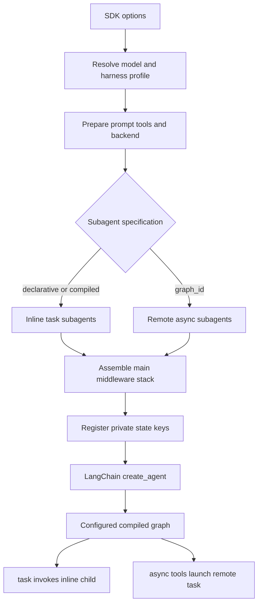

# SDK Construction and Execution

`create_deep_agent()` is the Deep Agents assembly boundary, not a separate runtime. It resolves the model and its harness profile, prepares a backend, prompt, tools, subagent specifications, and middleware, then delegates graph compilation to LangChain `create_agent()`. The returned compiled LangGraph receives the caller's checkpointer, store, cache, schemas, name, and debug option; Deep Agents adds a recursion limit of `9999` and integration metadata.

## Construction flow

Caption: `create_deep_agent()` classifies subagent specifications before building the main stack, then hands the assembled graph to LangChain; inline and remote delegation have different execution paths.

### Model, profile, prompt, and backend

A string model is resolved before its harness profile is selected. Passing `model=None` still builds the default Anthropic model, but that compatibility path is deprecated. In the absence of `backend=`, the SDK uses `StateBackend()`.

The active profile rewrites user-tool descriptions and supplies profile prompt material. The authored prompt order is caller text, profile base prompt, then profile suffix. If the caller passes a `SystemMessage`, its content blocks (including cache-control blocks) remain intact and the profile material is appended as a text block. Tool exclusion is separate from this rewrite: it is applied at the end of stack construction so middleware cannot reintroduce a model-visible excluded tool.

## Main middleware stack and profiles

The SDK first builds its core stack in this order:

1. `FilesystemMiddleware`;
2. `SubAgentMiddleware` when at least one inline subagent is available;
3. `_ParentNotifierMiddleware`;
4. summarization middleware;
5. `PatchToolCallsMiddleware`;
6. `AsyncSubAgentMiddleware` when remote async subagents were supplied.

It then adds profile middleware, optional `SkillsMiddleware`, provider prompt-caching middleware, optional `MemoryMiddleware`, and `HumanInTheLoopMiddleware` when either permissions or `interrupt_on` require it. `UnsupportedContentMiddleware` precedes `ModelRefusalMiddleware`. A profile's excluded tools are enforced by `_ToolExclusionMiddleware`, which is appended last.

Caller middleware does not simply append. The SDK first applies profile exclusions, replaces a same-named surviving middleware in place, inserts new caller middleware after the core stack and before the tail, then applies exclusions again. This placement lets a newly supplied `ModelFallbackMiddleware` catch the final default `ModelRefusalMiddleware`. Replacing `FilesystemMiddleware` inherits the agent permissions if the replacement has none; a nonempty conflicting permission policy raises `ValueError`.

Profiles cannot exclude the required filesystem or synchronous subagent middleware. Exclusions match a class by exact type or a string by exact middleware name. Construction rejects protected exclusions, an exclusion that matches no applicable stack, and ambiguous name collisions across distinct middleware classes rather than silently producing a degraded harness. `ModelRefusalMiddleware` is not protected, so a profile may remove it to preserve a raw refusal response.

### Built child stacks

The SDK adds `general-purpose` as the first inline subagent unless the profile disables it or an inline spec already uses that name. Its stack is filesystem, summarization, patching, profile middleware, optional skills, prompt caching, and `ModelRefusalMiddleware`; only caller middleware whose names match existing general-purpose slots is inherited. This avoids leaking arbitrary main-agent middleware into that default child.

A declarative `SubAgent` gets its own constructed stack: filesystem, summarization, patching, that child model's profile middleware, optional skills, caching, and refusal handling. `create_sub_agent()` appends a child `HumanInTheLoopMiddleware` for its `interrupt_on` setting and appends `UnsupportedContentMiddleware` if absent before calling LangChain `create_agent()`. A `CompiledSubAgent`, by contrast, is already a runnable and remains opaque to SDK stack construction.

## Delegation variants and state boundaries

`subagents=` supports three distinct forms:

- **Declarative `SubAgent`** — compiled into a local child graph and invoked synchronously through the parent `task` tool.
- **`CompiledSubAgent`** — an existing runnable used by `task`; it must return state containing `messages`.
- **`AsyncSubAgent`** — recognized by `graph_id` and routed to `AsyncSubAgentMiddleware`, which exposes remote background-task tools rather than the synchronous `task` tool.

The `task` tool validates unique names and accepts only `isolated` or beta `fork` mode. Isolated children receive the delegated description as a new human message. A fork receives the parent's effective, summarization-adjusted conversation plus the task; its own instructions are delivered in that task message so the inherited system-prompt prefix can be reused. A forked child is given a guarded `task` tool which refuses recursive delegation. Declarative forks can receive compatible parent private channels to rebuild their stack; opaque compiled forks exclude private keys.

Before either child form runs, the task middleware removes messages handled specially, structured output, skills bookkeeping, the caller rubric, and registered private fields. On return it passes only changed, non-excluded state keys and a single `ToolMessage`: a JSON serialization of `structured_response` when present, otherwise the last nonempty AI text. Parallel child calls that write the same custom parent field need a reducer; otherwise LangGraph raises `InvalidUpdateError`.

A child model refusal is handled at the delegation boundary. `task` and its async counterpart turn `ModelRefusalError`, or a structured-output validation failure containing a refusal block, into a retry-warning result for the parent. Other structured-output failures propagate. This gives declarative and opaque compiled children a usable parent-level failure result without claiming to install middleware inside opaque runnables.

Remote `AsyncSubAgentMiddleware` validates unique names, `isolated` or beta `fork` mode, and `interrupt` or `enqueue` update strategy. It stores task records under `async_tasks`, so IDs survive compaction. Launching returns promptly with an ID; status polling and follow-up model turns occur only in the asynchronous hooks (`ainvoke`/Agent Server path), while synchronous `invoke` still exposes the remote-task tools but does not poll.

## State, persistence, and execution

Without `state_schema=`, the main graph uses `DeepAgentState`. Its `messages` channel is a `DeltaChannel` using the local delta reducer, which normalizes raw message inputs, treats missing replay state as empty, replaces or removes messages by ID, and honors the remove-all sentinel. A custom schema is the graph base schema and is forwarded to declarative child compilation, not to precompiled or remote graphs. After final middleware assembly, the SDK collects private state fields from the base and installed middleware schemas and registers them with every installed `SubAgentMiddleware`, preventing those internal keys from crossing a task boundary.

The checkpointer and store are passed to the outer `create_agent()` call. Child calls inherit ambient LangGraph configuration and are tagged as subagent runs; their task call ID is stored as tracing metadata. Consequently, persistence, stream behavior, and resume semantics remain LangGraph responsibilities at the compiled graph boundary rather than a Deep Agents-owned loop.

## Filesystem permissions and approval

`FilesystemPermission` rules classify filesystem calls as `read` or `write` and have `allow`, `deny`, or `interrupt` effects. Rules are evaluated in declaration order and the first match wins; no match allows the call. `FilesystemMiddleware` enforces these policies for its filesystem tools, not for direct backend calls. A declarative subagent inherits parent permissions only if it does not set its own list; a child list replaces the parent policy. Compiled and remote subagents must be configured independently.

For a real `FilesystemBackend`, permission checks consider both the requested path and its symlink-resolved target, preventing a permitted alias from bypassing a deny rule. `interrupt` rules are translated during graph assembly into scoped `HumanInTheLoopMiddleware` predicates: exact operations are approved only when the target matches, whereas bulk operations such as `glob` and `grep` interrupt when their search subtree can overlap a protected path. User-provided `interrupt_on` entries override generated entries for the same tool.

`FilesystemBackend` itself has a separate containment choice. Its default `virtual_mode=True` anchors virtual paths under `root_dir`, rejects traversal and escaping resolved paths, and avoids exposing the physical root in tool-visible paths. It is a path guardrail, not process isolation; `virtual_mode=False` permits host-path access for trusted local workflows. Direct filesystem access is inappropriate for a web server without stronger isolation.

## Operational checks

Focused subagent tests verify constructor failures for empty or duplicate sets and invalid modes, default task-tool registration, declarative compilation with HITL, dynamic structured output only for declarative variants, and rejection of dynamic schemas for opaque compiled runnables. Fork tests verify prompt-prefix and tool-order preservation, inherited memory and prompt middleware, rejection of fork-local skills, summarization-aware history, and recursive-delegation refusal. These are the key regression points when changing construction order or child-state transfer.

## Related pages

- [Middleware stack](middleware-stack.md) — hook responsibilities and ordering.
- [Permissions and HITL](../concepts/permissions-hitl.md) — policy configuration and approvals.
- [Profiles and models](../concepts/profiles-models.md) — profile selection and prompt behavior.
- [Subagents and skills](../concepts/subagents-skills.md) — delegation configuration.
- [Build a Deep Agent](../workflows/build-a-deep-agent.md) — SDK usage workflow.
