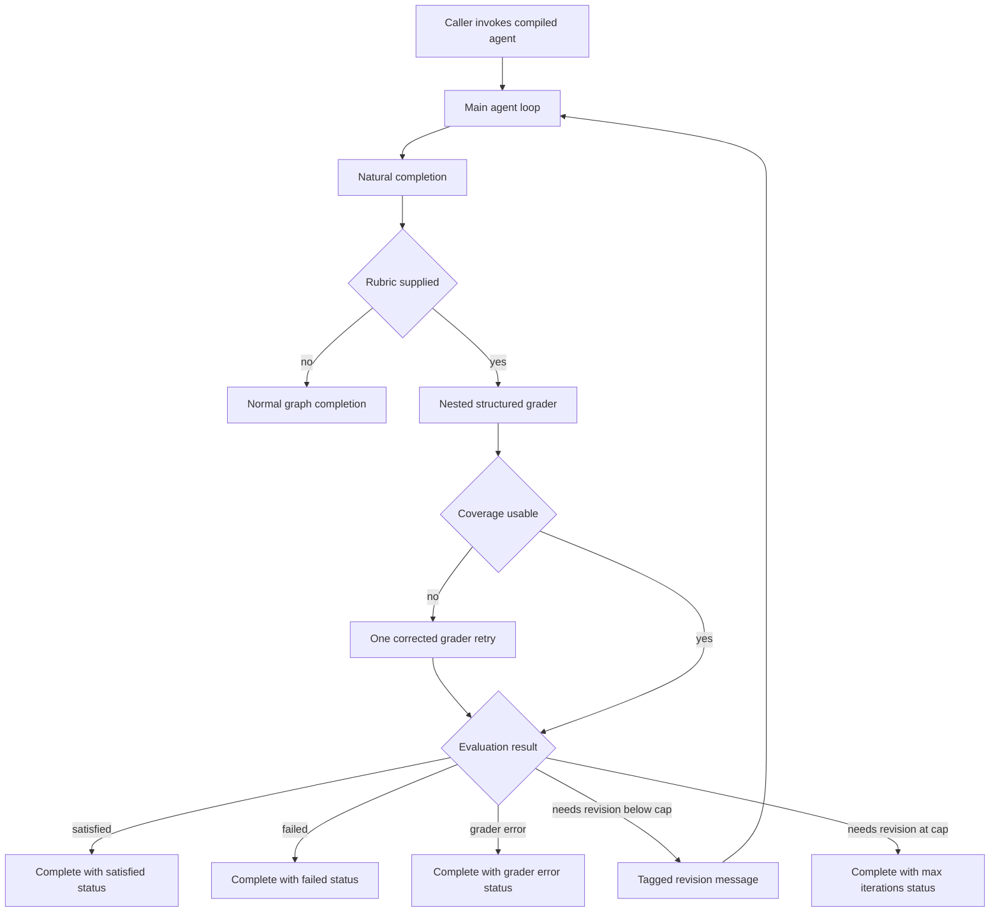

# SDK Construction and Execution

`create_deep_agent()` is the SDK assembly boundary. It resolves the model and harness profile, chooses a backend, separates inline from remote subagent specifications, assembles middleware, and calls LangChain `create_agent()`. The result is a configured compiled LangGraph, not a separate Deep Agents event loop.

The normal LangChain agent finishes when the model has no more tool calls. `RubricMiddleware` is a separately installed, public middleware that can review that natural completion when an invocation supplies a `rubric`; it is not in the default SDK stack. It uses a nested grader agent and, only when appropriate, sends the main graph back to its model node with revision feedback.

## Construction boundary

The entry point accepts a model, tools, prompt, caller middleware, subagents, skill and memory sources, permissions, backend, interrupt policy, response and state schemas, and LangGraph execution dependencies. A missing backend becomes `StateBackend()`. A model string is resolved before selecting its harness profile, while `model=None` follows the deprecated default-model path. The profile can rewrite tool descriptions and contributes base/suffix prompt material; a supplied `SystemMessage` retains its content blocks and receives profile prompt content as a new text block.

Subagent routing is structural:

- a spec with `graph_id` is a remote `AsyncSubAgent` and is handled by `AsyncSubAgentMiddleware`;
- a declarative `SubAgent` or runnable-bearing `CompiledSubAgent` is an inline `task` subagent;
- unless disabled by the profile or explicitly replaced, the SDK prepends the inline `general-purpose` subagent.

Thus remote specifications do not themselves add the blocking `task` tool, and disabling all inline agents does not disable the remote async-task tools.

### Middleware assembly

The main core is built as `FilesystemMiddleware`, optional `SubAgentMiddleware`, `_ParentNotifierMiddleware`, summarization middleware, `PatchToolCallsMiddleware`, and optional `AsyncSubAgentMiddleware`. The SDK then appends profile middleware, optional `SkillsMiddleware`, provider prompt-caching middleware, optional `MemoryMiddleware`, generated human-approval middleware, and `UnsupportedContentMiddleware`.

Caller middleware is not simply appended. Profile exclusions run over the assembled stack, caller middleware replaces a surviving same-name entry in place or is spliced after the core and before the tail, then exclusions run again. If the profile excludes model-visible tools, `_ToolExclusionMiddleware` is appended last so a later middleware cannot restore them. Filesystem and inline-subagent scaffolding are protected from profile exclusion; unmatched, ambiguous, or protected exclusions fail construction rather than silently producing a partial harness. A replacement filesystem middleware inherits configured agent permissions when it has none of its own, but conflicting nonempty policies are rejected.

The automatically generated `general-purpose` child has its own narrower stack—filesystem, summarization, patching, profile middleware, optional skills, and caching. Caller middleware reaches it only when it replaces an original slot in that child stack. This prevents main-agent-only middleware from accidentally becoming child behavior.

### State and compilation

Without a supplied schema, the graph uses `DeepAgentState`. Its `messages` channel is a `DeltaChannel` with the message-delta reducer: raw inputs are normalized; absent replay state is empty; messages update or remove by ID; and the remove-all sentinel resets history. A custom schema remains the base schema, and private fields contributed by it or installed middleware are given to installed `SubAgentMiddleware` instances as keys that must not cross a `task` boundary.

Finally, `create_deep_agent()` forwards the resolved model, prompt, rewritten tools, complete middleware stack, schemas, checkpointer, store, cache, and other execution options to `create_agent()`. It configures the resulting graph with recursion limit `9999` and Deep Agents integration metadata. Checkpointing and store ownership are therefore established at this outer graph-compilation boundary.

## Delegation and skills at the assembly boundary

Inline `task` delegation is a blocking child-graph invocation. Declarative children inherit parent permissions and `interrupt_on` only when they do not specify their own, and inherit caller tools only when `tools` is omitted. A forked inline child rebuilds the inherited prompt and conversation context; a compiled runnable owns its own compilation and schema. Remote async subagents are deliberately different: they return a task ID while work continues on an Agent Protocol server, with parent-local tracking in `async_tasks`; their configuration validates unique names plus `isolated` or beta `fork` mode and `interrupt` or `enqueue` update strategy.

When `skills=` is configured, `SkillsMiddleware` is placed after compaction and routing/fallback middleware and before prompt caching. It loads metadata once per thread, with later sources overriding duplicate names; setting `skills_metadata` to `None` requests a reload. `pinned_skills` is a stronger, per-turn disclosure mechanism: before the model call, known readable skills are appended in requested order as tagged `HumanMessage` snapshots, then the request field is cleared. Pins persist as conversation messages, not public output state; unknown or unreadable names are skipped. A pin also keeps tools named by that skill's `metadata.include_tools` disclosed only while the relevant skill message remains in context.

## Rubric-driven completion review

Install review explicitly and provide a rubric on the invocation that needs it:

```python
from deepagents import RubricMiddleware, create_deep_agent

agent = create_deep_agent(
    model=main_model,
    middleware=[RubricMiddleware(model=grader_model, max_iterations=3)],
)
result = agent.invoke({
    "messages": [{"role": "user", "content": "Implement the change."}],
    "rubric": "Tests pass and the requested behavior is documented.",
})
```

The middleware is a no-op without `rubric`. `before_agent` starts a fresh grading run when the rubric changed or the prior run was terminal; it resets the iteration count, mints a run ID, and clears frozen criteria. A nonterminal run with the same rubric retains its budget. At natural `after_agent` completion, the middleware synchronously or asynchronously invokes the grader, records its evaluation, and either falls through to normal termination or jumps to `model`.



Caption: completion review begins only after the ordinary agent would stop; one coverage retry is internal to a grading iteration, while only an eligible revision verdict returns control to the main model.

### Grader contract and trust boundary

The middleware lazily resolves its configured model and builds a distinct `rubric_grader` graph with `GraderResponse` structured output. The nested agent can have a custom prompt, tools, middleware, context schema, and state schema. `prepare_messages_for_grader` can transform the transcript; `build_grader_state` can add custom fields only with `grader_state_schema`, and cannot replace the middleware-owned `messages` payload. Static runtime context and diagnostic metadata are forwarded to grader invocation.

A valid structured response contains `satisfied`, `needs_revision`, or `failed`, an explanation, and criterion verdicts. Validation prevents a satisfied verdict with failures or a revision verdict whose nonempty criteria all pass; a failing criterion needs an actionable gap. `failed` means the rubric cannot be evaluated, rather than an infrastructure failure.

The grader receives a bounded, role-labelled transcript: the newest 30 messages, plus the original non-synthetic user message when it fell out of that window, with each message capped at 4,000 characters. The rubric, transcript, and criteria checklist are nonce-delimited and sanitised; the payload tells the grader that transcript content is untrusted. This is the trust boundary that prevents conversation or tool content from redefining completion.

### Criterion freezing, audit, and revision semantics

The first non-`failed` evaluation with criteria freezes criterion **names** for the grading run. Later grader payloads replay that checklist and request its count, preventing the grader from shrinking the criterion set between iterations. This is a consistency guard, not independent proof that the initial decomposition was complete: the middleware never parses free-form rubric prose, compares later coverage by count rather than names, and accepts over-coverage.

An empty non-failed response or an under-covered response causes one corrected grader retry. If coverage is still inadequate and the grader says `satisfied`, the result is downgraded to `needs_revision` with `unverified=True`. This is a **verification gap, not a confirmed defect**: revision feedback says so explicitly and does not present under-reported passing items as verified. If the retry itself raises, the valid first response is retained so the coverage gate can apply this downgrade rather than replacing it with a terminal grader error.

A `needs_revision` verdict below `max_iterations` appends a synthetic `HumanMessage` named and sourced `rubric_grader`, records the evaluation, and returns `jump_to="model"`. Ordinary feedback identifies failed criteria and asks the agent not to regress confirmed passes. At the cap the evaluation is rewritten to `max_iterations_reached`, so it no longer jumps. `satisfied`, `failed`, `grader_error`, and the capped result all preserve the last main-agent response; downstream acceptance logic must inspect rubric bookkeeping rather than infer success from that response.

`RubricState` exposes only `rubric` as public middleware I/O. Status, iteration count, evaluation history, active run identity, active rubric, and frozen criteria are `PrivateStateAttr` fields. They are absent from input/output schemas but remain checkpoint-visible through `agent.get_state(config).values`; evaluations include run ID, iteration, verdict, explanation, criteria, and `unverified`. The middleware emits `rubric_evaluation_start` and `rubric_evaluation_end` events and calls `on_evaluation`; callback exceptions are logged and suppressed, so callbacks are observational rather than an enforcement mechanism.

### Failure semantics and operation

`max_iterations` must be a positive integer and defaults to `3`. Grader exceptions, including a missing or malformed structured result, are recorded as `grader_error` with diagnostic model/strategy information rather than as rubric `failed`. `GraphBubbleUp` propagates as graph control flow, and `KeyboardInterrupt` and cancellation propagate because they are not caught as ordinary exceptions. A grader with tools can therefore pause or interrupt without having its control flow mislabeled as a failed evaluation.

Use a dedicated grader model and supply only the verification tools and extra state it needs. Each natural completion adds a grader call, plus at most one coverage retry, so review adds latency and cost. For an acceptance gate, consume private status from a checkpointed thread, rubric stream events, or the evaluation callback; do not rely on the final assistant text.

## Focused verification

End-to-end fake-model tests construct an agent through `create_deep_agent()` and verify the first-pass satisfied path, a revision jump and subsequent satisfaction, capped revision, no-rubric no-op, frozen-criterion coverage recovery, tagged feedback, and interrupt propagation. Pinned-skill tests cover requested ordering, snapshot persistence, duplicate and unknown names, unreadable files, parallel pins, tool disclosure lifetime, and isolation from child results.

## Related pages

- [Middleware stack](middleware-stack.md) — hook responsibilities and ordering.
- [Runtime behavior](runtime-behavior.md) — runtime execution and operations.
- [Middleware catalog](../concepts/middleware-catalog.md) — middleware capabilities.
- [Subagents and skills](../concepts/subagents-skills.md) — delegation and skills configuration.
- [Testing guide](../testing/testing-guide.md) — test selection and execution.
- [Build a Deep Agent](../workflows/build-a-deep-agent.md) — SDK usage workflow.
