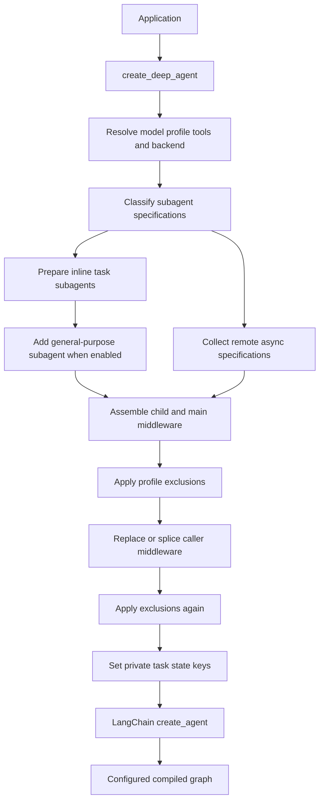
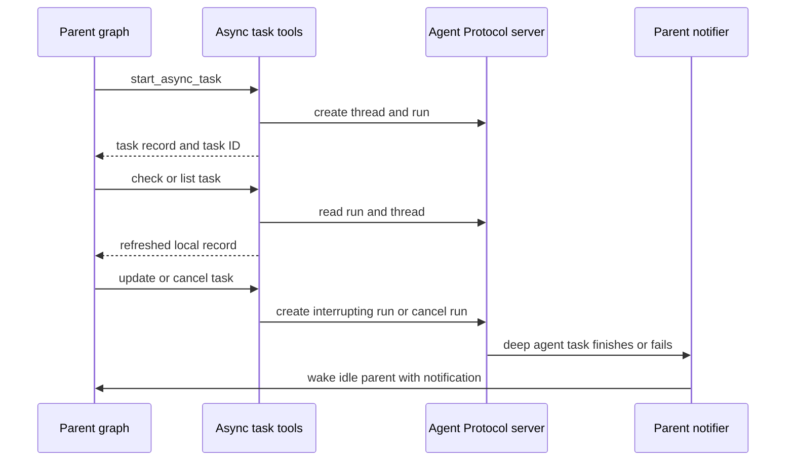

# SDK Construction and Execution

`create_deep_agent` is the public assembly boundary. It builds middleware and task policy around LangChain's `create_agent()` rather than implementing an independent agent loop. The resulting compiled graph owns normal model/tool execution, interrupts, checkpoints, and state persistence; remote asynchronous work remains an Agent Protocol server concern.

## Construction flow

Caption: Profile exclusions bracket caller middleware processing, and excluded-tool filtering is appended only after the final stack is known.

## Entry point and compiled graph

The builder resolves a model and harness profile, rewrites supplied tool descriptions according to that profile, and uses `StateBackend()` when no backend is supplied. A string model identifier is retained for profile selection while `resolve_model()` creates the usable model. `model=None` is a deprecated compatibility path that warns and builds `ChatAnthropic(model_name="claude-sonnet-4-6")`. Profile prompt material is appended to a string prompt, or added as a text block after the existing blocks of a caller-provided `SystemMessage`.

At the main boundary, `create_agent()` receives the resolved model, final prompt, rewritten tools, assembled middleware, response format, context schema, checkpointer, store, debug setting, name, cache, and either the supplied schema or `DeepAgentState`. The returned graph is configured with recursion limit `9999` and Deep Agents integration, version, and agent-name metadata. Checkpointer and store are passed at this main compilation boundary, not separately to synchronous child compilation.

### Message and state ownership

`DeepAgentState.messages` uses a `DeltaChannel` with `_messages_delta_reducer` and snapshot frequency 50. The reducer accepts raw message-like values, treats missing replay state as empty, replaces or removes messages by ID, and recognizes remove-all. This reduces checkpoint growth without changing the observable message channel.

A custom main `state_schema` is forwarded when a declarative task subagent is compiled. A `CompiledSubAgent` supplies an already-built runnable and therefore owns its schema; an `AsyncSubAgent` uses the remote graph's schema. Once the complete main middleware stack exists, private fields declared by that schema and middleware schemas are attached to every installed `SubAgentMiddleware` boundary, preventing those fields from crossing synchronous task boundaries.

Synchronous children run with LangGraph ambient configuration. Parent callbacks, tags, configurable values, and metadata propagate; a child runnable's bound configuration wins conflicts. The task bridge only adds the subagent tracing marker, avoiding duplicate explicit forwarding.

## Synchronous task subagents

A mapping with `runnable` is used as a `CompiledSubAgent`; other non-remote mappings are declarative `SubAgent` specifications. Declarative children resolve their own model and harness profile, inherit parent permissions and `interrupt_on` only when absent, and inherit parent tools only when `tools` is omitted. A fork also mirrors parent prompt-producing middleware to reconstruct the inherited prompt.

Unless the active profile disables it or an inline specification is already named `general-purpose`, construction prepends the default general-purpose declarative subagent. Its stack begins with filesystem, summarization, and patch middleware, followed by profile middleware, skills when configured, and prompt caching. It is deliberately not a wholesale copy of the main stack: caller middleware reaches it only when it replaces an original general-purpose stack slot.

`SubAgentMiddleware` is installed only if there is an inline pool and exposes `task`. It validates names and modes, compiles declarative specs via `create_sub_agent()`, adds `HumanInTheLoopMiddleware` when the child has `interrupt_on`, and ensures `UnsupportedContentMiddleware` exists.

An isolated task gets allowed parent state and a fresh `HumanMessage` containing the delegated description. A fork receives effective parent history after summarization plus the task message. Declarative forks retain state needed to rebuild their prompt and set a private fork marker, so recursive `task` delegation is refused. On completion, the bridge requires `messages`, removes message/private/excluded/unchanged values from the child update, and returns one `ToolMessage`: JSON for a `structured_response`, otherwise the last nonempty AI text.

## Remote asynchronous tasks

An `AsyncSubAgent` is identified by `graph_id` and is installed through `AsyncSubAgentMiddleware`, independently of the synchronous `task` pool. It provides `start_async_task`, `check_async_task`, `update_async_task`, `cancel_async_task`, and `list_async_tasks`. Launch creates a remote thread and run, then records an `AsyncTask` in parent state; its task ID is the remote thread ID, and launch returns immediately. The local record has a reducer and holds task type, current remote run/thread IDs, status, and timestamps. It is tracking data, not a copy of the remote graph's state.

Caption: The parent persists tracking records; the remote Agent Protocol server owns task threads and runs, while a compatible remote Deep Agent can notify an idle parent.

For `mode="isolated"`, launch sends only the delegated task. For experimental `mode="fork"`, it snapshots effective parent history, appends the task, removes parent-local artifacts and eviction markers, hydrates portable media, and serializes the snapshot for the remote input. Forking shares conversation content at launch, not a synchronized model, prompt, tools, or filesystem. Therefore remote authorization, permissions, and persistence must be configured and evaluated by the remote graph; they cannot be inferred from local synchronous-subagent inheritance.

The transport carries deliberately limited linkage. Task-thread metadata identifies the subagent and parent thread; on the same deployment it can also identify the parent assistant. A same-deployment launch forwards JSON-compatible run context (excluding the Deep Agents parent reference) when present, or sends a parent reference in configurable data. A launch to a `url` sends only the parent thread reference and does not forward parent context; trace headers are similarly limited to same-deployment launches. Authentication is supplied by the SDK environment for managed deployments or by the specification's `headers` for self-hosted servers. Omitting `url` selects local ASGI transport and requires an async parent entrypoint such as `ainvoke`; synchronous invocation requires a reachable URL.

A check derives `waiting` when the tracked run is successful but the thread is paused; it can discover a newer run when that successful run's thread became busy or errored. Updating starts a run on the same thread with `multitask_strategy="interrupt"`, replacing the current run and updating the tracked run ID. Cancelling a waiting task does not call remote cancellation because no run is active; it only changes parent-local tracking. Lists filter by cached status first and then refresh selected nonterminal tasks, retaining cached state if a fetch fails.

Async notification is available only through the async hooks. Before an async model call, and once after a final answer, middleware polls unfinished tasks and adds notifications only for newly observed success, error, timeout, or waiting outcomes. A remote Deep Agent assembled by this SDK includes `_ParentNotifierMiddleware`: for its own top-level async run launched by a parent, it reports completion or model failure once and wakes an idle parent thread when it has both parent thread and assistant identifiers. A paused remote task is not woken this way; its user answers on the remote task thread. Synchronous `invoke` exposes the task tools but does not perform these async polls or notifier callbacks.

## Main middleware order and profile policy

The main core is ordered as follows:

1. `FilesystemMiddleware`;
2. `SubAgentMiddleware` when inline synchronous subagents exist;
3. `_ParentNotifierMiddleware`;
4. summarization middleware;
5. `PatchToolCallsMiddleware`;
6. `AsyncSubAgentMiddleware` when remote specifications exist.

The builder then adds profile middleware, optional `SkillsMiddleware`, prompt-caching middleware, optional `MemoryMiddleware`, derived `HumanInTheLoopMiddleware`, and `UnsupportedContentMiddleware`. Profile exclusions first filter this stack. Caller middleware replaces a surviving same-name entry in place; a new name is spliced after the last surviving core entry and before the tail. Exclusions run again, then `_ToolExclusionMiddleware` is appended last. Thus a profile-forbidden tool cannot be reintroduced by caller middleware. The same two-pass exclusion pattern applies to declarative children; the general-purpose stack applies it around its intentionally limited replacement inheritance.

`FilesystemMiddleware` and `SubAgentMiddleware` are protected scaffolding: a profile cannot exclude them by exact class or exact middleware name. Construction fails for protected exclusions, collisions between a string exclusion and distinct middleware classes, or exclusions that match nowhere across the main and general-purpose stacks rather than silently producing a degraded agent.

Skills use backend sources. A caller middleware named `SkillsMiddleware` supplies sources to the normal skills slot when `skills` is omitted rather than creating a second layer. Metadata is cached per thread; later sources override earlier same-name entries, resetting `skills_metadata` to `None` reloads sources, and load errors are retained as warnings. Inline skill-tool disclosure follows its related read result without splitting a tool-result batch or preceding queued user content, and uses the model selected after fallback.

## Filesystem permissions and approval

Filesystem enforcement is separate from approval. `FilesystemMiddleware` enforces deny rules itself. The builder converts interrupt-mode filesystem permissions into path-sensitive `HumanInTheLoopMiddleware.interrupt_on` predicates and merges caller entries afterward, so a caller configuration for the same tool wins. This derived policy is applied to the main graph and constructed declarative children; it is not a policy transfer mechanism for a remote `AsyncSubAgent`.

Generated predicates cover filesystem operations including `ls`, `read_file`, `write_file`, `edit_file`, `delete`, `glob`, and `grep` when an interrupt rule applies. They distinguish exact-path from bulk operations, conservatively gate pathless and current-directory bulk calls, recognize glob patterns that can escape a supplied path, and use symlink-resolved targets when supported by the backend. Approval never overrides a later filesystem deny check. A checkpointer is required to persist and resume human interrupts.

## Backend paths and verification

`CompositeBackend.artifacts_root` defaults to `/`. Filesystem large-result eviction and summarization history offload derive paths from that root after trailing-slash normalization, such as `/workspace/large_tool_results` and `/workspace/conversation_history`.

Focused tests in `test_graph.py` cover stack construction, exclusions, state schemas, and general-purpose composition. `test_subagents.py` covers task handoff, state isolation, fork behavior, and ambient configuration. `test_async_subagents.py` covers remote launch, context/linkage boundaries, task status transitions, local-ASGI constraints, polling, notifications, and parent wake-up behavior. Permission tests exercise generated path predicates, while artifact-root tests cover root normalization and eviction paths.

## Related pages

- [Middleware stack](middleware-stack.md) — hook responsibilities and ordering.
- [Runtime behavior](runtime-behavior.md) — runtime execution and operations.
- [Permissions and human review](../concepts/permissions-hitl.md) — approval and enforcement semantics.
- [State persistence](../concepts/state-persistence.md) — checkpoint and store concerns.
- [Subagents and skills](../concepts/subagents-skills.md) — delegation configuration.
- [Testing guide](../testing/testing-guide.md) — test conventions.
