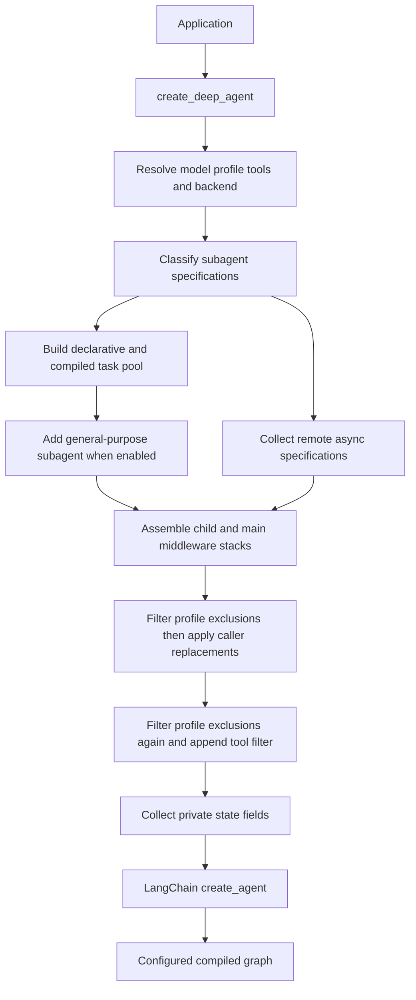
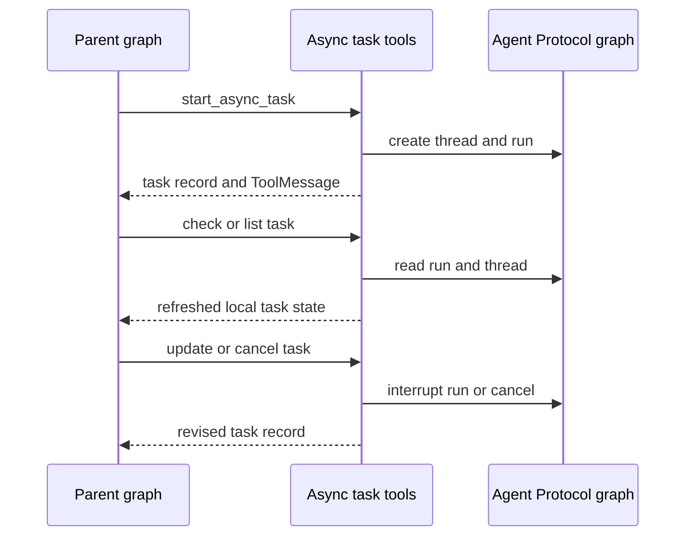

# SDK Construction and Execution

`create_deep_agent` is the public construction boundary, exported from `deepagents`. It resolves model and harness policy, turns declarative subagents into runnable graphs, builds middleware stacks, and delegates the agent loop to LangChain `create_agent()`. The returned compiled graph—not a bespoke Deep Agents loop—executes model calls, tools, interrupts, and persistence.

## Construction flow

Caption: Profile exclusions bracket caller middleware replacement; tool exclusion is deliberately the final middleware operation.

## Entry point, defaults, and final graph

The builder accepts a model instance or string, additional tools, prompt, middleware, subagents, skills, memory, filesystem policy, schemas, and LangGraph operational dependencies. A string is retained while selecting the harness profile, while `resolve_model()` obtains the actual model. The active profile rewrites supplied tool descriptions and contributes prompt material, extra middleware, excluded tools, general-purpose-subagent policy, and middleware exclusions. If no backend is supplied, the builder uses `StateBackend()`.

`model=None` remains a deprecated compatibility path: it emits a deprecation warning and builds `ChatAnthropic(model_name="claude-sonnet-4-6")`. Profile prompt text is appended to a string prompt; for a caller `SystemMessage`, it preserves existing content blocks and appends a text content block instead of flattening the message.

At the final boundary, `create_agent()` receives the resolved model, final prompt, rewritten tools, assembled middleware, response format, context schema, checkpointer, store, debug flag, name, cache, and either the supplied `state_schema` or `DeepAgentState`. The result is bound with recursion limit `9999` and Deep Agents integration/version/name metadata. Thus checkpointer and store are supplied only to the main compilation boundary; they are not independently passed when synchronous child graphs are compiled.

### Message and state ownership

`DeepAgentState.messages` is a `DeltaChannel` using `_messages_delta_reducer` with snapshot frequency 50, limiting checkpoint growth from repeated full-list snapshots. The reducer accepts raw message-like inputs, treats absent replay state as empty, replaces messages sharing an ID, removes tombstoned IDs, and honors `REMOVE_ALL_MESSAGES` as a reset.

A supplied main `state_schema` is forwarded when declarative task subagents are compiled. A `CompiledSubAgent` is already a runnable and therefore owns its own schema; an `AsyncSubAgent` runs against the schema of its remote graph. After the final main middleware list is assembled, the builder finds private fields from the explicit schema and middleware schemas and adds them to every installed `SubAgentMiddleware` boundary. This prevents middleware-private state from entering isolated children or returning in their updates.

For synchronous task invocation, LangGraph ambient configuration carries callbacks, tags, configurable values, and parent metadata into the child; the child’s bound configuration wins conflicting values. The task bridge adds the subagent tracing marker rather than explicitly forwarding all of that configuration.

## Subagent stacks and task boundaries

A specification with `graph_id` is remote and is collected for `AsyncSubAgentMiddleware`. A mapping with `runnable` is a `CompiledSubAgent`; other mappings are declarative `SubAgent` specifications. Declarative specifications resolve their own model and harness profile. They inherit parent permissions and `interrupt_on` only when those fields are absent, and inherit parent tools only when `tools` is omitted. Forked declarative children also mirror the parent prompt-producing middleware needed to rebuild the inherited prompt.

Unless the active profile disables it or an inline task spec is already named `general-purpose`, the builder prepends a default general-purpose declarative subagent. It uses the main resolved model, rewritten main tools, backend, permissions, profile, skills, prompt caching, and derived approval policy. The general-purpose stack is not a copy of the entire main stack: it starts with filesystem, summarization, and patching middleware; profile middleware and optional skills/caching follow. Caller middleware is inherited there only when it replaces an original general-purpose stack slot. This keeps main-only extensions from silently entering the default child.

`SubAgentMiddleware` is installed only when the inline pool is nonempty, and provides the synchronous `task` tool. It validates unique names and modes and compiles declarative specifications through `create_sub_agent()`. That child compiler requires model and tools, adds `HumanInTheLoopMiddleware` for an `interrupt_on` mapping, and ensures `UnsupportedContentMiddleware` exists.

An isolated task receives permitted parent state plus a fresh `HumanMessage` containing its delegated description. A fork receives effective parent history after its summarization event and then the task; declarative forks preserve the state needed to rebuild the parent prompt and carry a private fork marker. Recursive `task` delegation in that context is refused. At return, the bridge requires `messages`, strips messages, excluded/private fields, and unchanged inherited values from the state update, then provides one `ToolMessage`: serialized `structured_response` when present, otherwise the last nonempty AI text.

### Remote asynchronous tasks

When remote specifications are present, `AsyncSubAgentMiddleware` adds `start_async_task`, `check_async_task`, `update_async_task`, `cancel_async_task`, and `list_async_tasks`. Starting creates the remote thread and run and immediately stores a parent-local task record with remote thread/run IDs, allowing the parent graph to continue.

Caption: Tracking lives in parent state, while the Agent Protocol server owns remote execution state.

Fork mode sends the effective parent-history snapshot and delegated task to the remote graph; isolated mode sends only the task. Parent configuration is not transferred. A successful remote run with a paused thread is tracked as `waiting`; update interrupts the current run and creates a new run on the same thread, while cancelling a waiting task changes only local tracking. With no URL, local ASGI transport requires asynchronous parent invocation such as `ainvoke`.

## Main middleware ordering, replacement, and exclusions

The main core is assembled in this precise order:

1. `FilesystemMiddleware`;
2. `SubAgentMiddleware` only when inline synchronous subagents exist;
3. `_ParentNotifierMiddleware`;
4. summarization middleware;
5. `PatchToolCallsMiddleware`;
6. `AsyncSubAgentMiddleware` only when remote specifications exist.

The builder captures these core names before adding the tail. It then appends profile extra middleware, optional `SkillsMiddleware`, prompt-caching middleware, optional `MemoryMiddleware`, derived `HumanInTheLoopMiddleware`, and `UnsupportedContentMiddleware`. Profile exclusions filter this assembled list **before** caller middleware is processed. Caller middleware whose name still exists replaces that slot in place; a new name is inserted immediately after the last surviving core member and before the profile/caching/memory tail. The profile filter runs again, and `_ToolExclusionMiddleware` is appended last. Therefore a custom model-call wrapper cannot restore a profile-forbidden tool.

The first exclusion pass means a caller middleware cannot restore an entry already removed by the profile: it has a new name and is subject to the second filter. In contrast, a caller can intentionally replace a surviving named slot. The same bracketed filtering model is used for declarative child stacks; the default general-purpose stack applies the profile on both sides of its limited default-slot replacement step.

`FilesystemMiddleware` and `SubAgentMiddleware` are protected scaffolding. A profile may not exclude them by class or name because the former provides file tooling and permission enforcement and the latter owns `task`. Exact concrete type is used for class exclusions and exact `.name` for string exclusions. Construction fails rather than silently degrading when a protected entry is requested, a string exclusion collides with distinct middleware classes in one stack, or an exclusion matches nothing across the main and general-purpose stacks.

Skills are backend-sourced. When `skills` is omitted, caller middleware named `SkillsMiddleware` supplies sources for the normal skills slot instead of creating a second layer. Skill metadata is cached per thread; later sources override earlier same-name skills, resetting `skills_metadata` to `None` reloads it, and source failures become warnings. The skill-tool disclosure is placed after the relevant read result without splitting a tool-result batch or jumping ahead of queued user content, and uses the model selected after fallback.

## Filesystem policy and interrupts

Filesystem enforcement is distinct from approval. `FilesystemMiddleware` independently applies deny rules. The builder derives `HumanInTheLoopMiddleware.interrupt_on` entries only from `interrupt` permissions and merges caller entries afterward, so a caller entry for the same tool wins. The same derivation is used for the main graph and for constructed declarative children.

The generated entries cover `ls`, `read_file`, `write_file`, `edit_file`, `delete`, `glob`, and `grep` when an interrupt rule applies. Exact operations require a matching interrupt rule and do not request approval when a deny rule wins. Bulk operations conservatively interrupt when their subtree could overlap an interrupt anchor; a missing path and current-directory aliases are treated as potentially broad. `glob` additionally guards absolute patterns and relative patterns containing `..`, and predicates consider symlink-resolved targets when the backend supports resolution. The available human decisions are `approve`, `edit`, `reject`, and `respond`; approval does not bypass a later filesystem permission check, and `respond` skips execution. Persist and resume these interrupts by supplying a checkpointer.

## Backend artifacts and focused verification

A `CompositeBackend` exposes `artifacts_root`, defaulting to `/`. Filesystem large-result eviction and summarization history offload use that root: a configured `/workspace` root produces paths below `/workspace/large_tool_results` and `/workspace/conversation_history`, while a trailing slash is normalized. This matters when applications route backend storage or present tool-result paths back to an agent.

Focused tests cover construction and stack policy in `test_graph.py`, task handoff/state isolation/config propagation in `test_subagents.py`, remote task lifecycle in `test_async_subagents.py`, and assembled permissions/subagents/artifact behavior in `test_end_to_end.py`. `test_artifacts_root.py` separately verifies root normalization, bounded names for long tool-call IDs, and synchronous/asynchronous eviction paths.

## Related pages

- [Middleware stack](middleware-stack.md) — hook responsibilities and ordering.
- [Runtime behavior](runtime-behavior.md) — runtime execution and operations.
- [Middleware catalog](../concepts/middleware-catalog.md) — middleware capabilities.
- [Profiles and models](../concepts/profiles-models.md) — profile selection and model resolution.
- [State persistence](../concepts/state-persistence.md) — checkpoint and store concerns.
