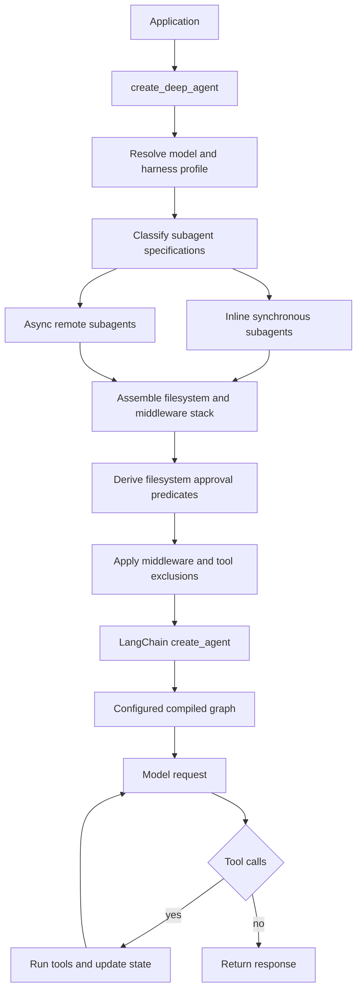
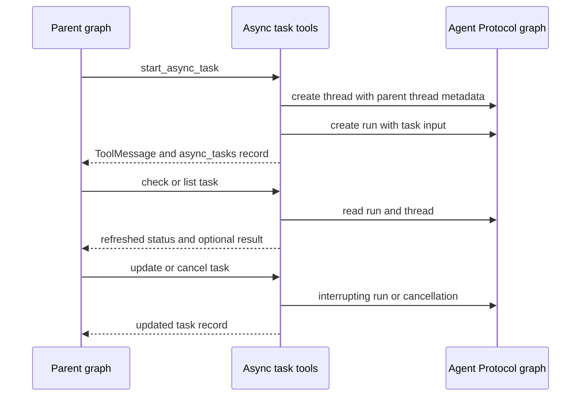

# SDK Construction and Execution

`create_deep_agent` is the public assembly boundary. Rather than owning a separate agent loop, it resolves Deep Agents policy and components, calls LangChain `create_agent()`, and returns the configured compiled graph. The resulting graph owns the model/tool loop, checkpointing, and state persistence supplied to that LangChain boundary.

## Construction flow

Caption: Construction resolves policy before compilation; the compiled LangChain graph performs the model-and-tool loop.

## Assembly contract

The builder accepts a model instance or model string. It retains a string specification for harness-profile selection, resolves the actual model, rewrites supplied tool descriptions according to that profile, and creates a `StateBackend()` when no backend is supplied. `model=None` is a deprecated compatibility path that warns and constructs `ChatAnthropic(model_name="claude-sonnet-4-6")`.

A harness profile contributes prompt material, tool-description overrides, extra middleware, excluded tools, general-purpose-subagent policy, and middleware exclusions. The authored `system_prompt` is combined with profile material: strings gain a separated suffix, while a supplied `SystemMessage` retains its content blocks and gains a text block. This avoids flattening caller message metadata.

At compilation, the builder forwards the resolved model, prompt, tools, middleware, response format, `context_schema`, checkpointer, store, debug flag, name, and cache to `create_agent()`. It chooses `DeepAgentState` unless `state_schema` is supplied, then binds a `9999` recursion limit and Deep Agents/version/name metadata with `.with_config()`.

`DeepAgentState.messages` uses a `DeltaChannel` with `_messages_delta_reducer` and a 50-update snapshot frequency. The reducer coerces raw message-like values, treats absent replay state as empty, replaces or removes messages by ID, and honors `REMOVE_ALL_MESSAGES`. This avoids repeatedly checkpointing an ever-growing full message list.

### State and checkpoint boundaries

The main graph is the persistence boundary: the supplied `checkpointer` and `store` go to its `create_agent()` call. Declarative synchronous children are compiled without those arguments, but invoke under the ambient LangGraph configuration. Consequently callbacks, tags, configurable values, parent metadata, and checkpoint namespace propagate through LangGraph; the child’s bound configuration wins colliding values such as its `lc_agent_name` and recursion limit. The task middleware only stamps `ls_agent_type="subagent"`, avoiding duplicate explicit forwarding.

A custom `state_schema` is forwarded to declarative children through `SubAgentMiddleware`; a caller-provided `CompiledSubAgent` owns its runnable and schema instead. After the final main stack is known, the builder gathers private fields from the explicit schema and installed middleware schemas, and adds them to each installed synchronous task boundary. Private fields are excluded from isolated child inputs and from every child’s returned update. This permits public state updates while protecting middleware-local state and reducing conflicts between parallel task calls.

## Subagent classification and ownership

Classification occurs before the main stack is built:

- A mapping containing `graph_id` is an `AsyncSubAgent`; it is removed from the synchronous `task` pool and becomes part of `AsyncSubAgentMiddleware`.
- A mapping containing `runnable` is a `CompiledSubAgent` and is used as supplied.
- Other mappings are declarative `SubAgent` specifications. The builder resolves their own model/profile and prepares filesystem, summarization, patching, profile, skill, caching, and applicable memory middleware.

Unless the active profile disables it or an inline specification already uses that name, the builder prepends the `general-purpose` declarative subagent. If there are no inline synchronous subagents, `SubAgentMiddleware` is not installed and the `task` tool is absent; remote async tools can still be present.

Declarative children inherit parent permissions and `interrupt_on` unless their specification supplies those fields; a supplied permissions list replaces the parent list. They inherit parent tools only when `tools` is omitted. A child with a distinct model gets that model’s harness profile rather than the parent profile. `create_sub_agent` requires model and tools, adds `HumanInTheLoopMiddleware` for resolved approvals, and ensures `UnsupportedContentMiddleware` is present. Compiled and remote graphs own their schemas and their runtime policy.

### Synchronous task lifecycle

`SubAgentMiddleware` validates unique names and supported modes, compiles declarative specs behind `task`, and wraps supplied runnables with subagent tracing identity. An isolated call supplies permitted parent state plus a new `HumanMessage` containing only the delegated description. A fork creates the effective parent history after its summarization event and appends the task. Declarative forks preserve the state needed to rebuild the parent prompt and get a private marker; recursive `task` calls return a refusal. Compiled forks receive a narrower non-private state because their schema is opaque.

On completion, the task bridge requires a returned `messages` key. It removes messages, standard excluded keys, private fields, and unchanged inherited values from the state update, then returns one `ToolMessage`: serialized `structured_response` when present, otherwise the last non-empty `AIMessage` text. The parent does not receive the child’s intermediate transcript as its normal task result.

### Remote asynchronous tasks

`AsyncSubAgentMiddleware` targets Agent Protocol graphs through the LangGraph SDK. It exposes `start_async_task`, `check_async_task`, `update_async_task`, `cancel_async_task`, and `list_async_tasks`. Launch creates a remote thread and run, then adds a task record keyed by its thread ID to the parent state’s `async_tasks`; the parent can continue instead of waiting for a report.

Caption: The parent stores tracking state locally while the Agent Protocol server owns the remote thread, run, tools, approvals, and execution.

The tracking record stores the agent name, remote `thread_id`, current `run_id`, status, and timestamps. A check reads the remote run and, after a successful run, its thread: a thread paused for human input becomes local status `waiting`, while a finished thread returns its last message as the result. Checks and lists update local status; terminal statuses avoid unnecessary live fetches. Lists filter against cached state before refresh and retain cached status on a remote fetch failure. An update creates a new run on the same remote thread using `multitask_strategy="interrupt"`; it retains the task ID but replaces the run ID. Cancelling a waiting task only marks local state because it has no active run to cancel.

Async `mode="fork"` snapshots effective compacted parent history at launch, clears local tool artifacts, hydrates offloaded tool content, and appends the delegated task before serializing it. Isolated mode sends only the task description. A fork shares that launch snapshot, not parent configuration: the remote graph owns its prompt, model, tools, middleware, permissions, state schema, and any HITL interaction. A task that is `waiting` must be answered or approved on the remote subagent thread; the parent cannot answer for it. Omitting `url` selects local ASGI transport, which requires an async parent entry point such as `ainvoke`; synchronous invocation requires a reachable URL.

## Middleware assembly and protected ordering

The main core is built in this order:

1. `FilesystemMiddleware`;
2. `SubAgentMiddleware` only when inline synchronous subagents exist;
3. summarization middleware;
4. `PatchToolCallsMiddleware`;
5. `AsyncSubAgentMiddleware` only when remote subagents exist.

The builder then adds profile middleware, optional `SkillsMiddleware`, prompt caching, optional `MemoryMiddleware`, optional human-in-the-loop middleware, and `UnsupportedContentMiddleware`. Caller middleware with the same `.name` replaces a surviving stack slot in place. A new name is spliced immediately after the core, ahead of the tail. Profile exclusions run before and after the splice; profile tool exclusion middleware is appended last, so custom model-call middleware cannot restore a forbidden tool.

`FilesystemMiddleware` and `SubAgentMiddleware` are protected scaffolding: the former provides file tools and enforces permissions, and the latter owns synchronous task handling. A profile cannot exclude either by class or name. Exclusion class matching is exact concrete type and string matching is exact middleware name. Construction raises `ValueError` for protected or private-name exclusions, same-name collisions among distinct middleware classes, and exclusions that match no middleware across the main and general-purpose stacks.

Skills are backend-sourced. When `skills` is omitted, caller middleware named `SkillsMiddleware` supplies sources to the default slot rather than creating a second layer. Skill metadata is cached in graph state per thread; later same-name sources override earlier ones, resetting `skills_metadata` to `None` requests reload, and source-load failures are retained as warnings. Inline skill-tool disclosure is emitted only after the skill read that authorizes it, without splitting a tool-result batch or moving ahead of queued user content, and it follows the model selected after fallback.

## Filesystem-derived human approval

Filesystem enforcement and approval are separate. `FilesystemMiddleware` enforces `deny` rules and filters denied results. The builder derives `HumanInTheLoopMiddleware.interrupt_on` entries only from `interrupt` permission rules, then merges caller `interrupt_on`; caller entries for the same tool win. A nonempty mapping installs human-in-the-loop middleware for the main graph and constructed declarative children.

The generated mapping covers `ls`, `read_file`, `write_file`, `edit_file`, `delete`, `glob`, and `grep` only when an interrupt rule can apply. Its `when` predicates are path-sensitive:

- Exact-path operations interrupt only for a matching interrupt rule. A matching `deny` decision suppresses approval because the filesystem tool will reject the call.
- Bulk operations interrupt when the search subtree could overlap an interrupt anchor. A missing bulk path is conservatively treated as potentially touching any protected path; `.` and similar current-directory forms become the accessible root.
- `glob` also gates an absolute pattern or a relative pattern containing `..`, preventing its pattern from escaping the supplied path. Where a backend resolves symlinks, both normalized and resolved paths participate.

Generated configurations allow `approve`, `edit`, `reject`, and `respond`. Approval does not replace filesystem enforcement: an edited call re-enters the permission check, while `respond` skips execution. Supply a checkpointer when an application must persist and resume approval interrupts.

## Focused verification

`test_graph.py` verifies profile/model resolution, default general-purpose policy, middleware placement and exclusion guarantees, propagation of custom schemas, and private-state collection. `test_subagents.py` verifies task handoff, state isolation, fork behavior, configuration inheritance, structured results, and checkpoint-readable child history. `test_end_to_end.py` verifies permission inheritance and overrides, synchronous/async coexistence, and assembled behavior with fake models.

`test_async_subagents.py` verifies the five-tool surface, name/mode validation, isolated versus forked payloads, local-transport async requirements, media hydration for forks, task-state reduction, waiting-state behavior, updates, cancellation, and live-status refresh. Permission tests cover conservative path, glob, and symlink approval decisions; provider-payload tests cover ordering of skill-tool disclosure.

## Related pages

- [Middleware stack](middleware-stack.md) — hook responsibilities and ordering.
- [Runtime behavior](runtime-behavior.md) — runtime execution and operational behavior.
- [Context management](../concepts/context-management.md) — summarization and context lifecycle.
- [Middleware catalog](../concepts/middleware-catalog.md) — middleware capabilities.
- [Permissions and HITL](../concepts/permissions-hitl.md) — permission policy and approval use.
- [Subagents and skills](../concepts/subagents-skills.md) — delegation and skills concepts.
