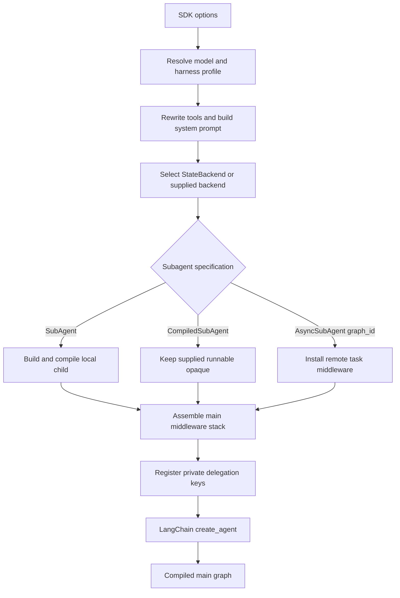
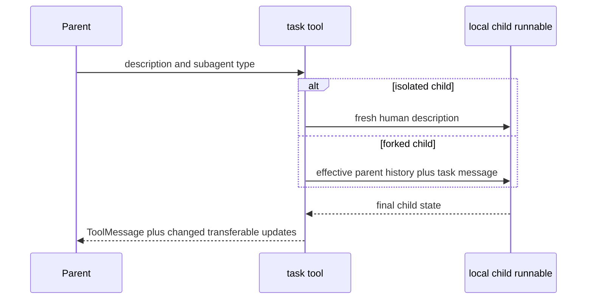
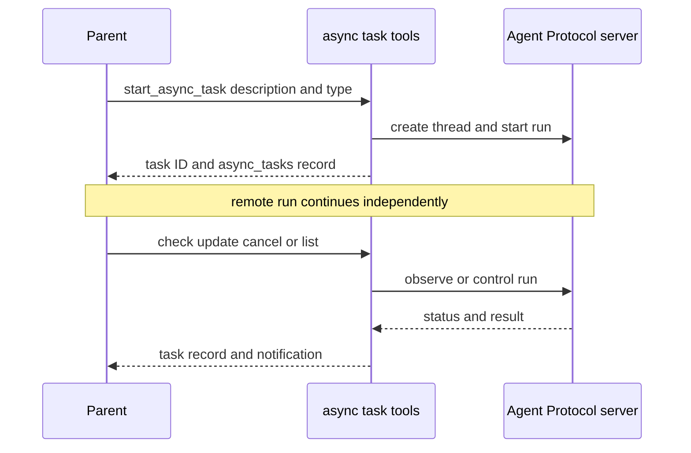

# SDK Construction and Execution

`create_deep_agent()` is an assembly boundary, not a separate agent runtime. It resolves the model and harness profile, selects a backend, builds middleware and declarative children, then delegates graph compilation to LangChain `create_agent()`. The resulting graph owns invocation, checkpointing, streaming, and resume; Deep Agents adds a recursion limit of `9999` and Deep Agents tracing metadata.

## Assembly flow

Caption: declarative children are compiled locally, supplied runnables remain caller-owned, and `graph_id` specifications install a remote-task integration rather than a local `task` child.

A string model is resolved; an already constructed `BaseChatModel` is used as supplied. `model=None` currently creates the deprecated default `claude-sonnet-4-6` model. The resolved model and, for a string, the original spec choose the harness profile. That profile supplies prompt material, tool-description overrides, optional middleware, excluded middleware/tools, and the general-purpose-child policy.

The main system prompt is caller material followed by profile material. For a caller `SystemMessage`, its existing content blocks are retained and profile text is appended as a separate text block. Tool description rewrites happen before construction; tool exclusion happens last so it filters both supplied and middleware-injected tools.

If no backend is supplied, construction uses `StateBackend`. It calls `bind_backend()` for caller middleware implementing `BackendConsumer`, and does the same before compiling declarative child middleware. This is the extension boundary for middleware that must share the agent's backend.

## Stack order and protected scaffolding

The core main stack is `FilesystemMiddleware`, `SubAgentMiddleware` when inline children exist, `_ParentNotifierMiddleware`, summarization, `PatchToolCallsMiddleware`, and—only for remote specifications—`AsyncSubAgentMiddleware`. The tail contains profile middleware, optional skills, provider cache middleware, optional memory and human approval middleware, `UnsupportedContentMiddleware`, and `ModelRefusalMiddleware`. A profile's `_ToolExclusionMiddleware` is appended after the final filter pass.

Caller middleware replaces a same-named entry in place. New entries are inserted after core middleware and before the profile/cache/memory tail. Thus a caller `ModelFallbackMiddleware` can catch the default tail `ModelRefusalMiddleware`. The stack is filtered for profile exclusions both before and after caller middleware is merged, preventing callers from restoring excluded entries. Required filesystem and synchronous-task scaffolding cannot be excluded; unmatched, ambiguous, or protected exclusions fail construction. A replacement filesystem middleware inherits top-level permissions if it has none, while conflicting nonempty rules fail construction.

Unless the profile disables it or an inline spec already uses the name, the SDK inserts a `general-purpose` declarative child. If there are no inline children, it does not install `SubAgentMiddleware` and there is no synchronous `task` tool. Remote tools are independent of that decision. General-purpose children accept only caller middleware that replaces an existing general-purpose slot; arbitrary main-only middleware is not copied into them.

A declarative child receives its own resolved model/profile, filesystem, summarization, patch, profile, optional skills/cache middleware, and refusal middleware. `create_sub_agent()` adds configured child approval middleware, ensures `UnsupportedContentMiddleware`, and invokes LangChain `create_agent()`. In contrast, a `CompiledSubAgent` remains opaque to SDK stack construction and must itself return a state containing `messages`.

## Two delegation contracts

### Synchronous local `task`

Caption: the synchronous path blocks for a local runnable and returns one task result into the parent graph; a fork changes the input payload, not the execution location.

`SubAgentMiddleware` requires unique names and accepts `isolated` or beta `fork` mode. Isolated children get only a fresh human message with the delegated description. Forks receive the parent's effective summarized history after the spawning task-call AI message is removed, then a human task message containing a preamble, optional fork instructions, and the delegated description. The preamble explains that prior delegation already happened and a recursive task attempt is refused.

A declarative fork is a rebuilt local graph: it inherits compatible parent state, including private channels required by its mirrored middleware, and its mirrored `task` tool is guarded by `_deepagents_forked_context`. The SDK keeps the parent's final system prompt byte-identical and places fork-specific instructions in the task message. It also positions the mirrored task tool after filesystem tools. These choices preserve the parent request prefix and tool ordering for provider prompt-cache reuse. A compiled fork is opaque and receives only transferable non-private state.

For isolated transfers and compiled forks, special channels and registered private keys are excluded. Returned updates similarly exclude special/private fields and unchanged input values; the parent gets a `ToolMessage` containing structured output, a refusal warning, or the last nonempty AI text. Parallel children that write the same custom key require an appropriate reducer or LangGraph can raise `InvalidUpdateError`.

Model refusal errors, and structured-output validation errors that carry a refusal, become retry-warning task results in both sync and async local invocation. Other validation errors propagate. For compiled LangGraph children, the runner streams values and checkpoints and exposes the saved checkpoint namespace only as the result `ToolMessage` artifact; a non-graph runnable falls back to the parent task namespace.

### Remote Agent Protocol tasks

Caption: remote asynchronous work creates a separate Agent Protocol thread and run. It never invokes the local synchronous child runnable or returns a result in the launching tool call.

`AsyncSubAgentMiddleware` is a separate integration for `AsyncSubAgent` specifications with `graph_id`. It validates nonempty unique names, `isolated` or beta `fork` mode, and `interrupt` or `enqueue` update strategy. It supplies exactly five tools: `start_async_task`, `check_async_task`, `update_async_task`, `cancel_async_task`, and `list_async_tasks`. Launch creates a remote thread and run, records the thread ID as the task ID under reducer-backed `async_tasks`, and immediately returns a tool result. Task records survive conversation compaction.

The remote launch payload contains **only** `messages`; it does not copy parent state keys such as files or private state. An isolated launch sends one user description. A remote fork snapshots the parent's effective conversation, applies any summarization event, removes the launching AI tool-call message, and appends the fork task message. The snapshot is deep enough to preserve message content and strips artifacts for JSON transport; it is not a live shared state boundary. Tests cover sync and async launch transports, summarization, payload isolation, and rehydration of offloaded media into the outgoing fork payload.

For a local deployment (no `url`), runs may receive forwarded JSON-compatible runtime context, streaming options, trace headers, and a parent reference so the platform can notify the parent; an external URL does not receive the parent trace headers or parent assistant wake-up reference. Optional headers default `x-auth-scheme` to `langsmith` without replacing an explicit scheme. A remote child is responsible for its own graph schema, middleware, permissions, and backend.

The automatic lifecycle is async-only. `abefore_agent` records a notification that started a run and polls unfinished tasks; `abefore_model` polls again. After a final answer, `aafter_model` polls and jumps back to the model only when a new notification was found. The sync hooks pass through, so `invoke` exposes the tools but does not provide automatic polling; `ainvoke` and Agent Server execution do. Failed status checks are logged and retried later. Notifications label successful results, errors, timeouts, cancellation, or a remote task waiting for its own user/approval; the parent cannot answer that remote interrupt.

## State, permissions, and operations

Without a supplied `state_schema`, the main graph uses `DeepAgentState`. Its `messages` channel is `DeltaChannel` with the message-delta reducer. The reducer accepts raw message-like input, treats absent replay state as empty, updates/removes messages by ID, and supports remove-all. A supplied base schema is forwarded to declarative child compilation, not to compiled or remote graphs. After the final main stack is assembled, private schema fields from the base schema and installed middleware are registered with every installed `SubAgentMiddleware`.

Filesystem permissions are tool-layer policy. Rules are first-match for read/write operations; deny is enforced by `FilesystemMiddleware`, while interrupt rules are synthesized into scoped `HumanInTheLoopMiddleware` predicates. Explicit user `interrupt_on` settings take precedence for a tool. Permissions do not automatically govern compiled or remote children.

`FilesystemBackend` virtual mode anchors paths below `root_dir`, rejects traversal and resolved escapes, and avoids exposing the real root in displayed paths. Non-virtual mode permits absolute paths and traversal outside that root. Virtual mode is a path guardrail, not process isolation; choose a stronger sandbox for untrusted workloads. Backend permissions also apply only through filesystem tools, not arbitrary direct backend calls.

Provider prompt caching is appended to SDK-built main and declarative-child stacks. Anthropic caching is lazy and only imports for Anthropic requests. Bedrock and Fireworks caching are optional; class lookup is cached while every stack gets a new instance.

## Focused regression checks

The construction tests cover profile prompt assembly, default child insertion/suppression, backend binding, private-state registration, middleware replacement/order, child stack isolation, cache middleware, and refusal fallback behavior. Fork tests make the cache-sensitive contract concrete: Anthropic parent/fork requests have identical tools, system prompt, cache controls, and inherited message prefix; OpenAI requests preserve the parent input prefix; fork instructions occur in the final task message rather than the system prompt. Middleware tests also verify invalid modes, fork skill rejection, inherited memory, task-call removal, and tool-order parity.

Remote-task tests cover validation, tool registration, launch/check/update/cancel/list state changes, status handling, notifications, task reducer behavior, fork snapshots, remote-only message payloads, and offloaded-media rehydration. Treat these tests as the change gates for state-transfer and lifecycle changes: local forks and remote forks share conversation semantics but have fundamentally different state ownership and completion behavior.

## Related pages

- [Middleware stack](middleware-stack.md) — middleware hooks and execution ordering.
- [Context management](../concepts/context-management.md) — compaction and summarization context.
- [Permissions and human approval](../concepts/permissions-hitl.md) — permission and approval configuration.
- [Subagents and skills](../concepts/subagents-skills.md) — delegation configuration.
- [Tools and filesystem](../concepts/tools-filesystem.md) — filesystem operations and backend behavior.
- [Testing guide](../testing/testing-guide.md) — repository test conventions.
